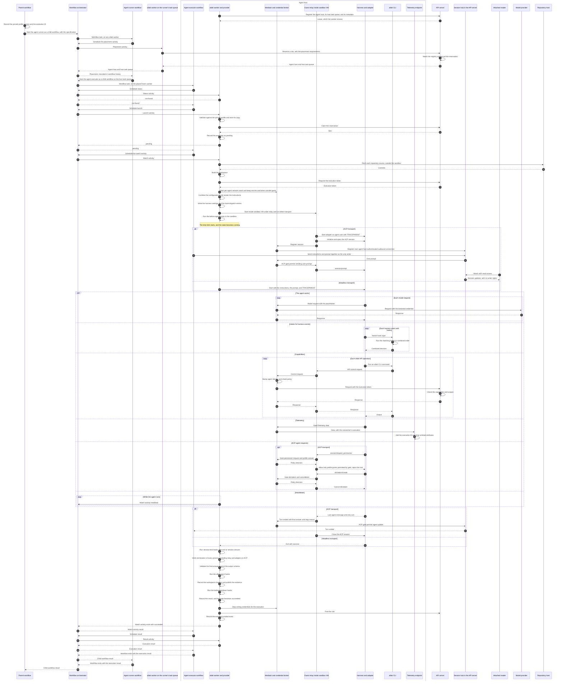

# Agent execution sequence

The execution belongs to a durable [agent](agent.md), which retains its conversation after the harness run. This diagram follows one execution generation that succeeds, from the moment the parent workflow starts the agent runner workflow until the parent receives the result. It shows each message between the parts of an execution, where the [lifecycle](agent-execution.md#lifecycle) gives only the steps.

- **Activities** go to the agent host only through the workflow orchestrator. The afakt worker on the host polls the orchestrator for them, and no other part connects to the host.
- **Workflows.** Any afakt worker can run the agent runner workflow. The agent executor workflow runs on the placed host's worker, and each activity it schedules goes to that host's task queue.
- **Placement** runs on the agent runner workflow's task queue and asks the API server's reservation API for a slot. The agent executor workflow then starts on the host task queue of the agent host that holds the reservation. See [Agent placement](agent-placement.md).
- **Status before launch** is the reconciliation rule, so that a retried activity and a step run again after a worker restart both continue from the existing execution and never start a second agent. See [Reconciliation after restart or retry](agent-execution.md#reconciliation-after-restart-or-retry).
- **The sandbox** confines the harness, the afakt CLI, and every hook. Each network request from the sandbox VM goes through the mediator. The credential broker injects credentials outside the guest. See [Agent sandbox](agent-sandbox.md).
- **Harness transport** comes from the selected profile model entry. ACP uses the guest relay and adapter inside the sandbox VM, with the mediator applying its ACP gate between relay and hub. Headless starts the harness directly. ACP executions allow readers and keep the agent executor workflow as the only writer. See [Harness transport](agent-execution.md#harness-transport).
- **Hook dispatch** runs the hooks for harness events through the harness's own hook system and the afakt CLI on both transports. See [Hook dispatch](agent-hooks.md#hook-dispatch).
- **Telemetry** from the harness joins the execution trace through the telemetry endpoint. See [Trace context propagation](agent-observability.md#trace-context-propagation).
- **After the terminal state,** the API server rejects the execution token. Cleanup runs after the retention period, outside this sequence. See [Evidence, retention, and cleanup](agent-execution-model.md#evidence-retention-and-cleanup).
