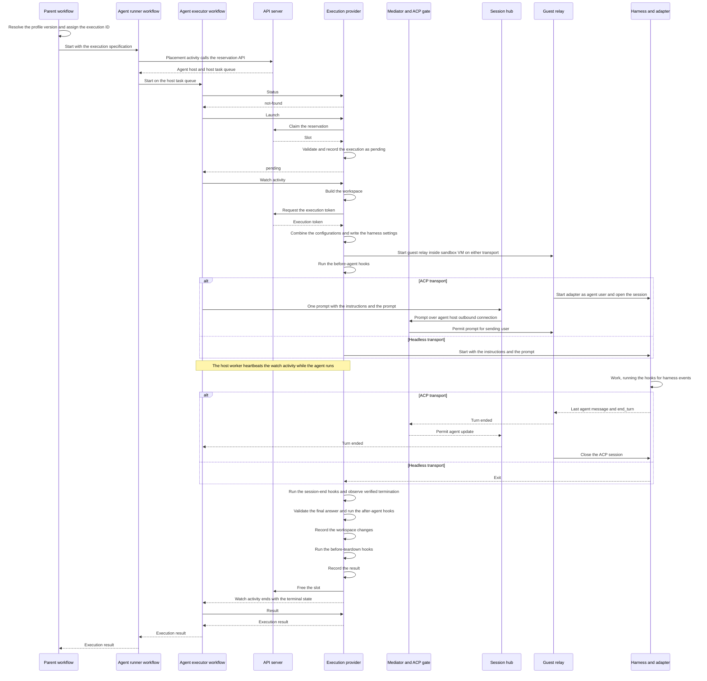
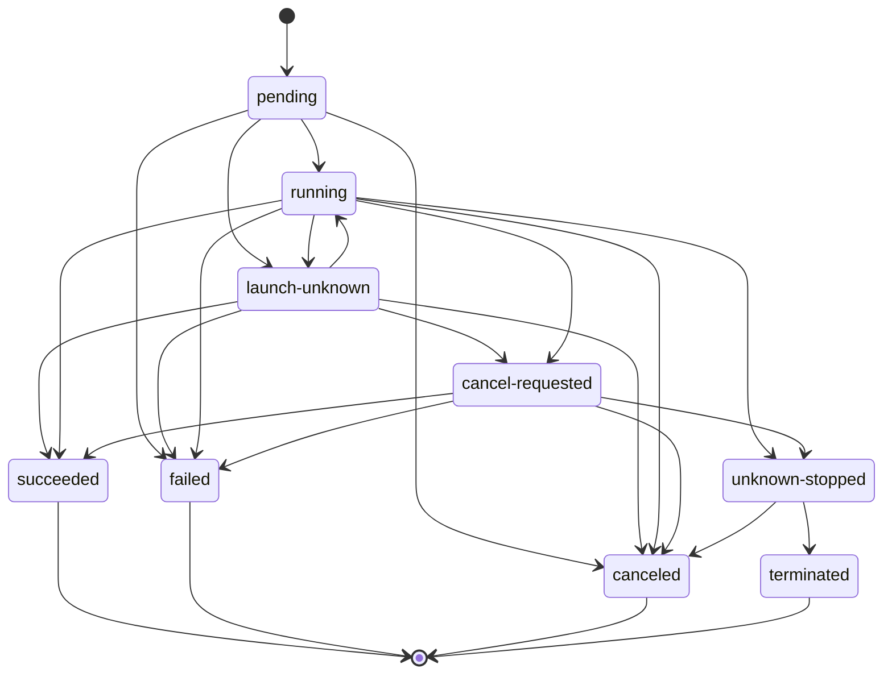

# Agent execution

An agent execution is one harness run belonging to one durable [agent](agent.md), from start to end. After the run ends, the agent and its session transcript remain. Provider operations identify the run by execution ID and generation. The mapping to logical execution generations remains an [open question](agent-open-questions.md#agents). Parent workflows start the [agent runner](components.md#agent-runner) as a child workflow with an execution specification and receive an execution result. Between the two, the agent runner places the execution on an agent host and starts the agent executor there. The executor calls the provider operations. These stay the same for every harness, model, and model provider.

An execution has these contracts and supporting resources:

- [Agent execution model](agent-execution-model.md) defines the fields and identity of an execution with its provenance record and evidence.
- [Agent execution contract](agent-execution-contract.md) defines the execution specification, the execution result, and the provider operations.
- [Agent placement](agent-placement.md) defines the agent host registry and the reservation API that bind each execution to an agent host.
- [Agent execution sequence](agent-execution-sequence.md) follows each message of one generation, from the start of the agent runner to the result.
- [Agent execution resource](agent-execution-resource.md) gives the resource form of an execution generation, with a full example.
- [Agent workspace](agent-workspace.md) defines the workspace sources and the environment variables the agent sees.
- [Agent workspace image](agent-workspace-image.md) defines prebuilt workspace trees, their image builds and storage, and layer reuse on agent hosts.
- [Agent hooks](agent-hooks.md) defines the hooks that run before, during, and after the agent's work.
- [Agent observability](agent-observability.md) defines the trace, spans, and metrics of each execution.
- [Agent profile](agent-profile.md) and [Agent sandbox](agent-sandbox.md) define what bounds and confines each execution.
- [Agent MCP gateway](agent-mcp-gateway.md) defines one Model Context Protocol (MCP) endpoint, server and tool access, approvals, and upstream credentials.
- [Agent provider requirements](agent-provider-requirements.md) lists what a conforming execution provider does, item by item.

## Parts

- **Parent workflow.** It builds the execution specification and starts the agent runner as a child workflow. Its default parent-close behavior requests cancellation of the child, which then cleans up.
- **Agent runner workflow.** Any afakt worker can run it. It places the execution on an agent host and starts the agent executor on that host's task queue as a child workflow. When the executor returns the execution result, the agent runner returns it to the parent.
- **Agent executor workflow.** It runs on the afakt worker of the placed agent host and handles one generation. Its workflow ID comes from the execution ID and the generation. It calls the provider operations as activities on the same host until the execution ends, and then it returns the execution result to the agent runner.
- **Agent host.** This machine runs agents. Its afakt worker registers the agent host with the API server. The worker serves the agent executor workflows placed on it and their activities, and it polls [workflow orchestrator](components.md#workflow-orchestrator) task queues for work. No other component connects to an agent host.
- **Execution provider.** It provides the four operations for one way of running agents, such as one harness on one agent host. The deterministic test provider offers the same contract with scripted behavior and no agent at all.
- **Harness.** This agent program sends prompts to a model and runs the tools the model calls in the workspace.
- **Model provider.** This service serves the model. Harness and model provider vary independently, and the specification lists both.
- **Credential broker.** The per-agent mediator supplies the only route out of the sandbox VM. Its credential broker runs outside the guest on the agent host. It adds credentials and the execution token to the requests that need them. See [Agent sandbox](agent-sandbox.md).

## Harness transport

The selected entry in the profile's models fixes the [harness transport](agent-profile.md#harness-transport). ACP is the default for Claude Code through `claude-agent-acp` and Codex through `codex-acp`. Other harnesses default to headless. An entry can select headless for a harness with an adapter, and headless runs support the full execution lifecycle.

For an ACP execution, the provider starts the [guest relay](agent-session.md#parts) inside the sandbox VM, and the relay starts the adapter under the separate agent user. The ACP channel ends at the mediator, whose gate checks each message before forwarding it to the session hub over the agent host's authenticated outbound connection. After initializing the adapter, the relay opens an ACP session. Only the agent executor workflow writes to it. It sends the rendered instructions and the prompt together as one prompt and waits for the turn to end. The turn's last agent message is the final answer. Then the relay closes the ACP session. Before treating the agent as stopped, the provider verifies termination of every process it started, including the relay, adapter, harness, and helpers.

The relay answers `session/request_permission` from the profile's harness permissions. It allows what the profile grants and rejects the rest. It cancels every `elicitation/create`. No person answers either request in an execution. People with read access may [attach](agent-session-attachment.md#execution-attachment) to a running ACP execution as readers and never become writers. Attachment isn't available for headless executions.

On a headless execution, the provider starts the harness with the rendered instructions and the prompt and reads its final-answer channel. Output schema validation, hooks, results, and evidence apply to both transports. A run completes on its own when the headless harness exits or the ACP turn ends with a stop reason other than `cancelled`. Completion with success means a successful headless exit or ACP `end_turn`. The final answer and the `after-agent` hooks still determine success.

| ACP stop reason | Execution path | Result reason |
| --- | --- | --- |
| `end_turn` | The success path, with output validation and `after-agent` hooks. | `agent-exit`, unless validation or a hook fails. |
| `cancelled` | The cancellation path, ending `canceled` after verified termination. | `cancellation`, or `supersession` when a higher generation caused it. |
| `refusal` | The failure path, ending `failed`. | `agent-refusal` |
| `max_tokens` | The failure path, ending `failed`. | `resource-limit` |
| `max_turn_requests` | The failure path, ending `failed`. | `resource-limit` |

A provider stop caused by a time limit or resource limit keeps that cause and follows the limit path. An ACP turn's own `max_tokens` or `max_turn_requests` response is a failure, distinct from a limit that forces the provider to stop the agent. A turn ending never proves process termination.

## Lifecycle

Each execution generation goes through these steps in order. A failure at any step ends the generation in a terminal state, and the later steps up to the result don't run, with three exceptions. Once the harness has started, the `session-end` hooks run after a headless exit or ACP session closure, whatever the reason. When the agent completes on its own with a failure or invalid output, the `after-agent` hooks with `exit` still run. Once the provider has opened the sandbox, the `before-teardown` hooks run at every end.

1. **Creation.** The parent workflow resolves the profile version, and afakt assigns the execution ID. Once workflow history records both, the parent builds the execution specification and starts the agent runner.
2. **Placement.** The agent runner binds the execution to one agent host and reserves an execution slot there. See [Agent placement](agent-placement.md).
3. **Launch.** The agent runner starts the agent executor on the placed host's task queue. The executor calls status, and it calls launch only when the execution doesn't exist, under the rules in [Reconciliation after restart or retry](#reconciliation-after-restart-or-retry). The provider validates the specification against the pinned profile version and stores a copy of that version. Then it records the execution as `pending`.
4. **Building the workspace.** From the [workspace sources](agent-workspace.md#workspace-sources), the provider builds the workspace. If that fails, the execution ends `failed` with workspace failure as its reason.
5. **Sandbox and harness configuration.** The provider combines the [sandbox configurations](agent-sandbox.md#combining-configurations) and the [agent environment](agent-workspace.md#agent-environment), and it renders the instructions. The API server issues the [execution token](agent-sandbox.md#execution-token). The supervisor starts the VM and guest relay before hooks on either transport. The provider then writes the harness settings, with the harness permissions, the tools, and the [hooks for harness events](agent-hooks.md#hook-dispatch).
6. **Before-agent hooks.** The provider runs the `before-agent` [hooks](agent-hooks.md#hook-events). The time limit starts with the first one, and the execution becomes `running`.
7. **Running the agent.** The provider starts the harness through the selected transport. On ACP, the agent executor workflow sends the rendered instructions and the prompt together through the relay. While the agent works, the harness runs the hooks for harness events through the afakt CLI, and the provider runs the `sandbox-violation` hooks for each violation the sandbox reports. The run ends when the agent completes on its own, a limit stops it, or a cancellation stops it. After a headless exit or ACP session closure, for any reason, the provider runs the `session-end` hooks within their own [session-end budget](agent-hooks.md#running-hooks), outside the time limit.
8. **After-agent hooks.** Once the agent completes on its own and the provider observes verified termination, the provider validates the final answer. It then runs the `after-agent` hooks that apply.
9. **Result.** The provider records the workspace changes. After the `before-teardown` hooks, it builds the [execution result](agent-execution-contract.md#execution-result) as it enters the terminal state. From then on, the credential broker stops writing credentials and the API server rejects the execution token. The provider also records the execution-ended event.
10. **Evidence and provenance.** From launch on, the provider publishes evidence and fills in the observed fields of the [provenance record](agent-execution-model.md#provenance-record). Both are complete by the time the result exists. Each step from placement on is also a span in the [execution trace](agent-observability.md#spans). The agent executor fetches the result and returns it to the agent runner, which returns it to the parent.
11. **Retention and cleanup.** The generation's workspace and evidence remain for the retention period. Then cleanup removes them, as [Evidence, retention, and cleanup](agent-execution-model.md#evidence-retention-and-cleanup) describes.

This diagram follows one generation that succeeds, from creation to the result.

## Execution states

These states describe a run, separately from the durable [agent lifecycle](agent.md#lifecycle).

| State | Terminal | Meaning |
| --- | --- | --- |
| `pending` | No | The provider recorded the execution and hasn't started its agent. |
| `launch-unknown` | No | The provider tried to start the agent and can't yet confirm whether it started. |
| `running` | No | The provider observed a hook or the agent running. |
| `cancel-requested` | No | The provider acknowledged a cancellation and the agent hasn't stopped. |
| `unknown-stopped` | No | A time limit, resource limit, or stop grace period ran out, and the provider hasn't observed the agent stop. The state keeps its stop cause, which is either the caller's stop request or the limit that ran out. |
| `succeeded` | Yes | The agent completed on its own with success and produced a valid payload, and each `after-agent` hook succeeded. |
| `failed` | Yes | The workspace build failed, the agent didn't start, completed with a failure, or produced invalid output, a `before-agent` or `after-agent` hook failed, or a `sandbox-violation` hook ended the run. |
| `canceled` | Yes | The provider observed the agent stop after an acknowledged cancellation or ACP `cancelled`, or the cancellation arrived before the agent started. |
| `terminated` | Yes | The provider observed the agent stop after a limit forced it. |

| From                          | To                      | When                                                                                             |
| ----------------------------- | ----------------------- | ------------------------------------------------------------------------------------------------ |
| `pending`                     | `running`               | The provider observes the first `before-agent` hook or the agent start.                          |
| `pending`                     | `launch-unknown`        | The start attempt doesn't return an answer the provider can trust.                               |
| `pending`                     | `failed`                | The workspace build fails, or the provider observes that the agent couldn't start.               |
| `pending`                     | `canceled`              | A cancellation arrives before the provider starts the agent.                                     |
| `launch-unknown`              | `running`               | The provider observes the agent running.                                                         |
| `launch-unknown`              | `succeeded` or `failed` | The provider observes that the agent already ended.                                              |
| `launch-unknown`              | `failed`                | The provider observes that the execution has no agent.                                           |
| `launch-unknown` or `running` | `cancel-requested`      | The provider acknowledges a cancellation.                                                        |
| `running`                     | `succeeded` or `failed` | The provider observes the agent complete and the end of the `after-agent` hooks that apply.          |
| `running` or `launch-unknown` | `canceled` | ACP returns `cancelled`, and the provider observes verified termination. |
| `running`                     | `failed`                | A `before-agent` hook fails.                                                                     |
| `running`                     | `failed`                | A `sandbox-violation` hook returns `terminate`, and the provider observes the agent stop.        |
| `running`                     | `launch-unknown`        | After the `before-agent` hooks, the start attempt doesn't return an answer the provider can trust. |
| `running`                     | `unknown-stopped`       | A hook or the agent exceeds a time limit or resource limit, and the provider signals it to stop. |
| `cancel-requested`            | `canceled`              | The provider observes the agent stop.                                                            |
| `cancel-requested`            | `succeeded` or `failed` | The agent completes on its own before the cancellation takes effect.                                 |
| `cancel-requested`            | `unknown-stopped`       | The stop grace period runs out, and the provider stops the agent by force.                       |
| `unknown-stopped`             | `canceled`              | The provider observes the agent stop, and the stop cause is a cancellation or a supersession.    |
| `unknown-stopped`             | `terminated`            | The provider observes the agent stop, and the stop cause is a limit.                             |

### Provider observations

These rules apply to all providers:

- A terminal state never changes.
- A provider observation is the one way into a terminal state. An elapsed timer, a reached deadline, an acknowledged cancellation, or a forced stop leaves the execution non-terminal until the provider observes the outcome.
- A timeout is never proof that the agent stopped. A reached limit or a spent stop grace period moves the execution to `unknown-stopped`. An observed stop is what moves it on, to `canceled` or `terminated` by the stop cause it keeps.
- Verified termination is the provider's observation that each process it started for the execution has exited. On ACP, that includes the relay and adapter. On both transports, it includes helpers still running after the harness ends. An observed stop always means verified termination.
- `launch-unknown` and `unknown-stopped` never count as success. A caller that reads either one waits, cancels, or reports the execution as unresolved.
- A loss of contact with the agent host doesn't change the state. Status returns `unavailable`, and the last recorded state stands.

### Virtual machine lifecycle

The host supervisor and `VMM` control the VM lifecycle independently of ACP and the guest. This path supplies start, suspend, resume, stop, `kill`, and snapshot control. The supervisor verifies a forced VM stop even if the guest or ACP gate doesn't answer. Graceful process signals and bounded hooks don't give the guest authority to block that fallback.

## Cancellation and limits

- **Cancellation.** A parent workflow cancels the agent runner workflow, which passes the cancellation on to its child, the agent executor workflow. The executor then calls cancel. While the agent runs, the provider first runs the `stop-requested` hooks. It then signals the running hook or agent to stop, waits the stop grace period, and then stops it by force. The execution becomes `canceled` once the provider observes the stop.
- **Limits.** The time limit and resource limits cover the hooks and the agent together. When one runs out, the provider stops the running process the same way, and the execution ends `terminated` once the provider observes the stop. The `stop-requested` hooks run at the time limit but not at a resource limit.
- **Closing the parent.** A parent workflow that closes first requests cancellation of the agent runner through its default parent-close behavior. The agent runner then cancels the agent executor, which cancels the execution and waits for its terminal state.

## Generations and supersession

Logical execution generations group deliberate attempts for the execution's agent. Their relationship to the boundary of one harness run remains [open](agent-open-questions.md#agents).

Only the parent makes a higher generation. It's a deliberate new attempt, such as after a failed result, that keeps the execution ID and may pin a different profile version or list different workspace sources. To start from the previous generation's workspace, it lists an `execution` source with its own execution ID and an earlier generation.

A higher generation can arrive while the previous one is still active. The provider then cancels the previous generation with supersession as the reason, and the new generation waits in `pending` until the previous generation becomes terminal. Only then does the provider build the new generation's workspace, so an `execution` source can refer to the generation it supersedes. One execution ID never has two agents running at once.

## Reconciliation after restart or retry

The agent executor's workflow ID comes from the execution ID and the generation. When an agent runner starts an executor that already runs, such as after the parent starts the agent runner again for the same generation, it waits on the running executor and never starts a second one.

Before any launch, the agent executor checks whether the execution exists. A first attempt follows these steps in order, and so do a retried activity and the same step after a worker restart:

1. Call status for the execution ID and generation on the agent host that has the placement.
2. On `not-found`, launch.
3. On any state, adopt the existing execution and continue from that state without launching. `pending`, `launch-unknown`, and `running` mean wait. A terminal state means fetch the result.
4. On `unavailable`, call status again after a delay. The agent executor never reads `unavailable` as `not-found`, and it never launches on another agent host instead.

Retries reuse the same generation. If a launch happens despite these steps, the [identity rules](agent-execution-model.md#execution-identity) still return the existing execution, and the provider doesn't start a second agent.

When the afakt worker on an agent host restarts, the supervisor keeps its virtual machine monitors and mediators running. The agents keep running inside their VMs. Execution records persist on the agent host across the restart. After it starts again, the worker loads those records and observes each execution's agent again before it answers status. Each agent executor on the host then goes on from its workflow history, and its next status call follows the preceding steps.

The execution record gives the step each execution was in. The worker doesn't run an interrupted step again, and it acts by step:

- **Before the agent starts.** For an interrupted workspace build, sandbox and harness configuration, or `before-agent` hook, the provider waits for verified termination of that step's processes. The execution then ends `failed` with worker restart as its reason.
- **While the agent runs.** The provider observes the agent again, and the execution goes on from its recorded state.
- **After the agent completes.** An interrupted `stop-requested`, `session-end`, `after-agent`, or `before-teardown` hook counts as a failed run of that hook, under the [hook failure rules](agent-hooks.md#hook-failures). An interrupted output validation or result build starts again from its beginning, because neither step changes anything outside the execution record.

## Placement on agent hosts

Placement binds an execution to one agent host before launch, and all later operations for that execution go to that host. [Agent placement](agent-placement.md) defines the agent host registry, the reservation API, and the slot rules. The host worker's [capacity controller](agent-placement.md#slot-capacity) adjusts slot capacity within the host's configured bounds from observed CPU use, memory use, and free workspace disk space, and reports it in each lease renewal. A capacity decrease preserves running executions and existing reservations and blocks new reservations until a slot is free.

- The agent executor workflow runs on the placed host's task queue, and so do its activities: launch, status, cancel, result, and the watch activity. Cleanup also runs as an activity there.
- While an agent runs, the host worker heartbeats a watch activity. A missed heartbeat shows that the workflow orchestrator lost contact with the host's worker, not that the agent stopped. Once the worker answers again, the agent executor workflow calls status on the same host task queue.
- While the agent host doesn't answer, the agent runner workflow waits on the agent executor workflow and never starts an executor for the same generation on another agent host.
