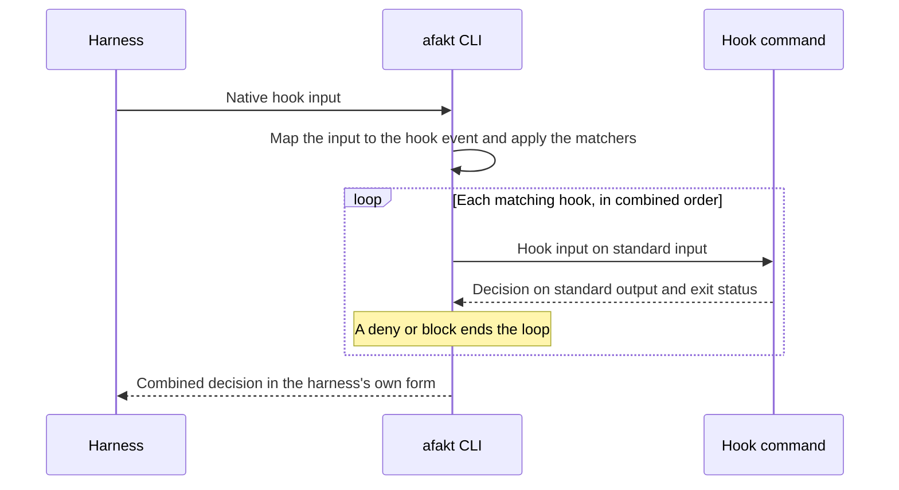

# Agent hooks

A hook is a command that runs inside the execution's sandbox when a hook event happens. Agent profiles and execution specifications define hooks with the same fields and the same events. Some events happen around the agent, where the execution provider runs their hooks. The rest happen inside the harness while the agent works, and their hooks can steer the agent through a decision such as `deny`.

## Hook events

Provider events happen around the agent. The provider runs their hooks itself. Harness events happen inside the harness while the agent works, and the harness runs their hooks through the afakt CLI, as [Hook dispatch](#hook-dispatch) describes.

| Event                  | Runs it  | When the hooks run                                                                                                                                                         | Matcher        | Decisions                     |
| ---------------------- | -------- | -------------------------------------------------------------------------------------------------------------------------------------------------------------------------- | -------------- | ----------------------------- |
| `before-agent`         | Provider | After the provider builds the workspace, with each workspace source in place, and before it starts the agent.                                                              | None           | None                          |
| `session-start`        | Harness  | Once, when the headless harness starts its session or the ACP adapter opens its session, before the first model request.                                                                                              | None           | `context`                     |
| `prompt-submit`        | Harness  | Before the harness sends a prompt to the model, both the execution's prompt and any continuation prompt.                                                                   | None           | `block`, `context`            |
| `model-request-before` | Harness  | Before each model request.                                                                                                                                                 | None           | `context`                     |
| `model-request-after`  | Harness  | After each model response.                                                                                                                                                 | None           | `context`, `continue`, `stop` |
| `tool-call-before`     | Harness  | Before a tool runs.                                                                                                                                                        | Tool names     | `deny`, `rewrite`, `context`  |
| `tool-call-after`      | Harness  | After a tool call ends, whether it succeeded or failed.                                                                                                                    | Tool names     | `replace`, `context`          |
| `permission-request`   | Harness  | Before the harness shows a permission prompt for an action.                                                                                                                | Tool names     | `deny`                        |
| `subagent-start`       | Harness  | When the agent starts a subagent.                                                                                                                                          | Subagent types | `context`                     |
| `subagent-stop`        | Harness  | When a subagent is about to finish.                                                                                                                                        | Subagent types | `continue`                    |
| `compaction-before`    | Harness  | Before the harness compacts the conversation.                                                                                                                              | None           | `block`                       |
| `compaction-after`     | Harness  | After the harness compacts the conversation.                                                                                                                               | None           | None                          |
| `agent-stop`           | Harness  | When the agent is about to finish its work.                                                                                                                                | None           | `continue`                    |
| `stop-requested`       | Provider | After a cancellation, a supersession, or the time limit ends the agent's run, before the provider signals the agent to stop.                                                  | Stop causes    | None                          |
| `sandbox-violation`    | Provider | Each time the sandbox reports a violation by the agent's processes, from the harness start until verified termination.                                                       | Violation kinds | `terminate`                  |
| `session-end`          | Provider | After the provider observes a headless harness exit or ACP session closure, including after a cancellation or a reached limit.                                                     | None           | None                          |
| `after-agent`          | Provider | Once the agent has completed on its own with verified termination and the provider has validated its final answer, whatever the validation found, before the provider records the workspace changes and produces the result. | None           | None                          |
| `before-teardown`      | Provider | Once at every end of a generation whose sandbox the provider opened, after the other hooks and after the provider records the workspace changes, and before it builds the result and removes the sandbox. | None           | None                          |

A `before-agent` hook prepares the workspace, such as by installing dependencies, and an `after-agent` hook checks the agent's work, such as by running the tests. A `session-end` hook runs after every headless harness exit or ACP session closure. A `stop-requested` hook saves partial work before the agent stops, such as by writing a progress note into the workspace. A `sandbox-violation` hook reacts to a denied network request or file access, and its `terminate` decision ends the execution. A `before-teardown` hook is the last command to run inside the sandbox, such as copying a cache out of the workspace. Whether a `stop-requested`, `session-end`, or `before-teardown` hook fails or not, the execution's outcome stays the same.

A matcher uses the tool names from the profile's tools, and the provider maps each one to the harness's own name. For a subagent event, it uses the harness's own subagent types. A `stop-requested` matcher lists stop causes, `cancellation`, `supersession`, or `time-limit`, and a `sandbox-violation` matcher lists violation kinds, `network` or `filesystem`.

Completion on its own and completion with success follow the [transport outcome rules](agent-execution.md#harness-transport). ACP `cancelled` follows cancellation and skips `after-agent` hooks. ACP `refusal`, `max_tokens`, and `max_turn_requests` run the `exit` hooks on the failure path.

## Hook fields

| Field             | Events                    | Meaning                                                                                                                                                                                                                                           |
| ----------------- | ------------------------- | ------------------------------------------------------------------------------------------------------------------------------------------------------------------------------------------------------------------------------------------------- |
| Name              | All                       | A label unique among the execution's hooks: 1 to 64 lowercase letters, digits, and `-`. The first character is a letter.                                                                                                                          |
| Event             | All                       | One of the [hook events](#hook-events).                                                                                                                                                                                                           |
| Matcher           | Events with a matcher     | The tool names, subagent types, stop causes, or violation kinds the hook applies to. Without it, the hook applies to every occurrence of the event.                                                                                                                              |
| Command           | All                       | The program and its arguments, as a list. The program runs directly, without a shell. A hook that needs a shell lists the shell as its program.                                                                                                   |
| Working directory | All                       | `.` for the workspace root, or the target path of a workspace source. Without it, the hook starts in the workspace root.                                                                                                                          |
| Environment       | All                       | Names and values for this hook alone, on top of the agent environment. See [Hook environment](#hook-environment).                                                                                                                                 |
| Timeout           | All                       | The longest one run of the hook may take. It must be shorter than the execution's time limit. Without it, 60 seconds applies.                                                                                                                     |
| Decisions         | Events with decisions     | The decisions the hook may return, from those its event allows. Without it, the hook only observes, and its output has no effect.                                                                                                                 |
| On failure        | Harness events            | `continue` or `block`. With `continue`, the event goes on as if the failed hook hadn't run. With `block`, a failed hook acts as a `deny` or `block` decision whose reason gives the hook's name, and the hook's decisions must include `deny` or `block`. Without it, `continue` applies. |
| When              | `after-agent`             | With `success`, the hook runs only after the agent completes with success and a valid final answer. With `exit`, it runs after any completion of the agent on its own. Without it, `success` applies.                                                      |

Arguments, the working directory, and environment values accept [sandbox variables](agent-sandbox.md#sandbox-variables) in the same `${name}` form as sandbox rules. Hooks aren't Go templates, and the instruction inputs aren't available to them.

## Combining hooks

The profile's hooks always run, and a specification can't remove or change them. A specification may always add its own hooks, for any event. The provider combines the two lists at launch:

- Names are unique across the combined list.
- At `before-agent`, `sandbox-violation`, and each harness event, the profile's hooks run first. A `deny`, `block`, or `terminate` from a profile hook then ends the event before any specification hook runs.
- At `stop-requested`, `session-end`, `after-agent`, and `before-teardown`, the specification's hooks run first. The profile's hooks then wrap the specification's on both sides of the agent.
- Within one source and one occurrence of an event, hooks run one at a time, in the order they appear.
- Occurrences of one event can overlap, such as `tool-call-after` for tool calls that the harness runs in parallel, or `sandbox-violation` for violations close together. A hook may then have concurrent runs, and it must handle them.

The configuration digest and the provenance record both include the combined list.

## Decisions

A hook for a harness event or for `sandbox-violation` returns a decision as one JSON object on standard output, with the decision in its `decision` field and the fields from this table beside it. Any decision may include a `context` field when the event allows `context`. An empty output with exit status 0 is no decision at all.

| Decision | Effect | Fields |
| --- | --- | --- |
| `context` | The harness adds the text to the agent's context. | `context` |
| `block` | Stops the prompt or the compaction, and the agent sees the reason. | `reason` |
| `deny` | Stops the tool call or the action behind the permission prompt. The agent sees why. | `reason` |
| `rewrite` | The tool runs with the arguments from the hook, each one replacing the argument of the same name. | `arguments` |
| `replace` | The agent sees the hook's text in place of the tool's result. The tool has already run. | `result` |
| `continue` | The agent or subagent keeps working, with the reason as its next instruction. | `reason` |
| `stop` | The agent finishes its work after the current response. | `reason` |
| `terminate` | The provider stops the agent as it does after a cancellation, and the execution ends `failed` with sandbox violation as its reason. | `reason` |

No decision widens what the agent may do. Hooks can't approve an action that the harness permissions deny, and `permission-request` offers only `deny`. The afakt CLI never returns an approval to the harness, such as `permissionDecision` set to `allow`.

## Hook input

On standard input, each command reads one JSON object with these fields.

| Field | Events | Value |
| --- | --- | --- |
| `event` | All | The hook event. |
| `hook` | All | The hook's name. |
| `harness` | All | The harness's name and version. |
| `tool` | `tool-call-before`, `tool-call-after`, and `permission-request` | The tool's name from the profile's tools, and its arguments as a JSON object. |
| `tool_outcome` | `tool-call-after` | `success` with the tool's result, or `failure` with its error. |
| `prompt` | `prompt-submit` | The prompt text. |
| `subagent` | `subagent-start` and `subagent-stop` | The subagent type. |
| `stop` | `stop-requested` | The stop cause. |
| `violation` | `sandbox-violation` | The violation kind and the denied host or path. |
| `continuations` | `agent-stop` and `subagent-stop` | How many times in a row hooks have already kept the agent or subagent working. |
| `native` | Harness events | The harness's own hook input, unchanged. |

## Running hooks

- Each hook runs inside the execution's sandbox under the [combined sandbox configuration](agent-sandbox.md#combining-configurations), with the agent's workspace access and mediated execution authority. Its network traffic passes through the mediator like the agent's. The guest never receives an execution token. A hook never has wider access than the agent. Under `read-only` workspace access, a hook can't change the workspace either.
- Harness permissions and tools apply to the agent, and they don't limit hooks.
- The time limit and resource limits cover the hooks and the agent together, apart from the `stop-requested`, `session-end`, and `before-teardown` hooks. A hook's timeout ends early when the time limit would end first.
- The `session-end` hooks share a session-end budget of their own, 10 seconds in total. It starts when the provider observes a headless harness exit or ACP session closure, after any stop grace period the run used, and the time limit doesn't count it. A `session-end` hook's timeout ends early when the budget would end first. Once the budget runs out, the provider skips the `session-end` hooks still to come.
- The `stop-requested` hooks share a stop budget of 10 seconds in total, outside the time limit. It starts when a cancellation, a supersession, or the time limit ends the agent's run, and the agent keeps running until these hooks end or the budget runs out. They run only while the agent runs, so a stop during a `before-agent` or `after-agent` hook goes straight to that hook. A resource limit stops the agent without them.
- The `before-teardown` hooks share a teardown budget of 10 seconds in total, outside the time limit, in the same way as the `session-end` hooks.
- When a hook runs out its timeout, the process that started it signals it to stop, waits the stop grace period, and then stops it by force. For a provider event, the next step starts only after the provider observes verified termination of the hook's processes.
- Hooks steer the agent, and they aren't a security boundary. A harness can run some actions without firing an event, such as a tool that the model provider runs remotely. The sandbox, the harness permissions, and the capabilities confine the agent.

## Hook failures

Any hook fails on a nonzero exit status, a timeout, or a failed start. For a harness event, invalid output or an undeclared decision also counts as a failure.

| Situation | Outcome |
| --- | --- |
| A `before-agent` hook fails | The provider skips the remaining `before-agent` hooks and never starts the agent. The execution ends `failed` with hook failure as its reason. |
| A hook for a harness event fails | The hook's on-failure rule applies. The failure never ends the execution by itself. |
| A `stop-requested`, `session-end`, or `before-teardown` hook fails | The provider records the failure and goes on. The execution's outcome stays the same. |
| A `sandbox-violation` hook fails | The provider records the failure, and the agent keeps working. |
| A `sandbox-violation` hook returns `terminate` | The provider skips the remaining hooks for that occurrence and stops the agent as it does after a cancellation, without the `stop-requested` hooks. The execution ends `failed` with sandbox violation as its reason. |
| The agent completes with success and a valid final answer | Each `after-agent` hook runs. After a hook fails, the remaining `exit` hooks still run and the remaining `success` hooks don't. Any hook failure ends the execution `failed` with hook failure as its reason, and the result has no payload. The raw final answer remains evidence. |
| The agent completes with a failure or with invalid output | Only the `exit` hooks run. The execution ends `failed` with the agent's own reason, whatever the hooks do. |
| A time limit or resource limit stops a hook or the agent | At the time limit, the `stop-requested` hooks run before the provider signals the agent. The provider skips the remaining `before-agent` and `after-agent` hooks. The `session-end` hooks still run when the harness had started. The execution ends `terminated` with that limit as its reason. |
| A cancellation or supersession arrives | While the agent runs, the `stop-requested` hooks run first. The provider then stops the running hook or agent as it stops an agent after a cancellation, and it skips the remaining `before-agent` and `after-agent` hooks. Of the later hooks, only those for `session-end` run, and only when the harness had started. The execution ends `canceled`. |

After each of these outcomes, the `before-teardown` hooks run once the provider has opened the sandbox.

## Hook dispatch

On both transports, harness events run through the harness's own hook system inside the sandbox. The harness support tables apply to ACP and headless runs alike. ACP messages don't replace the native hooks. Hooks for harness events go in during the same launch step as the harness permissions and tools, after the workspace build and before the first `before-agent` hook.

- For each harness event that has hooks, the provider writes one entry into the harness's global hook configuration. That's the user-level configuration under `${home}`, the execution's home directory inside the sandbox. Each entry runs the afakt CLI.
- This configuration lies outside the workspace, where the sandbox denies the agent writes. That way the agent can't change or remove its hooks.
- The harness stops a hook entry that runs past the entry's own timeout. The provider sets each entry's timeout to the sum of the timeouts of the hooks that the entry dispatches, plus a margin for the afakt CLI itself, because the harness defaults can be shorter, such as 30 seconds for `UserPromptSubmit` in Claude Code.
- Before it starts the agent, the provider checks that the written configuration contains an entry for each event with installed hooks.

On each occurrence of the event, the afakt CLI applies each hook's matcher. It runs the matching hooks one at a time, in the order of the combined list, each under its timeout and with the hook input on standard input. Finally, the CLI returns the combined decision to the harness in the harness's own form. The CLI combines the hooks' decisions for one occurrence under these rules:

- At the first `deny` or `block`, the event ends and the remaining hooks don't run. The combined decision is that `deny` or `block`, together with the `context` from the hooks before it.
- Each `context` adds its text, in the order the hooks ran.
- A hook sees the arguments after any earlier `rewrite`, and each later `rewrite` applies on top of the earlier ones.
- A hook sees the result after any earlier `replace`, and the last `replace` gives the result that the agent sees.
- At `agent-stop` and `subagent-stop`, the reasons of each `continue` join, in the order the hooks ran, into one instruction.

## Harness support

At launch, the provider assesses harness support only for what the combined hook list uses: the event of each hook for a harness event, and each decision that hook may return. It looks up each one in the [harness capability matrix](#harness-capability-matrix) for the selected harness and version. Events and decisions that no hook uses play no part. A harness never counts against an execution for them. Hooks for provider events run on every harness.

- **Supported.** The harness fires the event at every occurrence the event defines and honors each of the hook's decisions. The provider installs the hook.
- **Partial.** The harness fires the event at only some of its occurrences, or honors a decision with a limit that the matrix notes. The provider installs the hook and records a `hook-partial` warning.
- **Unsupported.** The harness never fires the event or can't honor one of the hook's decisions. The provider skips the hook and records a `hook-unsupported` warning. The launch goes on.

Each warning gives the hook, the event or decision it uses, and the harness. The provenance record and evidence list each warning, and the trace and metrics show it, as [Agent observability](agent-observability.md#events) describes. A skipped hook never runs, whatever its decisions, and the launch goes on.

When an execution has hooks on Codex, the provider does whatever Codex requires for those hooks to run, including its trust review.

### Workspace repository hooks

A workspace repository can bring its own hooks through the harness's project configuration at the workspace root: `.claude/settings.json` for Claude Code, `.codex/hooks.json` or `.codex/config.toml` for Codex, and `.agents/hooks.json` for Antigravity. Codex loads project hooks only once a person marks the project's `.codex/` layer as trusted. The harness runs those hooks alongside the entries that the provider writes, inside the same sandbox, in the harness's own order. The provider leaves them in place and unchanged.

- Before it starts the agent, the provider reads the project hook configuration that the selected harness reads from the workspace. For each entry it finds, it records the file, the native event, and the command.
- The provenance record lists those entries as repository hooks, and the provider publishes the configuration files as evidence.
- Because repository hooks run outside the afakt CLI, their runs and decisions stay out of the hook evidence and the trace. The combined hook list leaves them out too.

### Global hook configuration

| Harness | Global hook configuration, under `${home}` | Notes |
| --- | --- | --- |
| Claude Code | `.claude/settings.json`, in its `hooks` field | Hook entries from every settings level merge, and each one runs. |
| Codex | `.codex/hooks.json` | Codex runs a hook outside managed configuration only after a trust review, and it asks for that review again when the hook changes. Matching hooks from every file run, and Codex starts the matching command hooks for one event concurrently. |
| Antigravity | `.gemini/config/hooks.json` | Global hooks go in this file and workspace hooks in `.agents/hooks.json`, but the documentation is silent on whether both scopes run, their order, and the decision that takes effect. Unverified. |

### Harness capability matrix

Each row gives one event, or one decision at one event, with its support in each harness and the harness's own name for it. Only the rows for what an execution's hooks use apply to that execution.

| Event | Decision | Claude Code | Codex | Antigravity |
| --- | --- | --- | --- | --- |
| `session-start` | Event and `context` | Supported. `SessionStart` with `additionalContext`. | Supported. `SessionStart` with `additionalContext`. | Supported. `SessionStart` with `injectSteps`. |
| `prompt-submit` | Event | Partial. `UserPromptSubmit` runs for the execution's prompt, but the documentation is silent on continuation prompts after `Stop`. | Partial. Codex documents `UserPromptSubmit` for submitted prompts and is silent on the continuation prompt from a `Stop` hook. | Unsupported. The CLI has no prompt event. |
| `prompt-submit` | `block` | Partial. `"decision": "block"`. Claude Code shows the reason to the user and leaves it out of the agent's context. | Supported. `"decision": "block"`. | Unsupported. |
| `prompt-submit` | `context` | Supported. `additionalContext`. | Supported. `additionalContext`. | Unsupported. |
| `model-request-before` | Event and `context` | Partial. `PostToolBatch` runs before the next model request after a batch of tool calls, and `UserPromptSubmit` runs before a prompt. Claude Code doesn't run a hook before the other requests. | Unsupported. | Supported. `PreInvocation`, before each model call, with `injectSteps`. |
| `model-request-after` | Event and `context` | Unsupported. `Stop` runs only at the end of the turn. | Unsupported. | Supported. `PostInvocation`, after each model call, with `injectSteps`. |
| `model-request-after` | `continue` and `stop` | Unsupported. | Unsupported. | Supported. `terminationBehavior` set to `force_continue` or `terminate`, with the reason as an injected step. |
| `tool-call-before` | Event | Supported. `PreToolUse`. | Partial. `PreToolUse` covers shell, `apply_patch`, Model Context Protocol (MCP), and local function tools, but not hosted tools such as web search. | Supported. `PreToolUse` matches every tool. Coverage of MCP tools is unverified. |
| `tool-call-before` | `deny` | Supported. `permissionDecision` set to `deny`. | Supported. `permissionDecision` set to `deny`. | Supported. `decision` set to `deny`. |
| `tool-call-before` | `rewrite` | Unsupported. `updatedInput` takes effect with `permissionDecision` set to `allow`, which approves the call, or `ask`, which waits for a person. The afakt CLI returns only `deny` or no decision. | Unsupported. Codex accepts `updatedInput` only with `permissionDecision` set to `allow`, which the afakt CLI never returns. | Supported. `overwrite`, a shallow merge into the tool arguments. |
| `tool-call-before` | `context` | Supported. `additionalContext`. | Supported. `additionalContext`. | Unsupported. |
| `tool-call-after` | Event | Supported. `PostToolUse`, and `PostToolUseFailure` for a failed call. It runs concurrently for parallel tool calls. | Partial. `PostToolUse` runs after shell, `apply_patch`, MCP, and local function tools, but not after hosted tools such as web search. For a failed call, it runs only after a shell command with a nonzero exit status. | Partial. `PostToolUse` gives the tool's name, its arguments, and the error of a failed call, but not the result of a successful call, so `tool_outcome` has no result. |
| `tool-call-after` | `replace` | Partial. `updatedToolOutput` on `PostToolUse`, in the tool's own output shape. For a built-in tool, Claude Code ignores output in any other format and keeps the original result. `PostToolUseFailure` can't replace the result. | Supported. `"decision": "block"` replaces the result with the reason. | Unsupported. |
| `tool-call-after` | `context` | Supported. `additionalContext`. | Supported. `additionalContext`. | Unsupported. |
| `permission-request` | Event and `deny` | Partial. `PermissionRequest` with `behavior` set to `deny`. Claude Code doesn't run it for a network request from a command inside its own sandbox. | Supported. The hook output sets `decision.behavior` to `deny`. | Unsupported. |
| `subagent-start` | Event and `context` | Supported. `SubagentStart` with `additionalContext`. | Supported. `SubagentStart` with `additionalContext`. | Unsupported. |
| `subagent-stop` | Event and `continue` | Supported. `SubagentStop` with `"decision": "block"`. | Supported. `SubagentStop` with `"decision": "block"`. | Unsupported. |
| `compaction-before` | Event and `block` | Supported. `PreCompact` with `"decision": "block"`. | Supported. `PreCompact` with `"continue": false`. | Unsupported. |
| `compaction-after` | Event | Supported. `PostCompact`. | Supported. `PostCompact`. | Unsupported. |
| `agent-stop` | Event and `continue` | Partial. `Stop` with `"decision": "block"`. Claude Code allows eight continuations in a row, and the count resets each time the agent calls a tool. After an API error it runs `StopFailure` hooks in place of `Stop` hooks and ignores their output. | Supported. `Stop` with `"decision": "block"`, which starts a continuation. | Supported. `Stop` with `decision` set to `continue`. |

The matrix rests on each harness's own hook reference. A cell marked unverified rests on a gap or an ambiguity in that reference.

- [Claude Code hooks](https://code.claude.com/docs/en/hooks)
- [Codex hooks](https://learn.chatgpt.com/docs/hooks)
- [Antigravity CLI hooks](https://antigravity.google/docs/hooks?tab=cli)

## Hook environment

Each hook starts from the agent's environment, which combines the [execution environment](agent-workspace.md#execution-environment) and the [agent environment](agent-workspace.md#agent-environment) with the trace context. The hook's own environment entries apply on top, for that hook alone. They may replace an agent environment entry without `locked`, but they can't replace a locked entry or set a [reserved name](agent-workspace.md#reserved-names).

For a `before-agent`, `after-agent`, or `before-teardown` hook, `AFAKT_PHASE` is its event. Every other hook, `session-end` included, sees `agent`. Hooks also see these variables.

| Variable | Hooks | Value |
| --- | --- | --- |
| `AFAKT_HOOK_NAME` | All | Name of the hook. |
| `AFAKT_HOOK_EVENT` | All | The hook event. |
| `AFAKT_HOOK_DEADLINE` | All | When the hook's timeout runs out, in the same form as `AFAKT_DEADLINE`. |
| `AFAKT_AGENT_OUTCOME` | `after-agent` | `success`, `failure`, or `invalid-output`. |
| `AFAKT_AGENT_EXIT_STATUS` | `session-end`, `after-agent`, and `before-teardown` | Exit status of the headless harness, as a decimal integer. Unset on ACP runs or when the harness reports none. |
| `AFAKT_AGENT_STOP_REASON` | `session-end`, `after-agent`, and `before-teardown` | ACP stop reason. Unset on headless runs or before the adapter reports a stop reason. |
| `AFAKT_FINAL_ANSWER_FILE` | `after-agent` | Absolute path of a read-only file with the agent's raw final answer. |
| `AFAKT_END_STATE` | `before-teardown` | The terminal state the execution enters next, such as `succeeded`. |

## Hook evidence

The provider publishes a record of each hook as evidence, with the standard output and standard error logs of each run.

- Each record gives the hook's name, event, and source in the profile or the specification. It also gives the command, the hook's own environment entries after variable replacement, and the working directory.
- For each run, the record gives the tool name or subagent type when the event has one, the decision, the exit status, whether the hook failed, and the start and end times.
- The provenance record lists the combined hooks. For each hook it gives the number of runs and failures, or that the provider skipped it, and each [support warning](#harness-support) for an event or decision the hook uses. It also lists the [workspace repository hooks](#workspace-repository-hooks).
- Each hook run is also a span in the [execution trace](agent-observability.md#spans).
