# Agent launch sequence

[Public key infrastructure](pki.md).

Launch transitions follow the [agent launch lifecycle](agent-sandbox-lifecycle.md#Agent%20launch%20lifecycle). Control requests use the Application Programming Interface (API) server. Agent Client Protocol (ACP) traffic uses the workload proxy under mediator decisions. Its [client connection owner and path](agent-open-questions.md#%60OQ-SES-17%60) remain open. The mediator stamps identity and enforces policy without opening network connections. Using the launch's X.509 SPIFFE Verifiable Identity Document (SVID), the agent proxy authenticates over mutual Transport Layer Security (TLS). TLS ends at the receiving service. App requests from the afakt command-line interface (CLI) enter through the ingress gateway. See [Overlay connections](agent-workload-proxy.md#Overlay%20connections).

From the peer certificate, the API server identifies the agent launch and reads its capabilities and scopes from the agent launch spec it already holds. After the agent launch enters a terminal state, the API server refuses requests from its identity. No SVID or private key enters the guest. The credential broker also stays outside the guest. Its placement relative to the mediator and egress gateway remains [open](agent-open-questions.md#%60OQ-SBX-23%60).

```mermaid
sequenceDiagram
    autonumber
    participant Parent as Parent workflow
    participant Orch as Workflow orchestrator
    participant Dispatcher as agent dispatcher workflow
    participant Placer as afakt worker on the dispatcher's task queue
    box Agent host
        participant Launcher as agent launcher workflow
        participant Worker as agent host worker and agent sandbox provider
        participant Network as Agent proxy
        participant Mediator as Agent mediator
        participant Egress as Agent egress gateway
        participant Credentials as Credential broker
        participant Relay as Guest relay inside sandbox VM
        participant Harness as Harness and adapter
        participant CLI as afakt CLI
        participant Telemetry as Telemetry endpoint
    end
    participant API as API server
    participant Ingress as Ingress gateway
    participant SessionPath as ACP connection owner (open: OQ-SES-17)
    participant Reader as Attached reader
    participant Model as Model provider
    participant Repo as Repository host

    Worker->>API: Register the agent host, its host task queue, and its metadata
    API-->>Worker: Lease, which the worker renews

    Parent->>Parent: Submit an agent launch request
    Parent->>Orch: Start the agent dispatcher as a child workflow, with the agent launch request
    Orch->>Dispatcher: Workflow task, on any afakt worker

    Dispatcher->>Dispatcher: Authorize the agent launch request
    Dispatcher->>Orch: Schedule the placement activity
    Orch->>Placer: Placement activity
    Placer->>API: Reserve a slot, with the placement requirements
    API->>API: Match the registry and record the reservation
    API-->>Placer: Agent host and host task queue
    Placer-->>Orch: Agent host and host task queue
    Orch-->>Dispatcher: Placement, recorded in workflow history

    Dispatcher->>Dispatcher: Finalize agent launch spec from the agent spec generation
    Dispatcher->>Orch: Queue agent launcher with the spec on the agent executor task queue
    Orch->>Launcher: Workflow task, on the placed host's worker

    Launcher->>Orch: Schedule status
    Orch->>Worker: Status activity
    Worker-->>Orch: not-found
    Orch-->>Launcher: not-found
    Launcher->>Orch: Schedule provision
    Orch->>Worker: Provision activity
    Worker->>Worker: Validate against the pinned profile and store its copy
    Worker->>API: Claim the reservation
    API-->>Worker: Slot
    Worker->>Worker: Record the agent launch as pending
    Note over Launcher,Worker: Provision return boundary remains open

    Launcher->>Orch: Schedule the watch activity
    Orch->>Worker: Watch activity
    Worker->>Repo: Fetch each repository source, outside the sandbox
    Repo-->>Worker: Commits
    Worker->>Worker: Build the agent workspace
    Worker->>Mediator: Start per-launch policy service
    Worker->>Network: Start agent proxy
    Worker->>Credentials: Bind credentials to the agent launch outside guest
    Worker->>Worker: Combine the configurations and render the instructions
    Worker->>Worker: Write the harness settings and the hook dispatch entries
    Worker->>Relay: Start inside sandbox VM under relay user on either transport
    Worker->>Worker: Run the before-agent hooks in the sandbox
    Note over Worker: The time limit starts, and the state becomes running
    alt ACP transport
        Relay->>Harness: Start adapter as agent user with TRACEPARENT
        Relay->>Harness: Initialize and open the ACP session
        Relay->>Network: Register session
        Network->>Mediator: Request session registration decision
        Mediator-->>Network: Permit session registration
        Network->>SessionPath: Authenticated ACP path (owner and routing open)
        Note over Network,SessionPath: ACP endpoint and transport termination remain open
        Launcher->>SessionPath: Send instructions and prompt together as the only writer
        SessionPath->>Network: One prompt on ACP path
        Network->>Mediator: Authenticated caller and message
        Mediator-->>Network: Default-deny policy permits sending user prompt
        Network->>Relay: Prompt
        Relay->>Harness: session/prompt
        Reader->>Ingress: Attach with read access
        Ingress->>SessionPath: Attach reader
        SessionPath-->>Ingress: Session updates, with no writer rights
        Ingress-->>Reader: Session updates
    else Headless transport
        Worker->>Harness: Start with the instructions, the prompt, and TRACEPARENT
    end

    par The agent works
        loop Each model request
            Harness->>Network: Model request with the placeholder
            Network->>Mediator: Request connection and inspection decision
            Mediator-->>Network: Permit inspected destination
            Note over Network,Egress: Proxy termination and egress decryption role open (OQ-SBX-72)
            Network->>Egress: Inspected destination request
            Egress->>Egress: Decrypt and apply HTTP policy
            Egress->>Credentials: Permitted request
            Credentials->>Model: Inject the brokered credential
            Model-->>Credentials: Response
            Credentials-->>Egress: Response
            Egress-->>Network: Response
            Network-->>Harness: Response
        end
    and Hooks for harness events
        loop Each harness event with hooks
            Harness->>CLI: Native hook input
            CLI->>CLI: Run the matching hooks in combined order
            CLI-->>Harness: Combined decision
        end
    and Capabilities
        loop Each afakt API operation
            Harness->>CLI: Run an afakt CLI command
            CLI->>Relay: API control request
            Relay->>Network: Control request
            Network->>Mediator: Request control decision
            Mediator->>Mediator: Stamp agent identity and check policy
            Mediator->>Network: Permitted CLI request
            Network->>API: Mutual TLS with launch X.509-SVID over overlay
            Note over Network,API: API server terminates workload mutual TLS
            API->>API: Identify launch from peer certificate and check capabilities and scopes from its spec
            API-->>Network: Response
            Network-->>Relay: Response
            Relay-->>CLI: Response
            CLI-->>Harness: Output
        end
    and Telemetry
        Harness->>Network: OpenTelemetry data
        Network->>Mediator: Request telemetry decision
        Mediator->>Network: Permitted telemetry
        Network->>Telemetry: Data with authenticated launch identity
        Telemetry->>Telemetry: Add the agent launch ID and drop unlisted attributes
    and ACP agent requests
        opt ACP transport
            Harness->>Relay: session/request_permission
            Relay->>Mediator: Submit permission request and profile answer for policy checks
            Mediator-->>Relay: Policy decision
            Relay-->>Harness: Allow only profile grants permitted by mediator policy, reject the rest
            Harness->>Relay: elicitation/create
            Relay->>Mediator: Submit elicitation and cancellation for policy checks
            Mediator-->>Relay: Policy decision
            Relay-->>Harness: Cancel elicitation
        end
    and Heartbeats
        loop While the agent runs
            Worker->>Orch: Watch activity heartbeat
        end
    end

    alt ACP transport
        Harness-->>Relay: Last agent message and end_turn
        Relay->>Network: Turn ended with final answer and stop reason
        Network->>Mediator: Request update decision
        Mediator->>Network: Default-deny policy permits agent update
        Network->>SessionPath: ACP update (path open)
        SessionPath-->>Launcher: Turn ended
        Relay->>Harness: Close the ACP session
    else Headless transport
        Harness-->>Worker: Exit with success
    end
    Worker->>Worker: Run session-end hooks after exit or session closure
    Worker->>Worker: Verify termination of every process, including relay and adapter on ACP
    Worker->>Worker: Validate the final answer against the output schema
    Worker->>Worker: Run the after-agent hooks
    Worker->>Worker: Record the workspace changes and publish the evidence
    Worker->>Worker: Run the before-teardown hooks
    Worker->>Worker: Record the result, and the state becomes succeeded
    Worker->>Credentials: Stop writing credentials for the agent launch
    Worker->>API: Free the slot
    Worker->>Worker: Record the agent-launch-ended event
    Worker-->>Orch: Watch activity ends with succeeded
    Orch-->>Launcher: Watch activity result

    Launcher->>Orch: Schedule result
    Orch->>Worker: Result activity
    Worker-->>Orch: Agent launch result
    Orch-->>Launcher: Agent launch result
    Launcher-->>Orch: Workflow ends with the agent launch result
    Orch-->>Dispatcher: Child workflow result
    Dispatcher-->>Orch: Workflow ends with the agent launch result
    Orch-->>Parent: Child workflow result
```

- **Activities** go to the agent host only through the workflow orchestrator. The agent host worker polls the orchestrator for them, and no other part connects to the host.
- **Workflows.** Any afakt worker can run the agent dispatcher workflow. The agent launcher workflow runs on the placed host's worker, and each activity it schedules goes to that host's task queue.
- **Placement** runs on the agent dispatcher workflow's task queue and asks the API server's reservation API for a slot. The agent launcher workflow then starts on the host task queue of the agent host that holds the reservation. See [Agent placement](agent-placement.md).
- **Status before provision** is the reconciliation rule, so that a retried activity and a step run again after a worker restart both continue from the existing agent launch and never start a second agent. See [Reconciliation after restart or retry](agent-launch.md#Reconciliation%20after%20restart%20or%20retry).
- **The agent sandbox** confines the agent harness, the afakt CLI, and every hook. Each network request from the sandbox VM goes through the proxy under mediator decisions. The agent egress gateway, for inspected destinations, applies Hypertext Transfer Protocol (HTTP) policy. The credential broker injects credentials into permitted requests outside the guest. The mediator allows or denies passthrough destinations under connection policy without decrypting them. See [Agent sandbox](agent-sandbox.md).
- **Harness transport** follows the selected profile model entry and the [ACP launch connection rules](agent-acp.md#Launch%20connection). Headless starts the harness directly.
- **Hook dispatch** runs the hooks for harness events through the harness's own hook system and the afakt CLI on both transports. See [Hook dispatch](agent-hooks.md#Hook%20dispatch).
- **Telemetry** from the harness joins the trace of the agent launch through the telemetry endpoint. See [Trace context propagation](agent-observability.md#Trace%20context%20propagation).
- **After the terminal state,** the API server refuses requests from that agent launch's identity. Cleanup runs after the retention period, outside this sequence. See [Evidence, retention, and cleanup](agent-launch-model.md#Evidence,%20retention,%20and%20cleanup).
