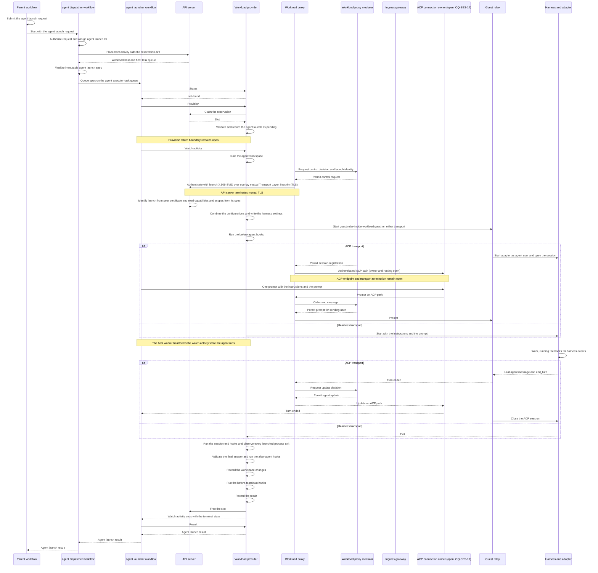

# Agent launch

[Public key infrastructure](pki.md).

An agent launch is one instantiation of an agent in an agent sandbox on a workload host. At most one runs per agent. Retry, resume, migration, and crash recovery create a new agent launch linked to its predecessor, while the durable [agent](agent.md) and its session transcript persist.

The [agent dispatcher workflow](components.md#Agent%20dispatcher) starts by default as a child of the caller's workflow. It authorizes an agent launch request and picks a host task queue. After finalizing the immutable agent launch spec, it queues the agent launch. The [agent launcher workflow](components.md#Agent%20launcher) takes that spec and obtains an agent sandbox through the specified workload provider. After starting the agent harness, it waits and tears down. It returns the result through the dispatcher to the caller.

An agent launch has these contracts and supporting resources:

- [Agent launch model](agent-launch-model.md) defines the fields and identity of an agent launch with its provenance record and evidence.
- [Agent launch contract](agent-launch-contract.md) defines the agent launch spec, the agent launch result, and the provider operations.
- [Workload placement](workload-placement.md) defines the workload host registry and the reservation Application Programming Interface (API) that bind each agent launch to a workload host.
- [Agent launch sequence](agent-launch-sequence.md) follows each message of one agent launch, from the start of the agent dispatcher to the result.
- [Agent launch resource](agent-launch-resource.md) gives the resource form of an agent launch, with a full example.
- [Agent workspace](agent-workspace.md) defines the workspace sources and the environment variables the agent sees.
- [Agent workspace image](agent-workspace-image.md) defines prebuilt workspace trees, their image builds and storage, and layer reuse on workload hosts.
- [Agent hooks](agent-hooks.md) defines the hooks that run before, during, and after the agent's work.
- [Agent observability](agent-observability.md) defines the trace, spans, and metrics of each agent launch.
- [Agent profile](agent-profile.md) and [Workload sandbox](workload-sandbox.md) define what bounds and confines each agent launch.
- [Agent MCP gateway](agent-mcp-gateway.md) defines one Model Context Protocol (MCP) endpoint, server and tool access, approvals, and upstream credentials.

[States and transitions](agent-workspace-lifecycle.md#States%20and%20transitions).

## Parts

- **parent workflow.** It submits an agent launch request and starts the agent dispatcher workflow as a child by default. Its default parent-close behavior requests cancellation of the child, which then cleans up.
- **Agent dispatcher workflow.** Any afakt worker can run it. It authorizes the agent launch request and picks a host task queue. It finalizes the agent launch spec before queueing the launch.
- **Agent launcher workflow.** The workload host worker runs it for one agent launch. It acquires an agent sandbox through the workload provider named by the spec, starts the agent harness, waits, and tears down.
- **Workload host.** A bare metal machine, virtual machine, container manager, or remote platform that hosts agent sandboxes. Its workload host worker connects it to the control plane and runs the agent launcher workflow.
- **Workload provider.** The adapter that manages an agent sandbox's lifecycle on a workload host. Its contract verbs are provision, restore, and release. Status, cancel, and result observe or control the associated agent launch.
- **Agent harness.** The agent program inside the agent sandbox. Claude Code and Codex are examples.
- **Model provider.** The service that serves model requests. Agent harness and model provider vary independently, and the spec lists both.
- **Workload proxy mediator.** The host-side component for one agent launch that ends the guest link and resolves guest names. It enforces connection policy. It directs the workload proxy to inspect destinations that require Hypertext Transfer Protocol (HTTP) policy or credential injection and to send permitted passthrough traffic without decryption. See [Workload sandbox](workload-sandbox.md).

## Harness transport

The selected profile entry fixes the [harness transport](agent-profile.md#Harness%20transport). Agent Client Protocol (ACP) launches use the [ACP connection contract](agent-acp.md#Launch%20connection). Headless defaults and integration remain [`OQ-SES-16`](agent-open-questions.md#%60OQ-SES-16%60).

[ACP launch connections and permission handling](agent-acp.md#Launch%20connection).

For a workflow-controlled ACP launch, a turn completes on its own when it ends with a stop reason other than `cancelled`. The success path starts with `end_turn`, with final-answer validation and applicable `after-agent` hooks determining the result. Headless startup, final-answer delivery, exit mapping, hooks, and evidence integration remain [`OQ-SES-16`](agent-open-questions.md#%60OQ-SES-16%60).

| ACP stop reason | Agent launch path | Result reason |
| --- | --- | --- |
| `end_turn` | The success path, with output validation and `after-agent` hooks. | `agent-exit`, unless validation or a hook fails. |
| `cancelled` | The cancellation path, ending `canceled` after the workload provider observes that every process it started for the launch has exited. | `cancellation`, or `supersession` when a successor agent launch caused it. |
| `refusal` | The failure path, ending `failed`. | `agent-refusal` |
| `max_tokens` | The failure path, ending `failed`. | `resource-limit` |
| `max_turn_requests` | The failure path, ending `failed`. | `resource-limit` |

A provider stop caused by a time limit or resource limit keeps that cause and follows the limit path. An ACP turn's own `max_tokens` or `max_turn_requests` response is a failure, distinct from a limit that forces the provider to stop the agent. A turn ending never proves process termination.

## Launch flow

Each step follows the [agent launch lifecycle](workload-lifecycle.md#Agent%20launch%20lifecycle), including its failure paths.

[Agent launch states](workload-lifecycle.md#Agent%20launch%20states).

[Provider observations](workload-lifecycle.md#Workload%20provider%20observations). [Cancellation and limits](workload-lifecycle.md#Cancellation%20and%20limits).

## Reconciliation after restart or retry

The agent launcher's workflow ID comes from the agent launch ID. When an agent dispatcher starts a launcher that already runs, such as after the parent starts the agent dispatcher again for the same agent launch, it waits on the running launcher and never starts a second one.

Before provision, the agent launcher checks whether the agent launch exists. A first attempt follows these steps in order, and so do a retried activity and the same step after a worker restart:

1. Call status for the agent launch ID on the workload host that has the placement.
2. On `not-found`, provision.
3. On any state, adopt the existing agent launch and continue from that state without provisioning again. `pending`, `launch-unknown`, and `running` mean wait. A terminal state means fetch the result.
4. On `unavailable`, call status again after a delay. The agent launcher never reads `unavailable` as `not-found`, and it never provisions that agent launch on another workload host instead.

A retried provider activity reconciles the same agent launch ID. Retrying the agent itself creates a new agent launch linked to its predecessor. If provision repeats despite these steps, the [identity rules](agent-launch-model.md#Agent%20launch%20identity) still return the existing agent launch, and the workload provider doesn't start a second agent.

When the worker on a workload host restarts, the supervisor keeps its virtual machine monitors and workload proxy mediators running. The agents keep running inside their VMs. Agent launch records persist on the workload host across the restart. After it starts again, the worker loads those records and observes each agent launch's agent again before it answers status. Each agent launcher on the host then goes on from its workflow history, and its next status call follows the preceding steps.

The agent launch record gives the step each agent launch was in. The worker doesn't run an interrupted step again, and it acts by step:

- **Before the agent starts.** For an interrupted workspace build, agent sandbox and agent harness configuration, or `before-agent` hook, the provider waits until it observes that every process from that step has exited. The agent launch then ends `failed` with worker restart as its reason.
- **While the agent runs.** The provider observes the agent again, and the agent launch goes on from its recorded state.
- **After the agent completes.** An interrupted `stop-requested`, `session-end`, `after-agent`, or `before-teardown` hook counts as a failed run of that hook, under the [hook failure rules](agent-hooks.md#Hook%20failures). An interrupted output validation or result build starts again from its beginning, because neither step changes anything outside the agent launch record.

## Placement on workload hosts

Placement binds an agent launch to one workload host before launch, and all later operations for that agent launch go to that host. [Workload placement](workload-placement.md) defines the workload host registry, the reservation API, and the slot rules. The host worker's [capacity controller](workload-placement.md#Slot%20capacity) adjusts slot capacity within the host's configured bounds from observed central processing unit (CPU) use, memory use, and free workspace disk space, and reports it in each lease renewal. A capacity decrease preserves running agent launches and existing reservations and blocks new reservations until a slot is free.

- The agent launcher workflow runs on the placed host's task queue, and so do its activities: provision, restore, release, status, cancel, result, and the watch activity. Cleanup also runs as an activity there.
- While an agent runs, the host worker heartbeats a watch activity. A missed heartbeat shows that the workflow orchestrator lost contact with the host's worker, not that the agent stopped. Once the worker answers again, the agent launcher workflow calls status on the same host task queue.
- While the workload host doesn't answer, the agent dispatcher workflow waits on the agent launcher workflow and never starts a launcher for the same agent launch on another workload host.
