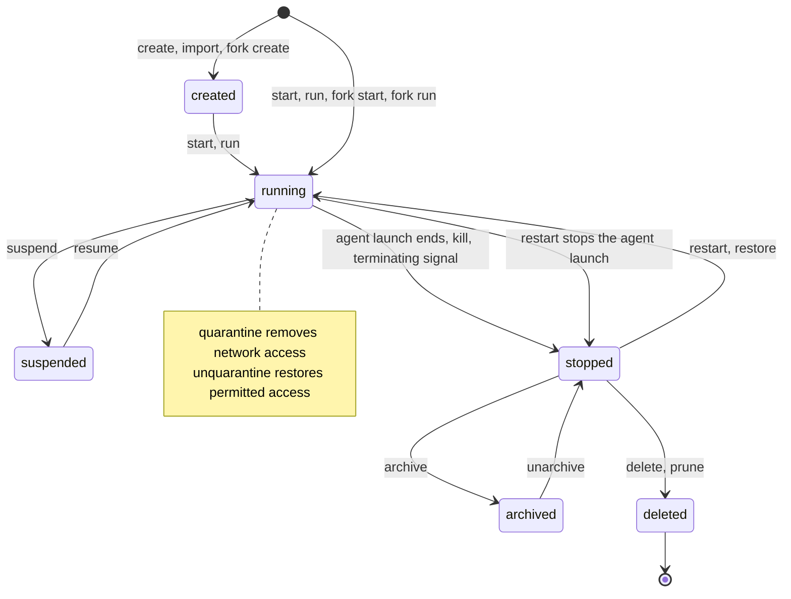

# Agent lifecycle

[Public key infrastructure](pki.md).

An agent retains its identity, configuration, and history across [agent launches](agent-launch.md) and [sessions](agent-session.md). At most one agent launch runs for an agent at a time. Retry, resume, migration, and crash recovery create a new agent launch linked to its predecessor. A session transcript remains after an agent launch ends.

## Agent states

| State | Meaning |
| --- | --- |
| `created` | The agent exists, and its agent harness hasn't started. |
| `running` | An agent launch is active. It may be working, idle, or waiting for input. |
| `suspended` | The agent preserves state for resume after a suspend request. |
| `stopped` | The agent launch ended. The agent and its retained resources remain. |
| `archived` | A workload snapshot preserves a stopped agent in archive storage where the agent runs in a virtual machine (VM). |
| `deleted` | Permanent deletion removed the agent resource. |

Quarantine is a network condition on a running agent. It removes network access without becoming a lifecycle state. Unquarantine restores connectivity within the agent's network rules.

The agent state transitions require successful completion. A signal or request alone doesn't prove the harness stopped. Before afakt treats an agent launch as ended, the provider [observes that every process it started for the launch has exited](workload-lifecycle.md#Agent%20launch%20states). Launch failures leave an agent without an active agent launch. Mapping intermediate provider states to agent status remains an open question.

## Create, start, and run

`afakt agent create` creates an agent without starting its agent harness. With `afakt agent start`, creation includes starting the harness. Starting a created agent begins its first agent launch. The profile binding supplies the behavior and authority bounds, and launch validates the agent launch's pinned profile and restrictions.

`afakt agent run` starts an agent and waits for its session to end before outputting the final message. It composes start, wait, and final-message retrieval. To wait alone, use `afakt agent wait`. The `afakt agent result` command reads the final message. Session-end wait and Secure Production Identity Framework for Everyone (SPIFFE) Verifiable Identity Document (SVID) lifetime remain [on hold](agent-open-questions.md#%60OQ-HOOK-18%60).

Workload identities use the provisional lifetimes and half-life renewal in [Certificate policies](pki.md#Certificate%20policies), subject to [`OQ-HOOK-18`](agent-open-questions.md#%60OQ-HOOK-18%60).

[Agent launch lifecycle](workload-lifecycle.md#Agent%20launch%20lifecycle). [Agent launch states](workload-lifecycle.md#Agent%20launch%20states).

## Agent launches and supersession

At most one agent launch runs for an agent at a time. Each replacement gets its own ID and predecessor link, while its immutable spec records the generation of the agent spec used at finalization.

A change to the agent spec creates a new generation. At a turn boundary, that change ends the active agent launch and starts a new one. Work in flight and session continuation remain [open](agent-open-questions.md#%60OQ-AGT-27%60).

A successor waits until its predecessor is terminal before running. The provider builds its agent workspace only after a predecessor used as a workspace source becomes terminal. Whether to accept and cancel an active predecessor or reject a competing request remains [open](agent-open-questions.md#%60OQ-EXE-3%60). Admission rules for ordering competing requests and granting supersession authority also remain [open](agent-open-questions.md#%60OQ-EXE-8%60).

## Launch sequence

The agent launch belongs to a durable [agent](agent.md), which retains its conversation after the launch ends. After the agent launcher completes its [lifecycle](workload-lifecycle.md#Agent%20launch%20lifecycle), the caller receives a successful launch's result through the agent dispatcher workflow. See the [complete launch sequence](agent-launch-sequence.md#Agent%20launch%20sequence) for the messages between components.

## Session lifecycle

The agent session lifecycle controls an interactive conversation and its active transport. Closing a transport or ending an agent launch leaves the retained transcript with its agent. How these control states map to [agent states](agent-lifecycle.md#Agent%20states) and agent launch boundaries remains [open](agent-open-questions.md#Agents).

1. **Creation.** When a client creates a session for an agent through the ingress gateway and API server with a profile, workspace sources, and an optional first prompt, the API server starts the agent session workflow with the new session ID.
2. **Placement.** The agent dispatcher workflow places the session on a workload host, as for an agent launch.
3. **Start.** The provider builds the agent workspace and starts the guest relay before the `before-agent` hooks. Their CLI control requests use the workload proxy mediator. After the hooks, the adapter starts in the agent sandbox and the relay sends `initialize` and `session/new`. Startup ownership remains [`OQ-SES-15`](agent-open-questions.md#%60OQ-SES-15%60). Session registration uses the workload proxy under mediator decisions. Its [endpoint owner and connection path](agent-open-questions.md#%60OQ-SES-17%60) remain open.
4. **Turns.** The agent receives prompts under the [ACP turn rules](agent-acp.md#Turns).
5. **Suspend.** After the idle timeout, the agent session workflow suspends the session. For a VM provider that supports paired capture, afakt takes a workload snapshot and an agent checkpoint together at an idle turn boundary, with the guest filesystem frozen. The supervisor captures VM state, and the agent harness captures its session state. After the `before-teardown` hooks, it stops the VM and frees the slot.
6. **Resume.** A prompt or an attach request for a suspended session resumes it. For a VM provider that supports paired capture, the supervisor restores the workload snapshot under the same guest paths, and the harness restores session state from the agent checkpoint. afakt reacquires credentials outside the guest. The guest relay reconnects through the proxy under mediator decisions. A restarted adapter receives `session/resume`. Which process and transport state survives restoration remains [open](agent-open-questions.md#Agents). Restoration in host modes and container managers remains [open](agent-open-questions.md#%60OQ-AGT-28%60).
7. **Close.** A close request, the session's lifetime limit, or a failure ends the session. The provider runs `session-end` hooks, records workspace changes, then runs `before-teardown` hooks and publishes the transcript as evidence, following [Hook events](agent-hooks.md#Hook%20events).

## Session states

Agent session states control the conversation, separate from the durable agent lifecycle and the states of an agent launch.

| State | Meaning |
| --- | --- |
| `starting` | The provider is building the agent workspace or starting the relay. |
| `running` | The agent is working on a turn. |
| `requires-action` | The agent waits on a permission or elicitation answer from the writer. |
| `idle` | The agent has no turn in progress and waits for a prompt. |
| `suspended` | For a VM, state persists in a workload snapshot and an agent checkpoint after the VM stops. |
| `closed` | The session ended on a close request or at its lifetime limit. |
| `failed` | The session ended on a failure. |

## Session limits

- The idle timeout bounds how long an idle session holds a slot before it suspends.
- The lifetime limit bounds a session from creation to close across every suspend and resume.

## Suspend, resume, and restart

A virtual machine alone doesn't establish capture or restore support. Eligibility and captured state remain [`OQ-AGT-1`](agent-open-questions.md#%60OQ-AGT-1%60) and [`OQ-AGT-3`](agent-open-questions.md#%60OQ-AGT-3%60).

For a VM provider that supports paired capture, `suspend` takes a workload snapshot and an agent checkpoint together at an idle turn boundary, then stops the VM through the workload host's supervisor and virtual machine monitors. Resume restores VM state from the workload snapshot and harness session state from the agent checkpoint under the same guest paths, reacquiring credentials outside the guest. The [suspend and resume](workload-lifecycle.md#Suspend%20and%20resume) contract keeps the agent workspace consistent with the harness's session state. Exactly which process and transport state returns remains open. Restoration in host modes and container managers remains [open](agent-open-questions.md#%60OQ-AGT-28%60).

`restart` restarts the agent's workspace and harness. Before the replacement agent launch starts, the predecessor agent launch ends. Identity and history remain with the agent. How restart selects the workspace revision and session to continue remains open.

[Suspend and resume](workload-lifecycle.md#Suspend%20and%20resume).

## Checkpoint capture

[Workspace disk deltas and portable revisions](agent-workspace-lifecycle.md#Workspace%20disk%20deltas%20and%20portable%20revisions).

## Archive and restore

The snapshot registry stores and serves workload snapshots. `archive` takes a workload snapshot of a stopped agent and moves it to archive storage. Returning the archived agent to stopped state on `unarchive` is the leading option. Exceptions for automatic start remain [open](agent-open-questions.md#Agents). `restore` starts an agent from a workload snapshot. Snapshot contents, credential exclusions, identity handling, and retention rules remain open beyond the [suspend and resume](workload-lifecycle.md#Suspend%20and%20resume) requirements.

An [workload snapshot](agent.md#Workload%20snapshots%20and%20the%20snapshot%20registry) captures VM state. An [agent checkpoint](agent.md#Agent%20checkpoints) captures harness session state. Snapshot commands and checkpoint operations keep these captures distinct.

[Virtual machine lifecycle](workload-lifecycle.md#Virtual%20machine%20lifecycle).

## Kill, signal, and quarantine

Through the supervisor and virtual machine monitors (VMMs), the agent `kill` operation stops the VM independently of the guest and Agent Client Protocol (ACP) policy. `signal` sends a process signal, whose effect depends on the signal and agent harness. The agent remains after either operation. Quarantine removes network access from a running agent, and `unquarantine` restores permitted connectivity. How quarantine affects broker, relay, and telemetry traffic remains open.

## Hooks through the lifecycle

Hooks follow the [event catalog](agent-hooks.md#Hook%20events), [budgets](agent-hooks.md#Running%20hooks), and [failure rules](agent-hooks.md#Hook%20failures). Hook protection, the scope of repository project configuration, and session-end wait remain under the [held questions](agent-open-questions.md#Agent%20hooks).

## Delete and prune

The agent `delete` operation permanently removes a stopped agent and can't be undone. `prune` permanently removes unused agents. Agent launch evidence still follows its [retention and cleanup rules](agent-launch-model.md#Evidence,%20retention,%20and%20cleanup). How deletion and pruning treat held evidence and shared resources remains open.
