# Agent threat model

Workload identity uses the provisional lifetimes and half-life renewal in [Certificate policies](pki.md#Certificate%20policies), subject to [`OQ-HOOK-18`](agent-open-questions.md#%60OQ-HOOK-18%60).

## Scope

The threat model covers agent launches, the shared services handling their traffic, identity, credentials, sessions, and workspace images, including the Model Context Protocol (MCP) gateway, because each can change an agent launch's authority or expose its data. STRIDE names six threat categories: spoofing, tampering, repudiation, information disclosure, denial of service, and elevation of privilege. Provider isolation, local transport, workspace storage, and capture mechanisms have separate threat models below.

The Application Programming Interface (API), command-line interface (CLI), Agent Client Protocol (ACP), Hypertext Transfer Protocol (HTTP), Transport Layer Security (TLS), Domain Name System (DNS), and SPIFFE Verifiable Identity Document (SVID) names apply throughout. SPIFFE means Secure Production Identity Framework for Everyone. Open Container Initiative (OCI) images contain workspace content. Transmission Control Protocol (TCP) carries connection streams. Standard input and output are the stdio transport for local MCP servers.

- Model quality and task correctness stay outside scope because confinement and authorization can't establish whether an allowed answer is correct.
- External services' internal operation stays outside scope because afakt controls their connection and credential use, not how they operate. Malicious responses remain attacker inputs.
- Independent business workflows, agentmail delivery, memory search, and artifact presentation stay outside scope because they have separate contracts. Their API authority and content entering agent execution remain in scope.
- Physical access and hardware failure stay outside scope because no physical protection contract applies to them. Compromised agent hosts and gateways remain explicit attacker positions.
- Deployment-specific identity and storage implementations remain unresolved because their selection and mechanisms remain open. Their required trust relationships remain in scope.

In-tree providers include [macOS VM](agent-sandbox-macos-vm.md), [Linux VM](agent-sandbox-linux-vm.md), [Windows VM](agent-sandbox-windows-vm.md), [macOS host](agent-sandbox-macos-host.md), [Linux host](agent-sandbox-linux-host.md), [Windows host](agent-sandbox-windows-host.md), [Docker Engine](agent-sandbox-docker-engine.md), [Docker Desktop on macOS](agent-sandbox-docker-desktop-macos.md), [Docker Desktop on Windows](agent-sandbox-docker-desktop-windows.md), [Podman](agent-sandbox-podman.md).

## Assets

| Asset                                                    | Holding component                                                                                      | Definition                                                                                                                                 |
| -------------------------------------------------------- | ------------------------------------------------------------------------------------------------------ | ------------------------------------------------------------------------------------------------------------------------------------------ |
| Brokered credentials and central refresh material        | Credential broker, credential store, and Model Context Protocol gateway                                | [Credential types and custody](agent-sandbox.md#Credential%20types%20and%20custody)                                                        |
| Workload identities, private keys, and signing authority | Host-side identity consumers, Workload API endpoint, and issuer whose ownership remains open           | [Workload identity](agent-host.md#Workload%20identity)                                                                                     |
| Agent workspace contents and source fetch credentials    | Workspace registry and agent host worker                                                               | [Workspace sources](agent-workspace.md#Workspace%20sources)                                                                                |
| Session messages and message signing keys                | Agent hub and API server                                                                               | [Message signatures](agent-session-attachment.md#Message%20signatures)                                                                     |
| Workspace images and publication tokens                  | Image registry, object store, image builder, and worker caches                                         | [Registry authentication](agent-workspace-image.md#Registry%20authentication)                                                              |
| Decision log and audit records                           | Agent mediator, agent egress gateway, credential broker, and MCP gateway. Storage custody remains open | [Network policy](agent-mediator.md#Network%20policy) and [Audit and telemetry](agent-mcp-gateway.md#Audit%20and%20telemetry)                |
| afakt API authority and immutable agent launch specs     | API server and agent dispatcher workflow                                                               | [Agent launch authentication](agent-proxy.md#Agent%20launch%20authentication)                                                            |
| Shared lifecycle authority and host capacity             | Agent host worker and reservation API                                                                  | [Virtual machine lifecycle](agent-sandbox-lifecycle.md#Virtual%20machine%20lifecycle) and [Slot reservations](agent-placement.md#Slot%20reservations) |
| Port publication routes and viewer grants                | Ingress gateway, preview server, mediator, and provider endpoint                                       | [Port discovery and records](agent-ports.md#Port%20discovery%20and%20records)                                                              |
| Profile content, hooks, and retained provenance          | Profile source and agent launch record                                                                 | [Pinning a profile version](agent-profile.md#Pinning%20a%20profile%20version)                                                              |

## Adversaries

| Attacker position | Starting access | Trust assumption |
| --- | --- | --- |
| Prompt-injected or malicious agent harness inside its agent sandbox | Agent user's processes, permitted tools, agent workspace access, and mediated requests | untrusted code under [Enforcement](agent-sandbox.md#Enforcement). |
| Hostile repository content and hooks | Source files, project settings, hook commands, or repository profiles that a caller selects | Hooks run in the agent sandbox and aren't a security boundary. See [Running hooks](agent-hooks.md#Running%20hooks). |
| Compromised upstream service or MCP server | Responses to allowed requests and any credentials legitimately delivered to that service | Tool access doesn't establish response trust. [Result filtering](agent-open-questions.md#%60OQ-MCP-3%60) remains open. |
| Another agent launch on the same agent host | Its own sandbox, permitted listeners, and any shared named tool caches | Independent workspace copies and mediated connections bound ordinary access only where the provider enforces them. [Host isolation](agent-open-questions.md#%60OQ-SBX-18%60) remains on hold. |
| Agent launch on another agent host | Its own workload-mediated connection and permitted destination names | Both ends require authorization under [Connections between agents](agent-ports.md#Connections%20between%20agents). |
| Network attacker between components | Ability to observe, delay, drop, replay, or alter network packets | Workload mutual TLS authenticates host connections under [Workload identity](agent-host.md#Workload%20identity). Other transport details remain open where identified below. |
| Authenticated user with limited roles | Valid sign-in and grants for some agents, sessions, profiles, or credentials | Authentication doesn't imply every target grant. See [Owned resources](agent.md#Owned%20resources). |
| Compromised agent host | Supervisor control, mediator state, workspace disks, and locally held credentials | Host control, enforcement, and custody require trust under [Trust boundary](agent-host.md#Trust%20boundary). |
| Compromised site gateway | Inspected traffic, gateway identity, certificate authority custody, and credentials available to its broker arrangement | The design gives it the host's policy trust under [Agent egress gateway](components.md#Agent%20egress%20gateway). |
| Compromised central MCP server | Its shared server process and concurrent request data | A sandbox and request scoping apply. The permitted sharing boundary remains [open](agent-open-questions.md#%60OQ-MCP-1%60). |
| Compromised storage or identity service | Retained blobs, log records, signing state, or registration authority within that service | Image digest checks don't establish log integrity or issuer recovery. [Storage access](agent-open-questions.md#%60OQ-IMG-13%60) and [issuer bootstrap](agent-open-questions.md#%60OQ-SBX-32%60) remain open. |

A compromised agent host or site gateway starts beyond the trust the design places in that component. Mutual TLS proves possession of its identity, not honest enforcement. Agent-side checks can't restore that trust. Hooks don't enforce host custody, and model behavior doesn't enforce it either.

## Trust boundaries

A trust boundary separates principals with different authority. Service authorization assumes a correctly bound provider endpoint. It doesn't prove local isolation.

| Boundary ID | Boundary | Two sides | Enforcement in the design |
| --- | --- | --- | --- |
| `TB-3` | Agent host and control plane | Worker and agent proxy / workflow and API services | [Workload identity](agent-host.md#Workload%20identity). Receiving services authenticate workload TLS over the overlay. See [Hub connection](agent-proxy.md#Hub%20connection). |
| `TB-4` | Client and control plane | User clients / ingress and app services | [Writer and readers](agent-acp.md#Writer%20and%20readers) and [Access and share links](agent-previews.md#Access%20and%20share%20links). |
| `TB-5` | Agent host and site gateway | Agent proxy / standalone gateway | [Egress gateway routing](agent-mediator.md#Egress%20gateway%20routing). Mutual TLS authenticates each side. Broker placement remains [`OQ-SBX-23`](agent-open-questions.md#%60OQ-SBX-23%60). |
| `TB-6` | Execution services and external services | Fetchers, resolver, gateways, and tunnel connector / upstream services | [Network policy](agent-mediator.md#Network%20policy) and [Public tunnel providers](agent-previews.md#Public%20tunnel%20providers). |
| `TB-7` | Source and destination agent authority | Source mediator / destination mediator | [Connections between agents](agent-ports.md#Connections%20between%20agents). Both ends require authorization. Endpoint binding remains [`OQ-SBX-13`](agent-open-questions.md#%60OQ-SBX-13%60). |
| `TB-8` | Execution services and retained storage | Workers and control plane / registries, object store, and logs | [Registry authentication](agent-workspace-image.md#Registry%20authentication). Direct object and audit access remain unresolved. |
| `TB-9` | MCP gateway and central server sandbox | Gateway authority / shared server process | [Server hosting and lifecycle](agent-mcp-gateway.md#Server%20hosting%20and%20lifecycle). Shared-process isolation remains [`OQ-MCP-1`](agent-open-questions.md#%60OQ-MCP-1%60). |
| `TB-10` | Remote sandbox and global egress gateway | Remote platform / global gateway | [Agent mediator](agent-mediator.md#Launch%20boundary). Remote traffic binding remains [`OQ-SBX-36`](agent-open-questions.md#%60OQ-SBX-36%60). |
| `TB-11` | Workload identity consumer and signing authority | Host-side callers / Workload API and issuer | [Workload identity](agent-host.md#Workload%20identity). Attestation and bootstrap remain [`OQ-SBX-30`](agent-open-questions.md#%60OQ-SBX-30%60) and [`OQ-SBX-32`](agent-open-questions.md#%60OQ-SBX-32%60). |
| `TB-12` | Agent requests and service authority | untrusted launch input / mediator policy and identity | [Control requests](agent-mediator.md#Control%20requests). This is the request authorization boundary. Provider-specific channels establish which launch sent the input. |
| `TB-13` | Mediator policy and network authority | Agent mediator and agent proxy for one launch | Local channel and framing ownership remain undecided. See [Agent hub](agent-hub.md). |
| `TB-14` | Overlay transport and service authority | Overlay nodes / receiving services | Coarse reachability never grants app access. See [Agent hub](agent-hub.md). |
| `TB-15` | Host caller and host authority | Host client / host-level connectivity | Name resolution never grants access. The mechanism is undecided. See [Agent hub](agent-hub.md). |
| `TB-16` | User tailnet and cluster overlay | User device / external ingress gateway | The gateway proxies apps without routing packets between networks. See [Agent hub](agent-hub.md). |

## Data flow diagrams

A data flow diagram shows processes, stores, external entities, and their exchanges. The element inventory defines each identifier once. Diagrams reference those elements, and each flow has one definition below its diagram. Arrows show initiation. Responses return on the same path. Boundary labels identify the side of each crossing.

### Element inventory

| Element ID | Element | Location or custody |
| --- | --- | --- |
| `E-1` | Authenticated user or automation | Client |
| `E-2` | Repository and profile source | External service |
| `E-3` | Upstream service | External service |
| `E-4` | Upstream name service | External service |
| `E-5` | Remote agent sandbox | Remote platform |
| `E-6` | Remote MCP server | External service |
| `E-7` | Operator credential client | Client |
| `E-8` | Agent launch endpoint | Provider-specific confinement and local transport |
| `E-10` | Workspace MCP server endpoint | Provider-specific confinement |
| `E-11` | Public tunnel service | External service |
| `P-1` | Agent execution system | Context grouping |
| `P-2` | API server | Control plane |
| `P-3` | Agent dispatcher workflow and workflow orchestrator | Control plane |
| `P-4` | Agent host worker and agent launcher workflow | Agent host |
| `P-5` | Workspace preparation service | Agent host worker |
| `P-8` | Agent mediator and agent DNS | Agent host |
| `P-9` | Agent egress gateway | Agent host |
| `P-10` | Site gateway | Standalone gateway |
| `P-11` | Global egress gateway | Control plane |
| `P-12` | Ingress gateway | Control plane |
| `P-13` | Agent hub | Control plane |
| `P-14` | Preview server | Control plane |
| `P-17` | Destination agent mediator | Destination agent host |
| `P-19` | Credential broker | Outside agent sandbox. Placement unresolved |
| `P-20` | Workload API endpoint | Agent host |
| `P-21` | Workload identity issuer | Placement unresolved |
| `P-22` | Credential store and exchange service | Control plane |
| `P-23` | Workspace image builder | Control plane |
| `P-24` | Workspace and image registry | Storage service |
| `P-26` | Model Context Protocol gateway | Control plane |
| `P-27` | Built-in afakt MCP server | Control plane |
| `P-28` | Central stdio MCP server | Control plane sandbox |
| `P-30` | Telemetry endpoint | Agent host |
| `P-31` | Port forwarder | Agent mediator and provider-specific listener path |
| `P-32` | Public tunnel connector | API server process |
| `P-33` | Agent proxy | Outside the guest. Launch identity custody |
| `P-34` | Destination agent proxy | Destination launch identity custody |
| `P-35` | Host-level network service | Host connectivity role. Mechanism undecided |
| `P-36` | Cluster overlay | Isolated cluster transport |
| `P-37` | Coordination interface | Control plane registration authority |
| `P-38` | Coordination server | Isolated Headscale |
| `P-39` | Overlay relay node | Encrypted overlay transport |
| `E-12` | User tailnet | External network boundary |
| `E-13` | Host client | Host-level caller authority |
| `DS-1` | Agent launch records and pinned configuration | Agent host and API server |
| `DS-2` | Prepared image content | Worker staging and verified layer caches |
| `DS-3` | Session message log | Agent hub |
| `DS-4` | Credential material | Credential store and broker memory by type |
| `DS-5` | Signing authority and trust material | Issuer. Custody unresolved |
| `DS-6` | Decision log and audit records | Storage unresolved |
| `DS-8` | Object store content | Storage service |
| `DS-11` | Telemetry collector | Deployment collector |

### Level zero context

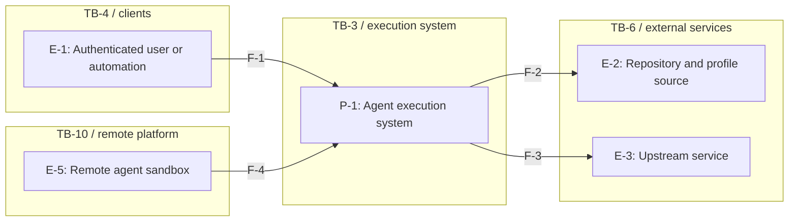

- **`F-1`.** Agent launch requests, session input, previews, and results. Crosses `TB-4`.
- **`F-2`.** Pinned source and profile content. Crosses `TB-6`.
- **`F-3`.** Permitted requests, responses, and brokered headers. Crosses `TB-6`.
- **`F-4`.** Remote egress and unresolved control attachment. Crosses `TB-10`.

### Agent launch start and teardown

Agent host workers receive lifecycle work through task queues. Each provider controls process startup, workspace capture, and termination under its own isolation boundary.

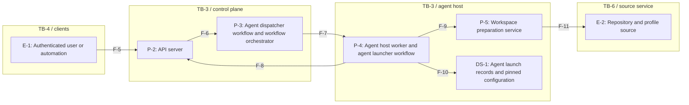

- **`F-5`.** Caller context, requested target, and profile. Crosses `TB-4`.
- **`F-6`.** Authorized request and immutable launch spec. No separate boundary.
- **`F-7`.** Tasks, status, cancellation, result, and cleanup over worker polling. Crosses `TB-3`.
- **`F-8`.** Registration leases, capacity, reservations, and slot release. Crosses `TB-3`.
- **`F-9`.** Source preparation and observations. No separate boundary.
- **`F-10`.** Pinned state, provenance, and result. No separate boundary.
- **`F-11`.** Pinned repositories and profiles with separate fetch credentials. Crosses `TB-6`.

### Agent mediator egress and telemetry

Agent mediator admission starts after the provider delivers traffic. Local and site gateways are alternatives for inspected destinations. passthrough remains subject to connection policy. Credential injection follows the custody paths below.

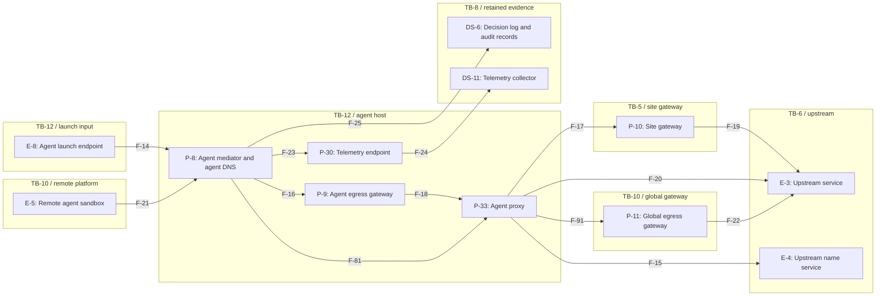

- **`F-14`.** untrusted name queries, destinations, and app bytes after provider transport. Crosses `TB-12`.
- **`F-15`.** Upstream name queries and answers. Crosses `TB-6`.
- **`F-16`.** Inspected connections requiring credential injection or HTTP policy. No separate boundary.
- **`F-17`.** Launch identity over mutual TLS and inspected traffic. Crosses `TB-5`.
- **`F-18`.** Locally inspected requests and responses. Crosses `TB-6`.
- **`F-19`.** Site-inspected requests and responses. Crosses `TB-6`.
- **`F-20`.** Permitted passthrough streams without decryption. Crosses `TB-6`.
- **`F-21`.** Remote egress through its per-launch mediator and agent proxy. Crosses `TB-10`.
- **`F-91`.** Policy-permitted remote traffic to the global gateway through the agent proxy. Crosses `TB-10`.
- **`F-22`.** Permitted global egress requests and responses. Crosses `TB-6`.
- **`F-23`.** Telemetry and attributed launch context. No separate boundary.
- **`F-24`.** Filtered telemetry with permitted attributes. Crosses `TB-8`.
- **`F-25`.** Network, HTTP, ACP, and control decisions. Crosses `TB-8`.

### Session attachment and previews

The port forwarder connects authorized publication streams through the agent mediator and the provider-specific listener path. Public tunnel connectors run in the API server process. Cloudflare Tunnel and Tailscale Funnel publish ingress listeners while preserving afakt sign-in, origin separation, and target access checks. They never publish raw agent ports.

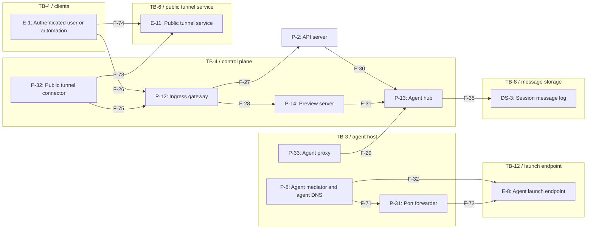

- **`F-26`.** Authenticated attachment, previews, and client tunnel requests. Crosses `TB-4`.
- **`F-27`.** Authenticated client context from ingress to the API server. Crosses `TB-4`.
- **`F-28`.** Authorized preview and client tunnel routing. No separate boundary.
- **`F-29`.** Agent proxy connection to the agent hub. Workload mutual TLS protects returning authorized streams. Crosses `TB-3`.
- **`F-30`.** Authenticated API request to the agent hub for remote control or session attachment. Crosses the service boundary.
- **`F-31`.** Preview server request to an authorized published port through the agent hub. Crosses the service boundary.
- **`F-32`.** Policy-checked session and control messages over provider transport. Crosses `TB-12`.
- **`F-35`.** Session messages and replay cursors. Crosses `TB-8`.
- **`F-71`.** Current publication and launch identity for each forwarding stream. No separate boundary.
- **`F-72`.** Authorized bytes to a provider-bound loopback listener. Crosses `TB-12`.
- **`F-73`.** Outbound tunnel connection, enrollment, public routing, and returning viewer requests. Crosses `TB-6`.
- **`F-74`.** Public preview requests to the tunnel service. Crosses `TB-4`.
- **`F-75`.** Tunnel-delivered requests to the selected ingress listener. No separate boundary.

### Connections between agents

The agent hub authenticates each launch's agent-proxy connection and joins authorized streams. Both mediators enforce the source policy and destination grant. Same-host traffic uses the overlay too. The worker stays outside the data path. Provider transport binds each mediator to its own guest listener. See [Launch-to-launch traffic](agent-hub.md#Launch-to-launch%20traffic).

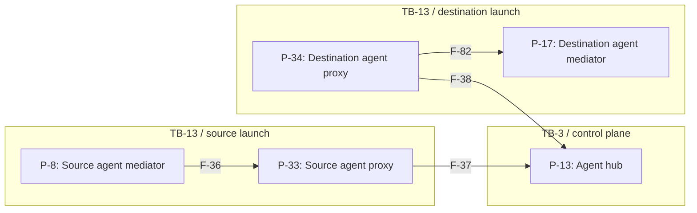

- **`F-36`.** Source mediator request and target grant to its agent proxy. Crosses `TB-13`.
- **`F-37`.** Source launch stream through its authenticated hub connection over the overlay. Crosses `TB-3`, `TB-7`.
- **`F-38`.** The destination agent proxy opens its hub connection over the overlay for returning granted streams. Crosses `TB-3`, `TB-7`.
- **`F-39`.** Not applicable: the worker has no same-host stream-joining role. Same-host launch traffic uses the overlay.
- **`F-40`.** Not applicable: there is no worker-to-mediator shortcut. Same-host launch traffic uses the overlay.

### Credential custody and exchange

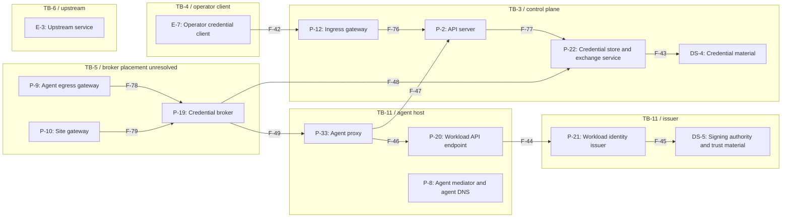

- **`F-42`.** Credential registration through authenticated ingress. Crosses `TB-4`.
- **`F-76`.** Operator credential registration. No separate boundary.
- **`F-77`.** Authorized registration and credential custody request. No separate boundary.
- **`F-43`.** Exchangeable secrets and refresh ownership. No separate boundary.
- **`F-44`.** Attestation, issuance, and rotation. Crosses `TB-11`.
- **`F-45`.** Signing authority and trust state. Crosses `TB-11`.
- **`F-46`.** Agent proxy request for the launch SVID and private key outside the guest. Crosses `TB-11`.
- **`F-47`.** Agent proxy request over mutual TLS on the overlay, ending at the API server. Crosses `TB-3`.
- **`F-48`.** Credential reference and short-lived or static credential by type. Exchange carrier unresolved. Crosses `TB-3`, `TB-5`.
- **`F-49`.** Credentialed request over TLS after identity and inject-domain checks. Crosses `TB-6`.
- **`F-78`.** Locally inspected request for credential injection. Process arrangement unresolved. No separate boundary.
- **`F-79`.** Site-inspected request for credential injection. Broker placement unresolved. Crosses `TB-5`.

### Workspace images and registries

Workspace image builds run their commands within the selected provider. Registry and object-store authorization apply to every provider. Local workspace layout, shared named tool caches, agent snapshots, and agent checkpoints use the provider-specific paths.

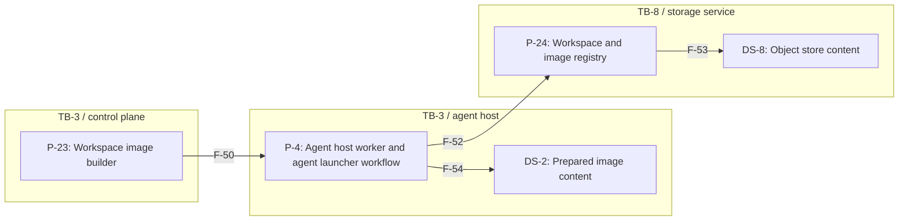

- **`F-50`.** Pinned build definition and task through the host queue. Crosses `TB-3`.
- **`F-52`.** Scoped registry tokens, manifests, layers, tags, and retention references. Crosses `TB-8`.
- **`F-53`.** Blob reads, writes, conditional updates, and collection. Crosses `TB-8`.
- **`F-54`.** Verified layer content and bounded extraction target. No separate boundary.

### MCP gateway calls

Model Context Protocol requests use the agent proxy over the overlay. Workspace server streams use the launch's hub connection after mediator policy checks. Replies travel on the same paths. Provider-specific relay access is separate from gateway allowlists and approvals.

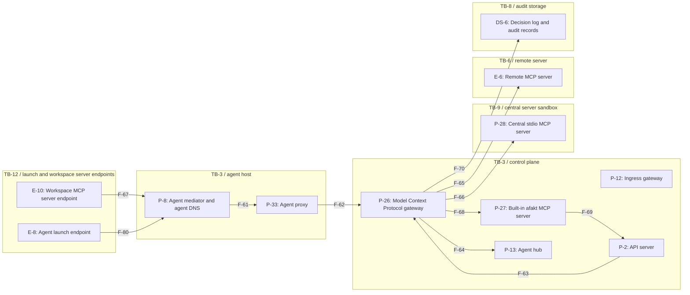

- **`F-61`.** Policy-checked MCP request with stamped launch identity from mediator to agent proxy. Crosses `TB-13`.
- **`F-62`.** Agent proxy connection to the MCP gateway over workload mutual TLS on the overlay. Crosses `TB-3`.
- **`F-63`.** Authenticated launch with stored capabilities and pinned profile. No separate boundary.
- **`F-64`.** Pending tool approval and writer or profile answer. No separate boundary.
- **`F-65`.** Allowed tool arguments, service credentials, and untrusted results. Crosses `TB-6`.
- **`F-66`.** Requests and responses scoped to launch and upstream authorization identity. Crosses `TB-9`.
- **`F-67`.** Workspace server streams over provider transport, then API routing to the gateway. Crosses `TB-12`.
- **`F-68`.** Allowed built-in tools under caller authority. No separate boundary.
- **`F-69`.** Capability and target-scope checks. No separate boundary.
- **`F-70`.** Call identity, approval, outcome, and timing without content. Crosses `TB-8`.
- **`F-80`.** Gateway calls through the provider control path. Crosses `TB-12`.

### Launch networking, host access, and overlay control

The agent mediator has no network of its own. The agent proxy stores its launch's identity and opens permitted connections. Host-level access has separate authority. Its local connection mechanism is undecided. A loopback reverse proxy is only an option in [host access](agent-open-questions.md#%60OQ-HST-9%60), not a selected element. Coordination and user tailnet attachments follow [Agent hub](agent-hub.md).

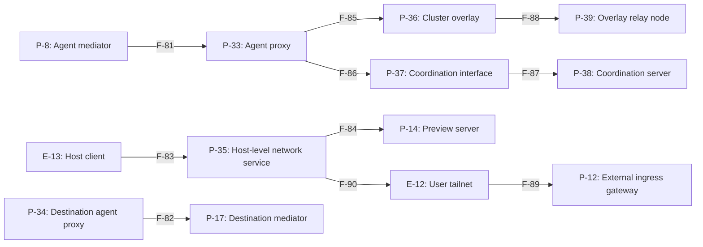

- **`F-81`.** Permitted launch request and returning stream across the mediator/agent-proxy boundary. Crosses `TB-13`.
- **`F-82`.** Destination source identity, publication, and grant context. Crosses `TB-13`.
- **`F-83`.** Host name query and access request. Host-level authorization is distinct from resolution. Crosses `TB-15`.
- **`F-84`.** Host-authorized published-port or preview request. Crosses `TB-3`, `TB-15`.
- **`F-85`.** Per-launch overlay membership and permitted service transport. Crosses `TB-14`.
- **`F-86`.** Node registration using the presented launch SVID and single-use tagged enrollment key. Crosses `TB-14`.
- **`F-87`.** Node registration, role tags, access rules, and deletion. Crosses the coordination authority boundary.
- **`F-88`.** Encrypted overlay transport through a relay node. Crosses `TB-14`.
- **`F-89`.** User app access through an attached tailnet. afakt authentication remains required. Crosses `TB-16`.
- **`F-90`.** Optional host-level attachment. Launch nodes never join user tailnets, and attachments never route packets into the cluster. Crosses `TB-16`.

## STRIDE analysis

STRIDE covers spoofing, tampering, repudiation, information disclosure, denial of service, and elevation of privilege. Each table covers the six categories for its flows and participating endpoints. The context flows inherit the detailed analysis. A mitigation addresses only its stated attack and assumes its dependencies hold. Gaps have no stated mitigation. Dependencies need an unresolved choice.

### Agent launch admission

| Threat ID | Element | STRIDE category | Threat | Mitigation in the design | Status |
| --- | --- | --- | --- | --- | --- |
| `TM-1` | `F-1`, `F-5`, `F-6`, `E-1`, `P-1`, `P-2`, `P-3` | spoofing | A caller substitutes another user or agent in a launch request. | The dispatcher authorizes requests. [Capabilities](agent-profile.md#Capabilities). User context binding remains open. | depends on an open question ([`OQ-SES-10`](agent-open-questions.md#%60OQ-SES-10%60)) |
| `TM-2` | `F-1`, `F-5`, `F-6`, `E-1`, `P-1`, `P-2`, `P-3` | tampering | A caller changes the frozen specification or widens its profile overrides. | [Launch validation](agent-profile.md#Launch%20validation) rejects invalid overrides. [Agent launch identity](agent-launch-model.md#Agent%20launch%20identity) rejects a changed specification under the same launch ID. | mitigated by the design |
| `TM-3` | `F-1`, `F-5`, `F-6`, `E-1`, `P-1`, `P-2`, `P-3` | repudiation | A caller denies having requested a launch or suppresses admission evidence. | Mitigation unspecified. [Provenance record](agent-launch-model.md#Provenance%20record). | gap ([`OQ-OBS-10`](agent-open-questions.md#%60OQ-OBS-10%60)) |
| `TM-4` | `F-1`, `F-5`, `F-6`, `E-1`, `P-1`, `P-2`, `P-3` | information disclosure | A limited user requests another owner's launch data through an ambiguous ownership binding. | Reference ownership doesn't grant target access. [Owned resources](agent.md#Owned%20resources). The ownership representation remains open. | depends on an open question ([`OQ-AGT-10`](agent-open-questions.md#%60OQ-AGT-10%60)) |
| `TM-5` | `F-1`, `F-5`, `F-6`, `E-1`, `P-1`, `P-2`, `P-3` | denial of service | Concurrent or repeated launch requests hold capacity or produce competing successors. | [Slot reservations](agent-placement.md#Slot%20reservations) bounds slots. Successor admission remains open. | depends on an open question ([`OQ-EXE-8`](agent-open-questions.md#%60OQ-EXE-8%60)) |
| `TM-6` | `F-1`, `F-5`, `F-6`, `E-1`, `P-1`, `P-2`, `P-3` | elevation of privilege | A repository profile grants itself capabilities or credential destinations beyond its owner's intended authority. | [Agent change request](agent.md#Agent%20change%20request) requires review and an operator ceiling. Repository profile bounds remain on hold. | depends on an open question ([`OQ-PRF-5`](agent-open-questions.md#%60OQ-PRF-5%60)) |

### Task delivery to an agent host

| Threat ID | Element | STRIDE category | Threat | Mitigation in the design | Status |
| --- | --- | --- | --- | --- | --- |
| `TM-7` | `F-7`, `F-8`, `F-9`, `F-10`, `F-50`, `P-3`, `P-4`, `P-2`, `P-5`, `DS-1`, `P-23` | spoofing | An unauthorized worker claims a task queue or reports another host's capacity. | [Workload identity](agent-host.md#Workload%20identity) authenticates host connections. Task-queue authorization has no stated mechanism. | depends on an open question ([`OQ-EXE-11`](agent-open-questions.md#%60OQ-EXE-11%60)) |
| `TM-8` | `F-7`, `F-8`, `F-9`, `F-10`, `F-50`, `P-3`, `P-4`, `P-2`, `P-5`, `DS-1`, `P-23` | tampering | A peer changes or replays workflow tasks and history to alter a launch. | [Reconciliation after restart or retry](agent-launch.md#Reconciliation%20after%20restart%20or%20retry) prevents duplicate provision. Workflow history protection remains unspecified. | depends on an open question ([`OQ-EXE-11`](agent-open-questions.md#%60OQ-EXE-11%60)) |
| `TM-9` | `F-7`, `F-8`, `F-9`, `F-10`, `F-50`, `P-3`, `P-4`, `P-2`, `P-5`, `DS-1`, `P-23` | repudiation | A compromised worker supplies false lifecycle observations or changes their retained history. | Mitigation unspecified. [Agent launch record](agent-launch-model.md#Agent%20launch%20record). [^provider-observations]| gap ([`OQ-SBX-37`](agent-open-questions.md#%60OQ-SBX-37%60)) |
| `TM-10` | `F-7`, `F-8`, `F-9`, `F-10`, `F-50`, `P-3`, `P-4`, `P-2`, `P-5`, `DS-1`, `P-23` | information disclosure | An unauthorized worker reads task prompts, sources, or retained launch records. | [Agent launch sequence](agent-launch-sequence.md#Agent%20launch%20sequence) assigns host queues, without defining queue read grants. | depends on an open question ([`OQ-EXE-11`](agent-open-questions.md#%60OQ-EXE-11%60)) |
| `TM-11` | `F-7`, `F-8`, `F-9`, `F-10`, `F-50`, `P-3`, `P-4`, `P-2`, `P-5`, `DS-1`, `P-23` | denial of service | A lost host keeps slots or successor work waiting indefinitely. | [Placement on agent hosts](agent-launch.md#Placement%20on%20agent%20hosts) retains ownership during uncertainty. Permanent loss remains open. | depends on an open question ([`OQ-EXE-2`](agent-open-questions.md#%60OQ-EXE-2%60)) |
| `TM-12` | `F-7`, `F-8`, `F-9`, `F-10`, `F-50`, `P-3`, `P-4`, `P-2`, `P-5`, `DS-1`, `P-23` | elevation of privilege | A compromised agent host uses its trusted observations and credentials to affect other launches. | Mitigation unspecified. [Trust boundary](agent-host.md#Trust%20boundary). [^provider-observations]| gap ([`OQ-SBX-37`](agent-open-questions.md#%60OQ-SBX-37%60)) |

### Repository and profile input

| Threat ID | Element | STRIDE category | Threat | Mitigation in the design | Status |
| --- | --- | --- | --- | --- | --- |
| `TM-13` | `F-2`, `F-11`, `P-1`, `E-2`, `P-5` | spoofing | A source substitutes different content for a pinned repository commit or profile digest. | [Workspace sources](agent-workspace.md#Workspace%20sources) pins commits. [Pinning a profile version](agent-profile.md#Pinning%20a%20profile%20version) checks profile digests. | mitigated by the design |
| `TM-14` | `F-2`, `F-11`, `P-1`, `E-2`, `P-5` | tampering | Repository configuration changes provider settings or certificate trust at runtime. | [Workspace repository hooks](agent-hooks.md#Workspace%20repository%20hooks) preserves repository hooks. Project setting scope remains on hold. | depends on an open question ([`OQ-HOOK-17`](agent-open-questions.md#%60OQ-HOOK-17%60)) |
| `TM-15` | `F-2`, `F-11`, `P-1`, `E-2`, `P-5` | repudiation | A repository hook performs an action without a record of that run. | [Workspace repository hooks](agent-hooks.md#Workspace%20repository%20hooks) captures configuration only. It supplies no record of each hook run. | gap ([Workspace repository hooks](agent-hooks.md#Workspace%20repository%20hooks)) |
| `TM-16` | `F-2`, `F-11`, `P-1`, `E-2`, `P-5` | information disclosure | A checkout exposes its fetch credential to agent harness code. | [Workspace sources](agent-workspace.md#Workspace%20sources) keeps fetch credentials outside the sandbox. Image builds exclude them from stored repository configuration. [^provider-materialization]| mitigated by the design |
| `TM-17` | `F-2`, `F-11`, `P-1`, `E-2`, `P-5` | denial of service | An oversize source or slow fetch exhausts preparation capacity before the harness starts. | [Workspace sources](agent-workspace.md#Workspace%20sources) fails unsuccessful construction. Preparation resource bounds remain open. | depends on an open question ([`OQ-HST-2`](agent-open-questions.md#%60OQ-HST-2%60)) |
| `TM-18` | `F-2`, `F-11`, `P-1`, `E-2`, `P-5` | elevation of privilege | A malicious repository uses its profile to permit its own sensitive operations. | [Repository profile files](agent-profile.md#Repository%20profile%20files) pins the selected content but doesn't settle a deployment ceiling. | depends on an open question ([`OQ-PRF-5`](agent-open-questions.md#%60OQ-PRF-5%60)) |
| `TM-20` | `F-2`, `F-11`, `P-1`, `E-2`, `P-5` | tampering | Agent code changes provider-installed hook configuration or dispatch after startup validation. | [Hook dispatch](agent-hooks.md#Hook%20dispatch) checks initial entries. Protection after startup remains on hold. [^provider-startup]| depends on an open question ([`OQ-HOOK-16`](agent-open-questions.md#%60OQ-HOOK-16%60)) |

### Agent mediator request admission

Spoofing and tampering of the local transport belong to each provider. The service threats below start when traffic reaches the agent mediator.

| Threat ID | Element | STRIDE category | Threat | Mitigation in the design | Status |
| --- | --- | --- | --- | --- | --- |
| `TM-27` | `F-14`, `F-16`, `E-8`, `P-8`, `P-33`, `P-9` | repudiation | Permitted traffic proceeds while durable storage can't receive its authorization decision. | [Network policy](agent-mediator.md#Network%20policy) requires every decision to enter the log. Action admission during logging failure remains open. See [Agent hub](agent-hub.md). | depends on an open question ([`OQ-OBS-7`](agent-open-questions.md#%60OQ-OBS-7%60)) |
| `TM-28` | `F-14`, `F-16`, `E-8`, `P-8`, `P-33`, `P-9` | information disclosure | Traffic or parser state from one launch leaks through a shared mediator process. | [Per-launch services](agent-proxy.md#Launch%20boundary) requires separate mediators for launches. Process and user separation remain undecided, so the service count alone doesn't establish memory isolation. | depends on an open question ([`OQ-SBX-19`](agent-open-questions.md#%60OQ-SBX-19%60)) |
| `TM-29` | `F-14`, `F-16`, `E-8`, `P-8`, `P-33`, `P-9` | denial of service | Malformed packets or many streams starve mediator control work. | [Network policy](agent-mediator.md#Network%20policy) denies unauthorized traffic. Overload and control service bounds remain open. [^provider-mediation] See [Agent hub](agent-hub.md). | depends on an open question ([`OQ-SBX-14`](agent-open-questions.md#%60OQ-SBX-14%60)) |
| `TM-30` | `F-14`, `F-16`, `E-8`, `P-8`, `P-33`, `P-9` | elevation of privilege | Guest traffic exploits the mediator parser to gain host authority. | [Agent mediator](agent-mediator.md#Launch%20boundary) leaves mediator confinement and kernel separation unresolved. [^provider-mediation] See [Agent hub](agent-hub.md). | depends on an open question ([`OQ-SBX-12`](agent-open-questions.md#%60OQ-SBX-12%60)) |
| `TM-168` | `F-14`, `F-16`, `E-8`, `P-8`, `P-33`, `P-9` | tampering | A changed or revoked deployment policy leaves existing mediator flows under stale authority. | [Network policy](agent-mediator.md#Network%20policy) defines destination bounds. Revision installation and the treatment of admitted flows remain unresolved. See [Agent hub](agent-hub.md). | depends on an open question ([`OQ-SBX-25`](agent-open-questions.md#%60OQ-SBX-25%60)) |
| `TM-167` | `F-14`, `F-16`, `E-8`, `P-8`, `P-33`, `P-9` | spoofing | A substituted deployment policy presents itself as the policy authorized for a launch. | [Network policy](agent-mediator.md#Network%20policy) requires policy evaluation. Authentication of deployment policy revisions remains unresolved. See [Agent hub](agent-hub.md). | depends on an open question ([`OQ-SBX-25`](agent-open-questions.md#%60OQ-SBX-25%60)) |

### Agent name resolution

| Threat ID | Element | STRIDE category | Threat | Mitigation in the design | Status |
| --- | --- | --- | --- | --- | --- |
| `TM-31` | `F-15`, `P-8`, `P-33`, `E-4` | spoofing | A network attacker supplies false upstream name answers. | [Network policy](agent-mediator.md#Network%20policy) records name-to-address bindings and has no host resolver fallback. Upstream answer protection remains open. [^provider-mediation] See [Agent hub](agent-hub.md). | depends on an open question ([`OQ-SBX-21`](agent-open-questions.md#%60OQ-SBX-21%60)) |
| `TM-32` | `F-15`, `P-8`, `P-33`, `E-4` | tampering | A guest exploits stale or changing name bindings to redirect an admitted connection. | [Network policy](agent-mediator.md#Network%20policy) evaluates name, address, and port. Synthetic addressing and binding behavior remain open. [^provider-mediation] See [Agent hub](agent-hub.md). | depends on an open question ([`OQ-SBX-22`](agent-open-questions.md#%60OQ-SBX-22%60)) |
| `TM-33` | `F-15`, `P-8`, `P-33`, `E-4` | repudiation | A guest denies sending a name query that never became a connection decision. | Mitigation unspecified. [Agent DNS](agent-mediator.md#Agent%20DNS). [^provider-mediation] See [Agent hub](agent-hub.md). | gap ([`OQ-SBX-35`](agent-open-questions.md#%60OQ-SBX-35%60)) |
| `TM-34` | `F-15`, `P-8`, `P-33`, `E-4` | information disclosure | A guest encodes private data in query names sent to an attacker-controlled upstream. | Mitigation unspecified. [Agent DNS](agent-mediator.md#Agent%20DNS). [^provider-mediation] See [Agent hub](agent-hub.md). | gap ([`OQ-SBX-35`](agent-open-questions.md#%60OQ-SBX-35%60)) |
| `TM-35` | `F-15`, `P-8`, `P-33`, `E-4` | denial of service | A guest sends excessive name queries or forces expensive upstream resolution. | Mitigation unspecified. [Agent DNS](agent-mediator.md#Agent%20DNS). [^provider-mediation] See [Agent hub](agent-hub.md). | gap ([`OQ-SBX-35`](agent-open-questions.md#%60OQ-SBX-35%60)) |
| `TM-36` | `F-15`, `P-8`, `P-33`, `E-4` | elevation of privilege | A false destination binding redirects traffic toward a more privileged service. | [Network policy](agent-mediator.md#Network%20policy) requires connection policy after resolution. Upstream trust remains open. [^provider-mediation] See [Agent hub](agent-hub.md). | depends on an open question ([`OQ-SBX-21`](agent-open-questions.md#%60OQ-SBX-21%60)) |

### Inspected destinations and site gateway

| Threat ID | Element | STRIDE category | Threat | Mitigation in the design | Status |
| --- | --- | --- | --- | --- | --- |
| `TM-37` | `F-3`, `F-17`, `F-18`, `F-19`, `F-49`, `F-78`, `F-79`, `P-1`, `E-3`, `P-8`, `P-33`, `P-10`, `P-9`, `P-19` | spoofing | A network attacker impersonates the site gateway or injects a credential into an unauthenticated plaintext connection. | [Egress gateway routing](agent-mediator.md#Egress%20gateway%20routing) requires mutual TLS. [Credential brokering](agent-sandbox.md#Credential%20brokering) permits injection only on TLS requests. See [Agent hub](agent-hub.md). | mitigated by the design |
| `TM-38` | `F-3`, `F-17`, `F-18`, `F-19`, `F-49`, `F-78`, `F-79`, `P-1`, `E-3`, `P-8`, `P-33`, `P-10`, `P-9`, `P-19` | tampering | An attacker installs a stale or unauthorized deployment policy revision. | [Network policy](agent-mediator.md#Network%20policy) applies policy. Policy authentication, atomic installation, and revocation remain open. See [Agent hub](agent-hub.md). | depends on an open question ([`OQ-SBX-25`](agent-open-questions.md#%60OQ-SBX-25%60)) |
| `TM-39` | `F-3`, `F-17`, `F-18`, `F-19`, `F-49`, `F-78`, `F-79`, `P-1`, `E-3`, `P-8`, `P-33`, `P-10`, `P-9`, `P-19` | repudiation | An injected credential use lacks durable evidence after a logging failure. | [Credential brokering](agent-sandbox.md#Credential%20brokering) records each injected use. [Network policy](agent-mediator.md#Network%20policy) records decisions. Admission on log failure remains open. See [Agent hub](agent-hub.md). | depends on an open question ([`OQ-OBS-7`](agent-open-questions.md#%60OQ-OBS-7%60)) |
| `TM-40` | `F-3`, `F-17`, `F-18`, `F-19`, `F-49`, `F-78`, `F-79`, `P-1`, `E-3`, `P-8`, `P-33`, `P-10`, `P-9`, `P-19` | information disclosure | A permitted upstream reflects or transforms a brokered secret into its response. | [Credential brokering](agent-sandbox.md#Credential%20brokering) keeps the injected header outside the guest but doesn't define safe response content. See [Agent hub](agent-hub.md). | depends on an open question ([`OQ-SBX-26`](agent-open-questions.md#%60OQ-SBX-26%60)) |
| `TM-41` | `F-3`, `F-17`, `F-18`, `F-19`, `F-49`, `F-78`, `F-79`, `P-1`, `E-3`, `P-8`, `P-33`, `P-10`, `P-9`, `P-19` | denial of service | A streaming request monopolizes the mediator or egress service and delays control. | [Network policy](agent-mediator.md#Network%20policy) defines policy checks. Complete guarantees for streaming and resources remain unspecified. See [Agent hub](agent-hub.md). | depends on an open question ([`OQ-SBX-14`](agent-open-questions.md#%60OQ-SBX-14%60)) |
| `TM-42` | `F-3`, `F-17`, `F-18`, `F-19`, `F-49`, `F-78`, `F-79`, `P-1`, `E-3`, `P-8`, `P-33`, `P-10`, `P-9`, `P-19` | elevation of privilege | With a broad inject domain, a repository profile can use credentials against an unintended service. | [Launch validation](agent-profile.md#Launch%20validation) checks domain consistency. The owner's credential domain ceiling remains on hold. See [Agent hub](agent-hub.md). | depends on an open question ([`OQ-PRF-5`](agent-open-questions.md#%60OQ-PRF-5%60)) |

### Traffic to passthrough destinations

| Threat ID | Element | STRIDE category | Threat | Mitigation in the design | Status |
| --- | --- | --- | --- | --- | --- |
| `TM-43` | `F-20`, `P-8`, `P-33`, `E-3` | spoofing | A client presents an absent or misleading server name to misclassify its destination. | [Network policy](agent-mediator.md#Network%20policy) checks server name, address, and port. Opaque destination classification remains open. See [Agent hub](agent-hub.md). | depends on an open question ([`OQ-SBX-24`](agent-open-questions.md#%60OQ-SBX-24%60)) |
| `TM-44` | `F-20`, `P-8`, `P-33`, `E-3` | tampering | An encrypted protocol tunnels a prohibited request through a destination allowed only at connection level. | [Network policy](agent-mediator.md#Network%20policy) forbids passthrough for destinations requiring inspection. Visibility rules remain open. See [Agent hub](agent-hub.md). | depends on an open question ([`OQ-SBX-24`](agent-open-questions.md#%60OQ-SBX-24%60)) |
| `TM-45` | `F-20`, `P-8`, `P-33`, `E-3` | repudiation | A caller denies an action inside an allowed encrypted stream. | [Network policy](agent-mediator.md#Network%20policy) records connection decisions, excluding content. Durable admission remains open. See [Agent hub](agent-hub.md). | depends on an open question ([`OQ-OBS-7`](agent-open-questions.md#%60OQ-OBS-7%60)) |
| `TM-46` | `F-20`, `P-8`, `P-33`, `E-3` | information disclosure | A guest exports data through an allowed encrypted destination whose app behavior is opaque to inspection. | [Network policy](agent-mediator.md#Network%20policy) bounds destination access, while passthrough visibility and classification remain open. See [Agent hub](agent-hub.md). | depends on an open question ([`OQ-SBX-24`](agent-open-questions.md#%60OQ-SBX-24%60)) |
| `TM-47` | `F-20`, `P-8`, `P-33`, `E-3` | denial of service | Long-lived passthrough streams consume connection capacity and starve control. | [Agent mediator](agent-mediator.md#Launch%20boundary) mediates every stream. Overload bounds remain open. See [Agent hub](agent-hub.md). | depends on an open question ([`OQ-SBX-14`](agent-open-questions.md#%60OQ-SBX-14%60)) |
| `TM-48` | `F-20`, `P-8`, `P-33`, `E-3` | elevation of privilege | An agent keeps an admitted passthrough connection after quarantine or policy revocation. | [Kill, signal, and quarantine](agent-lifecycle.md#Kill,%20signal,%20and%20quarantine) removes network access, but active-path revocation remains open. See [Agent hub](agent-hub.md). | depends on an open question ([`OQ-AGT-23`](agent-open-questions.md#%60OQ-AGT-23%60)) |

### Remote agent sandbox routing

| Threat ID | Element | STRIDE category | Threat | Mitigation in the design | Status |
| --- | --- | --- | --- | --- | --- |
| `TM-49` | `F-4`, `F-21`, `F-22`, `E-5`, `P-1`, `P-11`, `E-3`, `P-8`, `P-33`, `F-91` | spoofing | A remote sandbox claims another launch at the global egress gateway. | Mitigation unspecified. [Agent mediator](agent-mediator.md#Launch%20boundary). See [Per-launch services](agent-proxy.md#Launch%20boundary). | gap ([`OQ-SBX-36`](agent-open-questions.md#%60OQ-SBX-36%60)) |
| `TM-50` | `F-4`, `F-21`, `F-22`, `E-5`, `P-1`, `P-11`, `E-3`, `P-8`, `P-33`, `F-91` | tampering | A remote provider bypasses its per-launch mediator when forwarding control or session traffic. | [Per-launch services](agent-proxy.md#Launch%20boundary) requires identity stamping and a launch-authenticated agent proxy on every provider. Remote integration remains unspecified. | gap ([`OQ-SBX-36`](agent-open-questions.md#%60OQ-SBX-36%60)) |
| `TM-51` | `F-4`, `F-21`, `F-22`, `E-5`, `P-1`, `P-11`, `E-3`, `P-8`, `P-33`, `F-91` | repudiation | Remote requests lack a defined identity binding for decision attribution. | Mitigation unspecified. [Agent egress gateway](components.md#Agent%20egress%20gateway). See [Per-launch services](agent-proxy.md#Launch%20boundary). | gap ([`OQ-SBX-36`](agent-open-questions.md#%60OQ-SBX-36%60)) |
| `TM-52` | `F-4`, `F-21`, `F-22`, `E-5`, `P-1`, `P-11`, `E-3`, `P-8`, `P-33`, `F-91` | information disclosure | A remote sandbox sends private content on a direct route that bypasses global egress. | Mitigation unspecified. [Agent mediator](agent-mediator.md#Launch%20boundary) requires exclusive global egress but specifies no remote enforcement mechanism. See [Per-launch services](agent-proxy.md#Launch%20boundary). | gap ([`OQ-SBX-36`](agent-open-questions.md#%60OQ-SBX-36%60)) |
| `TM-53` | `F-4`, `F-21`, `F-22`, `E-5`, `P-1`, `P-11`, `E-3`, `P-8`, `P-33`, `F-91` | denial of service | A remote provider's capacity or lifetime limits prevent completion and recovery. | [Agent host registry](agent-placement.md#Agent%20host%20registry) records placement metadata. Remote eligibility constraints remain open. See [Per-launch services](agent-proxy.md#Launch%20boundary). | depends on an open question ([`OQ-PLC-7`](agent-open-questions.md#%60OQ-PLC-7%60)) |
| `TM-54` | `F-4`, `F-21`, `F-22`, `E-5`, `P-1`, `P-11`, `E-3`, `P-8`, `P-33`, `F-91` | elevation of privilege | A remote sandbox uses an undefined control attachment path to gain broader authority. | Mitigation unspecified. [Agent mediator](agent-mediator.md#Launch%20boundary). See [Per-launch services](agent-proxy.md#Launch%20boundary). | gap ([`OQ-SBX-36`](agent-open-questions.md#%60OQ-SBX-36%60)) |

### Telemetry and evidence export

| Threat ID | Element | STRIDE category | Threat | Mitigation in the design | Status |
| --- | --- | --- | --- | --- | --- |
| `TM-55` | `F-23`, `F-24`, `P-8`, `P-33`, `P-30`, `DS-11` | spoofing | A guest labels telemetry as another launch. | [Trace context propagation](agent-observability.md#Trace%20context%20propagation) derives launch identity from the authenticated agent-proxy connection and adds it at the telemetry endpoint. An authenticated launch endpoint and listener ownership are further attribution requirements under [`OQ-SES-5`](agent-open-questions.md#%60OQ-SES-5%60). Under [`OQ-SBX-18`](agent-open-questions.md#%60OQ-SBX-18%60), host separation is still on hold. [^provider-mediation] See [Agent hub](agent-hub.md). | depends on an open question ([`OQ-SBX-13`](agent-open-questions.md#%60OQ-SBX-13%60)) |
| `TM-56` | `F-23`, `F-24`, `P-8`, `P-33`, `P-30`, `DS-11` | tampering | A hostile harness supplies false events under permitted attributes. | Mitigation unspecified. [Trace context propagation](agent-observability.md#Trace%20context%20propagation). See [Agent hub](agent-hub.md). | gap ([`OQ-OBS-10`](agent-open-questions.md#%60OQ-OBS-10%60)) |
| `TM-57` | `F-23`, `F-24`, `P-8`, `P-33`, `P-30`, `DS-11` | repudiation | An attacker deletes or alters retained telemetry and evidence to hide an action. | Mitigation unspecified. [Evidence, retention, and cleanup](agent-launch-model.md#Evidence,%20retention,%20and%20cleanup). See [Agent hub](agent-hub.md). | gap ([`OQ-OBS-10`](agent-open-questions.md#%60OQ-OBS-10%60)) |
| `TM-58` | `F-23`, `F-24`, `P-8`, `P-33`, `P-30`, `DS-11` | information disclosure | Guest telemetry discloses secret values, file contents, or prompts without opt-in. | [What telemetry never records](agent-observability.md#What%20telemetry%20never%20records) excludes secrets and file contents. The endpoint drops excluded content and unlisted attributes. [^provider-observations] See [Agent hub](agent-hub.md). | mitigated by the design |
| `TM-59` | `F-23`, `F-24`, `P-8`, `P-33`, `P-30`, `DS-11` | denial of service | A guest floods the telemetry endpoint or evidence store with permitted records. | Mitigation unspecified. [Trace context propagation](agent-observability.md#Trace%20context%20propagation). See [Agent hub](agent-hub.md). | gap ([`OQ-OBS-11`](agent-open-questions.md#%60OQ-OBS-11%60)) |
| `TM-60` | `F-23`, `F-24`, `P-8`, `P-33`, `P-30`, `DS-11` | elevation of privilege | A malicious telemetry record exploits a receiver to gain its storage or service authority. | Mitigation unspecified. [Trace context propagation](agent-observability.md#Trace%20context%20propagation). See [Agent hub](agent-hub.md). | gap ([`OQ-OBS-11`](agent-open-questions.md#%60OQ-OBS-11%60)) |

### User attachment and preview access

| Threat ID | Element | STRIDE category | Threat | Mitigation in the design | Status |
| --- | --- | --- | --- | --- | --- |
| `TM-61` | `F-26`, `F-27`, `F-28`, `E-1`, `P-12`, `P-13`, `P-14` | spoofing | A network or browser attacker substitutes user context during sign-in or replica routing. | The [external ingress gateway](agent-hub.md#External%20ingress%20gateway) uses Traefik with afakt authentication middleware. Its integration remains [`OQ-SES-13`](agent-open-questions.md#%60OQ-SES-13%60). User identity binding remains open. See [Agent hub](agent-hub.md). | depends on an open question ([`OQ-SES-10`](agent-open-questions.md#%60OQ-SES-10%60)) |
| `TM-62` | `F-26`, `F-27`, `F-28`, `E-1`, `P-12`, `P-13`, `P-14` | tampering | A reader sends prompts or approval answers, or an old preview route selects a new listener. | [Agent launch attachment](agent-acp.md#Agent%20launch%20attachment) rejects writer actions by readers. Publication identity alone doesn't prevent replacement of a listener between discovery and connection. [^provider-mediation] See [Agent hub](agent-hub.md). | depends on an open question ([`OQ-PORT-6`](agent-open-questions.md#%60OQ-PORT-6%60)) |
| `TM-63` | `F-26`, `F-27`, `F-28`, `E-1`, `P-12`, `P-13`, `P-14` | repudiation | A client denies a session action whose sender claims aren't durably bound. | [Message signatures](agent-session-attachment.md#Message%20signatures) signs agent messages. Shared sender and replay rules remain open. See [Agent hub](agent-hub.md). | depends on an open question ([`OQ-SES-6`](agent-open-questions.md#%60OQ-SES-6%60)) |
| `TM-64` | `F-26`, `F-27`, `F-28`, `E-1`, `P-12`, `P-13`, `P-14` | information disclosure | A hostile preview script writes parent-domain cookies that affect a sibling preview. | [HTTP previews](agent-previews.md#HTTP%20previews) isolates API and dashboard origins, but sibling preview site isolation remains open. See [Agent hub](agent-hub.md). | depends on an open question ([`OQ-PORT-9`](agent-open-questions.md#%60OQ-PORT-9%60)) |
| `TM-65` | `F-26`, `F-27`, `F-28`, `E-1`, `P-12`, `P-13`, `P-14` | denial of service | Attachment or preview traffic exhausts ingress capacity or interferes with interactive streams. | [HTTP previews](agent-previews.md#HTTP%20previews) keeps streams on authorized outbound connections. Saturation behavior remains open. See [Agent hub](agent-hub.md). | depends on an open question ([`OQ-PORT-7`](agent-open-questions.md#%60OQ-PORT-7%60)) |
| `TM-66` | `F-26`, `F-27`, `F-28`, `E-1`, `P-12`, `P-13`, `P-14` | elevation of privilege | A preview app obtains afakt credentials or opens an arbitrary internal destination. | [Access and share links](agent-previews.md#Access%20and%20share%20links) strips credentials and authorizes each viewer request. The preview server routes only recorded publications. See [Agent hub](agent-hub.md). | mitigated by the design |

### Workload session transport

Workload mutual TLS protects the host-to-service transport. Local carrier authentication and same-user memory access belong to each provider.

| Threat ID | Element | STRIDE category | Threat | Mitigation in the design | Status |
| --- | --- | --- | --- | --- | --- |
| `TM-68` | `F-29`, `F-30`, `F-31`, `F-32`, `P-8`, `P-33`, `P-12`, `P-13`, `P-14`, `E-8` | tampering | A network attacker changes workload session or preview bytes between host and control plane. | [Workload identity](agent-host.md#Workload%20identity) ends workload mutual TLS at the receiving service, over the overlay. See [Agent hub](agent-hub.md). | mitigated by the design |
| `TM-69` | `F-29`, `F-30`, `F-31`, `F-32`, `P-8`, `P-33`, `P-12`, `P-13`, `P-14`, `E-8` | repudiation | A replayed or substituted sender claim survives session reconnection. | [ACP message policy](agent-acp.md#ACP%20message%20policy) rechecks buffered messages. Sender binding and replay state remain open. See [Agent hub](agent-hub.md). | depends on an open question ([`OQ-SES-6`](agent-open-questions.md#%60OQ-SES-6%60)) |
| `TM-71` | `F-29`, `F-30`, `F-31`, `F-32`, `P-8`, `P-33`, `P-12`, `P-13`, `P-14`, `E-8` | denial of service | Buffered ACP messages or preview streams consume control capacity. | [ACP message policy](agent-acp.md#ACP%20message%20policy) requires size and rate bounds. Their values remain open. See [Agent hub](agent-hub.md). | depends on an open question ([`OQ-PRQ-6`](agent-open-questions.md#%60OQ-PRQ-6%60)) |
| `TM-72` | `F-29`, `F-30`, `F-31`, `F-32`, `P-8`, `P-33`, `P-12`, `P-13`, `P-14`, `E-8` | elevation of privilege | A request for compound permission maps to a narrower policy resource than the action it performs. | [ACP message policy](agent-acp.md#ACP%20message%20policy) applies the default-deny ACP message policy. Command and target normalization remains open. See [Agent hub](agent-hub.md). | depends on an open question ([`OQ-SES-9`](agent-open-questions.md#%60OQ-SES-9%60)) |
| `TM-170` | `F-29`, `F-30`, `F-31`, `F-32`, `P-8`, `P-33`, `P-12`, `P-13`, `P-14`, `E-8` | information disclosure | A network attacker reads session or preview bytes between the agent host and receiving service. | [Workload identity](agent-host.md#Workload%20identity) protects the connection with mutual Transport Layer Security ending at that service. See [Agent hub](agent-hub.md). | mitigated by the design |
| `TM-169` | `F-29`, `F-30`, `F-31`, `F-32`, `P-8`, `P-33`, `P-12`, `P-13`, `P-14`, `E-8` | spoofing | A network attacker substitutes the agent hub or preview server during a workload connection. | [Workload identity](agent-host.md#Workload%20identity) uses mutual Transport Layer Security to authenticate the receiving service over the overlay. See [Agent hub](agent-hub.md). | mitigated by the design |

### Session message storage

| Threat ID | Element | STRIDE category | Threat | Mitigation in the design | Status |
| --- | --- | --- | --- | --- | --- |
| `TM-73` | `F-35`, `P-13`, `DS-3` | spoofing | A stored message attributes a prompt to the wrong agent, launch, user, or session. | [Message signatures](agent-session-attachment.md#Message%20signatures) signs an authenticated envelope. Claim binding remains open. See [Agent hub](agent-hub.md). | depends on an open question ([`OQ-SES-6`](agent-open-questions.md#%60OQ-SES-6%60)) |
| `TM-74` | `F-35`, `P-13`, `DS-3` | tampering | A storage attacker changes or deletes the append-only session log. | Mitigation unspecified. [History and replay](agent-session-attachment.md#History%20and%20replay). See [Agent hub](agent-hub.md). | gap ([`OQ-OBS-10`](agent-open-questions.md#%60OQ-OBS-10%60)) |
| `TM-75` | `F-35`, `P-13`, `DS-3` | repudiation | A sender denies a replayed message after signing authority changes. | [Message signatures](agent-session-attachment.md#Message%20signatures) retains public verification keys. Historical verification and replay coordination remain open. See [Agent hub](agent-hub.md). | depends on an open question ([`OQ-SES-6`](agent-open-questions.md#%60OQ-SES-6%60)) |
| `TM-76` | `F-35`, `P-13`, `DS-3` | information disclosure | History replay exposes another owner's retained transcript after ownership changes. | [Owned resources](agent.md#Owned%20resources) retains transcripts. Transfer access remains open. See [Agent hub](agent-hub.md). | depends on an open question ([`OQ-AGT-29`](agent-open-questions.md#%60OQ-AGT-29%60)) |
| `TM-77` | `F-35`, `P-13`, `DS-3` | denial of service | A replay cursor predates retention and triggers an unbounded history recovery. | [History and replay](agent-session-attachment.md#History%20and%20replay) defines replay, while recovery and pagination remain open. See [Agent hub](agent-hub.md). | depends on an open question ([`OQ-ATT-5`](agent-open-questions.md#%60OQ-ATT-5%60)) |
| `TM-78` | `F-35`, `P-13`, `DS-3` | elevation of privilege | An agent message causes the hub to bypass the receiving session's access scope. | [Agent messages](agent-session-attachment.md#Agent%20messages) requires the sender capability and target scope. It bounds hops and treats message content as untrusted. See [Agent hub](agent-hub.md). | mitigated by the design |

### Connections between agent launches

Service grants and destination listener binding both affect disclosure. Each provider also covers direct access through its local network view.

| Threat ID | Element | STRIDE category | Threat | Mitigation in the design | Status |
| --- | --- | --- | --- | --- | --- |
| `TM-79` | `F-36`, `F-37`, `F-38`, `P-8`, `P-33`, `P-13`, `P-17`, `P-34` | spoofing | Another launch claims the source or destination identity on a relayed connection. | [Connections between agents](agent-ports.md#Connections%20between%20agents) identifies remote endpoints by workload identity and requires both local and remote authorization. Attribution further depends on listener ownership and authentication of the launch endpoint under [`OQ-SES-5`](agent-open-questions.md#%60OQ-SES-5%60). The hold on host separation remains in [`OQ-SBX-18`](agent-open-questions.md#%60OQ-SBX-18%60). [^provider-mediation] See [Agent hub](agent-hub.md). | depends on an open question ([`OQ-SBX-13`](agent-open-questions.md#%60OQ-SBX-13%60)) |
| `TM-80` | `F-36`, `F-37`, `F-38`, `P-8`, `P-33`, `P-13`, `P-17`, `P-34` | tampering | A source changes a destination name or port to reach an unexposed listener. | [Connections between agents](agent-ports.md#Connections%20between%20agents) requires source network permission and destination exposure for that source. Attribution also needs an authenticated launch endpoint and listener ownership under [`OQ-SES-5`](agent-open-questions.md#%60OQ-SES-5%60). Host separation remains on hold under [`OQ-SBX-18`](agent-open-questions.md#%60OQ-SBX-18%60). [^provider-mediation] See [Agent hub](agent-hub.md). | depends on an open question ([`OQ-SBX-13`](agent-open-questions.md#%60OQ-SBX-13%60)) |
| `TM-81` | `F-36`, `F-37`, `F-38`, `P-8`, `P-33`, `P-13`, `P-17`, `P-34` | repudiation | Either endpoint denies a connection after decision logging becomes unavailable. | [Network policy](agent-mediator.md#Network%20policy) covers control and network decisions. Log admission remains open. See [Agent hub](agent-hub.md). | depends on an open question ([`OQ-OBS-7`](agent-open-questions.md#%60OQ-OBS-7%60)) |
| `TM-83` | `F-36`, `F-37`, `F-38`, `P-8`, `P-33`, `P-13`, `P-17`, `P-34` | denial of service | Agent-to-agent streams exhaust hub or mediator capacity. | [Connections between agents](agent-ports.md#Connections%20between%20agents) defines authorized joining, without service bounds under load. [^provider-mediation] See [Agent hub](agent-hub.md). | depends on an open question ([`OQ-SBX-14`](agent-open-questions.md#%60OQ-SBX-14%60)) |
| `TM-84` | `F-36`, `F-37`, `F-38`, `P-8`, `P-33`, `P-13`, `P-17`, `P-34` | elevation of privilege | An authorized peer acts as a proxy to send traffic beyond the source's intended egress policy. | [Connections between agents](agent-ports.md#Connections%20between%20agents) checks both endpoints, but destination classification and encrypted forwarding visibility remain open. [^provider-mediation] See [Agent hub](agent-hub.md). | depends on an open question ([`OQ-SBX-24`](agent-open-questions.md#%60OQ-SBX-24%60)) |
| `TM-171` | `F-36`, `F-37`, `F-38`, `P-8`, `P-33`, `P-13`, `P-17`, `P-34` | information disclosure | A relay delivers a permitted stream to a listener belonging to another launch. | [Connections between agents](agent-ports.md#Connections%20between%20agents) requires both endpoint grants. Binding the destination identity to its local listener remains unresolved. [^provider-mediation] See [Agent hub](agent-hub.md). | depends on an open question ([`OQ-SBX-13`](agent-open-questions.md#%60OQ-SBX-13%60)) |

### Credential registration and central custody

| Threat ID | Element | STRIDE category | Threat | Mitigation in the design | Status |
| --- | --- | --- | --- | --- | --- |
| `TM-85` | `F-42`, `F-43`, `F-76`, `F-77`, `E-7`, `P-12`, `P-22`, `DS-4`, `P-2` | spoofing | A limited user registers or selects another user's login credential. | [Secrets, credentials, and trust material](agent.md#Secrets,%20credentials,%20and%20trust%20material) isolates interactive authentication from the operator's own sign-in. User mapping remains open. | depends on an open question ([`OQ-SBX-7`](agent-open-questions.md#%60OQ-SBX-7%60)) |
| `TM-86` | `F-42`, `F-43`, `F-76`, `F-77`, `E-7`, `P-12`, `P-22`, `DS-4`, `P-2` | tampering | An attachment change leaves old credential authority active on a launch. | [Secrets, credentials, and trust material](agent.md#Secrets,%20credentials,%20and%20trust%20material) replaces the agent launch for spec changes. Effects on supplied credentials remain open. | depends on an open question ([`OQ-AGT-18`](agent-open-questions.md#%60OQ-AGT-18%60)) |
| `TM-87` | `F-42`, `F-43`, `F-76`, `F-77`, `E-7`, `P-12`, `P-22`, `DS-4`, `P-2` | repudiation | A credential administrator denies a registration, replacement, or deletion. | Mitigation unspecified. [Secrets, credentials, and trust material](agent.md#Secrets,%20credentials,%20and%20trust%20material). | gap ([`OQ-OBS-10`](agent-open-questions.md#%60OQ-OBS-10%60)) |
| `TM-88` | `F-42`, `F-43`, `F-76`, `F-77`, `E-7`, `P-12`, `P-22`, `DS-4`, `P-2` | information disclosure | A stolen central refresh or signing credential survives revocation or restart. | [Secrets, credentials, and trust material](agent.md#Secrets,%20credentials,%20and%20trust%20material) keeps exchangeable credentials central. Compromise and key revocation semantics remain open. | depends on an open question ([`OQ-AGT-21`](agent-open-questions.md#%60OQ-AGT-21%60)) |
| `TM-89` | `F-42`, `F-43`, `F-76`, `F-77`, `E-7`, `P-12`, `P-22`, `DS-4`, `P-2` | denial of service | Credential service loss prevents renewal or blocks session-end work. | [Agent launch authentication](agent-proxy.md#Agent%20launch%20authentication) keeps identity outside the guest. Wait and identity renewal bounds remain on hold. | depends on an open question ([`OQ-HOOK-18`](agent-open-questions.md#%60OQ-HOOK-18%60)) |
| `TM-90` | `F-42`, `F-43`, `F-76`, `F-77`, `E-7`, `P-12`, `P-22`, `DS-4`, `P-2` | elevation of privilege | A credential attachment or upstream principal grants rights beyond the caller's intended scope. | [Credential types and custody](agent-sandbox.md#Credential%20types%20and%20custody) separates credential types. Principal sharing and domain bounds remain open. | depends on an open question ([`OQ-SBX-34`](agent-open-questions.md#%60OQ-SBX-34%60)) |

### Workload identity issuance

| Threat ID | Element | STRIDE category | Threat | Mitigation in the design | Status |
| --- | --- | --- | --- | --- | --- |
| `TM-91` | `F-44`, `F-45`, `F-46`, `P-20`, `P-21`, `DS-5`, `P-8`, `P-33` | spoofing | An attacker substitutes a guest endpoint mapping before identity issuance. | [Workload identity](agent-host.md#Workload%20identity) prevents guest access to the Workload API endpoint. Independent mapping authority remains open. [^provider-mediation] See [Agent hub](agent-hub.md). | depends on an open question ([`OQ-SBX-30`](agent-open-questions.md#%60OQ-SBX-30%60)) |
| `TM-92` | `F-44`, `F-45`, `F-46`, `P-20`, `P-21`, `DS-5`, `P-8`, `P-33` | tampering | An attacker changes issuer registration or trust state during bootstrap or recovery. | [Workload identity](agent-host.md#Workload%20identity) defines one trust domain. Bootstrap trust remains open. See [Agent hub](agent-hub.md). | depends on an open question ([`OQ-SBX-32`](agent-open-questions.md#%60OQ-SBX-32%60)) |
| `TM-93` | `F-44`, `F-45`, `F-46`, `P-20`, `P-21`, `DS-5`, `P-8`, `P-33` | repudiation | Audit records go missing during identity issuance or rotation under churn. | [Workload identity](agent-host.md#Workload%20identity) defines issuance through host endpoints. Audit completeness under load remains open. See [Agent hub](agent-hub.md). | depends on an open question ([`OQ-OBS-9`](agent-open-questions.md#%60OQ-OBS-9%60)) |
| `TM-94` | `F-44`, `F-45`, `F-46`, `P-20`, `P-21`, `DS-5`, `P-8`, `P-33` | information disclosure | A compromised host-side identity broker requests private keys for other launches. | [Workload identity](agent-host.md#Workload%20identity) keeps keys outside guests. Broker target and return bounds remain open. [^provider-mediation] See [Agent hub](agent-hub.md). | depends on an open question ([`OQ-SBX-31`](agent-open-questions.md#%60OQ-SBX-31%60)) |
| `TM-95` | `F-44`, `F-45`, `F-46`, `P-20`, `P-21`, `DS-5`, `P-8`, `P-33` | denial of service | Issuer or data store failure prevents recovery with a valid identity after cached identities expire. | [Workload identity](agent-host.md#Workload%20identity) specifies workload identities, without an independent recovery bootstrap. See [Agent hub](agent-hub.md). | depends on an open question ([`OQ-SBX-32`](agent-open-questions.md#%60OQ-SBX-32%60)) |
| `TM-96` | `F-44`, `F-45`, `F-46`, `P-20`, `P-21`, `DS-5`, `P-8`, `P-33` | elevation of privilege | A compromised requester uses broad registration or audience authority to issue stronger identities. | [Workload identity](agent-host.md#Workload%20identity) limits the trust domain. Broker authority and issuance ownership remain open. See [Agent hub](agent-hub.md). | depends on an open question ([`OQ-SBX-33`](agent-open-questions.md#%60OQ-SBX-33%60)) |

### Agent launch authentication

| Threat ID | Element | STRIDE category | Threat | Mitigation in the design | Status |
| --- | --- | --- | --- | --- | --- |
| `TM-97` | `F-47`, `F-76`, `P-8`, `P-33`, `P-12`, `P-2` | spoofing | An agent harness supplies another launch identifier as authentication. | [Capabilities](agent-profile.md#Capabilities) derives the launch from the agent proxy's peer certificate, never from a guest-selected identifier. [^provider-mediation]This rejects a supplied identifier. It doesn't authenticate an unbound local carrier. See [Agent hub](agent-hub.md). | mitigated by the design |
| `TM-98` | `F-47`, `F-76`, `P-8`, `P-33`, `P-12`, `P-2` | tampering | A network attacker changes an authenticated API request in transit. | [Capabilities](agent-profile.md#Capabilities) uses X.509-SVID mutual TLS ending at the API server over the overlay. See [Agent hub](agent-hub.md). | mitigated by the design |
| `TM-99` | `F-47`, `F-76`, `P-8`, `P-33`, `P-12`, `P-2` | repudiation | A malicious host attributes a control request to its guest without evidence of guest authorship. | Mitigation unspecified. [Trust boundary](agent-host.md#Trust%20boundary). [^provider-observations] See [Agent hub](agent-hub.md). | gap ([`OQ-SBX-37`](agent-open-questions.md#%60OQ-SBX-37%60)) |
| `TM-100` | `F-47`, `F-76`, `P-8`, `P-33`, `P-12`, `P-2` | information disclosure | An agent harness obtains the agent proxy's SVID or private key through its configured environment. | [Agent launch authentication](agent-proxy.md#Agent%20launch%20authentication) keeps both outside the agent sandbox. [^provider-mediation] See [Agent hub](agent-hub.md). | mitigated by the design |
| `TM-101` | `F-47`, `F-76`, `P-8`, `P-33`, `P-12`, `P-2` | denial of service | A launch holds authenticated connections through an unresolved session-end wait or renewal failure. | [Agent launch authentication](agent-proxy.md#Agent%20launch%20authentication) refuses terminal identities. The pre-terminal wait and lifetime rule remains on hold. See [Agent hub](agent-hub.md). | depends on an open question ([`OQ-HOOK-18`](agent-open-questions.md#%60OQ-HOOK-18%60)) |
| `TM-102` | `F-47`, `F-76`, `P-8`, `P-33`, `P-12`, `P-2` | elevation of privilege | A valid workload identity calls an operation beyond its launch spec or after termination. | [Capabilities](agent-profile.md#Capabilities) checks stored capabilities and scopes on every request and rejects terminal identities. See [Agent hub](agent-hub.md). | mitigated by the design |

### Credential broker exchange

| Threat ID | Element | STRIDE category | Threat | Mitigation in the design | Status |
| --- | --- | --- | --- | --- | --- |
| `TM-103` | `F-48`, `F-78`, `F-79`, `P-19`, `P-22`, `P-9`, `P-10` | spoofing | An exchange accepts a credential request under the wrong audience or identity form. | [`OQ-SBX-17`](agent-open-questions.md#%60OQ-SBX-17%60) permits X.509 mutual TLS or an audience-bound identity document for exchange. The per-call choice remains open. | depends on an open question ([`OQ-SBX-17`](agent-open-questions.md#%60OQ-SBX-17%60)) |
| `TM-104` | `F-48`, `F-78`, `F-79`, `P-19`, `P-22`, `P-9`, `P-10` | tampering | A compromised traffic parser changes the broker's credential selection or injection request. | [Credential brokering](agent-sandbox.md#Credential%20brokering) requires per-request identity and domain checks. Broker placement and parser privilege separation remain open. [^provider-mediation]| depends on an open question ([`OQ-SBX-23`](agent-open-questions.md#%60OQ-SBX-23%60)) |
| `TM-105` | `F-48`, `F-78`, `F-79`, `P-19`, `P-22`, `P-9`, `P-10` | repudiation | A broker or site gateway removes injected-use records to hide its own credential access. | Mitigation unspecified. [Credential brokering](agent-sandbox.md#Credential%20brokering). | gap ([`OQ-OBS-10`](agent-open-questions.md#%60OQ-OBS-10%60)) |
| `TM-106` | `F-48`, `F-78`, `F-79`, `P-19`, `P-22`, `P-9`, `P-10` | information disclosure | A compromised site gateway or host reads broker memory and steals a static credential. | Mitigation unspecified. [Trust boundary](agent-host.md#Trust%20boundary) trusts credential custody outside the guest. [^provider-observations]| gap ([`OQ-SBX-37`](agent-open-questions.md#%60OQ-SBX-37%60)) |
| `TM-107` | `F-48`, `F-78`, `F-79`, `P-19`, `P-22`, `P-9`, `P-10` | denial of service | A stalled exchange prevents useful work or holds resources during teardown. | [Agent launch authentication](agent-proxy.md#Agent%20launch%20authentication) rejects terminal requests. Session-end and renewal bounds remain on hold. | depends on an open question ([`OQ-HOOK-18`](agent-open-questions.md#%60OQ-HOOK-18%60)) |
| `TM-108` | `F-48`, `F-78`, `F-79`, `P-19`, `P-22`, `P-9`, `P-10` | elevation of privilege | An exchange yields a shared provider principal with broader rights than the launch. | [Credential types and custody](agent-sandbox.md#Credential%20types%20and%20custody) centralizes exchangeable material. Provider principal bounds remain open. | depends on an open question ([`OQ-SBX-34`](agent-open-questions.md#%60OQ-SBX-34%60)) |

### Workspace image transfer and materialization

| Threat ID | Element | STRIDE category | Threat | Mitigation in the design | Status |
| --- | --- | --- | --- | --- | --- |
| `TM-109` | `F-52`, `F-54`, `P-4`, `P-24`, `DS-2` | spoofing | A guest or unknown signer impersonates a registry client. | [Registry authentication](agent-workspace-image.md#Registry%20authentication) authenticates tokens and checks repository and action scopes. | mitigated by the design |
| `TM-110` | `F-52`, `F-54`, `P-4`, `P-24`, `DS-2` | tampering | A corrupt image layer, archive path, or link changes files outside its extraction target. | [Agent host caches and startup](agent-workspace-image.md#Agent%20host%20caches%20and%20startup) verifies content digests and confines extraction, including archive links, to the source target. This excludes later interpretation of repository configuration during workspace capture. [^provider-materialization]| mitigated by the design |
| `TM-111` | `F-52`, `F-54`, `P-4`, `P-24`, `DS-2` | repudiation | A publisher denies having moved a tag or deleted an image. | Mitigation unspecified. [Registry authentication](agent-workspace-image.md#Registry%20authentication). | gap ([`OQ-OBS-10`](agent-open-questions.md#%60OQ-OBS-10%60)) |
| `TM-112` | `F-52`, `F-54`, `P-4`, `P-24`, `DS-2` | information disclosure | An inherited or intermediate image layer exposes a build secret that a later step deleted. | [Image builds](agent-workspace-image.md#Image%20builds) excludes credential state. Local secret inputs and every-layer disclosure remain open. | depends on an open question ([`OQ-IMG-6`](agent-open-questions.md#%60OQ-IMG-6%60)) |
| `TM-113` | `F-52`, `F-54`, `P-4`, `P-24`, `DS-2` | denial of service | Uploads and retained references exhaust storage faster than collection can reclaim it. | [Retention and garbage collection](agent-workspace-image.md#Retention%20and%20garbage%20collection) protects live content and yields preheat work. Reclamation bounds remain open. | depends on an open question ([`OQ-IMG-12`](agent-open-questions.md#%60OQ-IMG-12%60)) |
| `TM-114` | `F-52`, `F-54`, `P-4`, `P-24`, `DS-2` | elevation of privilege | A validly hashed but hostile image persists executable content across agent launches. | [Image sources and digest pinning](agent-workspace-image.md#Image%20sources%20and%20digest%20pinning) proves content identity, not publisher trust. Signature and verification policy remain open. [^provider-materialization]| depends on an open question ([`OQ-IMG-1`](agent-open-questions.md#%60OQ-IMG-1%60)) |
| `TM-172` | `F-54`, `P-4`, `DS-2` | tampering | Native name aliases or permission translation change verified image content or redirect writes outside the selected workspace. | [macOS host](agent-sandbox-macos-host.md#Workspace%20image%20materialization), [Windows host](agent-sandbox-windows-host.md#Workspace%20image%20materialization), [Windows VM](agent-sandbox-windows-vm.md#Workspace%20image%20materialization) leave native filesystem compatibility unresolved. Archive path checks alone don't specify that translation. | gap ([`OQ-IMG-14`](agent-open-questions.md#%60OQ-IMG-14%60)) |

### Object store access

| Threat ID | Element | STRIDE category | Threat | Mitigation in the design | Status |
| --- | --- | --- | --- | --- | --- |
| `TM-115` | `F-53`, `P-24`, `DS-8` | spoofing | An unauthorized store client impersonates the registry or another blob writer. | Mitigation unspecified. [Object store](agent-workspace-image.md#Object%20store). | gap ([`OQ-IMG-13`](agent-open-questions.md#%60OQ-IMG-13%60)) |
| `TM-116` | `F-53`, `P-24`, `DS-8` | tampering | Direct store access replaces or deletes objects outside registry authorization. | Mitigation unspecified. [Object store](agent-workspace-image.md#Object%20store) provides conditional writes, without direct-client authorization rules. | gap ([`OQ-IMG-13`](agent-open-questions.md#%60OQ-IMG-13%60)) |
| `TM-117` | `F-53`, `P-24`, `DS-8` | repudiation | A store administrator denies deleting or replacing retained content. | Mitigation unspecified. [Object store](agent-workspace-image.md#Object%20store). | gap ([`OQ-OBS-10`](agent-open-questions.md#%60OQ-OBS-10%60)) |
| `TM-118` | `F-53`, `P-24`, `DS-8` | information disclosure | A direct store reader or backup reader discloses private workspace or session content. | Mitigation unspecified. [Object store](agent-workspace-image.md#Object%20store). | gap ([`OQ-IMG-13`](agent-open-questions.md#%60OQ-IMG-13%60)) |
| `TM-119` | `F-53`, `P-24`, `DS-8` | denial of service | Abandoned uploads or delayed collection consume the object store's free space. | [Object store](agent-workspace-image.md#Object%20store) expires temporary content. Reclamation and capacity guarantees remain open. | depends on an open question ([`OQ-IMG-12`](agent-open-questions.md#%60OQ-IMG-12%60)) |
| `TM-120` | `F-53`, `P-24`, `DS-8` | elevation of privilege | A component uses broad object credentials to alter another component's retained data. | Mitigation unspecified. [Object store](agent-workspace-image.md#Object%20store). | gap ([`OQ-IMG-13`](agent-open-questions.md#%60OQ-IMG-13%60)) |

### MCP gateway tool dispatch

| Threat ID | Element | STRIDE category | Threat | Mitigation in the design | Status |
| --- | --- | --- | --- | --- | --- |
| `TM-133` | `F-61`, `F-62`, `F-63`, `F-64`, `F-65`, `F-67`, `F-68`, `F-69`, `F-80`, `P-8`, `P-33`, `P-12`, `P-2`, `P-26`, `P-13`, `E-6`, `E-10`, `P-27`, `E-8` | spoofing | A caller selects another launch through a protocol identifier or a colliding tool name. | [Endpoint and harness integration](agent-mcp-gateway.md#Endpoint%20and%20harness%20integration) binds calls to authenticated identity and distinct server/tool names. See [Agent hub](agent-hub.md). | mitigated by the design |
| `TM-134` | `F-61`, `F-62`, `F-63`, `F-64`, `F-65`, `F-67`, `F-68`, `F-69`, `F-80`, `P-8`, `P-33`, `P-12`, `P-2`, `P-26`, `P-13`, `E-6`, `E-10`, `P-27`, `E-8` | tampering | A caller changes a pending approval or revives a canceled call to dispatch another action. | [Tool approvals](agent-mcp-gateway.md#Tool%20approvals) limits approval to the pending call and blocks dispatch after cancellation. See [Agent hub](agent-hub.md). | mitigated by the design |
| `TM-135` | `F-61`, `F-62`, `F-63`, `F-64`, `F-65`, `F-67`, `F-68`, `F-69`, `F-80`, `P-8`, `P-33`, `P-12`, `P-2`, `P-26`, `P-13`, `E-6`, `E-10`, `P-27`, `E-8` | repudiation | A gateway dispatches a call whose record can't persist in the audit store. | [Audit and telemetry](agent-mcp-gateway.md#Audit%20and%20telemetry) requires every call to produce a record. Durable admission behavior remains open. See [Agent hub](agent-hub.md). | depends on an open question ([`OQ-OBS-7`](agent-open-questions.md#%60OQ-OBS-7%60)) |
| `TM-136` | `F-61`, `F-62`, `F-63`, `F-64`, `F-65`, `F-67`, `F-68`, `F-69`, `F-80`, `P-8`, `P-33`, `P-12`, `P-2`, `P-26`, `P-13`, `E-6`, `E-10`, `P-27`, `E-8` | information disclosure | An upstream server returns credential material or attacker instructions as a tool result. | The gateway excludes direct credential delivery under [Upstream credentials](agent-mcp-gateway.md#Upstream%20credentials). Response handling remains open. See [Agent hub](agent-hub.md). | depends on an open question ([`OQ-SBX-26`](agent-open-questions.md#%60OQ-SBX-26%60)) |
| `TM-137` | `F-61`, `F-62`, `F-63`, `F-64`, `F-65`, `F-67`, `F-68`, `F-69`, `F-80`, `P-8`, `P-33`, `P-12`, `P-2`, `P-26`, `P-13`, `E-6`, `E-10`, `P-27`, `E-8` | denial of service | Slow upstream calls or pending approvals exhaust gateway capacity. | [Server hosting and lifecycle](agent-mcp-gateway.md#Server%20hosting%20and%20lifecycle) supervises local servers. Admission, fairness, and response waits remain open. See [Agent hub](agent-hub.md). | depends on an open question ([`OQ-MCP-4`](agent-open-questions.md#%60OQ-MCP-4%60)) |
| `TM-138` | `F-61`, `F-62`, `F-63`, `F-64`, `F-65`, `F-67`, `F-68`, `F-69`, `F-80`, `P-8`, `P-33`, `P-12`, `P-2`, `P-26`, `P-13`, `E-6`, `E-10`, `P-27`, `E-8` | elevation of privilege | A tool approval, upstream credential, or child profile grants wider afakt authority. | [Built-in afakt MCP server](agent-mcp-gateway.md#Built-in%20afakt%20MCP%20server) checks allowlists and caller capabilities without allowing approval to widen them. See [Agent hub](agent-hub.md). | mitigated by the design |

### Shared central MCP server

| Threat ID | Element | STRIDE category | Threat | Mitigation in the design | Status |
| --- | --- | --- | --- | --- | --- |
| `TM-139` | `F-66`, `P-26`, `P-28` | spoofing | A shared server uses one caller's upstream identity for another caller. | [Server hosting and lifecycle](agent-mcp-gateway.md#Server%20hosting%20and%20lifecycle) scopes requests. User-to-upstream identity mapping remains open. | depends on an open question ([`OQ-MCP-1`](agent-open-questions.md#%60OQ-MCP-1%60)) |
| `TM-140` | `F-66`, `P-26`, `P-28` | tampering | A compromised server mixes or alters results across concurrent callers. | [Server hosting and lifecycle](agent-mcp-gateway.md#Server%20hosting%20and%20lifecycle) correlates responses. Shared-process trust and isolation remain open. | depends on an open question ([`OQ-MCP-1`](agent-open-questions.md#%60OQ-MCP-1%60)) |
| `TM-141` | `F-66`, `P-26`, `P-28` | repudiation | A central server disputes an upstream effect for which gateway metadata provides insufficient proof. | Mitigation unspecified. [Audit and telemetry](agent-mcp-gateway.md#Audit%20and%20telemetry). | gap ([`OQ-OBS-10`](agent-open-questions.md#%60OQ-OBS-10%60)) |
| `TM-142` | `F-66`, `P-26`, `P-28` | information disclosure | A compromised shared process reads another authorization identity's data or credentials. | [Server hosting and lifecycle](agent-mcp-gateway.md#Server%20hosting%20and%20lifecycle) requires a sandbox. Qualified separation between identities remains open. | depends on an open question ([`OQ-MCP-1`](agent-open-questions.md#%60OQ-MCP-1%60)) |
| `TM-143` | `F-66`, `P-26`, `P-28` | denial of service | A shared server monopolizes gateway calls or repeatedly fails readiness. | [Server hosting and lifecycle](agent-mcp-gateway.md#Server%20hosting%20and%20lifecycle) supplies supervision and backoff. Fairness and limits remain open. | depends on an open question ([`OQ-MCP-4`](agent-open-questions.md#%60OQ-MCP-4%60)) |
| `TM-144` | `F-66`, `P-26`, `P-28` | elevation of privilege | A result from an upstream tool injects instructions that induce a permitted but harmful agent action. | [Server and tool access](agent-mcp-gateway.md#Server%20and%20tool%20access) restricts tools, without deciding result filtering. | depends on an open question ([`OQ-MCP-3`](agent-open-questions.md#%60OQ-MCP-3%60)) |

### Decision log and audit storage

| Threat ID | Element | STRIDE category | Threat | Mitigation in the design | Status |
| --- | --- | --- | --- | --- | --- |
| `TM-145` | `F-25`, `F-70`, `P-8`, `P-33`, `DS-6`, `P-26` | spoofing | A compromised writer attributes a decision or audit record to another launch. | Mitigation unspecified. [Network policy](agent-mediator.md#Network%20policy). [Audit and telemetry](agent-mcp-gateway.md#Audit%20and%20telemetry). See [Agent hub](agent-hub.md). | gap ([`OQ-OBS-10`](agent-open-questions.md#%60OQ-OBS-10%60)) |
| `TM-146` | `F-25`, `F-70`, `P-8`, `P-33`, `DS-6`, `P-26` | tampering | A writer or storage attacker changes or erases decision log and audit records. | Mitigation unspecified. [Network policy](agent-mediator.md#Network%20policy). [Audit and telemetry](agent-mcp-gateway.md#Audit%20and%20telemetry). See [Agent hub](agent-hub.md). | gap ([`OQ-OBS-10`](agent-open-questions.md#%60OQ-OBS-10%60)) |
| `TM-147` | `F-25`, `F-70`, `P-8`, `P-33`, `DS-6`, `P-26` | repudiation | A protected action completes while durable logging fails. The decision history remains incomplete. | [Network policy](agent-mediator.md#Network%20policy) requires logging but leaves admission during failure unresolved. See [Agent hub](agent-hub.md). | depends on an open question ([`OQ-OBS-7`](agent-open-questions.md#%60OQ-OBS-7%60)) |
| `TM-148` | `F-25`, `F-70`, `P-8`, `P-33`, `DS-6`, `P-26` | information disclosure | A limited user reads sensitive decision metadata without a defined read grant. | [Network policy](agent-mediator.md#Network%20policy) excludes secrets and content. Access and retention rules remain open. See [Agent hub](agent-hub.md). | depends on an open question ([`OQ-OBS-8`](agent-open-questions.md#%60OQ-OBS-8%60)) |
| `TM-149` | `F-25`, `F-70`, `P-8`, `P-33`, `DS-6`, `P-26` | denial of service | Decision records exhaust bounded storage and prevent control work. | [Network policy](agent-mediator.md#Network%20policy) records every decision. Reserved control capacity and loss policy remain open. See [Agent hub](agent-hub.md). | depends on an open question ([`OQ-OBS-7`](agent-open-questions.md#%60OQ-OBS-7%60)) |
| `TM-150` | `F-25`, `F-70`, `P-8`, `P-33`, `DS-6`, `P-26` | elevation of privilege | A storage principal removes evidence of its own unauthorized actions. | Mitigation unspecified. [Network policy](agent-mediator.md#Network%20policy). [Audit and telemetry](agent-mcp-gateway.md#Audit%20and%20telemetry). See [Agent hub](agent-hub.md). | gap ([`OQ-OBS-10`](agent-open-questions.md#%60OQ-OBS-10%60)) |

### Other attacks

These other paths supplement the complete categories for preview access and gateway dispatch.

| Threat ID | Element | STRIDE category | Threat | Mitigation in the design | Status |
| --- | --- | --- | --- | --- | --- |
| `TM-152` | `F-26`, `F-28`, `F-72`, `E-1`, `P-12`, `P-14`, `P-31`, `E-8` | information disclosure | A preview app reads afakt browser credentials or receives them in a forwarded request. | [HTTP previews](agent-previews.md#HTTP%20previews) separates API origins and strips credentials before forwarding. See [Agent hub](agent-hub.md). | mitigated by the design |
| `TM-153` | `F-65`, `P-26`, `E-6` | elevation of privilege | A remote MCP result steers a harness toward a harmful action that still fits its grants. | [Server and tool access](agent-mcp-gateway.md#Server%20and%20tool%20access) restricts tool access. Content filtering remains open. | depends on an open question ([`OQ-MCP-3`](agent-open-questions.md#%60OQ-MCP-3%60)) |

### Port forwarding

| Threat ID | Element | STRIDE category | Threat | Mitigation in the design | Status |
| --- | --- | --- | --- | --- | --- |
| `TM-155` | `F-71`, `F-72`, `P-8`, `P-33`, `P-31`, `E-8` | spoofing | A caller supplies another launch's publication to select its listener. | [HTTP previews](agent-previews.md#HTTP%20previews) checks publication and launch identity for every stream. Local endpoint binding remains unresolved. [^provider-mediation] See [Agent hub](agent-hub.md). | depends on an open question ([`OQ-SES-5`](agent-open-questions.md#%60OQ-SES-5%60)) |
| `TM-156` | `F-71`, `F-72`, `P-8`, `P-33`, `P-31`, `E-8` | tampering | A listener changes owner between discovery and connection. | [Port discovery and records](agent-ports.md#Port%20discovery%20and%20records) checks listener ownership and loopback scope. The exact binding across restoration remains unresolved. [^provider-mediation] See [Agent hub](agent-hub.md). | depends on an open question ([`OQ-PORT-6`](agent-open-questions.md#%60OQ-PORT-6%60)) |
| `TM-157` | `F-71`, `F-72`, `P-8`, `P-33`, `P-31`, `E-8` | repudiation | A caller denies sending bytes through an authorized client tunnel. | [Network policy](agent-mediator.md#Network%20policy) records authorization decisions without stream content. Durable evidence remains unresolved. See [Agent hub](agent-hub.md). | depends on an open question ([`OQ-OBS-7`](agent-open-questions.md#%60OQ-OBS-7%60)) |
| `TM-158` | `F-71`, `F-72`, `P-8`, `P-33`, `P-31`, `E-8` | information disclosure | A stale publication delivers private traffic to a replacement listener. | [Port discovery and records](agent-ports.md#Port%20discovery%20and%20records) closes old publications and requires new listener records. Endpoint validation across resume remains unresolved. [^provider-mediation] See [Agent hub](agent-hub.md). | depends on an open question ([`OQ-PORT-6`](agent-open-questions.md#%60OQ-PORT-6%60)) |
| `TM-159` | `F-71`, `F-72`, `P-8`, `P-33`, `P-31`, `E-8` | denial of service | A client holds forwarding streams until control traffic loses capacity. | [TCP client tunnels](agent-ports.md#TCP%20client%20tunnels) requires authorization but supplies no independent resource bound. [^provider-mediation] See [Agent hub](agent-hub.md). | depends on an open question ([`OQ-PORT-7`](agent-open-questions.md#%60OQ-PORT-7%60)) |
| `TM-160` | `F-71`, `F-72`, `P-8`, `P-33`, `P-31`, `E-8` | elevation of privilege | A client supplies an arbitrary internal address instead of a published port. | [HTTP previews](agent-previews.md#HTTP%20previews) restricts broker routing to recorded publications. [TCP client tunnels](agent-ports.md#TCP%20client%20tunnels) requires target access before forwarding. See [Agent hub](agent-hub.md). | mitigated by the design |

### Public tunnel providers

| Threat ID | Element | STRIDE category | Threat | Mitigation in the design | Status |
| --- | --- | --- | --- | --- | --- |
| `TM-161` | `F-73`, `F-74`, `F-75`, `P-32`, `E-11`, `E-1`, `P-12` | spoofing | A substituted public tunnel route presents an attacker endpoint as an afakt preview. | [Public tunnel providers](agent-previews.md#Public%20tunnel%20providers) configures public naming and provider credentials. Certificate enrollment and renewal remain unresolved. | depends on an open question ([`OQ-PORT-4`](agent-open-questions.md#%60OQ-PORT-4%60)) |
| `TM-162` | `F-73`, `F-74`, `F-75`, `P-32`, `E-11`, `E-1`, `P-12` | tampering | A tunnel route sends preview traffic to the API listener or another publication. | [Public tunnel providers](agent-previews.md#Public%20tunnel%20providers) preserves separate origins and listener routing. Authentication of route changes and connector input remains unspecified. | gap ([`OQ-PORT-11`](agent-open-questions.md#%60OQ-PORT-11%60)) |
| `TM-163` | `F-73`, `F-74`, `F-75`, `P-32`, `E-11`, `E-1`, `P-12` | repudiation | A compromised connector removes evidence of a route change. | [Ports and previews](agent-observability.md#Ports%20and%20previews) records connection metrics, without a durable tunnel-administration audit contract. | gap ([`OQ-PORT-11`](agent-open-questions.md#%60OQ-PORT-11%60)) |
| `TM-164` | `F-73`, `F-74`, `F-75`, `P-32`, `E-11`, `E-1`, `P-12` | information disclosure | A compromised connector reads provider credentials or traffic within the API server process. | [Public tunnel providers](agent-previews.md#Public%20tunnel%20providers) keeps credentials on the control plane. No independent containment boundary protects them from the connector. | gap ([`OQ-PORT-11`](agent-open-questions.md#%60OQ-PORT-11%60)) |
| `TM-165` | `F-73`, `F-74`, `F-75`, `P-32`, `E-11`, `E-1`, `P-12` | denial of service | Enrollment failures or tunnel traffic exhaust the API server process. | [Public tunnel providers](agent-previews.md#Public%20tunnel%20providers) reports publication failures. Connector resource limits and recovery bounds remain unspecified. | gap ([`OQ-PORT-11`](agent-open-questions.md#%60OQ-PORT-11%60)) |
| `TM-166` | `F-73`, `F-74`, `F-75`, `P-32`, `E-11`, `E-1`, `P-12` | elevation of privilege | Hostile tunnel input compromises the embedded connector and reaches API server authority. | [Public tunnel providers](agent-previews.md#Public%20tunnel%20providers) embeds connectors in the API server process. Parser containment remains unspecified. | gap ([`OQ-PORT-11`](agent-open-questions.md#%60OQ-PORT-11%60)) |

### Agent proxy and hub connection

| Threat ID | Element | STRIDE category | Threat | Mitigation in the design | Status |
| --- | --- | --- | --- | --- | --- |
| `TM-173` | `P-8`, `P-33`, `P-13`, `F-81`, `F-29` | spoofing | A process substitutes another launch's local agent-proxy endpoint. | [Hub connection](agent-proxy.md#Hub%20connection) requires launch-bound local context. Peer authentication for that context is undecided. | depends on an open question ([`OQ-HUB-14`](agent-open-questions.md#%60OQ-HUB-14%60)) |
| `TM-174` | `P-8`, `P-33`, `P-13`, `F-81`, `F-29` | tampering | A malformed hub frame changes the caller or target associated with a stream. | [Hub connection](agent-proxy.md#Hub%20connection) preserves caller and target authority on streams. Frame validation and ownership remain undecided. | depends on an open question ([`OQ-HUB-14`](agent-open-questions.md#%60OQ-HUB-14%60)) |
| `TM-175` | `P-8`, `P-33`, `P-13`, `F-81`, `F-29` | repudiation | Reconnect loses the association between an admitted stream and its authorization record. | [Remote control and sessions](agent-acp.md#ACP%20through%20the%20agent%20hub) requires history replay. Stream attribution during reconnect needs a binding rule. | depends on an open question ([`OQ-HUB-14`](agent-open-questions.md#%60OQ-HUB-14%60)) |
| `TM-176` | `P-8`, `P-33`, `P-13`, `F-81`, `F-29` | information disclosure | Connection replacement sends a stream to a different launch. | [Hub connection](agent-proxy.md#Hub%20connection) separates authenticated launch connections. Connection replacement must also preserve local stream ownership. | depends on an open question ([`OQ-HUB-14`](agent-open-questions.md#%60OQ-HUB-14%60)) |
| `TM-177` | `P-8`, `P-33`, `P-13`, `F-81`, `F-29` | denial of service | One launch consumes hub buffers or blocks control streams with published-port traffic. | [Hub connection](agent-proxy.md#Hub%20connection) requires admission bounds. Buffer allocation and control scheduling remain undecided. | depends on an open question ([`OQ-SBX-14`](agent-open-questions.md#%60OQ-SBX-14%60)) |
| `TM-178` | `P-8`, `P-33`, `P-13`, `F-81`, `F-29` | elevation of privilege | After compromising the agent proxy, an attacker sends traffic without mediator approval. | [Per-launch services](agent-proxy.md#Launch%20boundary) separates policy from network authority. Authentication of their local channel is undecided. | depends on an open question ([`OQ-HUB-14`](agent-open-questions.md#%60OQ-HUB-14%60)) |

### Host-level access

| Threat ID | Element | STRIDE category | Threat | Mitigation in the design | Status |
| --- | --- | --- | --- | --- | --- |
| `TM-179` | `E-13`, `P-35`, `F-83`, `F-84` | spoofing | A host-mode agent impersonates an authorized host client. | [Agent host access](agent-hub.md#Agent%20host%20access) requires host-level authorization. Local caller authentication is undecided. | depends on an open question ([`OQ-HST-9`](agent-open-questions.md#%60OQ-HST-9%60)) |
| `TM-180` | `E-13`, `P-35`, `F-83`, `F-84` | tampering | A local process changes internal name routing to substitute a destination. | [Agent host access](agent-hub.md#Agent%20host%20access) distinguishes resolution from access. Routing installation authority is undecided. | depends on an open question ([`OQ-HST-9`](agent-open-questions.md#%60OQ-HST-9%60)) |
| `TM-181` | `E-13`, `P-35`, `F-83`, `F-84` | repudiation | Host access lacks an attributable caller record. | [Agent host access](agent-hub.md#Agent%20host%20access) uses host authority. Attribution of a local caller remains unspecified. | depends on an open question ([`OQ-HST-9`](agent-open-questions.md#%60OQ-HST-9%60)) |
| `TM-182` | `E-13`, `P-35`, `F-83`, `F-84` | information disclosure | A local process reads host-authorized preview traffic or credentials. | [Agent host access](agent-hub.md#Agent%20host%20access) excludes guest egress from host connectivity. Local transport protection remains undecided. | depends on an open question ([`OQ-HST-9`](agent-open-questions.md#%60OQ-HST-9%60)) |
| `TM-183` | `E-13`, `P-35`, `F-83`, `F-84` | denial of service | Local requests exhaust host resolution or connection capacity. | [Agent host access](agent-hub.md#Agent%20host%20access) requires a host access mechanism. Its admission and resource limits are unspecified. | depends on an open question ([`OQ-HST-9`](agent-open-questions.md#%60OQ-HST-9%60)) |
| `TM-184` | `E-13`, `P-35`, `F-83`, `F-84` | elevation of privilege | After resolving a name, an unauthorized process gains host-level access. | [Agent host access](agent-hub.md#Agent%20host%20access) requires authorization independently of resolution. The enforcement mechanism is undecided. | depends on an open question ([`OQ-HST-9`](agent-open-questions.md#%60OQ-HST-9%60)) |

### Overlay transport and relay nodes

| Threat ID | Element | STRIDE category | Threat | Mitigation in the design | Status |
| --- | --- | --- | --- | --- | --- |
| `TM-185` | `P-33`, `P-36`, `P-39`, `F-85`, `F-88` | spoofing | A substituted stable-node address directs a launch toward a hostile service. | [Overlay transport](agent-hub.md#Overlay%20transport) preserves workload authentication even with static addresses. Address-map distribution remains unspecified. | depends on an open question ([`OQ-HST-10`](agent-open-questions.md#%60OQ-HST-10%60)) |
| `TM-186` | `P-33`, `P-36`, `P-39`, `F-85`, `F-88` | tampering | An obsolete rule in the overlay allows traffic after the intended reachability changes. | [Overlay transport](agent-hub.md#Overlay%20transport) uses coarse access rules. Propagation bounds remain undecided. | depends on an open question ([`OQ-HST-10`](agent-open-questions.md#%60OQ-HST-10%60)) |
| `TM-187` | `P-33`, `P-36`, `P-39`, `F-85`, `F-88` | repudiation | Relay and node events lose attribution during reconnect churn. | [Overlay transport](agent-hub.md#Overlay%20transport) gives nodes distinct identities. Audit behavior during churn remains undecided. | depends on an open question ([`OQ-HST-10`](agent-open-questions.md#%60OQ-HST-10%60)) |
| `TM-188` | `P-33`, `P-36`, `P-39`, `F-85`, `F-88` | information disclosure | A relay observes traffic metadata beyond its permitted operational scope. | [Overlay transport](agent-hub.md#Overlay%20transport) uses relay nodes. Metadata access and retention bounds are unspecified. | depends on an open question ([`OQ-HST-10`](agent-open-questions.md#%60OQ-HST-10%60)) |
| `TM-189` | `P-33`, `P-36`, `P-39`, `F-85`, `F-88` | denial of service | Coordination loss or node churn prevents permitted overlay connections. | [Overlay transport](agent-hub.md#Overlay%20transport) stores stable-node addresses. That map establishes no availability or churn guarantee. | depends on an open question ([`OQ-HST-10`](agent-open-questions.md#%60OQ-HST-10%60)) |
| `TM-190` | `P-33`, `P-36`, `P-39`, `F-85`, `F-88` | elevation of privilege | A launch treats coarse overlay access as authority for an unpublished port. | [Launch-to-launch traffic](agent-hub.md#Launch-to-launch%20traffic) requires hub and mediator authorization beyond overlay reachability. | mitigated by the design |

### Coordination interface and server

| Threat ID | Element | STRIDE category | Threat | Mitigation in the design | Status |
| --- | --- | --- | --- | --- | --- |
| `TM-191` | `P-37`, `P-38`, `F-86`, `F-87` | spoofing | A requester enrolls a node under another workload's identity. | [Coordination interface](agent-hub.md#Coordination%20interface) checks a presented SVID before enrollment. Registration-to-role binding remains undecided. | depends on an open question ([`OQ-SBX-43`](agent-open-questions.md#%60OQ-SBX-43%60)) |
| `TM-192` | `P-37`, `P-38`, `F-86`, `F-87` | tampering | A requester substitutes tags or access rules during node registration. | [Coordination interface](agent-hub.md#Coordination%20interface) controls tags and access rules. Request authorization and update validation need service admission rules. | depends on an open question ([`OQ-SBX-43`](agent-open-questions.md#%60OQ-SBX-43%60)) |
| `TM-193` | `P-37`, `P-38`, `F-86`, `F-87` | repudiation | Node deletion or a role change lacks durable attribution. | [Coordination interface](agent-hub.md#Coordination%20interface) manages node deletion. Its durable audit contract remains unspecified. | depends on an open question ([`OQ-SBX-43`](agent-open-questions.md#%60OQ-SBX-43%60)) |
| `TM-194` | `P-37`, `P-38`, `F-86`, `F-87` | information disclosure | An enrollment key or stable-node map escapes its intended custody. | [Coordination interface](agent-hub.md#Coordination%20interface) issues single-use tagged keys. Delivery and storage protection remain unspecified. | depends on an open question ([`OQ-SBX-43`](agent-open-questions.md#%60OQ-SBX-43%60)) |
| `TM-195` | `P-37`, `P-38`, `F-86`, `F-87` | denial of service | Repeated enrollment or deletion exhausts the coordination service. | [Coordination interface](agent-hub.md#Coordination%20interface) centralizes registration operations. Enrollment rate and resource bounds are undecided. | depends on an open question ([`OQ-SBX-43`](agent-open-questions.md#%60OQ-SBX-43%60)) |
| `TM-196` | `P-37`, `P-38`, `F-86`, `F-87` | elevation of privilege | A launch obtains a tag for a control plane role through the coordination interface. | [Coordination interface](agent-hub.md#Coordination%20interface) assigns role tags. Limits on the requesting identity's registration authority remain undecided. | depends on an open question ([`OQ-SBX-43`](agent-open-questions.md#%60OQ-SBX-43%60)) |

### User tailnet attachments

| Threat ID | Element | STRIDE category | Threat | Mitigation in the design | Status |
| --- | --- | --- | --- | --- | --- |
| `TM-197` | `E-12`, `P-12`, `P-35`, `F-89`, `F-90` | spoofing | An attacker substitutes a tailnet device claim for the authenticated afakt user. | [User tailnet attachments](agent-hub.md#User%20tailnet%20attachments) requires afakt sign-in. Binding an extra tailnet identity signal is undecided. | depends on an open question ([`OQ-HUB-17`](agent-open-questions.md#%60OQ-HUB-17%60)) |
| `TM-198` | `E-12`, `P-12`, `P-35`, `F-89`, `F-90` | tampering | An attachment change directs user traffic to another cluster or service. | [User tailnet attachments](agent-hub.md#User%20tailnet%20attachments) restricts attachments to gateway and optional host roles. Attachment update authentication remains undecided. | depends on an open question ([`OQ-HUB-17`](agent-open-questions.md#%60OQ-HUB-17%60)) |
| `TM-199` | `E-12`, `P-12`, `P-35`, `F-89`, `F-90` | repudiation | Tailnet and app records can't attribute an access request to the same caller. | [User tailnet attachments](agent-hub.md#User%20tailnet%20attachments) separates device and app identity. Cross-boundary audit attribution remains unspecified. | depends on an open question ([`OQ-HUB-17`](agent-open-questions.md#%60OQ-HUB-17%60)) |
| `TM-200` | `E-12`, `P-12`, `P-35`, `F-89`, `F-90` | information disclosure | A user tailnet exposes cluster traffic beyond the selected app endpoint. | [User tailnet attachments](agent-hub.md#User%20tailnet%20attachments) forbids launch membership. Attachment containment and certificate behavior remain undecided. | depends on an open question ([`OQ-HUB-17`](agent-open-questions.md#%60OQ-HUB-17%60)) |
| `TM-201` | `E-12`, `P-12`, `P-35`, `F-89`, `F-90` | denial of service | An attached tailnet floods the gateway or host access role. | [User tailnet attachments](agent-hub.md#User%20tailnet%20attachments) routes app requests through the gateway. Attachment admission limits remain unspecified. | depends on an open question ([`OQ-HUB-17`](agent-open-questions.md#%60OQ-HUB-17%60)) |
| `TM-202` | `E-12`, `P-12`, `P-35`, `F-89`, `F-90` | elevation of privilege | A tailnet attachment becomes a packet route into the cluster overlay. | [User tailnet attachments](agent-hub.md#User%20tailnet%20attachments) forbids packet routing between tailnets and the cluster. | mitigated by the design |

## Attack trees

An attack tree decomposes a goal into alternatives or required steps. `OR` needs any child. `AND` needs every child. Leaves reference defined threats. Cheapest paths compare the available starting positions without estimating exploit cost. Provider escape and local persistence paths belong to the provider threat models.

### exfiltrate a brokered credential

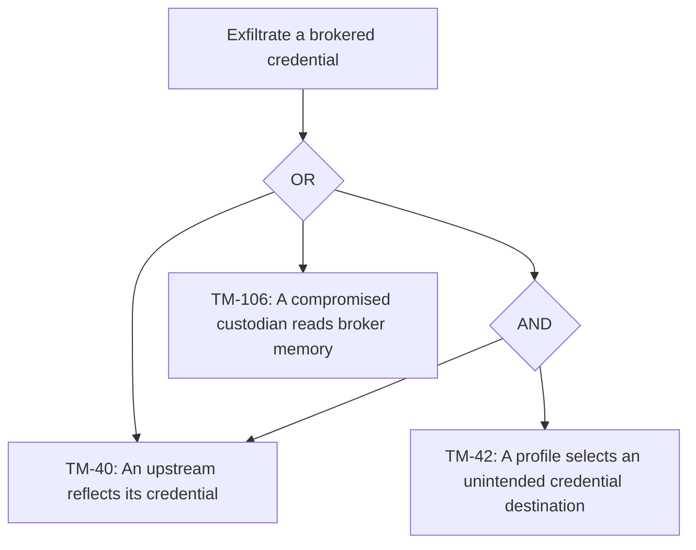

- Cheapest path and blocking controls. An already permitted upstream can return its credential because header injection doesn't control that response. [`OQ-SBX-26`](agent-open-questions.md#%60OQ-SBX-26%60) remains unresolved.

### Act as another agent launch or agent

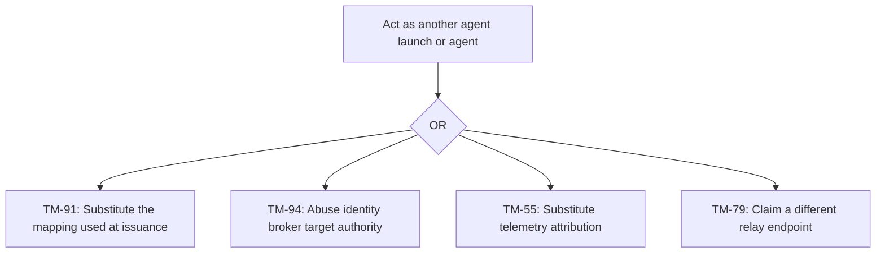

- Cheapest path and blocking controls. Substitute endpoint context before attribution. [`OQ-SBX-13`](agent-open-questions.md#%60OQ-SBX-13%60) and [`OQ-SES-5`](agent-open-questions.md#%60OQ-SES-5%60) leave the binding unresolved. Peer certificates reject a guest-selected API identity field but don't establish the local sender.

### Read or change another agent launch's workspace or session

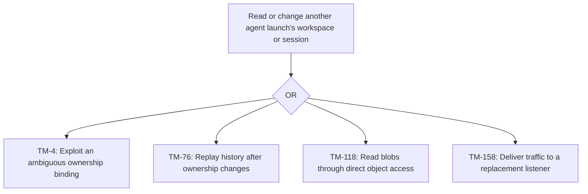

- Cheapest path and blocking controls. Use an existing broad storage grant or ambiguous owner grant. Object authorization remains [`OQ-IMG-13`](agent-open-questions.md#%60OQ-IMG-13%60). Provider-local cache and capture access don't need a service grant and have separate trees.

### Send traffic past egress policy

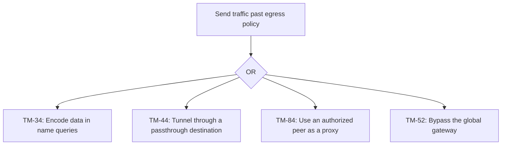

- Cheapest path and blocking controls. A permitted name query can contain data without becoming an inspected connection. Query authorization remains [`OQ-SBX-35`](agent-open-questions.md#%60OQ-SBX-35%60). Both peer grants constrain relay use but don't settle proxy behavior.

### Persist hostile state across agent launches

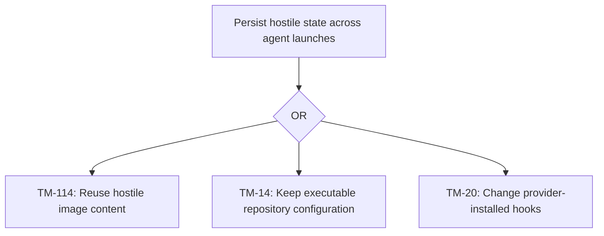

- Cheapest path and blocking controls. Keep executable configuration in an authorized source. Digests establish content identity, not safety. Hook protection and repository scope remain on hold. Capture-specific persistence belongs to each provider.

### Erase or falsify decision log and audit records

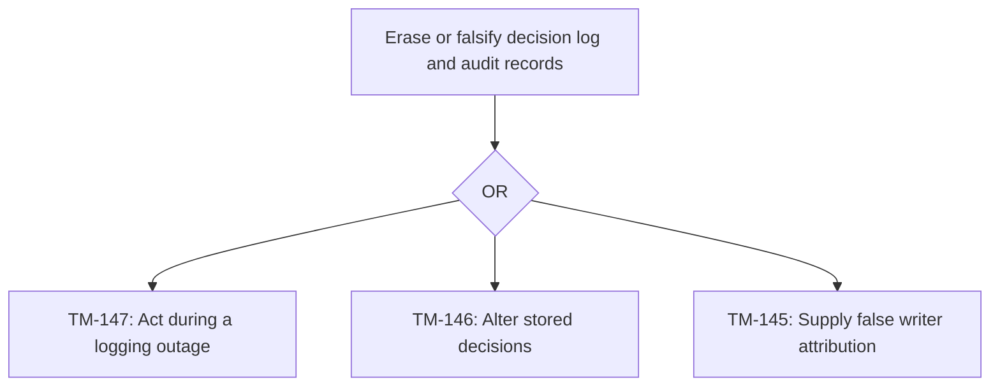

- Cheapest path and blocking controls. Trigger an action during a logging outage. [`OQ-OBS-7`](agent-open-questions.md#%60OQ-OBS-7%60) leaves action admission unresolved. [`OQ-OBS-10`](agent-open-questions.md#%60OQ-OBS-10%60) leaves compromise detection unresolved.

### Exhaust an agent host or control plane component

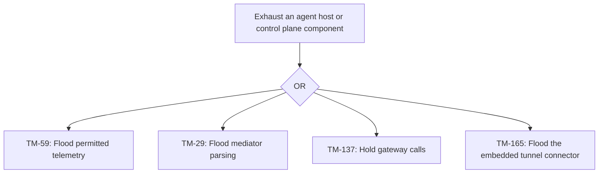

- Cheapest path and blocking controls. Flood a permitted input. Authentication doesn't bound consumption. Telemetry, mediator, gateway, and connector admission still have separate gaps.

## Agent sandbox providers

- [macOS VM](agent-threat-model-macos-vm.md). [Provider design](agent-sandbox-macos-vm.md). Isolation, local transport, storage, capture, and platform threats.
- [Linux VM](agent-threat-model-linux-vm.md). [Provider design](agent-sandbox-linux-vm.md). Isolation, local transport, storage, capture, and platform threats.
- [Windows VM](agent-threat-model-windows-vm.md). [Provider design](agent-sandbox-windows-vm.md). Isolation, local transport, storage, capture, and platform threats.
- [macOS host](agent-threat-model-macos-host.md). [Provider design](agent-sandbox-macos-host.md). Isolation, local transport, storage, capture, and platform threats.
- [Linux host](agent-threat-model-linux-host.md). [Provider design](agent-sandbox-linux-host.md). Isolation, local transport, storage, capture, and platform threats.
- [Windows host](agent-threat-model-windows-host.md). [Provider design](agent-sandbox-windows-host.md). Isolation, local transport, storage, capture, and platform threats.
- [Docker Engine on Linux](agent-threat-model-docker-engine.md). [Provider design](agent-sandbox-docker-engine.md). Isolation, local transport, storage, capture, and platform threats.
- [Docker Desktop on macOS](agent-threat-model-docker-desktop-macos.md). [Provider design](agent-sandbox-docker-desktop-macos.md). Isolation, local transport, storage, capture, and platform threats.
- [Docker Desktop on Windows](agent-threat-model-docker-desktop-windows.md). [Provider design](agent-sandbox-docker-desktop-windows.md). Isolation, local transport, storage, capture, and platform threats.
- [Podman](agent-threat-model-podman.md). [Provider design](agent-sandbox-podman.md). Isolation, local transport, storage, capture, and platform threats.
- [Claude Managed Agents](agent-threat-model-claude-managed-agents.md). Remote execution, vendor custody, and provider integration threats.
- [OpenAI Agents API](agent-threat-model-openai-agents-api.md). Remote execution, vendor custody, and provider integration threats.
- [Modal Sandboxes](agent-threat-model-modal.md). Remote execution, vendor custody, and provider integration threats.
- [Cloudflare Sandbox SDK](agent-threat-model-cloudflare.md). Remote execution, vendor custody, and provider integration threats.

## Residual risks and gaps

Hook protection, the scope of project configuration in repositories, repository profile self-grant and credential domain bounds, host isolation baseline, and session-end wait with SPIFFE Verifiable Identity Document lifetime remain on hold. Credential broker placement remains unresolved. An unresolved option supplies no mitigation.

### Agent launch admission

- `TM-1`. A caller substitutes another user or agent in a launch request. depends on an open question ([`OQ-SES-10`](agent-open-questions.md#%60OQ-SES-10%60)).
- `TM-3`. A caller denies having requested a launch or suppresses admission evidence. gap ([`OQ-OBS-10`](agent-open-questions.md#%60OQ-OBS-10%60)).
- `TM-4`. A limited user requests another owner's launch data through an ambiguous ownership binding. depends on an open question ([`OQ-AGT-10`](agent-open-questions.md#%60OQ-AGT-10%60)).
- `TM-5`. Concurrent or repeated launch requests hold capacity or produce competing successors. depends on an open question ([`OQ-EXE-8`](agent-open-questions.md#%60OQ-EXE-8%60)).
- `TM-6`. A repository profile grants itself capabilities or credential destinations beyond its owner's intended authority. depends on an open question ([`OQ-PRF-5`](agent-open-questions.md#%60OQ-PRF-5%60)).

### Task delivery to an agent host

- `TM-7`. An unauthorized worker claims a task queue or reports another host's capacity. depends on an open question ([`OQ-EXE-11`](agent-open-questions.md#%60OQ-EXE-11%60)).
- `TM-8`. A peer changes or replays workflow tasks and history to alter a launch. depends on an open question ([`OQ-EXE-11`](agent-open-questions.md#%60OQ-EXE-11%60)).
- `TM-9`. A compromised worker supplies false lifecycle observations or changes their retained history. gap ([`OQ-SBX-37`](agent-open-questions.md#%60OQ-SBX-37%60)).
- `TM-10`. An unauthorized worker reads task prompts, sources, or retained launch records. depends on an open question ([`OQ-EXE-11`](agent-open-questions.md#%60OQ-EXE-11%60)).
- `TM-11`. A lost host keeps slots or successor work waiting indefinitely. depends on an open question ([`OQ-EXE-2`](agent-open-questions.md#%60OQ-EXE-2%60)).
- `TM-12`. A compromised agent host uses its trusted observations and credentials to affect other launches. gap ([`OQ-SBX-37`](agent-open-questions.md#%60OQ-SBX-37%60)).

### Repository and profile input

- `TM-14`. Repository configuration changes provider settings or certificate trust at runtime. depends on an open question ([`OQ-HOOK-17`](agent-open-questions.md#%60OQ-HOOK-17%60)).
- `TM-15`. A repository hook performs an action without a record of that run. gap ([Workspace repository hooks](agent-hooks.md#Workspace%20repository%20hooks)).
- `TM-17`. An oversize source or slow fetch exhausts preparation capacity before the harness starts. depends on an open question ([`OQ-HST-2`](agent-open-questions.md#%60OQ-HST-2%60)).
- `TM-18`. A malicious repository uses its profile to permit its own sensitive operations. depends on an open question ([`OQ-PRF-5`](agent-open-questions.md#%60OQ-PRF-5%60)).
- `TM-20`. Agent code changes provider-installed hook configuration or dispatch after startup validation. depends on an open question ([`OQ-HOOK-16`](agent-open-questions.md#%60OQ-HOOK-16%60)).

### Agent mediator request admission

- `TM-168`. A changed or revoked deployment policy leaves existing mediator flows under stale authority. depends on an open question ([`OQ-SBX-25`](agent-open-questions.md#%60OQ-SBX-25%60)).
- `TM-167`. A substituted deployment policy presents itself as the policy authorized for a launch. depends on an open question ([`OQ-SBX-25`](agent-open-questions.md#%60OQ-SBX-25%60)).
- `TM-27`. Permitted traffic proceeds while durable storage can't receive its authorization decision. depends on an open question ([`OQ-OBS-7`](agent-open-questions.md#%60OQ-OBS-7%60)).
- `TM-28`. Traffic or parser state from one launch leaks through a shared mediator process. depends on an open question ([`OQ-SBX-19`](agent-open-questions.md#%60OQ-SBX-19%60)).
- `TM-29`. Malformed packets or many streams starve mediator control work. depends on an open question ([`OQ-SBX-14`](agent-open-questions.md#%60OQ-SBX-14%60)).
- `TM-30`. Guest traffic exploits the mediator parser to gain host authority. depends on an open question ([`OQ-SBX-12`](agent-open-questions.md#%60OQ-SBX-12%60)).

### Agent name resolution

- `TM-31`. A network attacker supplies false upstream name answers. depends on an open question ([`OQ-SBX-21`](agent-open-questions.md#%60OQ-SBX-21%60)).
- `TM-32`. A guest exploits stale or changing name bindings to redirect an admitted connection. depends on an open question ([`OQ-SBX-22`](agent-open-questions.md#%60OQ-SBX-22%60)).
- `TM-33`. A guest denies sending a name query that never became a connection decision. gap ([`OQ-SBX-35`](agent-open-questions.md#%60OQ-SBX-35%60)).
- `TM-34`. A guest encodes private data in query names sent to an attacker-controlled upstream. gap ([`OQ-SBX-35`](agent-open-questions.md#%60OQ-SBX-35%60)).
- `TM-35`. A guest sends excessive name queries or forces expensive upstream resolution. gap ([`OQ-SBX-35`](agent-open-questions.md#%60OQ-SBX-35%60)).
- `TM-36`. A false destination binding redirects traffic toward a more privileged service. depends on an open question ([`OQ-SBX-21`](agent-open-questions.md#%60OQ-SBX-21%60)).

### Inspected destinations and site gateway

- `TM-38`. An attacker installs a stale or unauthorized deployment policy revision. depends on an open question ([`OQ-SBX-25`](agent-open-questions.md#%60OQ-SBX-25%60)).
- `TM-39`. An injected credential use lacks durable evidence after a logging failure. depends on an open question ([`OQ-OBS-7`](agent-open-questions.md#%60OQ-OBS-7%60)).
- `TM-40`. A permitted upstream reflects or transforms a brokered secret into its response. depends on an open question ([`OQ-SBX-26`](agent-open-questions.md#%60OQ-SBX-26%60)).
- `TM-41`. A streaming request monopolizes the mediator or egress service and delays control. depends on an open question ([`OQ-SBX-14`](agent-open-questions.md#%60OQ-SBX-14%60)).
- `TM-42`. With a broad inject domain, a repository profile can use credentials against an unintended service. depends on an open question ([`OQ-PRF-5`](agent-open-questions.md#%60OQ-PRF-5%60)).

### Traffic to passthrough destinations

- `TM-43`. A client presents an absent or misleading server name to misclassify its destination. depends on an open question ([`OQ-SBX-24`](agent-open-questions.md#%60OQ-SBX-24%60)).
- `TM-44`. An encrypted protocol tunnels a prohibited request through a destination allowed only at connection level. depends on an open question ([`OQ-SBX-24`](agent-open-questions.md#%60OQ-SBX-24%60)).
- `TM-45`. A caller denies an action inside an allowed encrypted stream. depends on an open question ([`OQ-OBS-7`](agent-open-questions.md#%60OQ-OBS-7%60)).
- `TM-46`. A guest exports data through an allowed encrypted destination whose app behavior is opaque to inspection. depends on an open question ([`OQ-SBX-24`](agent-open-questions.md#%60OQ-SBX-24%60)).
- `TM-47`. Long-lived passthrough streams consume connection capacity and starve control. depends on an open question ([`OQ-SBX-14`](agent-open-questions.md#%60OQ-SBX-14%60)).
- `TM-48`. An agent keeps an admitted passthrough connection after quarantine or policy revocation. depends on an open question ([`OQ-AGT-23`](agent-open-questions.md#%60OQ-AGT-23%60)).

### Remote agent sandbox routing

- `TM-49`. A remote sandbox claims another launch at the global egress gateway. gap ([`OQ-SBX-36`](agent-open-questions.md#%60OQ-SBX-36%60)).
- `TM-50`. A remote provider bypasses its per-launch mediator when forwarding control or session traffic. gap ([`OQ-SBX-36`](agent-open-questions.md#%60OQ-SBX-36%60)).
- `TM-51`. Remote requests lack a defined identity binding for decision attribution. gap ([`OQ-SBX-36`](agent-open-questions.md#%60OQ-SBX-36%60)).
- `TM-52`. A remote sandbox sends private content on a direct route that bypasses global egress. gap ([`OQ-SBX-36`](agent-open-questions.md#%60OQ-SBX-36%60)).
- `TM-53`. A remote provider's capacity or lifetime limits prevent completion and recovery. depends on an open question ([`OQ-PLC-7`](agent-open-questions.md#%60OQ-PLC-7%60)).
- `TM-54`. A remote sandbox uses an undefined control attachment path to gain broader authority. gap ([`OQ-SBX-36`](agent-open-questions.md#%60OQ-SBX-36%60)).

### Telemetry and evidence export

- `TM-55`. A guest labels telemetry as another launch. depends on an open question ([`OQ-SBX-13`](agent-open-questions.md#%60OQ-SBX-13%60)).
- `TM-56`. A hostile harness supplies false events under permitted attributes. gap ([`OQ-OBS-10`](agent-open-questions.md#%60OQ-OBS-10%60)).
- `TM-57`. An attacker deletes or alters retained telemetry and evidence to hide an action. gap ([`OQ-OBS-10`](agent-open-questions.md#%60OQ-OBS-10%60)).
- `TM-59`. A guest floods the telemetry endpoint or evidence store with permitted records. gap ([`OQ-OBS-11`](agent-open-questions.md#%60OQ-OBS-11%60)).
- `TM-60`. A malicious telemetry record exploits a receiver to gain its storage or service authority. gap ([`OQ-OBS-11`](agent-open-questions.md#%60OQ-OBS-11%60)).

### User attachment and preview access

- `TM-62`. A reader sends prompts or approval answers, or an old preview route selects a new listener. depends on an open question ([`OQ-PORT-6`](agent-open-questions.md#%60OQ-PORT-6%60)).
- `TM-61`. A network or browser attacker substitutes user context during sign-in or replica routing. depends on an open question ([`OQ-SES-10`](agent-open-questions.md#%60OQ-SES-10%60)).
- `TM-63`. A client denies a session action whose sender claims aren't durably bound. depends on an open question ([`OQ-SES-6`](agent-open-questions.md#%60OQ-SES-6%60)).
- `TM-64`. A hostile preview script writes parent-domain cookies that affect a sibling preview. depends on an open question ([`OQ-PORT-9`](agent-open-questions.md#%60OQ-PORT-9%60)).
- `TM-65`. Attachment or preview traffic exhausts ingress capacity or interferes with interactive streams. depends on an open question ([`OQ-PORT-7`](agent-open-questions.md#%60OQ-PORT-7%60)).

### Workload session transport

- `TM-69`. A replayed or substituted sender claim survives session reconnection. depends on an open question ([`OQ-SES-6`](agent-open-questions.md#%60OQ-SES-6%60)).
- `TM-71`. Buffered ACP messages or preview streams consume control capacity. depends on an open question ([`OQ-PRQ-6`](agent-open-questions.md#%60OQ-PRQ-6%60)).
- `TM-72`. A request for compound permission maps to a narrower policy resource than the action it performs. depends on an open question ([`OQ-SES-9`](agent-open-questions.md#%60OQ-SES-9%60)).

### Session message storage

- `TM-73`. A stored message attributes a prompt to the wrong agent, launch, user, or session. depends on an open question ([`OQ-SES-6`](agent-open-questions.md#%60OQ-SES-6%60)).
- `TM-74`. A storage attacker changes or deletes the append-only session log. gap ([`OQ-OBS-10`](agent-open-questions.md#%60OQ-OBS-10%60)).
- `TM-75`. A sender denies a replayed message after signing authority changes. depends on an open question ([`OQ-SES-6`](agent-open-questions.md#%60OQ-SES-6%60)).
- `TM-76`. History replay exposes another owner's retained transcript after ownership changes. depends on an open question ([`OQ-AGT-29`](agent-open-questions.md#%60OQ-AGT-29%60)).
- `TM-77`. A replay cursor predates retention and triggers an unbounded history recovery. depends on an open question ([`OQ-ATT-5`](agent-open-questions.md#%60OQ-ATT-5%60)).

### Connections between agent launches

- `TM-171`. A relay delivers a permitted stream to a listener belonging to another launch. depends on an open question ([`OQ-SBX-13`](agent-open-questions.md#%60OQ-SBX-13%60)).
- `TM-79`. Another launch claims the source or destination identity on a relayed connection. depends on an open question ([`OQ-SBX-13`](agent-open-questions.md#%60OQ-SBX-13%60)).
- `TM-80`. A source changes a destination name or port to reach an unexposed listener. depends on an open question ([`OQ-SBX-13`](agent-open-questions.md#%60OQ-SBX-13%60)).
- `TM-81`. Either endpoint denies a connection after decision logging becomes unavailable. depends on an open question ([`OQ-OBS-7`](agent-open-questions.md#%60OQ-OBS-7%60)).
- `TM-83`. Agent-to-agent streams exhaust relay or mediator capacity. depends on an open question ([`OQ-SBX-14`](agent-open-questions.md#%60OQ-SBX-14%60)).
- `TM-84`. An authorized peer acts as a proxy to send traffic beyond the source's intended egress policy. depends on an open question ([`OQ-SBX-24`](agent-open-questions.md#%60OQ-SBX-24%60)).

### Credential registration and central custody

- `TM-85`. A limited user registers or selects another user's login credential. depends on an open question ([`OQ-SBX-7`](agent-open-questions.md#%60OQ-SBX-7%60)).
- `TM-86`. An attachment change leaves old credential authority active on a launch. depends on an open question ([`OQ-AGT-18`](agent-open-questions.md#%60OQ-AGT-18%60)).
- `TM-87`. A credential administrator denies a registration, replacement, or deletion. gap ([`OQ-OBS-10`](agent-open-questions.md#%60OQ-OBS-10%60)).
- `TM-88`. A stolen central refresh or signing credential survives revocation or restart. depends on an open question ([`OQ-AGT-21`](agent-open-questions.md#%60OQ-AGT-21%60)).
- `TM-89`. Credential service loss prevents renewal or blocks session-end work. depends on an open question ([`OQ-HOOK-18`](agent-open-questions.md#%60OQ-HOOK-18%60)).
- `TM-90`. A credential attachment or upstream principal grants rights beyond the caller's intended scope. depends on an open question ([`OQ-SBX-34`](agent-open-questions.md#%60OQ-SBX-34%60)).

### Workload identity issuance

- `TM-91`. An attacker substitutes a guest endpoint mapping before identity issuance. depends on an open question ([`OQ-SBX-30`](agent-open-questions.md#%60OQ-SBX-30%60)).
- `TM-92`. An attacker changes issuer registration or trust state during bootstrap or recovery. depends on an open question ([`OQ-SBX-32`](agent-open-questions.md#%60OQ-SBX-32%60)).
- `TM-93`. Audit records go missing during identity issuance or rotation under churn. depends on an open question ([`OQ-OBS-9`](agent-open-questions.md#%60OQ-OBS-9%60)).
- `TM-94`. A compromised host-side identity broker requests private keys for other launches. depends on an open question ([`OQ-SBX-31`](agent-open-questions.md#%60OQ-SBX-31%60)).
- `TM-95`. Issuer or data store failure prevents recovery with a valid identity after cached identities expire. depends on an open question ([`OQ-SBX-32`](agent-open-questions.md#%60OQ-SBX-32%60)).
- `TM-96`. A compromised requester uses broad registration or audience authority to issue stronger identities. depends on an open question ([`OQ-SBX-33`](agent-open-questions.md#%60OQ-SBX-33%60)).

### Agent launch authentication

- `TM-99`. A malicious host attributes a control request to its guest without evidence of guest authorship. gap ([`OQ-SBX-37`](agent-open-questions.md#%60OQ-SBX-37%60)).
- `TM-101`. A launch holds authenticated connections through an unresolved session-end wait or renewal failure. depends on an open question ([`OQ-HOOK-18`](agent-open-questions.md#%60OQ-HOOK-18%60)).

### Credential broker exchange

- `TM-103`. An exchange accepts a credential request under the wrong audience or identity form. depends on an open question ([`OQ-SBX-17`](agent-open-questions.md#%60OQ-SBX-17%60)).
- `TM-104`. A compromised traffic parser changes the broker's credential selection or injection request. depends on an open question ([`OQ-SBX-23`](agent-open-questions.md#%60OQ-SBX-23%60)).
- `TM-105`. A broker or site gateway removes injected-use records to hide its own credential access. gap ([`OQ-OBS-10`](agent-open-questions.md#%60OQ-OBS-10%60)).
- `TM-106`. A compromised site gateway or host reads broker memory and steals a static credential. gap ([`OQ-SBX-37`](agent-open-questions.md#%60OQ-SBX-37%60)).
- `TM-107`. A stalled exchange prevents useful work or holds resources during teardown. depends on an open question ([`OQ-HOOK-18`](agent-open-questions.md#%60OQ-HOOK-18%60)).
- `TM-108`. An exchange yields a shared provider principal with broader rights than the launch. depends on an open question ([`OQ-SBX-34`](agent-open-questions.md#%60OQ-SBX-34%60)).

### Workspace image transfer and materialization

- `TM-111`. A publisher denies having moved a tag or deleted an image. gap ([`OQ-OBS-10`](agent-open-questions.md#%60OQ-OBS-10%60)).
- `TM-112`. An inherited or intermediate image layer exposes a build secret that a later step deleted. depends on an open question ([`OQ-IMG-6`](agent-open-questions.md#%60OQ-IMG-6%60)).
- `TM-113`. Uploads and retained references exhaust storage faster than collection can reclaim it. depends on an open question ([`OQ-IMG-12`](agent-open-questions.md#%60OQ-IMG-12%60)).
- `TM-114`. A validly hashed but hostile image persists executable content across agent launches. depends on an open question ([`OQ-IMG-1`](agent-open-questions.md#%60OQ-IMG-1%60)).
- `TM-172`. Native filesystem translation can change verified content or its target. gap ([`OQ-IMG-14`](agent-open-questions.md#%60OQ-IMG-14%60)).

### Object store access

- `TM-115`. An unauthorized store client impersonates the registry or another blob writer. gap ([`OQ-IMG-13`](agent-open-questions.md#%60OQ-IMG-13%60)).
- `TM-116`. Direct store access replaces or deletes objects outside registry authorization. gap ([`OQ-IMG-13`](agent-open-questions.md#%60OQ-IMG-13%60)).
- `TM-117`. A store administrator denies deleting or replacing retained content. gap ([`OQ-OBS-10`](agent-open-questions.md#%60OQ-OBS-10%60)).
- `TM-118`. A direct store reader or backup reader discloses private workspace or session content. gap ([`OQ-IMG-13`](agent-open-questions.md#%60OQ-IMG-13%60)).
- `TM-119`. Abandoned uploads or delayed collection consume the object store's free space. depends on an open question ([`OQ-IMG-12`](agent-open-questions.md#%60OQ-IMG-12%60)).
- `TM-120`. A component uses broad object credentials to alter another component's retained data. gap ([`OQ-IMG-13`](agent-open-questions.md#%60OQ-IMG-13%60)).

### MCP gateway tool dispatch

- `TM-135`. A gateway dispatches a call whose record can't persist in the audit store. depends on an open question ([`OQ-OBS-7`](agent-open-questions.md#%60OQ-OBS-7%60)).
- `TM-136`. An upstream server returns credential material or attacker instructions as a tool result. depends on an open question ([`OQ-SBX-26`](agent-open-questions.md#%60OQ-SBX-26%60)).
- `TM-137`. Slow upstream calls or pending approvals exhaust gateway capacity. depends on an open question ([`OQ-MCP-4`](agent-open-questions.md#%60OQ-MCP-4%60)).

### Shared central MCP server

- `TM-139`. A shared server uses one caller's upstream identity for another caller. depends on an open question ([`OQ-MCP-1`](agent-open-questions.md#%60OQ-MCP-1%60)).
- `TM-140`. A compromised server mixes or alters results across concurrent callers. depends on an open question ([`OQ-MCP-1`](agent-open-questions.md#%60OQ-MCP-1%60)).
- `TM-141`. A central server disputes an upstream effect for which gateway metadata provides insufficient proof. gap ([`OQ-OBS-10`](agent-open-questions.md#%60OQ-OBS-10%60)).
- `TM-142`. A compromised shared process reads another authorization identity's data or credentials. depends on an open question ([`OQ-MCP-1`](agent-open-questions.md#%60OQ-MCP-1%60)).
- `TM-143`. A shared server monopolizes gateway calls or repeatedly fails readiness. depends on an open question ([`OQ-MCP-4`](agent-open-questions.md#%60OQ-MCP-4%60)).
- `TM-144`. A result from an upstream tool injects instructions that induce a permitted but harmful agent action. depends on an open question ([`OQ-MCP-3`](agent-open-questions.md#%60OQ-MCP-3%60)).

### Decision log and audit storage

- `TM-145`. A compromised writer attributes a decision or audit record to another launch. gap ([`OQ-OBS-10`](agent-open-questions.md#%60OQ-OBS-10%60)).
- `TM-146`. A writer or storage attacker changes or erases decision log and audit records. gap ([`OQ-OBS-10`](agent-open-questions.md#%60OQ-OBS-10%60)).
- `TM-147`. A protected action completes while durable logging fails. The decision history remains incomplete. depends on an open question ([`OQ-OBS-7`](agent-open-questions.md#%60OQ-OBS-7%60)).
- `TM-148`. A limited user reads sensitive decision metadata without a defined read grant. depends on an open question ([`OQ-OBS-8`](agent-open-questions.md#%60OQ-OBS-8%60)).
- `TM-149`. Decision records exhaust bounded storage and prevent control work. depends on an open question ([`OQ-OBS-7`](agent-open-questions.md#%60OQ-OBS-7%60)).
- `TM-150`. A storage principal removes evidence of its own unauthorized actions. gap ([`OQ-OBS-10`](agent-open-questions.md#%60OQ-OBS-10%60)).

### Other attacks

- `TM-153`. A remote MCP result steers a harness toward a harmful action that still fits its grants. depends on an open question ([`OQ-MCP-3`](agent-open-questions.md#%60OQ-MCP-3%60)).

### Port forwarding

- `TM-155`. A caller supplies another launch's publication to select its listener. depends on an open question ([`OQ-SES-5`](agent-open-questions.md#%60OQ-SES-5%60)).
- `TM-156`. A listener changes owner between discovery and connection. depends on an open question ([`OQ-PORT-6`](agent-open-questions.md#%60OQ-PORT-6%60)).
- `TM-157`. A caller denies sending bytes through an authorized client tunnel. depends on an open question ([`OQ-OBS-7`](agent-open-questions.md#%60OQ-OBS-7%60)).
- `TM-158`. A stale publication delivers private traffic to a replacement listener. depends on an open question ([`OQ-PORT-6`](agent-open-questions.md#%60OQ-PORT-6%60)).
- `TM-159`. A client holds forwarding streams until control traffic loses capacity. depends on an open question ([`OQ-PORT-7`](agent-open-questions.md#%60OQ-PORT-7%60)).

### Public tunnel providers

- `TM-161`. A substituted public tunnel route presents an attacker endpoint as an afakt preview. depends on an open question ([`OQ-PORT-4`](agent-open-questions.md#%60OQ-PORT-4%60)).
- `TM-162`. A tunnel route sends preview traffic to the API listener or another publication. gap ([`OQ-PORT-11`](agent-open-questions.md#%60OQ-PORT-11%60)).
- `TM-163`. A compromised connector removes evidence of a route change. gap ([`OQ-PORT-11`](agent-open-questions.md#%60OQ-PORT-11%60)).
- `TM-164`. A compromised connector reads provider credentials or traffic within the API server process. gap ([`OQ-PORT-11`](agent-open-questions.md#%60OQ-PORT-11%60)).
- `TM-165`. Enrollment failures or tunnel traffic exhaust the API server process. gap ([`OQ-PORT-11`](agent-open-questions.md#%60OQ-PORT-11%60)).
- `TM-166`. Hostile tunnel input compromises the embedded connector and reaches API server authority. gap ([`OQ-PORT-11`](agent-open-questions.md#%60OQ-PORT-11%60)).

## Provider design citations

[^provider-observations]: [macOS VM](agent-sandbox-macos-vm.md#Host%20observations), [Linux VM](agent-sandbox-linux-vm.md#Host%20observations), [Windows VM](agent-sandbox-windows-vm.md#Host%20observations), [macOS host](agent-sandbox-macos-host.md#Host%20observations), [Linux host](agent-sandbox-linux-host.md#Host%20observations), [Windows host](agent-sandbox-windows-host.md#Host%20observations), [Docker Engine](agent-sandbox-docker-engine.md#Host%20observations), [Docker Desktop on macOS](agent-sandbox-docker-desktop-macos.md#Host%20observations), [Docker Desktop on Windows](agent-sandbox-docker-desktop-windows.md#Host%20observations), [Podman](agent-sandbox-podman.md#Host%20observations).

[^provider-materialization]: [macOS VM](agent-sandbox-macos-vm.md#Workspace%20image%20materialization), [Linux VM](agent-sandbox-linux-vm.md#Workspace%20image%20materialization), [Windows VM](agent-sandbox-windows-vm.md#Workspace%20image%20materialization), [macOS host](agent-sandbox-macos-host.md#Workspace%20image%20materialization), [Linux host](agent-sandbox-linux-host.md#Workspace%20image%20materialization), [Windows host](agent-sandbox-windows-host.md#Workspace%20image%20materialization), [Docker Engine](agent-sandbox-docker-engine.md#Workspace%20image%20materialization), [Docker Desktop on macOS](agent-sandbox-docker-desktop-macos.md#Workspace%20image%20materialization), [Docker Desktop on Windows](agent-sandbox-docker-desktop-windows.md#Workspace%20image%20materialization), [Podman](agent-sandbox-podman.md#Workspace%20image%20materialization).

[^provider-startup]: [macOS VM](agent-sandbox-macos-vm.md#Process%20placement%20and%20startup), [Linux VM](agent-sandbox-linux-vm.md#Process%20placement%20and%20startup), [Windows VM](agent-sandbox-windows-vm.md#Process%20placement%20and%20startup), [macOS host](agent-sandbox-macos-host.md#Process%20placement%20and%20startup), [Linux host](agent-sandbox-linux-host.md#Process%20placement%20and%20startup), [Windows host](agent-sandbox-windows-host.md#Process%20placement%20and%20startup), [Docker Engine](agent-sandbox-docker-engine.md#Process%20placement%20and%20startup), [Docker Desktop on macOS](agent-sandbox-docker-desktop-macos.md#Process%20placement%20and%20startup), [Docker Desktop on Windows](agent-sandbox-docker-desktop-windows.md#Process%20placement%20and%20startup), [Podman](agent-sandbox-podman.md#Process%20placement%20and%20startup).

[^provider-mediation]: [macOS VM](agent-sandbox-macos-vm.md#Mediator%20connection%20and%20name%20resolution), [Linux VM](agent-sandbox-linux-vm.md#Mediator%20connection%20and%20name%20resolution), [Windows VM](agent-sandbox-windows-vm.md#Mediator%20connection%20and%20name%20resolution), [macOS host](agent-sandbox-macos-host.md#Mediator%20connection%20and%20name%20resolution), [Linux host](agent-sandbox-linux-host.md#Mediator%20connection%20and%20name%20resolution), [Windows host](agent-sandbox-windows-host.md#Mediator%20connection%20and%20name%20resolution), [Docker Engine](agent-sandbox-docker-engine.md#Mediator%20connection%20and%20name%20resolution), [Docker Desktop on macOS](agent-sandbox-docker-desktop-macos.md#Mediator%20connection%20and%20name%20resolution), [Docker Desktop on Windows](agent-sandbox-docker-desktop-windows.md#Mediator%20connection%20and%20name%20resolution), [Podman](agent-sandbox-podman.md#Mediator%20connection%20and%20name%20resolution).
