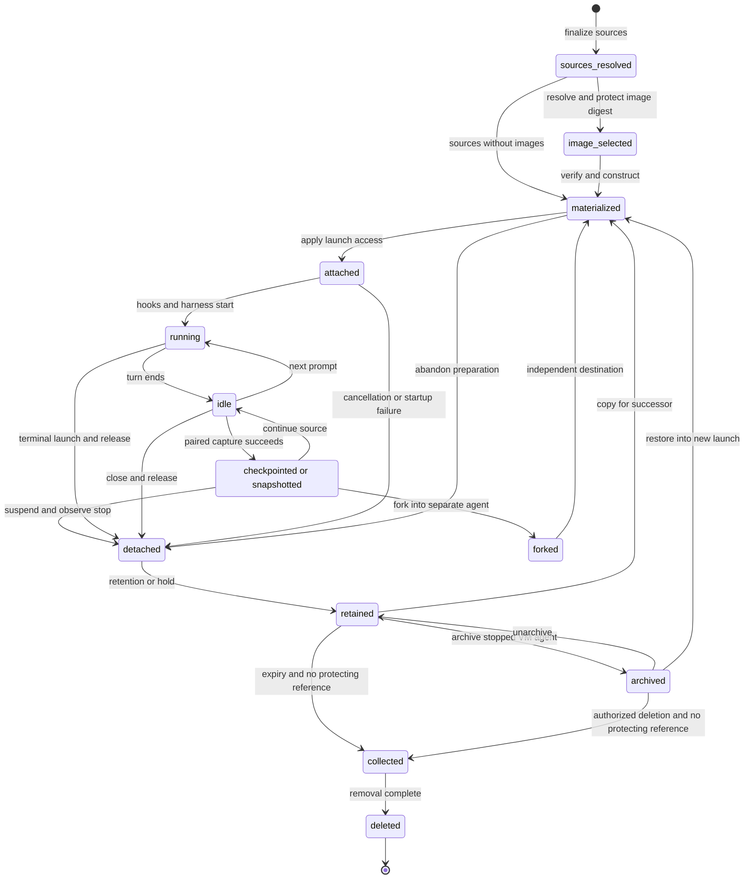

# Agent workspace lifecycle

[Public key infrastructure](pki.md).

An agent workspace belongs to a durable agent. Each agent launch receives an independent materialization of its sources. Workspace files, the agent harness's session state, and the sandbox's machine state have separate lifetimes and capture boundaries. The relationship between launch copies and durable workspace revisions remains [undecided](agent-open-questions.md#%60OQ-AGT-25%60).

## States and transitions

The agent workspace passes through source resolution, materialization, attachment, use, and retention before collection. Running and idle describe its attached launch's activity. A checkpoint or snapshot captures a boundary without requiring the source workspace to end. Forking creates a separate destination. Archive applies to a stopped agent with a virtual machine (VM) snapshot. Detached means the launch no longer uses the materialization, while retained means cleanup must preserve it, without either condition defining new agent or launch status values.

Transitions that copy or restore content act on a new materialization and preserve any retained source. Collection is eligibility and removal work. Deletion is complete only after required removals succeed. Archive and durable-reference collection rules remain [undecided](agent-open-questions.md#%60OQ-AGT-11%60), including their relationship to launch retention.

| Transition | Owner | Trigger | Failure behavior |
| --- | --- | --- | --- |
| Request → sources resolved | Control plane, through the agent dispatcher | Authorization, placement, and immutable launch-spec finalization | Invalid inputs fail validation before the provider records a launch. Image tags resolve later during workspace construction. |
| Sources resolved → image selected | Worker, through the sandbox provider | Resolve an image tag or accept its requested digest | Failure to record and protect the digest fails workspace construction. Retries use the recorded digest. |
| Resolved sources or selected image → materialized | Worker, through the sandbox provider | Fetch, verify, extract, checkout, or copy each source | Fetch, verification, or unpack failure ends the launch `failed` with `workspace-failure` before agent startup. Incomplete content never becomes a reusable cache entry. |
| Materialized → attached | Sandbox provider | Apply workspace access and configure the launch | Unsupported confinement rejects the launch. Ownership and mount details follow the provider contract. |
| Attached → running | Agent launcher and sandbox provider | Run hooks and start the harness | Interrupted preparation fails after observed process exit. Uncertain startup retains launch ownership. |
| Running → idle → running | Guest agent harness and session workflow | A turn ends, then another prompt arrives | Idle doesn't prove all background writers stopped. Capture needs the separate consistency boundary. |
| Idle → checkpointed or snapshotted | Sandbox provider, worker, and guest agent harness | Checkpoint or suspend at an idle turn boundary | The harness captures session state. The supervisor captures VM state. Crash and cancellation outcomes remain undecided under the capture transaction question. |
| Capture → forked → materialized | Control plane and sandbox provider | Create a separate agent with its own identity | Copied resource scope and destination authority remain undecided. A copy doesn't grant source credentials. |
| Captured or running → detached → retained | Agent launcher and sandbox provider | Suspend, normal end, cancellation, or supersession, with observed termination | Uncertain termination prevents terminal status and replacement. Release preserves retained content. |
| Retained → archived → retained or materialized | Control plane and sandbox provider | Archive a stopped VM agent, unarchive, or restore | Archive contents and automatic-start exceptions remain undecided. Restore creates a new launch. |
| Retained → collected | Worker and control plane | Retention expires and no hold, active process, or pending source use protects the launch copy | Recheck protection immediately before removal. Uncertain reference releases keep registry content. |
| Collected → deleted | Worker for launch copies, registry for unreferenced image content | Remove eligible owned content | Report remaining items. Cleanup with leftovers is incomplete. Durable-agent deletion and shared-resource handling remain undecided. |

The sandbox provider's [observation rules](agent-sandbox-lifecycle.md#Provider%20observations) govern terminal transitions. A missing host response never proves that a workspace has no writer. Capture failures follow [Crash consistency and cancellation](#Crash%20consistency%20and%20cancellation). Durable copies follow [Forks, archives, and transfer](#Forks,%20archives,%20and%20transfer).

## Creation and pinned inputs

The agent workspace sources are `repository`, `image`, `agent-launch`, and `empty`. Repository sources specify a full commit and may create a new branch there, while empty sources create empty directories. Targets are relative to the workspace root and can't overlap. The [source contract](agent-workspace.md#Workspace%20sources) defines their fields and path rules. Archives and uploaded files have no selected general source contract. Their admission, capture, and pinning remain [undecided](agent-open-questions.md#%60OQ-WSP-21%60). Uploaded prompt attachments remain distinct from workspace sources.

The sandbox provider fetches repositories outside the sandbox using host-configured fetch credentials. Those credentials never enter the sandbox or the checkout's stored configuration. An `agent-launch` source names an ended launch whose retained workspace remains on the selected host. A superseded launch qualifies only after it becomes terminal. Each launch builds independent copies of its own sources, and a successor explicitly references its predecessor to reuse that retained content. A missing, active, or cleaned source produces `workspace-source-unavailable` before the provider records the new launch. A fetch failure or an existing requested branch fails workspace construction before the agent starts.

An agent launch spec pins the profile source, name, version, and digest, the agent spec generation, repository commits, prompt and attachment references with digests, and the selected harness and model. At launch, the provider resolves sandbox variables, combines the profile and launch environment, renders instructions, and records the resulting configuration digest and evidence. Reserved and locked environment names keep their [validation rules](agent-workspace.md#Agent%20environment). The agent launch environment and trace context remain attempt-derived inputs outside the configured agent environment's canonical encoding.

Instruction inputs form a secret-free JavaScript Object Notation (JSON) object validated against the profile's input schema. The profile's Go template reads only those inputs and uses built-in template functions. It can't read the environment, files, credentials, or clock, so the same template and inputs render the same instructions. See [Instruction templates](agent-profile.md#Instruction%20templates).

Provenance separates requested sources from observed commits, branches, image digests, and copied-workspace digests. The [configuration digest](agent-launch-model.md#Agent%20launch%20record) also covers the rendered instructions, sandbox configuration, configured environment, hooks, overrides, transport, and resolved harness settings. Recording these inputs preserves retry identity. It doesn't fix external service responses or make an agent's output deterministic.

## Image sources and digest pinning

An `image` [workspace source](agent-workspace.md#Workspace%20sources) supplies an image reference and a target path. This reference specifies an image repository and tag, or an image repository and manifest digest. Relative path and non-overlap rules for the target match those of the other source kinds. Before applying workspace access and running hooks, the agent sandbox provider places the directory tree there.

During the workspace build, the provider resolves a tag to a manifest digest once and records both the requested reference and the resolved digest on the agent launch. It persists the digest before fetching layers or making the agent workspace available. Resolution also establishes the [retention reference](#Retention%20and%20garbage%20collection) that protects the image from collection. Failure to record and protect the digest fails the workspace build. A retried operation uses the recorded digest without resolving the tag again. To reuse the same content, a later agent launch can request the repository and that digest explicitly. Supplying the tag instead resolves it for that agent launch's own workspace. Resolution and cache use leave the immutable agent launch spec and its digest unchanged. The [provenance record](agent-launch-model.md#Provenance%20record) keeps the requested reference separate from the observed manifest digest.

The provider verifies the manifest, config, and layer digests before using their content. A failed pull, verification, or unpack ends the workspace build with `workspace-failure`, without falling back to another tag or to an unverified cache entry.

An image can contain a checkout at an older commit than an agent launch needs.

Following an `image` source with a `repository` source at the same target would allow an incremental fetch and checkout while retaining dependencies and build outputs. The source rules reject duplicate targets. That form requires a source rule change and remains an [open question](agent-open-questions.md#Agent%20workspace%20image).

## Registry admission

The workspace image registry authorizes repository and action scopes before transferring content. Outside the sandbox, the worker holds short-lived pull tokens. Knowing a content digest doesn't grant read access, and a warm cache requires authorization for the launch's image repository. A build's push scope doesn't grant deletion or administration. The [registry authentication contract](agent-workspace-image.md#Registry%20authentication) covers manifest and blob reads, ranges, cross-repository mounts, tag operations, deletion, token renewal, and signing-key checks.

Selection of the registry software remains [undecided](agent-open-questions.md#%60OQ-IMG-16%60). Replica publication, shared metadata, and collection coordination remain [undecided](agent-open-questions.md#%60OQ-IMG-2%60), as does [peer transfer](agent-open-questions.md#%60OQ-IMG-3%60). Neither a local cache nor a site copy supplies independent publication authority or permission to read another repository.

## Agent host caches and startup

Each agent host worker keeps a local layer cache keyed by content digest and a cache of unpacked layers keyed by the verified layer digest. Cache entries are immutable. Only complete, verified entries become reusable, and the caches stay outside the agent's writable agent workspace, distinct from the profile's named tool caches.

For worker-owned pulls, the worker fetches each image source's manifest and config. Pull ownership remains [`OQ-IMG-8`](agent-open-questions.md#%60OQ-IMG-8%60). It finds the missing layers and fetches them with parallel ranged reads, verifying each assembled blob against its descriptor before admitting it to the layer cache. The worker discards a corrupt entry and fetches it again.

Unpacked layers become reusable only after extraction and validation finish.

For worker-owned materialization, the worker extracts independent layers in parallel into private staging directories. Linux guests use a writable ext4 workspace disk built from those entries and a separate read-only root disk for the operating system. Other providers follow [Attachment and provider storage](agent-workspace-lifecycle.md#Attachment%20and%20provider%20storage), with native metadata mapping under [`OQ-IMG-14`](agent-open-questions.md#%60OQ-IMG-14%60). Writes to disjoint final paths can run in parallel. Overlapping paths, deletions, and opaque directories follow manifest order. The completed tree has exactly the result of applying the layers in that order. Even archive paths or links never cause extraction to write outside the source's target. The worker caches the unpacked base and disk by digest so agents from the same image reuse that base. Copy-on-write clones of the disk, using reflinks, Apple File System (APFS) clones, or qcow2 overlays, give each agent its own writable disk. Where cloning is unavailable, a plain copy preserves independence. It never shares writable hard links with a cache entry or another workspace. Changing or deleting files in an agent launch leaves the cached layers and other agent launches unchanged.

All required content is present before hooks or the agent start. Whether the worker must pull it before VM boot or the guest may pull it through its agent mediator remains [open](agent-open-questions.md#Agent%20workspace%20image).

Workspace start doesn't use Filesystem in User Space (FUSE) lazy pull or a snapshotter. A cache hit avoids a transfer or extraction. The worker still obtains control plane authorization for each agent launch's image repository even when every layer is local.

Private extraction constructs the exact manifest-ordered tree before publication. An invalid archive can't publish a partial tree or write through a path or link outside its target. Unsupported native metadata, name collisions, links, and permission translation remain [undecided](agent-open-questions.md#%60OQ-IMG-14%60). A content digest verifies bytes. It doesn't permit repository metadata to execute outside confinement. Host-side repository processing follows the unresolved [metadata contract](agent-open-questions.md#%60OQ-WSP-18%60).

## Attachment and provider storage

Access to the agent workspace is `read-write` or `read-only`, bounded by the pinned profile. Access applies to the whole workspace after construction. The sandbox provider adds the workspace to the allowed writes for read-write access or to denied writes for read-only access. Scratch has its own writable allocation outside the workspace root. Sharing of named tool caches occurs only through their configured paths. They aren't the immutable image cache. The mapping of home, scratch, and named cache paths to permitted writes remains [undecided](agent-open-questions.md#%60OQ-WSP-14%60).

A materialization has one launch's writer authority. At most one launch runs for an agent, and different launches never share a writable workspace or writable hard links to cached content. A second launch gets its own materialization. A successor using the predecessor as a source waits for its terminal state. This doesn't restrict the harness to one process. Hooks, helpers, and standalone commands can write within the permitted launch, so capture must account for them. Ordering competing launch requests remains [undecided](agent-open-questions.md#%60OQ-EXE-8%60), as does [standalone command capture ordering](agent-open-questions.md#%60OQ-AGT-40%60).

| Provider | Workspace attachment and ownership | Capture boundary |
| --- | --- | --- |
| [Linux VM](agent-sandbox-linux-vm.md#Workspace,%20scratch,%20and%20caches) and [macOS VM](agent-sandbox-macos-vm.md#Workspace,%20scratch,%20and%20caches) | A Linux guest sees a writable workspace disk beside a read-only root disk. Host backing and verified caches remain outside guest writes. | Frozen workspace disk with paired VM and native-session capture. |
| [Windows VM](agent-sandbox-windows-vm.md#Workspace,%20scratch,%20and%20caches) | The Linux guest uses separate boot and workspace disks. Native Windows guest storage and access mappings remain undecided. | The inner guest is the capture target. Native Windows capture needs its own adapter. |
| [Docker Engine](agent-sandbox-docker-engine.md#Workspace,%20scratch,%20and%20caches), [Docker Desktop on macOS](agent-sandbox-docker-desktop-macos.md#Workspace,%20scratch,%20and%20caches), [Docker Desktop on Windows](agent-sandbox-docker-desktop-windows.md#Workspace,%20scratch,%20and%20caches), and [Podman](agent-sandbox-podman.md#Workspace,%20scratch,%20and%20caches) | A separate workspace tree attaches to the container. Directory, volume, outer-machine storage, and ownership mappings remain undecided. The runtime image and its cache are separate. | No agent snapshot. Pairing workspace content with a harness checkpoint remains undecided. |
| [Linux host](agent-sandbox-linux-host.md#Workspace,%20scratch,%20and%20caches) | Host directory storage appears through the confined process mount view. Native cloning, copying, and ownership remain undecided. | No agent snapshot. A process-group stop doesn't prove all writers stopped. |
| [macOS host](agent-sandbox-macos-host.md#Workspace,%20scratch,%20and%20caches) | Seatbelt rules expose host filesystem paths. No mount namespace hides the other host paths. | Native clone metadata, capture rights, and path stability remain undecided. |
| [Windows host](agent-sandbox-windows-host.md#Workspace,%20scratch,%20and%20caches) | Host storage needs native filesystem access mappings, compatible names, and link handling. | Native confinement and capture rights remain undecided. |
| [Claude Managed Agents](agent-sandbox-claude-managed-agents.md#Workspace,%20scratch,%20and%20caches), [OpenAI Agents Application Programming Interface (API)](agent-sandbox-openai-agents-api.md#Workspace,%20scratch,%20and%20caches), [Modal Sandboxes](agent-sandbox-modal.md#Workspace,%20scratch,%20and%20caches), and [Cloudflare Sandbox software development kit (SDK)](agent-sandbox-cloudflare.md#Workspace,%20scratch,%20and%20caches) | Vendor files, volumes, uploads, and saved environments need explicit mappings to independent launch storage. | Vendor persistence alone doesn't establish an afakt snapshot, checkpoint, or cleanup guarantee. |

The agent host worker runs under a dedicated non-root user, or a dedicated non-administrator account on Windows. For host-mode execution, the strong recommendation is a dedicated user. A separate user for each launch remains on hold under the [host isolation baseline](agent-open-questions.md#%60OQ-SBX-18%60). The relay and agent use separate users in the Linux guest. Filesystem ownership, worker capture access after permission changes, and native path stability remain [undecided](agent-open-questions.md#%60OQ-WSP-15%60), [including each provider's storage mapping](agent-open-questions.md#%60OQ-WSP-20%60). A clone or read-only mount doesn't remove authority from an exposed host service socket.

## During a launch

The agent workspace contains files changed by the harness, hooks, and helpers. The provider publishes evidence from launch onward and updates observed provenance fields. Status exposes references published so far. Across worker restarts, the launch record persists on the agent host. These records don't establish continuous remote backup of each filesystem write. Continuous workspace replication and its durability boundary remain [undecided](agent-open-questions.md#%60OQ-WSP-21%60).

The agent session retains the conversation and past transcripts independently of the current launch. Native harness history and context belong to agent session state even when their files share storage with the workspace. VM memory, devices, and processes belong to the agent snapshot's scope. Scratch and named tool caches have separate lifetimes, and copying workspace files alone doesn't establish restoration of native session history or live processes.

Workspace changes join the result's evidence alongside the transcript, standard error, rendered instructions, environment, sandbox configuration, hook records, and raw final answer. Using media type and digest, the result refers to evidence. It records requested inputs separately from observed values. The exact workspace revision and capture scope remain [undecided](agent-open-questions.md#%60OQ-AGT-25%60). Publishing source changes through a repository capability and publishing workspace evidence keep the distinct choices in [workspace change publication](agent-open-questions.md#%60OQ-WSP-1%60).

## Workspace disk deltas and portable revisions

For an agent running in a VM, a local workspace disk delta taken at an idle turn boundary captures a block delta of the workspace disk with the guest filesystem frozen. afakt takes an [agent snapshot](agent.md#Agent%20snapshots%20and%20the%20snapshot%20registry) and an [agent checkpoint](agent.md#Agent%20checkpoints) together at that boundary, capturing VM state separately from the harness's session state.

Host modes and container managers have no agent snapshot.

A portable workspace revision is an Open Container Initiative (OCI) diff layer plus a content-hashed file inventory, pushed to the registry. Content hashes determine correctness. Modification times and sizes never determine it. Portable revisions preserve files across disk layouts. Local block deltas require their matching base disk and don't replace the portable revision format.

An agent checkpoint captures the harness's session state. It isn't the local block checkpoint of a workspace disk. Where rewind restores machine state, the paired capture binds both to the same idle turn boundary. The exact set of workspace, native history, memory, and device state remains [undecided](agent-open-questions.md#%60OQ-AGT-3%60). A session with no active turn can have background writers. The independently enforced writer boundary and handling of an agent that doesn't become idle remain [undecided](agent-open-questions.md#%60OQ-AGT-2%60). Where agent checkpoint rewind also restores VM state, afakt takes an agent snapshot and an agent checkpoint together at the same idle turn boundary. The guest filesystem is frozen for capture so the workspace disk delta and session state agree.

On resume, the sandbox provider restores the paired captures under the same guest paths and reacquires credentials outside the guest. It rechecks channels and port publications. Which processes survive and which restart remains [undecided](agent-open-questions.md#%60OQ-AGT-1%60). An open socket path isn't evidence of a live endpoint. A portable file revision doesn't guarantee live connections or process memory. Restoration in host modes and container managers remains [undecided](agent-open-questions.md#%60OQ-AGT-28%60).

## Crash consistency and cancellation

The workspace capture transaction must distinguish preparing content from publishing a usable revision. Manifest-last publication makes complete content available before its manifest. Whether that publication commits a paired checkpoint, and how cancellation reports an uncertain publication, remain [undecided](agent-open-questions.md#%60OQ-WSP-17%60). The complete checkpoint transaction and recovery behavior at each boundary remain [undecided](agent-open-questions.md#%60OQ-WSP-22%60).

| Boundary | Required distinction | Undecided failure behavior |
| --- | --- | --- |
| Waiting for idle and stopping writers | An ended turn doesn't prove writer quiescence. | Admission fencing, wait bounds, and recovery when a writer can't stop. |
| Freezing filesystems and pausing the VM | A partial freeze isn't a complete paired capture. | Unwinding partial freezes and pauses after cancellation or worker loss. |
| Capturing workspace, native state, memory, and devices | Complete members must belong to the same boundary. | Detecting mixed members and validating restored state before admitting another turn. |
| Uploading objects before the manifest | Partial or abandoned uploads aren't published captures. | Upload cleanup, protection during collection, and recovery after interrupted transfer. |
| Publishing the manifest | Lost acknowledgement doesn't establish whether publication committed. | Durable commit visibility, cancellation after publication, and reconciliation after a crash. |
| Thawing and reopening admission | A restored file tree alone doesn't prove usable session or device state. | Recovery from partial thaw, channel reconstruction, and host or storage failure. |

File-content verification doesn't prove durability after host power loss. Checkpoint capture bounds, recovery deadlines, and storage-failure behavior remain part of the same [transaction question](agent-open-questions.md#%60OQ-WSP-22%60). No capture or rewind can undo an external action.

## Forks, archives, and transfer

An agent fork creates a separate agent with its own identity. `fork create` doesn't start its harness. `fork start` starts it, and `fork run` also waits for session end and returns the final message. Agent checkpoint rewind starts a new conversation branch and retains the old branch for audit. Resource-copy scope, historical state, and destination authorization remain [undecided](agent-open-questions.md#%60OQ-AGT-16%60). Forks never imply shared writable workspace content.

An agent archive stores the agent snapshot of a stopped VM agent. Unarchive behavior remains [`OQ-AGT-17`](agent-open-questions.md#%60OQ-AGT-17%60). The [archive contract](agent-lifecycle.md#Archive%20and%20restore) leaves automatic-start exceptions undecided. `restore` starts from an agent snapshot through a new launch. Snapshot storage and its access controls remain distinct from ordinary workspace-image publication.

Agent export packages the agent and its workspace as an OCI artifact, and import creates an agent from it. Portable workspace revisions use OCI diff layers and content-hashed inventories, but transfer encoding doesn't grant permission to copy identity or credentials. Native history, metadata compatibility, snapshot contents, and the complete resource set remain [undecided](agent-open-questions.md#%60OQ-AGT-16%60). Cross-host migration and source-termination requirements remain [undecided](agent-open-questions.md#%60OQ-AGT-12%60). Open connections require channel revalidation. Portability doesn't promise that live sockets or processes move with files.

## Placement and preheating

Agent host workers report cached layer digests as advisory host metadata. Among registered agent hosts that meet all placement requirements and have a free slot, the reservation Application Programming Interface (API) may prefer one that already caches more of the image's layers. Locality never overrides each agent launch's binding to its selected agent host, the host required by an `agent-launch` source, lease eligibility, or slot accounting. A cache report can become stale. A miss triggers an ordinary pull rather than a placement failure. See [Image locality](agent-placement.md#Image%20locality).

After a successful build, the control plane can enqueue a preheat request on chosen agent hosts' task queues. Each worker pulls and verifies the published digest with a pull token and populates both caches without starting an agent or creating an agent workspace. Preheating respects the host's free-disk target and doesn't reserve a slot for a future agent launch. The worker polls its task queue for preheat requests without the control plane connecting to the agent host. A preheat failure leaves the published image usable through an ordinary pull.

## Retention and garbage collection

Each workspace image definition retains tags for its last N successful builds, where N is its configured positive build count. Its output tag points to a complete successful build, and dropping an older build tag doesn't remove any agent launch's protection of its digest.

The control plane keeps retention references for resolved image digests used by non-terminal agent launches and by terminal agent launches whose retention hasn't ended or whose retention hold remains in force. Resolution protects the digest before making it available to the workspace build.

The registry interface uses protected tags or collection roots with the same effect for those references, separate from the last N build tags. Releasing the final agent launch reference makes an image eligible for ordinary collection only when no other root retains it.

The registry collects untagged, unprotected manifests and unreferenced blobs online while pulls and pushes continue. Its collection roots include build tags, output tags, agent launch references, and active build inputs and uploads. Protection covers the manifest, config, and every referenced layer, including layers inherited from a base. Collection and reference creation coordinate so an image can't disappear between resolution and protection. If the control plane can't confirm that a reference is safe to release, collection retains it.

Worker caches have separate retention. The worker evicts least recently used layer blobs and unpacked entries to meet the free-disk [resource target](agent-placement.md#Slot%20capacity), skipping entries in use by a transfer or workspace materialization and bases backing active disks or retained checkpoint deltas. Preheating yields to that target. Eviction doesn't remove workspace files or registry content, and a later miss fetches the pinned digest again. If eviction can't recover enough space, the capacity controller still applies its slot rules.

The agent's current workspace, conversation, checkpoints, snapshots, and shared artifacts need protection beyond an individual launch's expiry. Their authoritative durable reference catalog and release rules remain [undecided](agent-open-questions.md#%60OQ-AGT-11%60). A retained local disk delta also depends on its base. Parent compatibility, chain depth, flattening, and collection limits remain [undecided](agent-open-questions.md#%60OQ-IMG-9%60).

The deployment's default launch-retention period remains [undecided](agent-open-questions.md#%60OQ-CON-3%60), as do durable workspace, checkpoint, snapshot, and archive retention periods. Numeric storage quotas, capture limits, extraction limits, and cache or preheat thresholds remain undecided under [provider storage](agent-open-questions.md#%60OQ-WSP-20%60), [capture admission](agent-open-questions.md#%60OQ-WSP-17%60), and [preheating](agent-open-questions.md#%60OQ-IMG-4%60). Collection lag, abandoned-upload bounds, physical reclamation, and uncertain-reference reconciliation deadlines remain [undecided](agent-open-questions.md#%60OQ-IMG-12%60).

## Deletion and teardown

Cleanup concerns retained launch copies of workspace and evidence. How that retention protects the agent's current workspace and conversation remains an [open question](agent-open-questions.md#Agents).

After the agent launch ends, the agent sandbox provider retains its workspace and evidence for the specification's retention period. Then cleanup removes them, under these rules:

- A retention hold on an agent launch protects its workspace and evidence past the retention period until someone releases the hold.
- Cleanup runs on the placed agent host. It skips an agent launch that's non-terminal, held, still has running processes, or has a workspace that a `pending` agent launch on the same host lists as a source, and it checks those conditions again right before it removes anything.
- Cleanup removes only the items that belong to that agent launch, and it reports any item it couldn't remove. With items left over, cleanup isn't complete.
- After cleanup, result returns `expired` for that agent launch, while status still reports its terminal state.

Sandbox release isn't workspace deletion.

Capture follows [Hook events](agent-hooks.md#Hook%20events). On normal completion it occurs after answer validation and the applicable `after-agent` and `session-end` hooks, before `before-teardown`. Cancellation and supersession follow [Cancellation and limits](agent-sandbox-lifecycle.md#Cancellation%20and%20limits). Detachment and deletion observations remain [`OQ-WSP-23`](agent-open-questions.md#%60OQ-WSP-23%60).

Workspace and evidence cleanup also removes the launch's scratch directory. It doesn't evict shared named caches or registry content merely because one launch ends. Agent deletion and pruning must account for retained and shared content under [deletion eligibility](agent-open-questions.md#%60OQ-AGT-15%60). Provider-specific mounts, directories, disks, container objects, and remote resources need distinct removal observations. The exact cleanup order and proof that no launch-owned resource remains are [undecided](agent-open-questions.md#%60OQ-WSP-23%60).

Fetch credentials, registry tokens, broker secrets, signing keys, and material for workload identity stay outside workspace captures. Credential references in immutable configuration and provenance remain historical data and don't preserve active authority. At terminal launch state the broker stops injection and the server refuses that launch's requests. How retained captures exclude or reauthorize referenced resources remains [undecided](agent-open-questions.md#%60OQ-AGT-16%60), as does [credential retirement](agent-open-questions.md#%60OQ-SBX-40%60). Session-end wait and Secure Production Identity Framework for Everyone (SPIFFE) Verifiable Identity Document (SVID) lifetime remain [on hold](agent-open-questions.md#%60OQ-HOOK-18%60).

Workload identities use the provisional lifetimes and half-life renewal in [Certificate policies](pki.md#Certificate%20policies), subject to [`OQ-HOOK-18`](agent-open-questions.md#%60OQ-HOOK-18%60).

Later deletion leaves earlier image layers intact.

## Image builds

The workspace image builder coordinates a job on an agent host through the workflow orchestrator and the host's task queue. This job reserves a slot under the [slot capacity](agent-placement.md#Slot%20capacity) rules. It releases the slot when it ends. Commands run inside the same agent sandbox VM boundary as agents, bounded by the pinned profile's sandbox, workspace access, credentials, and limits, without requiring a container build daemon.

1. Resolve and record the build inputs, then reserve a compatible agent host.
2. Materialize the optional base into a fresh workspace directory and fetch each source repository at its recorded commit. Repository fetches run outside the sandbox, with the same fetch credential handling as `repository` sources. Fetch credentials never enter the sandbox or the checkout's stored configuration.
3. Run the ordered build steps inside the profile's sandbox. Their network traffic uses the agent mediator under that profile's rules. Inspected destinations use the agent egress gateway for Hypertext Transfer Protocol (HTTP) policy. The credential broker injects credentials into permitted requests outside the guest, with its [placement undecided](agent-open-questions.md#%60OQ-SBX-23%60). For permitted passthrough destinations, the agent proxy opens off-host connections without decryption after mediator policy checks. Dependency installation and compilation write into the workspace tree that the image captures.
4. After every build process stops, the worker snapshots the tree into layers and records the build config. It verifies the output digests, then pushes the blobs and manifest through the registry interface. The push token stays with the worker outside the sandbox, for use only with the build's image repository.
5. Publish a distinct build tag and move the definition's output tag only after the complete image is available. A failed build or upload leaves the previous output tag unchanged. The builder serializes publication for each definition so overlapping builds can't race a tag update.
6. Release the build's slot and request any configured [preheating](#Placement%20and%20preheating).

The image capture covers only the workspace tree, excluding the sandbox home, scratch directory, broker state, and worker credentials. Secrets never belong in image config or layers.

A step that needs a secret uses the profile's brokered access where it fits. How to supply other build secrets without leaving them in any layer remains an open question. Removing a secret in a later layer doesn't remove it from an earlier one.

Workspace image definitions record their source commits, base digest, profile version and digest, and fixed definition before steps run. Schedules, branch pushes, and manual requests supply inputs under [Workspace image definitions](agent-workspace-image.md#Workspace%20image%20definitions). How a profile supplies a workspace image reference remains [undecided](agent-open-questions.md#%60OQ-IMG-15%60). A launch image source follows [Image sources and digest pinning](#Image%20sources%20and%20digest%20pinning). A tag resolves once for that launch. It isn't a mutable replacement for its recorded digest.

Guest image production, Linux flavor selection, an optional container manager inside a VM sandbox, container-builder selection, and a self-built image pipeline remain [undecided](agent-open-questions.md#%60OQ-IMG-15%60). The workspace-tree build contract doesn't select those facilities.

Publication order for overlapping builds and recovery after a lost tag-update acknowledgement remain [undecided](agent-open-questions.md#%60OQ-IMG-10%60).

## Operations and telemetry

The command-line interface (CLI) separates one agent's revision history from reusable workspace images and definitions. `afakt agent workspace` provides `commit`, `info`, `pull`, `push`, `reset`, and `tag`. `afakt workspace` manages definitions, builds, import, export, manifests, tags, statistics, and pruning. These operations don't replace Git operations in a source repository. [Agent snapshot commands](cli.md#Agent%20snapshot) manage capture, transfer, metadata, and deletion, while [agent checkpoint commands](cli.md#Agent%20checkpoint) address native session state.

The API and provider contract expose provision, restore, release, status, cancel, and result. Workspace cleanup runs on the placed host as an activity. Whether it becomes a separate provider operation remains [undecided](agent-open-questions.md#%60OQ-CON-1%60). Dedicated workspace and snapshot API paths, their cancellation results, and lifecycle event names beyond the launch-ended event remain [undecided](agent-open-questions.md#%60OQ-WSP-23%60).

Each image build emits an `afakt.workspace.image.build` span covering source preparation, sandboxed steps, snapshotting, and publication. It joins its triggering workflow's trace through the build activity. An agent launch's `afakt.workspace.source` span records the resolved image digest and links to that build span when its context is available, connecting the trace of the agent launch to the prebuild without repeating the build at launch.

[Agent observability](agent-observability.md#Workspace%20images) defines the build duration and result metrics, layer cache hits and misses, fetched bytes, and workspace build duration split into fetch, unpack, and repository steps. Image references, digests, source uniform resource locators (URLs), and commands never become metric attributes. Build credentials and file contents remain outside telemetry under the same content rules as agent launches. The agent-launch-ended event records the launch ID, terminal state and reason, duration, and labels once, even when the provider observes the same end again.

The `afakt.cleanups` metric distinguishes complete from incomplete cleanup. [Workspace metrics](agent-observability.md#Metrics) cover source duration, image build duration and results, cache requests, fetched bytes, and fetch, unpack, and repository preparation time. Workspace and snapshot event contracts remain undecided.

### Source or image preparation failure

Use [Image sources and digest pinning](#Image%20sources%20and%20digest%20pinning) and [Reconciliation after restart or retry](agent-launch.md#Reconciliation%20after%20restart%20or%20retry). Failed verification never selects a different tag or an unverified cache entry.

### Capture interrupted or publication uncertain

Use [Crash consistency and cancellation](#Crash%20consistency%20and%20cancellation). The transaction's commit, cancellation, and recovery outcomes remain undecided. A missing response isn't a rollback observation.

### Host unavailable or stop unconfirmed

Use [Provider observations](agent-sandbox-lifecycle.md#Provider%20observations) and [Restart and recovery](agent-host.md#Restart%20and%20recovery). Keep the host binding and unresolved ownership until the provider observes termination.

### Disk pressure or failed preheating

Use [Retention and garbage collection](#Retention%20and%20garbage%20collection). Cache eviction preserves entries in use and checkpoint bases. A preheat failure leaves ordinary verified pulling available.

### Cleanup incomplete or retained content missing

Use [Deletion and teardown](#Deletion%20and%20teardown). Report leftovers and preserve uncertain references. Recovery from missing retained content and proof of completed removal remain [undecided](agent-open-questions.md#%60OQ-WSP-23%60).

## Open questions

The agent workspace lifecycle retains the [capture scope](agent-open-questions.md#%60OQ-AGT-3%60), [durable retention](agent-open-questions.md#%60OQ-AGT-11%60), [revision selection](agent-open-questions.md#%60OQ-AGT-25%60), [host-mode restoration](agent-open-questions.md#%60OQ-AGT-28%60), [capture authorization](agent-open-questions.md#%60OQ-AGT-31%60), [source metadata](agent-open-questions.md#%60OQ-WSP-18%60), and [provider storage](agent-open-questions.md#%60OQ-WSP-20%60) questions. Source upload and continuous durability, capture failure transactions, teardown verification, guest image production, and registry selection remain undecided in the preceding linked questions.

[Hook protection](agent-open-questions.md#%60OQ-HOOK-16%60), [repository project configuration scope](agent-open-questions.md#%60OQ-HOOK-17%60), [repository profile self-grant and credential domain bounds](agent-open-questions.md#%60OQ-PRF-5%60), [host isolation baseline](agent-open-questions.md#%60OQ-SBX-18%60), and [session-end wait and SVID lifetime](agent-open-questions.md#%60OQ-HOOK-18%60) remain on hold.
