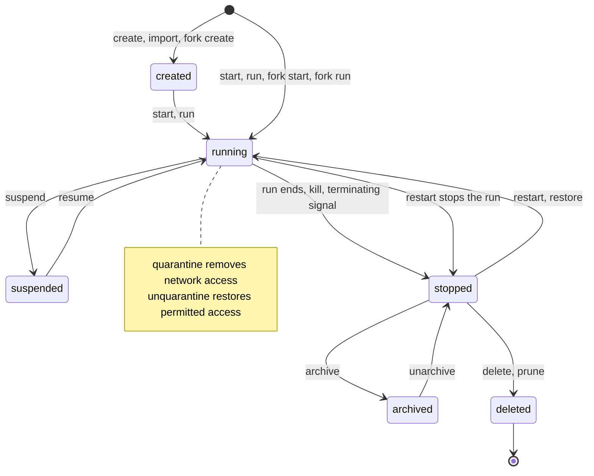

# Agents

An agent is a durable resource that persists across harness runs. Its configuration, workspace, conversations, and work history belong to it. Starting or ending a harness run changes the agent's activity without replacing the agent's identity.

An [execution](agent-execution.md) is one harness run belonging to one agent, from start to end. The agent's conversation forms a [session](agent-session.md). Its transcript remains after the run ends, and the agent retains its current session and past session transcripts. A session can continue across runs. Execution outcomes describe a run. Agent states describe the durable resource.

## Owned resources

| Resource | Relationship to the agent |
| --- | --- |
| Profile binding | Selects the [agent profile](agent-profile.md) that bounds behavior and authority. Each execution pins the exact profile content it uses. |
| Workspace and workspace revisions | Hold the agent's files and named points in their history. [Workspace sources](agent-workspace.md#workspace-sources) supply the directory tree for a run. |
| Current session and past session transcripts | Hold the conversation and its retained history, independent of harness process lifetime. |
| Checkpoints | Mark positions to which the current session can rewind. |
| Executions | Record harness runs, their outcomes, evidence, and provenance. |
| Credentials loaded into its broker | Bind authorized credential references to brokered use without exposing secret values to the harness. |
| Hooks | Add commands at [hook events](agent-hooks.md#hook-events), subject to profile rules. |
| MCP servers | Attach Model Context Protocol (MCP) services to the agent within its permitted access. |
| Skills | Supply reusable instructions and supporting resources to the harness. |
| Memory | Retains knowledge that the agent can query across sessions. |
| Artifacts | Associate stored inputs and outputs with the agent. |
| Mail | Holds the agent's incoming and outgoing agentmail messages. |
| Group memberships | Associate the agent with groups for announcements and coordination. |
| Subscriptions | Queue user messages upon delivery of events from a source. |
| Budget | Bounds allowed usage across the agent's work. |
| Labels and annotations | Store metadata for selection and reporting or descriptive context. Neither grants authority. |

Ownership of a reference doesn't grant access to its target. Profile capabilities, sandbox rules, and service authorization still bound each execution. The [execution token](agent-sandbox.md#execution-token) authorizes a run, and the agent's durable identity doesn't extend that token's lifetime.

## Lifecycle

| State | Meaning |
| --- | --- |
| `created` | The agent exists, and its harness hasn't started. |
| `running` | A harness run is active. It may be working, idle, or waiting for input. |
| `suspended` | The agent preserves state for resume after a suspend request. |
| `stopped` | The harness run ended. The agent and its retained resources remain. |
| `archived` | A snapshot preserves a stopped agent in archive storage. |
| `deleted` | Permanent deletion removed the agent resource. |

Quarantine is a network condition on a running agent. It removes network access without becoming a lifecycle state. Unquarantine restores connectivity within the agent's network rules.

Successful transitions appear in the diagram. A signal or request alone doesn't prove the harness stopped. Before afakt treats a run as ended, the provider's [verified termination](agent-execution.md#execution-states) rules apply. Launch failures leave an agent without an active run. Mapping intermediate provider states to agent status remains an open question.

## Create, start, and run

`afakt agent create` creates an agent without starting its harness. With `afakt agent start`, creation includes starting the harness. Starting a created agent begins its first execution. The profile binding supplies the behavior and authority bounds, and launch validates the execution's pinned profile and restrictions.

`afakt agent run` starts an agent and waits for its session to end before outputting the final message. It composes start, wait, and final-message retrieval. To wait alone, use `afakt agent wait`. The `afakt agent result` command reads the final message. Session-end wait and execution-token lifetime remain [open](agent-open-questions.md#agent-hooks).

## Attach and messages

`afakt agent attach` connects a terminal client to the agent's active conversation under the [writer and reader rules](agent-session-attachment.md#writer-and-readers). A workflow-controlled ACP execution admits readers only, and headless runs don't offer attachment. `steer` interrupts the current turn with a user message. `queue-message` delivers a user message after the current turn. Both remain subject to session authority and transport support.

`history` reads or follows current and historical transcripts. The `session` commands list, rename, download, and delete retained transcripts. `clear` clears the current session, while `compact` reduces its conversation context. Clearing context doesn't itself delete the agent or its execution history.

## Suspend, resume, and restart

`suspend` saves a checkpoint at an idle turn boundary and stops the VM through the agent host's supervisor and `VMM`. Resume restores that checkpoint under the same paths inside the guest and reacquires credentials outside it. The [suspend and resume](agent-session.md#suspend-and-resume) contract preserves the workspace and harness session state together. Exactly which process and transport state returns remains open.

`restart` restarts the agent's workspace and harness. Before the replacement run starts, the old run ends. Identity and history remain with the agent. How restart selects the workspace revision and session to continue remains open.

## Kill, signal, and quarantine

`kill` stops the VM through the supervisor and `VMM`. It operates independently of the guest and ACP policy. `signal` sends a process signal, whose effect depends on the signal and harness. The agent remains after either operation. Quarantine removes network access from a running agent, and `unquarantine` restores permitted connectivity. The interaction with broker, relay, and telemetry traffic remains open.

## Forks

A fork copies an agent into a separate agent. `fork create` leaves the copy created without starting the harness. `fork start` starts the copy, and `fork run` also waits for its session to end and outputs the final message. `fork list` lists an agent's forks. The copy has its own identity. The scope of copied resources and authority remains open.

## Snapshots and the snapshot registry

An agent snapshot is an archive of agent state for restoration or transfer. `snapshot create` captures state and uploads it to the snapshot registry. The snapshot commands list, inspect, download, upload, tag, label, annotate, delete, and prune snapshots. A snapshot isn't a checkpoint or a workspace image.

The snapshot registry stores and serves these archives. `archive` snapshots a stopped agent and moves the snapshot to archive storage. Returning the archived agent to stopped state on `unarchive` is the leading option. Exceptions for automatic start remain [open](agent-open-questions.md#agents). `restore` starts an agent from a snapshot. Snapshot contents, credential exclusions, identity handling, and retention rules remain open beyond the [interactive session snapshot](agent-session.md#suspend-and-resume) requirements.

## Export, import, and migrate

`export` packages an agent and its workspace as an Open Container Initiative (OCI) artifact. `import` creates an agent from that artifact. The transfer format doesn't imply permission to copy credentials or identity. Which owned resources travel in the artifact remains open.

`migrate` moves an agent to another agent host. The durable agent remains the same resource. Whether migration restores a compatible VM snapshot or reconstructs the transcript and workspace from portable state, and how it relates to execution placement, remain open.

## Delete and prune

`delete` permanently removes a stopped agent and can't be undone. `prune` permanently removes unused agents. Execution evidence still follows its [retention and cleanup rules](agent-execution-model.md#evidence-retention-and-cleanup). How deletion and pruning treat held evidence and shared resources remains open.

## Checkpoints

A checkpoint pairs a VM snapshot, the workspace disk delta, and the harness's session state, captured together at an idle turn boundary with the guest filesystem frozen. The agent can create, inspect, list, delete, or clear checkpoints. `afakt agent checkpoint rewind` starts a new conversation branch from a checkpoint and restores its workspace, retaining the original branch for audit. Rewind doesn't undo external effects. How it represents those effects and which process state it preserves remain open.

## Workspace revisions and the workspace registry

A portable workspace revision records a point in an agent's file history as an OCI diff layer plus a content-hashed file inventory. Content hashes determine correctness. Modification times and sizes never do. Local workspace checkpoints use frozen block deltas instead. The agent workspace commands commit revisions, inspect them, reset to another revision, and tag them. Push publishes the agent's workspace to the workspace registry. Pull fetches and applies another revision. These operations concern the agent's workspace rather than the source repositories' own commit and push operations.

The workspace registry stores workspace content and revision references. It also supplies [workspace images and definitions](agent-workspace-image.md). `afakt workspace` manages those reusable images and definitions, while `afakt agent workspace` addresses one agent's revision history. Their relationship to generation-specific workspace copies remains open.

## Agentmail, groups, and subscriptions

Agentmail is messaging addressed to durable agents. An agent has an inbox, outbox, and sent messages. Its mail commands draft, post, schedule, receive, acknowledge, inspect, undo, and verify messages. [Signed session messages](agent-session-attachment.md#message-signatures) supply a separate conversation-level mechanism. How agentmail uses that mechanism remains open.

An agent group is a named set of agents with membership, metadata, and events. Group broadcasts send announcements to members. A subscription connects an event source to an agent and queues user messages as deliveries arrive. Delivery ordering, retries, deduplication, and behavior while the recipient is inactive remain open for both mail and subscriptions.

## Memory, skills, and artifacts

Memory stores knowledge for reuse across the agent's sessions. Memory commands create, read, update, delete, copy, compact, and query entries. Storage, query semantics, and access boundaries remain open. Skills provide reusable instructions and resources. Adding a skill associates it with the agent without changing profile authority.

Stored content that can serve as input or output forms an artifact. Agent artifact commands manage associations with an agent, while `afakt artifact` manages the content resources and their metadata. The artifact proxy serves an artifact when `afakt artifact serve` publishes it through that service, but access checks, content lifetime, and the scope of serving remain open.

## Policies, roles, and organizational scope

A policy defines authorization rules. It can attach to roles, credentials, or sandbox configurations. A policy proposal represents a proposed change with explicit approval or rejection. Neither a proposal nor an agent's request for a change grants authority by itself.

A role groups associations with policies and authorizations for credentials. Within an organization, managed work shares an access scope. Projects group work within that scope. Requests record work to perform, complete or incomplete closure, and a reason for that closure. Agents work under these scopes without replacing their own profile or execution identity. Scope inheritance and the relationship between roles and the execution label named `role` remain open.

## Secrets, credentials, and trust material

A secret stores a sensitive value. Using secret material and authorization rules, a credential describes authenticated access. Credential references are fields on both the [agent profile](agent-profile.md#profile-fields) and the [agent execution](agent-execution-contract.md#execution-specification). Each reference specifies a credential in afakt's credential store. Attaching a credential to an agent permits brokered use without exposing its value to the harness. [Credential brokering](agent-sandbox.md#credential-brokering) takes references from the profile and execution. Reference bounds and attachment changes during a run remain [open](agent-open-questions.md#agents).

On their own workstation, the operator runs `afakt credential add TYPE CREDENTIAL_NAME` from the CLI, with the credential type selecting the authentication flow. Acting as a client of the API server, which may run on another machine, the CLI runs any harness authentication command and sends its result to the server for storage. The server never runs that command. Interactive authentication requires the operator and never runs headless, and disabling interaction doesn't turn an interactive flow into a headless one. The verb `add` registers an object that originates outside afakt, as with credentials. With `create`, afakt makes an object that it originates, as with `afakt agent create`.

| Credential type | Authentication flow |
| --- | --- |
| `claude-code-oauth-token` | The CLI points Claude Code's configuration directory at a private temporary directory and runs `claude setup-token` interactively. After the operator finishes, the CLI reads the token from the command's output and sends it to the API server. It then removes the directory. The operator's own Claude Code sign-in remains unread and unchanged by the CLI. |
| `anthropic-api-key` | The CLI sends the supplied key to the API server for storage in the credential store. It doesn't run a harness command or perform another authentication flow. |
| `codex-login` | With Codex's configuration directory pointing at a private temporary directory, the CLI runs the device-code flow of `codex login` interactively. Once the operator finishes, the CLI reads the resulting auth file from that directory and sends it to the API server. It then removes the directory, never reading or changing the operator's own Codex sign-in. afakt's credential store contains one central refresh token on which the mediator's credential brokering relies. |
| `openai-api-key` | For storage in the credential store, the CLI sends the API server the supplied key without running a harness command or performing another authentication flow. |

For login credentials, afakt's credential store is the only refresh owner. The broker refreshes through that store and never passes the token to the agent or shares a refresh lock with the operator's own CLI sign-in. Profiles, execution specifications, sandbox configurations, records, and evidence contain references, never secret values.

SSH keys authenticate SSH connections or sign content, while SSH known hosts record trusted remote host keys. GNU Privacy Guard (GPG) keys supply signing or encryption identities. Trusted Transport Layer Security (TLS) certificates establish certificate trust. Sandbox authorizations control which keys, keychain items, and credentials a sandbox may use. Key storage, signing delegation, rotation, and revocation remain open.

## Sandboxes

The agent's [sandbox](agent-sandbox.md) confines its run. `afakt agent sandbox` views that configuration. `afakt sandbox` manages sandbox configurations and standalone sandboxes, including command execution, network rules, and credential authorizations. A standalone sandbox runs commands without requiring an agent conversation. Its identity, lifecycle, and relationship to execution tokens remain open.

## Budgets and usage

An agent budget bounds allowed spending or consumption. Usage records observed cost, tokens, and subscription usage across its work. `budget` sets or updates the budget, `limits` shows resource and usage limits, and `usage` reads consumption. Accumulation across executions, usage forecasts, and enforcement at exhaustion remain open alongside the [execution limit contract](agent-execution-contract.md#execution-specification).
