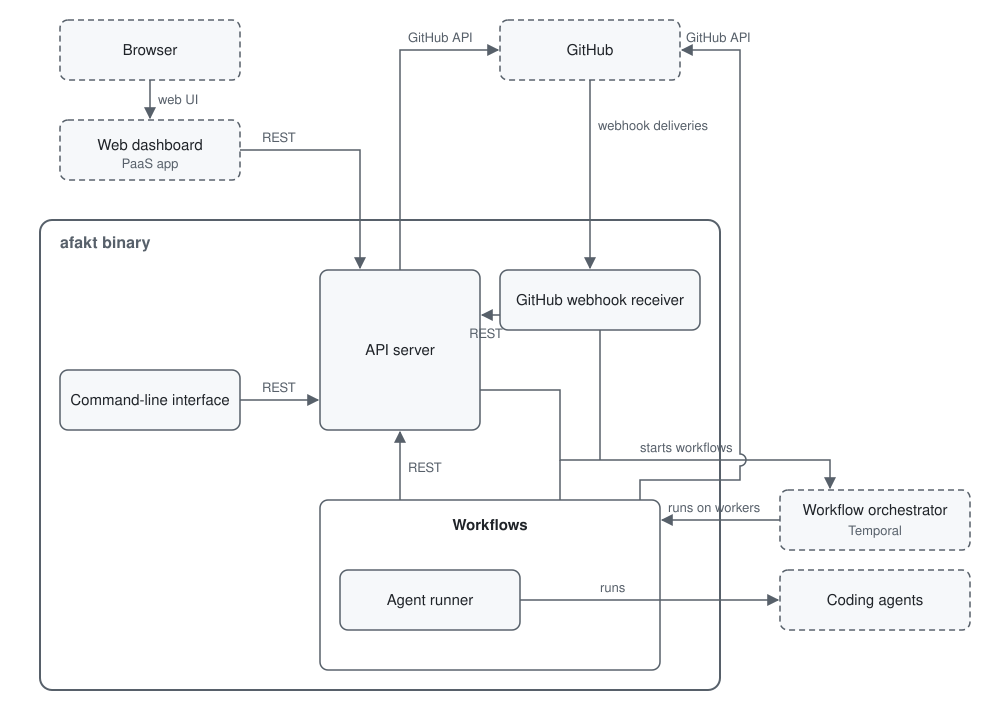

# Architecture

afakt is a modular monolith. One binary contains every component in [Components](components.md), and `afakt server --target=api|webhook|dashboard|worker|all` selects which runtime services a process runs.

The `all` target combines the API, webhook receiver, dashboard, and worker in one process. The API, webhook receiver, dashboard, and embedded Temporal Web UI share the process's HTTP listener. With embedded Temporal, the combined process runs without external services or an operational store.

## Clients and the API

The API server exposes afakt's REST API. The web dashboard, the command-line interface, native apps, and the coordination workflows call it. The binary serves the web dashboard from the same origin as the API. The API server also starts workflows on the workflow orchestrator.

## GitHub

The GitHub webhook receiver accepts webhook deliveries from GitHub. It calls the API server and starts workflows on the workflow orchestrator. In the other direction, the API server and the workflows call the GitHub API.

## Workflows

Temporal is the workflow orchestrator. It runs afakt's workflows on workers inside the binary, and a workflow can start other workflows. The Agent runner workflow runs AI coding agents.

Workers connect to an external Temporal server or use an embedded server for development and tests.

Every process answers `/livez` and `/readyz` on its listener. `/livez` reports that the process answers at all. `/readyz` passes once every service has started and, with the worker target, only while the Temporal namespace is reachable. It fails again when the shutdown begins.

The Temporal Web UI gives developers and testers a view of the embedded server's namespaces, workflows, and histories.
