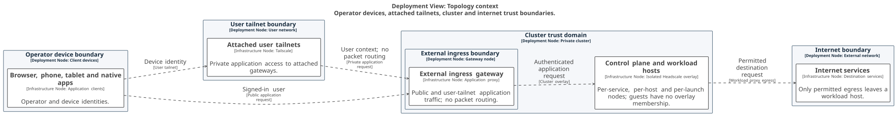
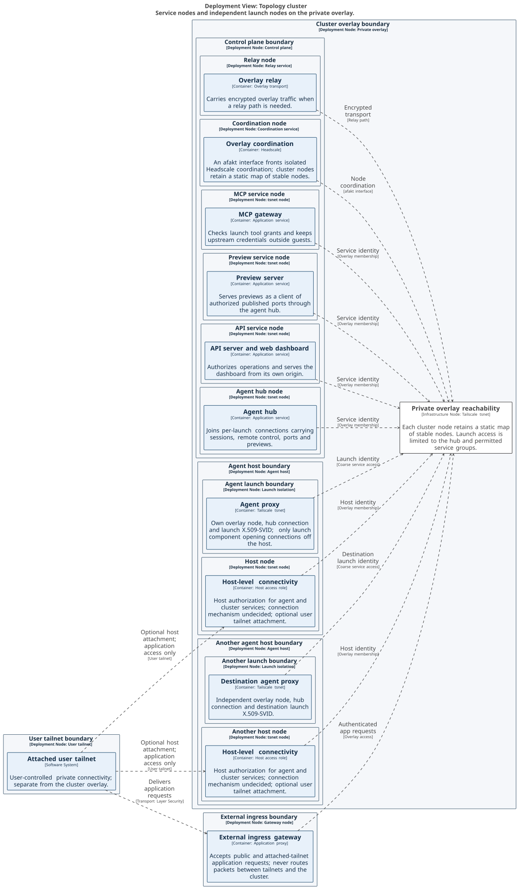
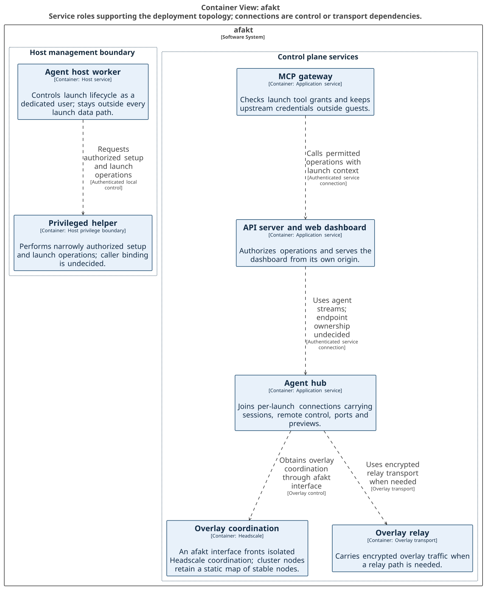
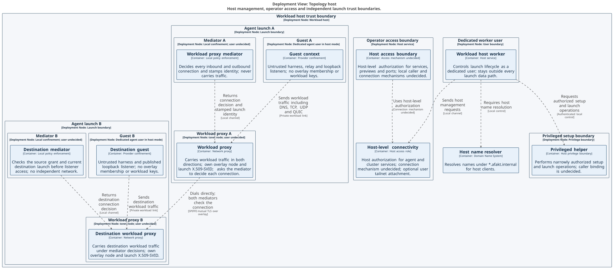
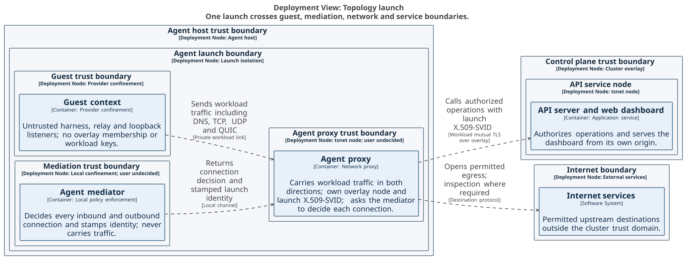
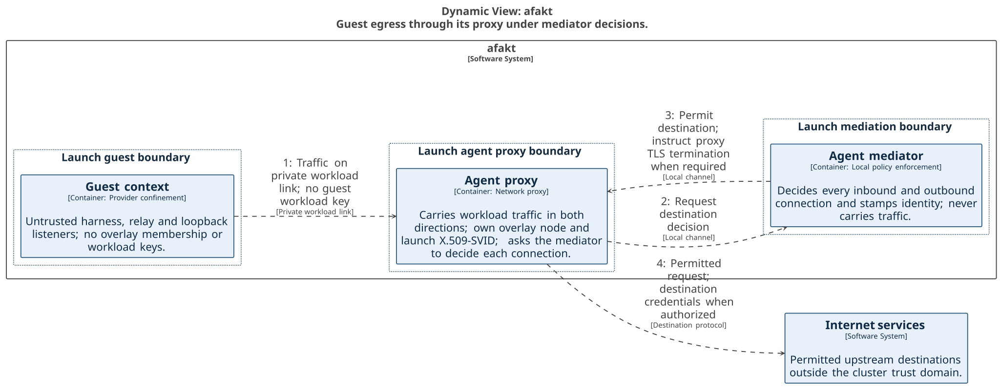
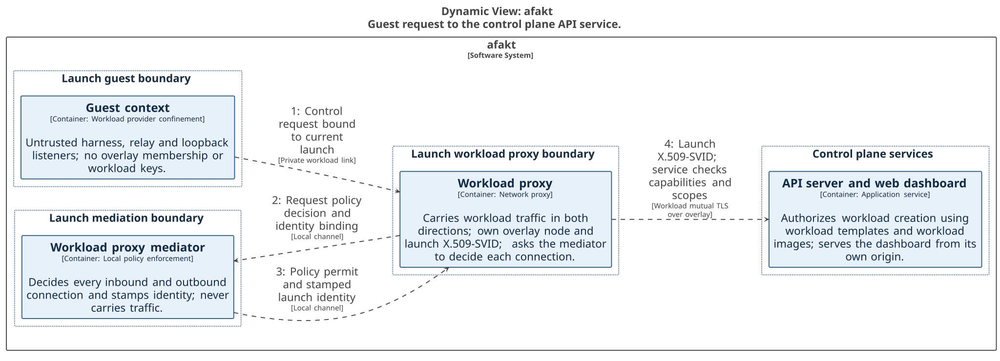
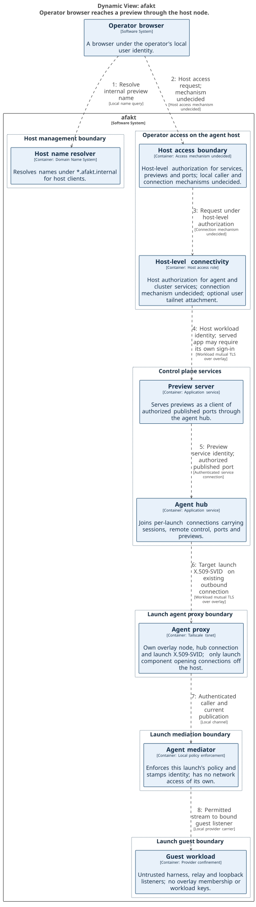
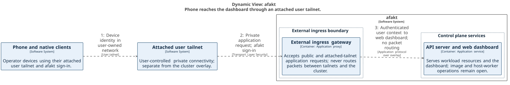
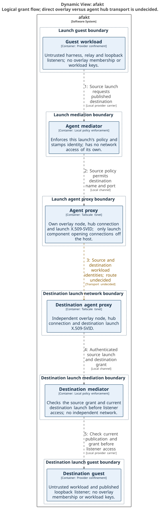

# Network topology

[Public key infrastructure](pki.md).

The cluster connects control plane services and agent hosts through a private overlay. Each agent launch has its own agent mediator and agent proxy. The guest has no overlay membership, and its mediator enforces policy before its agent proxy opens a connection off the host. The agent hub joins launch connections for sessions, remote control, published ports, and previews.

## Context

The operator uses browsers, phones, tablets, or native apps to reach the cluster. Public app requests enter through the external ingress gateway. A user can attach their own tailnets to that gateway for private app access. The user tailnet and cluster overlay remain separate trust zones: the gateway proxies app requests and never routes packets between them. Network access depends on a device's identity on the tailnet. Signing in to afakt supplies the user's app identity. Internet services remain outside both zones and receive only permitted destination requests.

User access follows [session authentication](agent-acp.md#The%20protocol%20endpoint) and [preview access](agent-previews.md#Access%20and%20share%20links). Authentication across service hops depends on [user-context binding](agent-open-questions.md#%60OQ-SES-10%60). Tailnet attachment and overlay behavior depend on [overlay qualification](agent-open-questions.md#%60OQ-HST-10%60).

## Cluster

The cluster overlay uses Tailscale's userspace client library, `tsnet`, against an isolated Headscale. Each agent proxy, agent host, and control plane service instance has its own node. Instances of one role share a tag but have separate node identities. Within the control plane are an agent hub, an Application Programming Interface (API) server, a preview server, a Model Context Protocol (MCP) gateway, and coordination and relay nodes. From its own origin, the API service serves the web dashboard. Headscale coordination sits behind afakt's own interface, which registers nodes and issues single-use tagged pre-authentication keys against a presented workload identity. That interface also sets tags and access rules and deletes nodes. Hub and coordination [instance counts](agent-open-questions.md#%60OQ-HUB-1%60) remain undecided. Each cluster node stores a static map of stable nodes for coordination outages. That map supplies addresses without granting permission to bypass authentication or policy.

The external ingress gateway uses Traefik with afakt authentication middleware for public and user-facing app traffic, under [External ingress gateway](agent-hub.md#External%20ingress%20gateway). Internal services connect to one another over the overlay without a separate internal gateway. User-tailnet attachment is available to the gateway and optionally an agent host's host-level node. Launch nodes never join user tailnets, and tailnet attachment doesn't select a mechanism for one node to join more than one tailnet. Overlay access control lists (ACLs) limit launches to the agent hub and permitted service groups. Mediators enforce grants for individual launch-to-launch connections.

Control plane services authenticate workload connections using mutual Transport Layer Security (TLS) and service identities. An agent proxy stores its launch's X.509 SPIFFE Verifiable Identity Document (SVID), outside the guest. Host access uses the host identity. For each agent proxy, the agent hub accepts a separate multiplexed connection. As a client of published ports, the preview server connects to a guest through that hub. Session, preview-stream, and launch-stream joining belong to the agent hub.

[Workload identity](agent-host.md#Workload%20identity), [service authorization](agent-open-questions.md#%60OQ-SBX-43%60), and [tool access](agent-mcp-gateway.md#Server%20and%20tool%20access) define the authority at these boundaries. [Overlay qualification](agent-open-questions.md#%60OQ-HST-10%60) leaves operational properties undecided. [Agent hub endpoint ownership](agent-open-questions.md#%60OQ-SES-11%60) leaves remote-control and session routing responsibilities undecided. The [policy engine](agent-open-questions.md#%60OQ-SBX-61%60) is undecided.

## Agent host

The agent host worker manages launch lifecycle as a dedicated non-root user. Host-mode launches use a separate dedicated agent user. A privileged helper crosses the setup and launch authority boundary. Each agent host supplies Domain Name System (DNS) resolution of `afakt.internal` and connectivity to agent ports, previews, services, and cluster services. Resolution doesn't grant access: requests require host-level authorization. The host-level network service names this role. Its mechanism and resolver ownership remain [undecided](agent-open-questions.md#%60OQ-HST-9%60).

Each agent launch has an independent guest, mediator, agent proxy, hub connection, and launch identity. Launches have no implicit access to one another. As the shared lifecycle controller, the worker stays out of every launch's data path. Operator and host-management requests pass through the host-level network service, which never handles guest egress. User selection for the mediator and agent proxy remains [undecided](agent-open-questions.md#%60OQ-HST-8%60). Traffic between launches on the same host uses the overlay, with no local shortcut.

[Host responsibilities](agent-host.md#What%20runs%20on%20an%20agent%20host) and [runtime privileges](agent-host.md#Runtime%20privileges%20and%20platforms) supply lifecycle context. Helper caller binding depends on [helper authentication](agent-open-questions.md#%60OQ-SBX-27%60). Local caller checks, name routing, and host-client certificate trust depend on [host access](agent-open-questions.md#%60OQ-HST-9%60). The broader [host isolation baseline](agent-open-questions.md#%60OQ-SBX-18%60) remains on hold.

## Agent launch

The agent launch contains three separate trust zones. These are untrusted guest code, the agent mediator that enforces policy, and the agent proxy that holds network access. Over a local carrier bound to its launch, the guest sends requests. It receives neither the launch SVID nor its private key. The mediator stamps launch identity and checks requests and returning streams. It doesn't have a network of its own. Using the launch SVID for workload authentication, the agent proxy opens the launch's hub connection and permitted service and internet connections. Each receiving service authenticates as its own workload.

The [guest layout](agent-sandbox.md#Guest%20layout%20and%20lifecycle%20control), [control requests](agent-mediator.md#Control%20requests), and [launch authentication](agent-proxy.md#Agent%20launch%20authentication) define the guest and service authority. Local carrier authentication depends on [guest-link protection](agent-open-questions.md#%60OQ-SBX-13%60). Provider capture depends on [mandatory mediation](agent-open-questions.md#%60OQ-SBX-54%60). Enforcement of the mediator's no-network rule on each operating system is [undecided](agent-open-questions.md#%60OQ-SBX-62%60). That rule doesn't select a service user or settle the host isolation baseline.

## Guest to the internet

The [agent proxy](agent-proxy.md#Internet%20connections) opens internet connections permitted by the agent mediator.

[Network policy](agent-mediator.md#Network%20policy) and [credential custody](agent-sandbox.md#Credential%20types%20and%20custody) bound the request. The [policy engine](agent-open-questions.md#%60OQ-SBX-61%60), [destination classification](agent-open-questions.md#%60OQ-SBX-24%60), [upstream name resolution](agent-open-questions.md#%60OQ-SBX-21%60), and [mediator network confinement](agent-open-questions.md#%60OQ-SBX-62%60) remain undecided.

## Guest to a control plane service

Over its launch-bound carrier, the guest sends a control request to the agent mediator. After a policy permit, the mediator stamps the launch identity and hands the request to that launch's agent proxy. Over the overlay, the agent proxy opens a workload-authenticated connection to the API service. From its peer certificate, the service reads the launch identity and checks capabilities and scopes against the immutable launch spec. The guest can't substitute another launch identity. Calls to the MCP gateway cross the same guest, mediator, agent-proxy, and service boundaries with the gateway's tool checks.

[Control requests](agent-mediator.md#Control%20requests), [capabilities](agent-profile.md#Capabilities), and [tool access](agent-mcp-gateway.md#Server%20and%20tool%20access) supply the request contract. [Local sender binding](agent-open-questions.md#%60OQ-SES-6%60), [service admission](agent-open-questions.md#%60OQ-SBX-43%60), and the [policy engine](agent-open-questions.md#%60OQ-SBX-61%60) remain undecided. [Session-end wait and SVID lifetime](agent-open-questions.md#%60OQ-HOOK-18%60) remain on hold.

Workload identities use the provisional lifetimes and half-life renewal in [Certificate policies](pki.md#Certificate%20policies), subject to [`OQ-HOOK-18`](agent-open-questions.md#%60OQ-HOOK-18%60).

## Operator browser to a preview

The preview request follows the [host browser access rules](agent-previews.md#Host%20browser%20access).

## Phone through a user tailnet to the dashboard

The phone connects through its user tailnet to the external ingress gateway at a MagicDNS name such as `https://afakt.<tailnet>.ts.net`. Hypertext Transfer Protocol Secure (HTTPS) protects the app connection. Tailnet device identity permits network reachability, while afakt sign-in identifies the user. The gateway forwards authenticated app requests to the API service's web dashboard over the cluster overlay. Its tailnet attachment never becomes a packet route into that overlay. Tablets and native apps use the same user-facing boundary, and launch nodes remain outside the user's tailnet.

[Dashboard access](components.md#Web%20dashboard) and [user authentication](agent-acp.md#The%20protocol%20endpoint) define app authority. [User-context binding](agent-open-questions.md#%60OQ-SES-10%60) and [overlay qualification](agent-open-questions.md#%60OQ-HST-10%60) leave authentication propagation, certificate behavior, and attachment details undecided.

## Launch to launch under a grant

The source guest requests a connection to a published destination name and port through its agent mediator. The source mediator checks the source launch's network policy before passing the request to its own agent proxy. Workload identities of the source and destination launches cross the logical connection between agent proxies. Its dashed edge leaves direct overlay paths versus the agent hub [undecided](agent-open-questions.md#%60OQ-PORT-8%60). It doesn't select a direct connection. The destination agent proxy passes the source identity and target grant to its mediator, which checks the destination launch, current publication, and grant before reaching the guest listener. Overlay ACLs supply only coarse reachability. Neither a listener nor overlay access grants permission to use a port.

[Connections between agents](agent-ports.md#Connections%20between%20agents) defines the two-sided authorization. The [policy engine](agent-open-questions.md#%60OQ-SBX-61%60), [local carrier binding](agent-open-questions.md#%60OQ-SBX-13%60), and [stream retirement](agent-open-questions.md#%60OQ-SBX-40%60) remain undecided. Same-host launch traffic uses the overlay too. Neither the worker nor the host-level network service transmits launch traffic.
