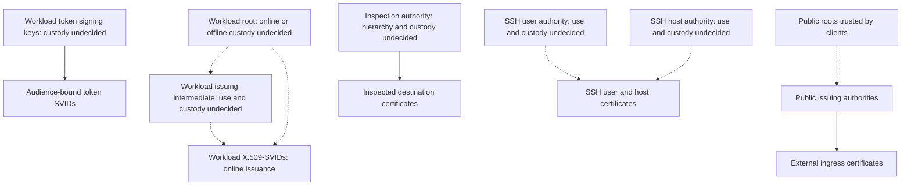

# Public key infrastructure

afakt separates workload identity, public transport trust, inspection trust, and signing authority. A valid certificate proves an identity within its trust boundary. Authorization also checks the operation and its target. The [workload inventory](pki-workload.md), [transport inventory](pki-transport.md), and [signing and secret inventory](pki-signing.md) identify the material at each boundary. [Operations](pki-operations.md) covers issuance, renewal, recovery, and threats.

## Issuer capability

A workload identity issuer provides attestation, registration, certificate and token issuance, and authenticated trust distribution. The choice of issuer software and its administrative ownership remain [undecided](agent-open-questions.md#%60OQ-SBX-33%60), along with its [operational contract](agent-open-questions.md#%60OQ-PKI-1%60). Regardless of the issuer selected, the boundary between an authenticated workload and its permitted actions remains the same.

Each control plane has one Secure Production Identity Framework for Everyone (SPIFFE) trust domain, without federation to other control planes. A workload has an identity of the form `spiffe://<trust-domain>/...`. Host-side processes get SPIFFE Verifiable Identity Documents (SVIDs) through a Workload Application Programming Interface (API) endpoint that the guest can't access. The workload proxy keeps its launch's identity and private key outside the guest. See [Workload identity](workload-host.md#Workload%20identity) and [Launch boundary](workload-proxy.md#Launch%20boundary).

## Authority hierarchy

For workload identities, the trust bundle establishes trust in workload certificates. Guest trust for inspected destinations comes from the inspection authority. Public transport certificates chain to authorities trusted by external clients. Within each boundary, the hierarchy remains [undecided](agent-open-questions.md#%60OQ-PKI-2%60), including whether the workload root delegates to intermediates. Dashed edges below denote undecided delegation or authority selection.

Secure Shell (SSH) authorities, if used, authenticate SSH principals. They don't issue workload certificates. JavaScript Object Notation (JSON) Web Token (JWT) signing keys authenticate token SVIDs through a public key set. An X.509 certificate for a token signing key isn't implied by the diagram. [Credential delegation](agent-open-questions.md#%60OQ-AGT-21%60) leaves SSH authority selection undecided.

| Authority | Permitted purpose | Constraints awaiting a decision |
| --- | --- | --- |
| Workload root and any intermediate | Establish identities in the trust domain of one control plane. | Delegation, online or offline custody, name constraints, path length, extended key usages (EKUs), and exact Uniform Resource Identifier (URI) subject alternative name (SAN) profiles remain [undecided](agent-open-questions.md#%60OQ-PKI-2%60). |
| Inspection authority | Authenticate inspected destinations to the guest after mediator admission. | Delegation, path length, EKUs, destination SAN restrictions, and lifetime remain [undecided](agent-open-questions.md#%60OQ-PKI-6%60). |
| Public issuing authority | Authenticate external ingress names to clients. | Authority, chain, EKUs, issuance constraints, and certificate profile remain [undecided](agent-open-questions.md#%60OQ-PKI-5%60). |
| SSH user and host authorities, if used | Authenticate delegated user principals and remote hosts. | Authority selection, principal restrictions, extensions, and validity remain [undecided](agent-open-questions.md#%60OQ-AGT-21%60). |

## Certificate policies

The workload identity starting values are an X.509-SVID lifetime of one hour, a JWT-SVID lifetime of five minutes, and an issuing certificate authority (CA) lifetime of 24 hours, with renewal at half of each lifetime. Each starting value remains subject to the held [session-end wait and identity lifetime decision](agent-open-questions.md#%60OQ-HOOK-18%60), and these values don't establish a root lifetime or an upper lifetime limit for another certificate class.

| Policy | Rule or unresolved bound |
| --- | --- |
| Algorithms and key sizes | The inventory explicitly marks the value for each class undecided pending selection of its [cryptographic profile](agent-open-questions.md#%60OQ-PKI-2%60). |
| Lifetime limits | Upper lifetime limits for roots, issuing authorities, workload certificates, public and inspection certificates, and delegated credentials remain [undecided](agent-open-questions.md#%60OQ-PKI-2%60). Workload starting values remain under the preceding held decision. |
| Clock skew and backdating | Allowed skew, backdating, and deadline interpretation remain [undecided](agent-open-questions.md#%60OQ-SBX-49%60). |
| Identity names | The SPIFFE path scheme is [undecided](agent-open-questions.md#%60OQ-MOD-9%60). An internal service name from [overlay naming](workload-overlay.md#Names) doesn't itself specify a certificate SAN or confer authority. |
| Certificate validation | Complete profile validation and its enforcement boundary remain [undecided](agent-open-questions.md#%60OQ-SBX-46%60). Service authorization remains separate from signature validation. |
| Issuance admission | Launch mapping and renewal authorization remain [undecided](agent-open-questions.md#%60OQ-SBX-30%60). A guest can't choose another launch identity or access the Workload API. |
| Exchange admission | A credential exchange uses an X.509-SVID over mutual Transport Layer Security (TLS) or an audience-bound JWT-SVID. [Exchange rules](agent-open-questions.md#%60OQ-SBX-17%60) determine the form. |
| Issuance rate limits | Workload issuance limits remain [undecided](agent-open-questions.md#%60OQ-PKI-2%60). Exchange rate, count, and retry bounds remain [undecided](agent-open-questions.md#%60OQ-SBX-51%60). |
| Terminal launches | The API server and Model Context Protocol (MCP) gateway reject requests from terminal launches. [Active connection retirement](agent-open-questions.md#%60OQ-SBX-40%60) and [exchanged credential expiry](agent-open-questions.md#%60OQ-SBX-48%60) remain undecided. |

## Key storage tiers

Key custody separates guest code, host-side components, central services, and release or recovery authorities. Brokered secrets and signing material stay outside the agent sandbox under [credential custody](workload-sandbox.md#Credential%20types%20and%20custody). The [key export rule](agent-open-questions.md#%60OQ-SBX-42%60) and the held [host isolation baseline](agent-open-questions.md#%60OQ-SBX-18%60) govern further separation.

| Tier | Custody rule |
| --- | --- |
| Guest | Public inspection trust may enter the guest. Launch SVIDs, their private keys, brokered credentials, and message signing keys don't. |
| Workload host or site gateway | Launch identity and authorized broker material stay outside the guest. Software storage, operating-system keychain, Trusted Platform Module (TPM), or Secure Enclave requirements are [undecided](agent-open-questions.md#%60OQ-SBX-42%60). |
| Control plane | Exchangeable credentials stay central. Secret-store protection and hardware security module (HSM) use remain [undecided](agent-open-questions.md#%60OQ-PKI-9%60). |
| Root, release, and recovery authority | Operator separation, offline storage, HSM requirements, and backup custody remain [undecided](agent-open-questions.md#%60OQ-PKI-2%60). Release key custody has a separate [signing question](agent-open-questions.md#%60OQ-PKI-8%60). |

Hardware-backed enrollment doesn't imply hardware-backed workload keys. A key held by an operating-system keychain isn't necessarily non-exportable. Enrollment evidence, private-key custody, and authorization each require their own checks under [host enrollment](agent-open-questions.md#%60OQ-HST-3%60).

## Compromised hosts and workers

Trust in the workload host covers lifecycle control, mediation, and locally held credentials. Compromise can expose that authority. A valid identity doesn't prove honest enforcement, and the worker's shared lifecycle role doesn't grant it a place in launch data paths. See [Trust boundary](workload-host.md#Trust%20boundary) and [Workload host](network-topology.md#Workload%20host).

What a compromised worker or host can issue depends on [registration authority](agent-open-questions.md#%60OQ-SBX-30%60) and [broker scope](agent-open-questions.md#%60OQ-SBX-31%60), both undecided. No bounded cross-launch issuance claim follows from keeping keys outside the guest. Host revocation, independent compromise detection, and containment remain under [host revocation](agent-open-questions.md#%60OQ-HST-6%60) and [compromise containment](agent-open-questions.md#%60OQ-SBX-37%60).
