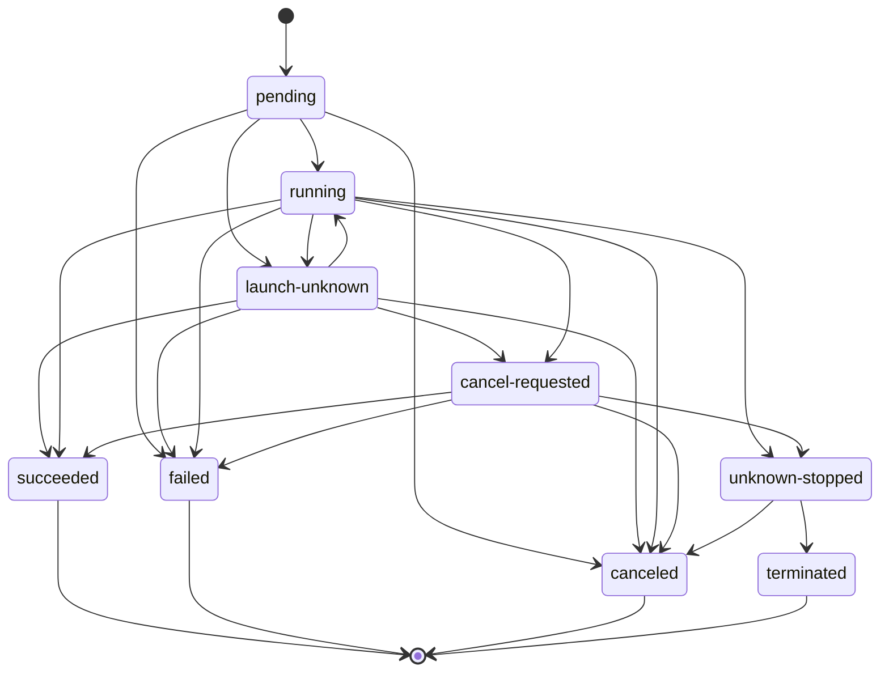

# Workload lifecycle

[Public key infrastructure](pki.md).

For one agent launch, the workload provider manages provisioning, restoration, and release. Launch states record provider observations separately from [agent states](agent-lifecycle.md#Agent%20states) and [session states](agent-lifecycle.md#Session%20states). A virtual machine (VM) has lifecycle control independent of the Agent Client Protocol (ACP) and the guest.

[Deletion and teardown](agent-workspace-lifecycle.md#Deletion%20and%20teardown).

## Agent launch lifecycle

Each agent launch goes through these steps in order. A confirmed failure ends the agent launch in a terminal state only after the required [provider observations](workload-lifecycle.md#Workload%20provider%20observations), and the later steps up to the result don't run, with three exceptions. Once the agent harness has started, the `session-end` hooks run after a headless exit or ACP session closure, whatever the reason. When the agent completes on its own with a failure or invalid output, the `after-agent` hooks with `exit` still run. Once the workload provider has opened the agent sandbox, the `before-teardown` hooks run at every end.

1. **Request.** The parent workflow submits an agent launch request. The agent dispatcher authorizes it, and afakt assigns the agent launch ID.
2. **Placement and finalization.** The agent dispatcher picks a host task queue and reserves an agent launch slot. It then finalizes the agent launch spec from the agent spec generation. See [Workload placement](workload-placement.md).
3. **Launch.** The agent dispatcher starts the agent launcher on the placed host's task queue. The launcher calls status, and it calls provision only when the agent launch doesn't exist, under the rules in [Reconciliation after restart or retry](agent-launch.md#Reconciliation%20after%20restart%20or%20retry). The provider validates the specification against the pinned profile version and stores a copy of that version. It records the agent launch as `pending`. The order relative to claiming a slot remains [`OQ-PLC-11`](agent-open-questions.md#%60OQ-PLC-11%60).
4. **Building the agent workspace.** From the [workspace sources](agent-workspace.md#Workspace%20sources), the provider builds the workspace. If that fails, the agent launch ends `failed` with workspace failure as its reason.
5. **Sandbox and harness configuration.** The provider combines the [sandbox configurations](workload-sandbox.md#Combining%20configurations) and the [workload environment](agent-workspace.md#Workload%20environment), and it renders the instructions. The workload proxy uses its launch's X.509 Secure Production Identity Framework for Everyone (SPIFFE) Verifiable Identity Document (SVID) for [agent launch authentication](workload-proxy.md#Agent%20launch%20authentication). The SVID and its private key stay outside the guest. Harness settings include permissions, tools, and [hooks for harness events](agent-hooks.md#Hook%20dispatch). The relay and settings must be ready before hooks on either transport. Their relative startup order and adapter ownership remain [`OQ-SES-15`](agent-open-questions.md#%60OQ-SES-15%60). Provider-specific placement follows [Provider lifecycle contracts](workload-lifecycle.md#Workload%20provider%20lifecycle%20contracts).
6. **Before-agent hooks.** The provider runs the `before-agent` [hooks](agent-hooks.md#Hook%20events). The time limit starts with the first one, and the agent launch becomes `running`.
7. **Running the agent.** The provider starts the harness through the selected transport. On workflow-controlled ACP launches, the agent launcher workflow sends the rendered instructions and the prompt together through the relay. While the agent works, the agent harness runs the hooks for harness events through the afakt command-line interface (CLI), and the provider runs the `sandbox-violation` hooks for each violation the sandbox reports. The agent launch ends when the agent completes on its own, a limit stops it, or a cancellation stops it. After a headless exit or ACP session closure, for any reason, the provider runs the `session-end` hooks within their own [session-end budget](agent-hooks.md#Running%20hooks), outside the time limit.
8. **After-agent hooks.** Once the agent completes on its own and the provider observes that the harness, adapter, and their helpers have exited, the provider validates the final answer. It then runs the `after-agent` hooks that apply, retaining mediated control for them under [Running hooks](agent-hooks.md#Running%20hooks).
9. **Result.** The provider records the workspace changes. After the `before-teardown` hooks, it builds the [agent launch result](agent-launch-contract.md#Agent%20launch%20result) as it enters the terminal state. From then on, the credential broker stops writing credentials and the Application Programming Interface (API) server refuses requests from that agent launch's identity. The provider also records the agent-launch-ended event.
10. **Evidence and provenance.** From launch on, the provider publishes evidence and fills in the observed fields of the [provenance record](agent-launch-model.md#Provenance%20record). Both are complete by the time the result exists. Each step from placement on is also a span in the [trace of the agent launch](agent-observability.md#Spans). The agent launcher fetches the result and returns it to the agent dispatcher, which returns it to the parent.
11. **Retention and cleanup.** The agent launch's workspace and evidence remain for the retention period. Then cleanup removes them, as [Evidence, retention, and cleanup](agent-launch-model.md#Evidence,%20retention,%20and%20cleanup) describes.

A successful agent launch passes from creation through preparation and agent harness activity to its result.

## Agent launch states

Agent launch states describe a run, separately from the durable [agent lifecycle](agent-lifecycle.md#Agent%20states).

| State | Terminal | Meaning |
| --- | --- | --- |
| `pending` | No | The workload provider recorded the agent launch and hasn't started its agent. |
| `launch-unknown` | No | The provider tried to start the agent and can't yet confirm whether it started. |
| `running` | No | The provider observed a hook or the agent running. |
| `cancel-requested` | No | The provider acknowledged a cancellation and the agent hasn't stopped. |
| `unknown-stopped` | No | A time limit, resource limit, or stop grace period ran out, and the provider hasn't observed the agent stop. The state keeps its stop cause, which is either the caller's stop request or the limit that ran out. |
| `succeeded` | Yes | The agent completed on its own with success and produced a valid payload, and each `after-agent` hook succeeded. |
| `failed` | Yes | The workspace build failed, the agent didn't start, completed with a failure, or produced invalid output, a `before-agent` or `after-agent` hook failed, or a `sandbox-violation` hook ended the run. |
| `canceled` | Yes | The provider observed the agent stop after an acknowledged cancellation or ACP `cancelled`, or the cancellation arrived before the agent started. |
| `terminated` | Yes | The provider observed the agent stop after a limit forced it. |

| From                          | To                      | When                                                                                             |
| ----------------------------- | ----------------------- | ------------------------------------------------------------------------------------------------ |
| `pending`                     | `running`               | The provider observes the first `before-agent` hook or the agent start.                          |
| `pending`                     | `launch-unknown`        | The start attempt doesn't return an answer the provider can trust.                               |
| `pending`                     | `failed`                | The workspace build fails, or the provider observes that the agent couldn't start.               |
| `pending`                     | `canceled`              | A cancellation arrives before the provider starts the agent.                                     |
| `launch-unknown`              | `running`               | The provider observes the agent running.                                                         |
| `launch-unknown`              | `succeeded` or `failed` | The provider observes that the agent already ended.                                              |
| `launch-unknown`              | `failed`                | The provider observes that the agent launch has no agent.                                           |
| `launch-unknown` or `running` | `cancel-requested`      | The provider acknowledges a cancellation.                                                        |
| `running`                     | `succeeded` or `failed` | The provider observes the agent complete and the end of the `after-agent` hooks that apply.          |
| `running` or `launch-unknown` | `canceled` | ACP returns `cancelled`, and the provider observes that every process it started for the launch has exited. |
| `running`                     | `failed`                | A `before-agent` hook fails.                                                                     |
| `running`                     | `failed`                | A `sandbox-violation` hook returns `terminate`, and the provider observes the agent stop.        |
| `running`                     | `launch-unknown`        | After the `before-agent` hooks, the start attempt doesn't return an answer the provider can trust. |
| `running`                     | `unknown-stopped`       | A hook or the agent exceeds a time limit or resource limit, and the provider signals it to stop. |
| `cancel-requested`            | `canceled`              | The provider observes the agent stop.                                                            |
| `cancel-requested`            | `succeeded` or `failed` | The agent completes on its own before the cancellation takes effect.                                 |
| `cancel-requested`            | `unknown-stopped`       | The stop grace period runs out, and the provider stops the agent by force.                       |
| `unknown-stopped`             | `canceled`              | The provider observes the agent stop, and the stop cause is a cancellation or a supersession.    |
| `unknown-stopped`             | `terminated`            | The provider observes the agent stop, and the stop cause is a limit.                             |

Terminal transitions require [provider observations](workload-lifecycle.md#Workload%20provider%20observations).

## Startup and readiness

For the hypervisor provider, native start reaches the agent sandbox-ready stage. Agent harness startup follows separately. Suspend, resume, stop, `kill`, and workload snapshot operations go through the workload host's supervisor and hypervisor. They never go through ACP or the guest. No guest or session policy can block lifecycle control. Filesystem freezing keeps VM state consistent with the workspace disk delta when afakt takes a workload snapshot and an agent checkpoint together at an idle turn boundary. The agent harness takes its agent checkpoint of session state. Capture doesn't grant the guest authority over host lifecycle operations. Host modes and container managers have no workload snapshot.

## Workload provider observations

These rules apply to all providers:

- A terminal state never changes.
- A provider observation is the one way into a terminal state. An elapsed timer, a reached deadline, an acknowledged cancellation, or a forced stop leaves the agent launch non-terminal until the provider observes the outcome.
- A timeout is never proof that the agent stopped. A reached limit or a spent stop grace period moves the agent launch to `unknown-stopped`. An observed stop is what moves it on, to `canceled` or `terminated` by the stop cause it keeps.
- Before reporting a stop, the provider observes that each process it started for the agent launch has exited. On ACP, that includes the relay and adapter. On both transports, it includes helpers still running after the agent harness ends.
- `launch-unknown` and `unknown-stopped` never count as success. A caller that reads either one waits, cancels, or reports the agent launch as unresolved.
- A loss of contact with the workload host doesn't change the state. Status returns `unavailable`, and the last recorded state stands.

[Virtual machine lifecycle](workload-lifecycle.md#Virtual%20machine%20lifecycle).

## Cancellation and limits

- **Cancellation.** A parent workflow cancels the agent dispatcher workflow, which passes the cancellation on to its child, the agent launcher workflow. The launcher then calls cancel. While the agent runs, the workload provider first runs the `stop-requested` hooks. It then signals the running hook or agent to stop, waits the stop grace period, and then stops it by force. The agent launch becomes `canceled` once the provider observes the stop.
- **Limits.** The time limit and resource limits cover the hooks and the agent together. When one runs out, the provider stops the running process the same way, and the agent launch ends `terminated` once the provider observes the stop. The `stop-requested` hooks run at the time limit but not at a resource limit.
- **Closing the parent.** A parent workflow that closes first requests cancellation of the agent dispatcher through its default parent-close behavior. The agent dispatcher then cancels the agent launcher, which cancels the agent launch and waits for its terminal state.

[Agent launches and supersession](agent-lifecycle.md#Agent%20launches%20and%20supersession).

## Suspend and resume

A virtual machine alone doesn't establish capture or restore support. Eligibility and captured state remain [`OQ-AGT-1`](agent-open-questions.md#%60OQ-AGT-1%60) and [`OQ-AGT-3`](agent-open-questions.md#%60OQ-AGT-3%60).

For a VM provider that supports paired capture, afakt takes a workload snapshot and an agent checkpoint together at the same idle turn boundary. The workload snapshot captures VM state, while the agent harness takes its own checkpoint of session state. The guest filesystem is frozen for capture so the workspace disk delta and session state agree. Credentials and broker state stay outside the guest and both captures.

In the object store, the workload provider retains the workload snapshot and agent checkpoint data. Resume creates a new agent launch linked to its predecessor. It restores VM state from the snapshot and harness session state from the checkpoint. It preserves guest paths and reacquires credentials outside the guest. It must recheck port publications and channels. Which process state, compatibility constraints, and placement rules allow restoration on another workload host remain [open](agent-open-questions.md#Agents). Host modes and container managers have no workload snapshot. Their rewind and resume behavior remains [open](agent-open-questions.md#%60OQ-AGT-28%60).

## Virtual machine lifecycle

The workload host supervisor and virtual machine monitors control the VM lifecycle independently of ACP and the guest. This path supplies start, suspend, resume, stop, `kill`, and workload snapshot control. A workload snapshot captures VM state and exists only where the agent runs in a VM. Where harness session state must agree with VM state, afakt takes a workload snapshot and an agent checkpoint together at an idle turn boundary. Session state checkpoints are the agent harness's responsibility. Restoration in host modes and container managers remains [open](agent-open-questions.md#%60OQ-AGT-28%60). The supervisor verifies a forced VM stop even if the guest or the mediator's ACP policy checks don't respond. Graceful process signals and bounded hooks don't give the guest authority to block that fallback.

## Workload provider lifecycle contracts

The workload provider supplies its startup, capture, teardown, and observation contract. Provider-specific readiness evidence and restoration gaps follow these boundaries.

| Provider | Startup | Capture and restore | Cancellation and teardown | Observations |
| --- | --- | --- | --- | --- |
| Workload provider for Claude Managed Agents | [Startup](workload-provider-claude-managed-agents.md#Process%20placement%20and%20startup) | [Capture and restore](workload-provider-claude-managed-agents.md#Workload%20snapshots%20and%20agent%20checkpoints) | [Teardown](workload-provider-claude-managed-agents.md#Cancellation%20and%20teardown) | [Observations](workload-provider-claude-managed-agents.md#Host%20observations) |
| Workload provider for Cloudflare Sandbox software development kit (SDK) | [Startup](workload-provider-cloudflare.md#Process%20placement%20and%20startup) | [Capture and restore](workload-provider-cloudflare.md#Workload%20snapshots%20and%20agent%20checkpoints) | [Teardown](workload-provider-cloudflare.md#Cancellation%20and%20teardown) | [Observations](workload-provider-cloudflare.md#Host%20observations) |
| Workload provider for Docker Desktop on macOS | [Startup](workload-provider-docker-desktop-macos.md#Process%20placement%20and%20startup) | [Capture and restore](workload-provider-docker-desktop-macos.md#Workload%20snapshots%20and%20agent%20checkpoints) | [Teardown](workload-provider-docker-desktop-macos.md#Cancellation%20and%20teardown) | [Observations](workload-provider-docker-desktop-macos.md#Host%20observations) |
| Workload provider for Docker Desktop on Windows | [Startup](workload-provider-docker-desktop-windows.md#Process%20placement%20and%20startup) | [Capture and restore](workload-provider-docker-desktop-windows.md#Workload%20snapshots%20and%20agent%20checkpoints) | [Teardown](workload-provider-docker-desktop-windows.md#Cancellation%20and%20teardown) | [Observations](workload-provider-docker-desktop-windows.md#Host%20observations) |
| Workload provider for Docker Engine | [Startup](workload-provider-docker-engine.md#Process%20placement%20and%20startup) | [Capture and restore](workload-provider-docker-engine.md#Workload%20snapshots%20and%20agent%20checkpoints) | [Teardown](workload-provider-docker-engine.md#Cancellation%20and%20teardown) | [Observations](workload-provider-docker-engine.md#Host%20observations) |
| Workload provider for Linux host | [Startup](workload-provider-linux-host.md#Process%20placement%20and%20startup) | [Capture and restore](workload-provider-linux-host.md#Workload%20snapshots%20and%20agent%20checkpoints) | [Teardown](workload-provider-linux-host.md#Cancellation%20and%20teardown) | [Observations](workload-provider-linux-host.md#Host%20observations) |
| Workload provider for Linux VM | [Startup](workload-provider-linux-vm.md#Process%20placement%20and%20startup) | [Capture and restore](workload-provider-linux-vm.md#Workload%20snapshots%20and%20agent%20checkpoints) | [Teardown](workload-provider-linux-vm.md#Cancellation%20and%20teardown) | [Observations](workload-provider-linux-vm.md#Host%20observations) |
| Workload provider for macOS host | [Startup](workload-provider-macos-host.md#Process%20placement%20and%20startup) | [Capture and restore](workload-provider-macos-host.md#Workload%20snapshots%20and%20agent%20checkpoints) | [Teardown](workload-provider-macos-host.md#Cancellation%20and%20teardown) | [Observations](workload-provider-macos-host.md#Host%20observations) |
| Workload provider for macOS VM | [Startup](workload-provider-macos-vm.md#Process%20placement%20and%20startup) | [Capture and restore](workload-provider-macos-vm.md#Workload%20snapshots%20and%20agent%20checkpoints) | [Teardown](workload-provider-macos-vm.md#Cancellation%20and%20teardown) | [Observations](workload-provider-macos-vm.md#Host%20observations) |
| Workload provider for Modal Sandboxes | [Startup](workload-provider-modal.md#Process%20placement%20and%20startup) | [Capture and restore](workload-provider-modal.md#Workload%20snapshots%20and%20agent%20checkpoints) | [Teardown](workload-provider-modal.md#Cancellation%20and%20teardown) | [Observations](workload-provider-modal.md#Host%20observations) |
| Workload provider for OpenAI Agents API | [Startup](workload-provider-openai-agents-api.md#Process%20placement%20and%20startup) | [Capture and restore](workload-provider-openai-agents-api.md#Workload%20snapshots%20and%20agent%20checkpoints) | [Teardown](workload-provider-openai-agents-api.md#Cancellation%20and%20teardown) | [Observations](workload-provider-openai-agents-api.md#Host%20observations) |
| Workload provider for Podman | [Startup](workload-provider-podman.md#Process%20placement%20and%20startup) | [Capture and restore](workload-provider-podman.md#Workload%20snapshots%20and%20agent%20checkpoints) | [Teardown](workload-provider-podman.md#Cancellation%20and%20teardown) | [Observations](workload-provider-podman.md#Host%20observations) |
| Workload provider for Windows host | [Startup](workload-provider-windows-host.md#Process%20placement%20and%20startup) | [Capture and restore](workload-provider-windows-host.md#Workload%20snapshots%20and%20agent%20checkpoints) | [Teardown](workload-provider-windows-host.md#Cancellation%20and%20teardown) | [Observations](workload-provider-windows-host.md#Host%20observations) |
| Workload provider for Windows VM | [Startup](workload-provider-windows-vm.md#Process%20placement%20and%20startup) | [Capture and restore](workload-provider-windows-vm.md#Workload%20snapshots%20and%20agent%20checkpoints) | [Teardown](workload-provider-windows-vm.md#Cancellation%20and%20teardown) | [Observations](workload-provider-windows-vm.md#Host%20observations) |

## Recovery and open questions

The agent launcher [reconciles an existing launch](agent-launch.md#Reconciliation%20after%20restart%20or%20retry) after a retry or worker restart. Lost contact proves no termination. [Provision readiness](agent-open-questions.md#%60OQ-CON-9%60), [capture scope](agent-open-questions.md#%60OQ-AGT-3%60), and [restoration without a virtual machine](agent-open-questions.md#%60OQ-AGT-28%60) remain undecided. [Hook protection](agent-open-questions.md#%60OQ-HOOK-16%60) and [session-end wait and SVID lifetime](agent-open-questions.md#%60OQ-HOOK-18%60) remain on hold.

Workload identities use the provisional lifetimes and half-life renewal in [Certificate policies](pki.md#Certificate%20policies), subject to [`OQ-HOOK-18`](agent-open-questions.md#%60OQ-HOOK-18%60).
