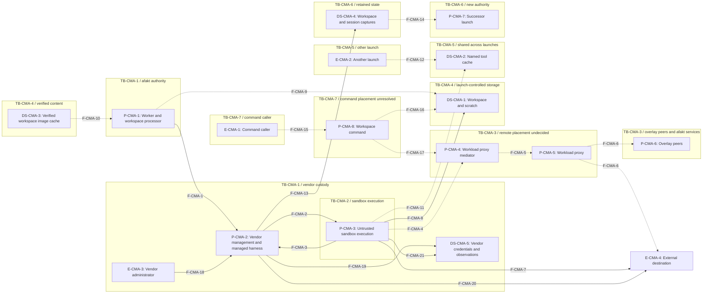
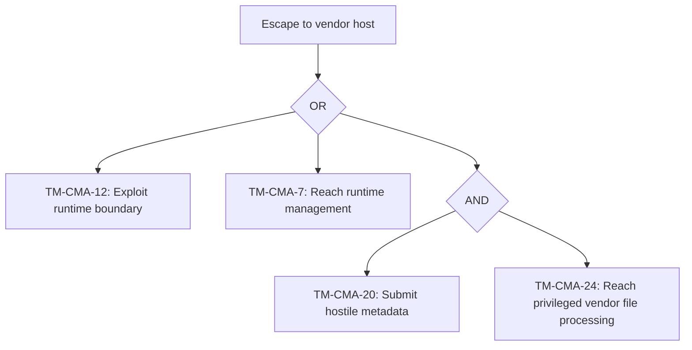
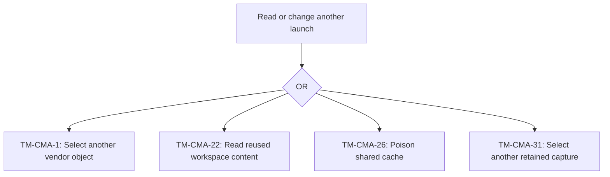
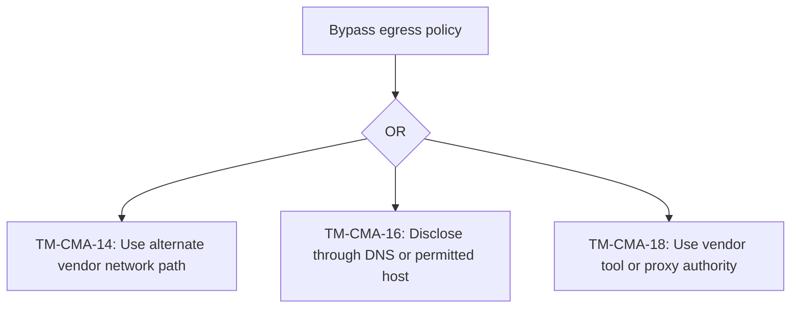
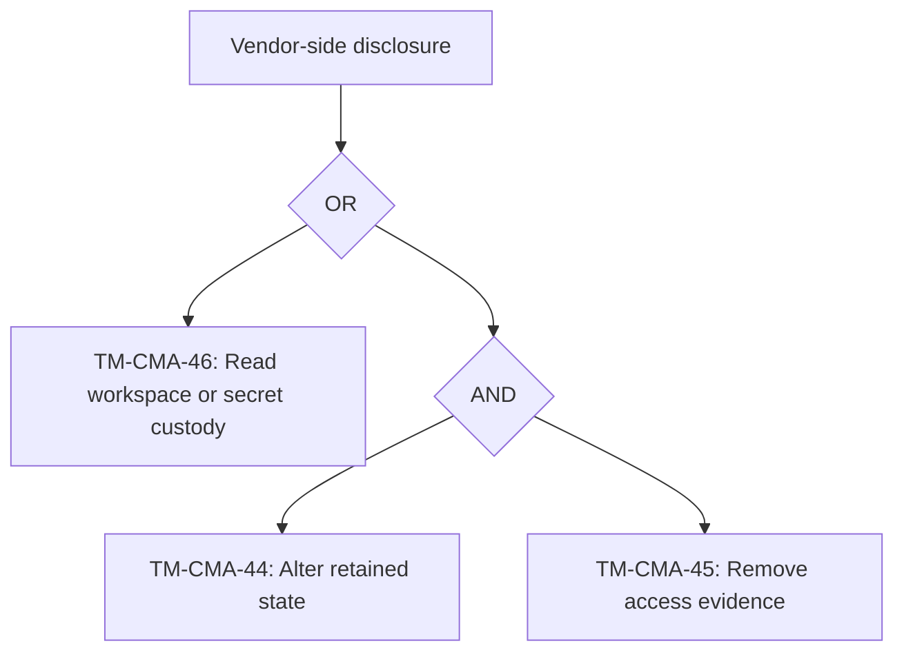

# Workload threat model for Claude Managed Agents

[Public key infrastructure](pki.md).

## Scope

The Claude Managed Agents workload provider follows its [provider design](workload-provider-claude-managed-agents.md).

Vendor lifecycle authority, sandbox isolation, workspace and session storage, network paths, and retained state fall within this model, as do commands requested through `afakt workload exec`. The [common workload threat model](workload-threat-model.md) covers shared control plane authorization, credential exchange, session access, registries, and audit storage because their controls don't depend on this vendor.

STRIDE covers spoofing, tampering, repudiation, information disclosure, denial of service, and elevation of privilege. A virtual machine (VM) can supply a private kernel. Domain Name System (DNS) queries and Agent Client Protocol (ACP) sessions require the launch's workload proxy mediator. Model Context Protocol (MCP) tools require afakt gateway authorization. An Application Programming Interface (API) exposes vendor management operations. Hypertext Transfer Protocol Secure (HTTPS) encrypts web traffic, while Hypertext Transfer Protocol (HTTP) names the underlying request protocol.

[Platforms and privileges](workload-provider-claude-managed-agents.md#Platforms%20and%20privileges) and [Isolation boundary](workload-provider-claude-managed-agents.md#Isolation%20boundary) define the known runtime boundary and missing privilege contract. [Process placement and startup](workload-provider-claude-managed-agents.md#Process%20placement%20and%20startup) distinguishes harness placement from tool execution. [Mediator connection and name resolution](workload-provider-claude-managed-agents.md#Mediator%20connection%20and%20name%20resolution) leaves mandatory remote mediation unresolved. [Cancellation and teardown](workload-provider-claude-managed-agents.md#Cancellation%20and%20teardown) requires observed termination. Vendor idle state alone is insufficient. Adversaries include malicious sandbox code and hostile repository files. Another agent launch or a limited management caller can also attack. A compromised vendor service or administrator also threatens the launch. Vendor custody forms a separate trust boundary without an accepted residual risk for disclosure. Containment after an attacker compromises the runtime needs independent controls. The isolation baseline for workload hosts remains on hold under [`OQ-SBX-18`](agent-open-questions.md#%60OQ-SBX-18%60).

## Trust boundaries

| Boundary ID | Boundary | Two sides | Enforcement in the design |
| --- | --- | --- | --- |
| `TB-CMA-1` | Vendor custody | afakt authority / vendor management, runtime, storage, and administrators | [Host observations](workload-provider-claude-managed-agents.md#Host%20observations). Independent vendor evidence and custody controls remain [`OQ-SBX-64`](agent-open-questions.md#%60OQ-SBX-64%60). |
| `TB-CMA-2` | Sandbox runtime | untrusted execution / vendor kernel, runtime, and management | [Isolation boundary](workload-provider-claude-managed-agents.md#Isolation%20boundary). Containment after runtime compromise remains [`OQ-SBX-65`](agent-open-questions.md#%60OQ-SBX-65%60). |
| `TB-CMA-3` | Remote mediation | Sandbox and vendor network paths / launch policy and authenticated afakt services | [Mediator connection and name resolution](workload-provider-claude-managed-agents.md#Mediator%20connection%20and%20name%20resolution). Carrier and bypass prevention remain [`OQ-SBX-36`](agent-open-questions.md#%60OQ-SBX-36%60). |
| `TB-CMA-4` | Workspace processing | Launch-controlled files / privileged transfer, materialization, and capture | [Workspace, scratch, and caches](workload-provider-claude-managed-agents.md#Workspace,%20scratch,%20and%20caches). Storage mapping and hostile metadata remain [`OQ-WSP-20`](agent-open-questions.md#%60OQ-WSP-20%60), [`OQ-WSP-18`](agent-open-questions.md#%60OQ-WSP-18%60). |
| `TB-CMA-5` | Shared named cache | One launch / state consumed by another launch | [Workspace, scratch, and caches](workload-provider-claude-managed-agents.md#Workspace,%20scratch,%20and%20caches). Cache access and provenance remain [`OQ-WSP-19`](agent-open-questions.md#%60OQ-WSP-19%60). |
| `TB-CMA-6` | Retained state | Current launch / captured content and successor authority | [Workload snapshots and agent checkpoints](workload-provider-claude-managed-agents.md#Workload%20snapshots%20and%20agent%20checkpoints). Pairing and authorization remain [`OQ-AGT-3`](agent-open-questions.md#%60OQ-AGT-3%60), [`OQ-AGT-31`](agent-open-questions.md#%60OQ-AGT-31%60). |
| `TB-CMA-7` | Workspace command | Command requester / target workspace, process, and launch authority | [Process placement and startup](workload-provider-claude-managed-agents.md#Process%20placement%20and%20startup). Command integration remains [`OQ-AGT-40`](agent-open-questions.md#%60OQ-AGT-40%60). |

## Data flow diagram

### Element inventory

| Element ID | Element | Location or custody |
| --- | --- | --- |
| `E-CMA-1` | Workspace command caller | afakt caller |
| `E-CMA-2` | Another agent launch | Separate launch authority |
| `E-CMA-3` | Vendor administrator | Privileged vendor authority |
| `E-CMA-4` | External destination | Outside afakt and the launch |
| `P-CMA-1` | Workload host worker and workspace processor | afakt management. Remote storage mapping unresolved |
| `P-CMA-2` | Vendor management and managed harness | Vendor custody outside untrusted execution |
| `P-CMA-3` | Hosted tool container | Vendor container. Managed tools, not the hosted agent loop |
| `P-CMA-4` | Workload proxy mediator | Required per launch. Remote placement unresolved |
| `P-CMA-5` | Workload proxy | Required outside sandbox. Remote placement unresolved |
| `P-CMA-6` | Overlay peers | Workload peers and control plane services. Shared models apply |
| `P-CMA-7` | Successor launch | New launch authority |
| `P-CMA-8` | Workspace command | afakt-sandbox placement unresolved |
| `DS-CMA-1` | Workspace and scratch | Launch data. Remote backing and separation unresolved |
| `DS-CMA-2` | Shared named tool cache | Cross-launch sharing. Workload provider mapping unresolved |
| `DS-CMA-3` | Verified workspace image cache | Outside launch-writable storage. Remote mapping unresolved |
| `DS-CMA-4` | Retained workspace and session state | Vendor copies or afakt captures. Paired capture unresolved |
| `DS-CMA-5` | Vendor-held credentials and observations | Vendor custody. Access and retention unresolved |

### Level one workload provider flows

Arrows show requests and responses, with dashed arrows marking afakt exchanges that need a provider carrier or placement decision. Vendor network paths remain visible because they can bypass that intended path. Shared caches and retained state have separate boundaries because neither belongs implicitly to one launch. Physical placement for the mediator and workload proxy remains undecided.

- **`F-CMA-1`.** Creation, configuration, status, and stop operations, including managed session control where present. Crosses `TB-CMA-1`.
- **`F-CMA-2`.** Execution requests, process control, and observed outcomes across the sandbox boundary. Crosses `TB-CMA-2`.
- **`F-CMA-3`.** untrusted runtime input, system calls, and execution output presented to vendor services. Crosses `TB-CMA-2`.
- **`F-CMA-4`.** Required launch-bound network, name queries, control, ACP, MCP, and preview traffic. Crosses `TB-CMA-1`, `TB-CMA-3`.
- **`F-CMA-5`.** Permitted requests passed from the no-network mediator to its workload proxy. Crosses `TB-CMA-3`.
- **`F-CMA-6`.** Direct authenticated overlay connections and permitted internet traffic through the workload proxy. Its placement and carrier remain under [`OQ-SBX-36`](agent-open-questions.md#%60OQ-SBX-36%60). Session routing depends on [`OQ-SES-17`](agent-open-questions.md#%60OQ-SES-17%60). Published-port routing depends on [`OQ-PORT-14`](agent-open-questions.md#%60OQ-PORT-14%60). Common service controls apply. Crosses `TB-CMA-3`.
- **`F-CMA-7`.** Vendor-permitted external traffic, including potential direct paths outside afakt mediation. Crosses `TB-CMA-1`, `TB-CMA-3`.
- **`F-CMA-8`.** Workspace and scratch reads and writes. Crosses `TB-CMA-4`.
- **`F-CMA-9`.** Remote workspace transfer, capture, materialization, and cleanup of hostile content. Crosses `TB-CMA-1`, `TB-CMA-4`.
- **`F-CMA-10`.** Verified workspace image content for independent writable materialization. Crosses `TB-CMA-4`.
- **`F-CMA-11`.** Named cache access by this launch. Provider backing unresolved. Crosses `TB-CMA-5`.
- **`F-CMA-12`.** Named cache access by another launch, exposing cross-launch sharing. Crosses `TB-CMA-5`.
- **`F-CMA-13`.** Vendor-retained execution and session content. afakt capture scope remains unresolved. Crosses `TB-CMA-1`, `TB-CMA-6`.
- **`F-CMA-14`.** Retained content admitted to a successor with new launch authority. Crosses `TB-CMA-6`.
- **`F-CMA-15`.** Authorized workspace command request. Crosses `TB-CMA-7`.
- **`F-CMA-16`.** Command reads and writes in the selected workspace. Crosses `TB-CMA-4`, `TB-CMA-7`.
- **`F-CMA-17`.** Command traffic requiring the current launch’s mediator. Crosses `TB-CMA-3`, `TB-CMA-7`.
- **`F-CMA-18`.** Privileged vendor control. Exact internal access limits aren't stated. Crosses `TB-CMA-1`.
- **`F-CMA-19`.** Vendor service handling of supplied credentials, runtime observations, and logs. Crosses `TB-CMA-1`.
- **`F-CMA-20`.** Managed tool calls outside the sandbox. Crosses `TB-CMA-1`, `TB-CMA-3`.
- **`F-CMA-21`.** Execution output and file content exposed to vendor processing. Internal retention remains undecided. Crosses `TB-CMA-1`, `TB-CMA-2`.

## STRIDE analysis

Each table covers the six categories for its listed flows and endpoints. A mitigation of ordinary cross-sandbox access doesn't mitigate an exploit of the runtime itself. No vendor mechanism substitutes for an unresolved afakt integration.

### Remote lifecycle and harness control

Anthropic’s hosted agent loop remains outside the hosted tool container. Runner, hook, and session ownership lack an afakt mapping. See [Process placement and startup](workload-provider-claude-managed-agents.md#Process%20placement%20and%20startup).

| Threat ID | Element | STRIDE category | Threat | Mitigation in the design | Status |
| --- | --- | --- | --- | --- | --- |
| `TM-CMA-1` | `F-CMA-1`, `F-CMA-2`, `P-CMA-1`, `P-CMA-2`, `P-CMA-3` | spoofing | A management caller selects another launch through a reused vendor object identifier. | Vendor object binding to the current launch remains undecided under [Process placement and startup](workload-provider-claude-managed-agents.md#Process%20placement%20and%20startup). | depends on an open question ([`OQ-SBX-52`](agent-open-questions.md#%60OQ-SBX-52%60)) |
| `TM-CMA-2` | `F-CMA-1`, `F-CMA-2`, `P-CMA-1`, `P-CMA-2`, `P-CMA-3` | tampering | A changed environment or updated vault alters authority when the service next resolves its state while afakt retains an immutable launch spec. | Enforcement of the pinned configuration across vendor changes remains undecided under [Process placement and startup](workload-provider-claude-managed-agents.md#Process%20placement%20and%20startup). | depends on an open question ([`OQ-SBX-63`](agent-open-questions.md#%60OQ-SBX-63%60)) |
| `TM-CMA-3` | `F-CMA-1`, `F-CMA-2`, `P-CMA-1`, `P-CMA-2`, `P-CMA-3` | repudiation | A vendor service supplies a false startup, cancellation, or completion history. | Independent verification of vendor lifecycle observations has no stated mechanism under [Process placement and startup](workload-provider-claude-managed-agents.md#Process%20placement%20and%20startup). | gap ([`OQ-SBX-64`](agent-open-questions.md#%60OQ-SBX-64%60)) |
| `TM-CMA-4` | `F-CMA-1`, `F-CMA-2`, `P-CMA-1`, `P-CMA-2`, `P-CMA-3` | information disclosure | A broad provider credential exposes another launch’s prompts, files, or session records. | The scope of management credentials across launch data remains unspecified under [Process placement and startup](workload-provider-claude-managed-agents.md#Process%20placement%20and%20startup). | gap ([`OQ-SBX-64`](agent-open-questions.md#%60OQ-SBX-64%60)) |
| `TM-CMA-5` | `F-CMA-1`, `F-CMA-2`, `P-CMA-1`, `P-CMA-2`, `P-CMA-3` | denial of service | Account limits or unavailable remote capacity prevent startup or reconciliation. | Account capacity and workload provider availability need placement rules under [Platform dependencies](workload-provider-claude-managed-agents.md#Platform%20dependencies). | depends on an open question ([`OQ-PLC-7`](agent-open-questions.md#%60OQ-PLC-7%60)) |
| `TM-CMA-6` | `F-CMA-1`, `F-CMA-2`, `P-CMA-1`, `P-CMA-2`, `P-CMA-3` | elevation of privilege | An idle session with an active workflow run receives stopped status and overlaps its successor. | Remote stop evidence and safe replacement ordering remain undecided under [Cancellation and teardown](workload-provider-claude-managed-agents.md#Cancellation%20and%20teardown). | depends on an open question ([`OQ-SBX-66`](agent-open-questions.md#%60OQ-SBX-66%60)) |

### Sandbox runtime and vendor host

The vendor states that separate sessions have fresh isolated filesystems. This addresses direct file access without a runtime exploit, shared memory, or API authority. It supplies no containment after escape. See [Isolation boundary](workload-provider-claude-managed-agents.md#Isolation%20boundary).

| Threat ID | Element | STRIDE category | Threat | Mitigation in the design | Status |
| --- | --- | --- | --- | --- | --- |
| `TM-CMA-7` | `F-CMA-3`, `P-CMA-2`, `P-CMA-3` | spoofing | untrusted execution impersonates a runtime management caller. | Authentication of runtime management callers has no stated afakt mapping under [Isolation boundary](workload-provider-claude-managed-agents.md#Isolation%20boundary). | gap ([`OQ-SBX-65`](agent-open-questions.md#%60OQ-SBX-65%60)) |
| `TM-CMA-8` | `F-CMA-3`, `P-CMA-2`, `P-CMA-3` | tampering | A process directly changes files in a separate sandbox without shared storage or management authority. | [Isolation boundary](workload-provider-claude-managed-agents.md#Isolation%20boundary) states separate sandbox filesystems under the vendor runtime boundary. This threat excludes shared mounts, management authority, and runtime exploits. | mitigated by the design |
| `TM-CMA-9` | `F-CMA-3`, `P-CMA-2`, `P-CMA-3` | repudiation | A runtime compromise suppresses evidence of activity on the vendor host. | The vendor boundary supplies no independent evidence after runtime compromise under [Isolation boundary](workload-provider-claude-managed-agents.md#Isolation%20boundary). | gap ([`OQ-SBX-64`](agent-open-questions.md#%60OQ-SBX-64%60)) |
| `TM-CMA-10` | `F-CMA-3`, `P-CMA-2`, `P-CMA-3` | information disclosure | A runtime exploit exposes another sandbox’s memory or private workspace. | Containment of a runtime exploit can't rely on the compromised runtime under [Isolation boundary](workload-provider-claude-managed-agents.md#Isolation%20boundary). | gap ([`OQ-SBX-65`](agent-open-questions.md#%60OQ-SBX-65%60)) |
| `TM-CMA-11` | `F-CMA-3`, `P-CMA-2`, `P-CMA-3` | denial of service | A launch consumes shared runtime resources needed by other launches. | Resource limits need an account and runtime allocation policy under [Platform dependencies](workload-provider-claude-managed-agents.md#Platform%20dependencies). | depends on an open question ([`OQ-PLC-7`](agent-open-questions.md#%60OQ-PLC-7%60)) |
| `TM-CMA-12` | `F-CMA-3`, `P-CMA-2`, `P-CMA-3` | elevation of privilege | Hostile system calls or virtual-device input escape the runtime into the vendor host. | Containment after an escape into the vendor host remains unspecified under [Isolation boundary](workload-provider-claude-managed-agents.md#Isolation%20boundary). | gap ([`OQ-SBX-65`](agent-open-questions.md#%60OQ-SBX-65%60)) |

### Workload proxy mediator and vendor network paths

Sandbox and server-side tools have different paths, and no documented route forces them all through afakt. See [Mediator connection and name resolution](workload-provider-claude-managed-agents.md#Mediator%20connection%20and%20name%20resolution).

| Threat ID | Element | STRIDE category | Threat | Mitigation in the design | Status |
| --- | --- | --- | --- | --- | --- |
| `TM-CMA-13` | `F-CMA-4`, `F-CMA-5`, `F-CMA-6`, `F-CMA-7`, `F-CMA-20`, `P-CMA-2`, `P-CMA-3`, `P-CMA-4`, `P-CMA-5`, `P-CMA-6`, `E-CMA-4` | spoofing | A vendor-side endpoint attributes traffic to another afakt launch. | Workload provider identity assertions need a binding to the current afakt launch under [Mediator connection and name resolution](workload-provider-claude-managed-agents.md#Mediator%20connection%20and%20name%20resolution). | depends on an open question ([`OQ-SBX-52`](agent-open-questions.md#%60OQ-SBX-52%60)) |
| `TM-CMA-14` | `F-CMA-4`, `F-CMA-5`, `F-CMA-6`, `F-CMA-7`, `F-CMA-20`, `P-CMA-2`, `P-CMA-3`, `P-CMA-4`, `P-CMA-5`, `P-CMA-6`, `E-CMA-4` | tampering | An unrestricted environment or resource attachment supplies a route that never enters afakt’s mediator. | The required exclusive mediator route has no selected workload provider mechanism under [Mediator connection and name resolution](workload-provider-claude-managed-agents.md#Mediator%20connection%20and%20name%20resolution). | gap ([`OQ-SBX-36`](agent-open-questions.md#%60OQ-SBX-36%60)) |
| `TM-CMA-15` | `F-CMA-4`, `F-CMA-5`, `F-CMA-6`, `F-CMA-7`, `F-CMA-20`, `P-CMA-2`, `P-CMA-3`, `P-CMA-4`, `P-CMA-5`, `P-CMA-6`, `E-CMA-4` | repudiation | A vendor omits traffic on its network path from afakt’s decision history. | Independent accounting for vendor-side network actions remains unspecified under [Mediator connection and name resolution](workload-provider-claude-managed-agents.md#Mediator%20connection%20and%20name%20resolution). | gap ([`OQ-SBX-64`](agent-open-questions.md#%60OQ-SBX-64%60)) |
| `TM-CMA-16` | `F-CMA-4`, `F-CMA-5`, `F-CMA-6`, `F-CMA-7`, `F-CMA-20`, `P-CMA-2`, `P-CMA-3`, `P-CMA-4`, `P-CMA-5`, `P-CMA-6`, `E-CMA-4` | information disclosure | An allowed host receives workspace uploads through cloud or server-side tools outside afakt inspection. | Name queries and vendor egress lack a selected afakt inspection path under [Mediator connection and name resolution](workload-provider-claude-managed-agents.md#Mediator%20connection%20and%20name%20resolution). | gap ([`OQ-SBX-36`](agent-open-questions.md#%60OQ-SBX-36%60)) |
| `TM-CMA-17` | `F-CMA-4`, `F-CMA-5`, `F-CMA-6`, `F-CMA-7`, `F-CMA-20`, `P-CMA-2`, `P-CMA-3`, `P-CMA-4`, `P-CMA-5`, `P-CMA-6`, `E-CMA-4` | denial of service | Blocked or stalled remote transport prevents control, session, or preview progress. | Control transport and its progress bounds need a provider mapping under [Mediator connection and name resolution](workload-provider-claude-managed-agents.md#Mediator%20connection%20and%20name%20resolution). | depends on an open question ([`OQ-SBX-36`](agent-open-questions.md#%60OQ-SBX-36%60)) |
| `TM-CMA-18` | `F-CMA-4`, `F-CMA-5`, `F-CMA-6`, `F-CMA-7`, `F-CMA-20`, `P-CMA-2`, `P-CMA-3`, `P-CMA-4`, `P-CMA-5`, `P-CMA-6`, `E-CMA-4` | elevation of privilege | A server-side web or MCP tool uses attached vault authority outside afakt’s gateway and launch checks. | Vendor tool and proxy authority lack binding to afakt admission under [Mediator connection and name resolution](workload-provider-claude-managed-agents.md#Mediator%20connection%20and%20name%20resolution). | gap ([`OQ-SBX-36`](agent-open-questions.md#%60OQ-SBX-36%60)) |

### Workspace transfer and processing

Read-only input copies, output publication, and shared package caching leave afakt storage ownership and capture unresolved. See [Workspace, scratch, and caches](workload-provider-claude-managed-agents.md#Workspace,%20scratch,%20and%20caches).

| Threat ID | Element | STRIDE category | Threat | Mitigation in the design | Status |
| --- | --- | --- | --- | --- | --- |
| `TM-CMA-19` | `F-CMA-8`, `F-CMA-9`, `F-CMA-10`, `P-CMA-1`, `P-CMA-3`, `DS-CMA-1`, `DS-CMA-3` | spoofing | A file or artifact handle selects another launch’s workspace. | File handles need ownership checks for the intended launch under [Workspace, scratch, and caches](workload-provider-claude-managed-agents.md#Workspace,%20scratch,%20and%20caches). | depends on an open question ([`OQ-WSP-20`](agent-open-questions.md#%60OQ-WSP-20%60)) |
| `TM-CMA-20` | `F-CMA-8`, `F-CMA-9`, `F-CMA-10`, `P-CMA-1`, `P-CMA-3`, `DS-CMA-1`, `DS-CMA-3` | tampering | Hostile repository metadata changes how remote capture or extraction processes files. | Confinement of hostile metadata processing remains undecided under [Workspace image materialization](workload-provider-claude-managed-agents.md#Workspace%20image%20materialization). | depends on an open question ([`OQ-WSP-18`](agent-open-questions.md#%60OQ-WSP-18%60)) |
| `TM-CMA-21` | `F-CMA-8`, `F-CMA-9`, `F-CMA-10`, `P-CMA-1`, `P-CMA-3`, `DS-CMA-1`, `DS-CMA-3` | repudiation | A vendor changes file content without independently attributable evidence. | Attribution of vendor file changes lacks independent evidence under [Workspace, scratch, and caches](workload-provider-claude-managed-agents.md#Workspace,%20scratch,%20and%20caches). | gap ([`OQ-SBX-64`](agent-open-questions.md#%60OQ-SBX-64%60)) |
| `TM-CMA-22` | `F-CMA-8`, `F-CMA-9`, `F-CMA-10`, `P-CMA-1`, `P-CMA-3`, `DS-CMA-1`, `DS-CMA-3` | information disclosure | Session file copies, uploaded originals, or shared memory remain accessible after deletion of only one resource. | Storage reuse and deletion need a launch-specific ownership mapping under [Workspace, scratch, and caches](workload-provider-claude-managed-agents.md#Workspace,%20scratch,%20and%20caches). | depends on an open question ([`OQ-WSP-20`](agent-open-questions.md#%60OQ-WSP-20%60)) |
| `TM-CMA-23` | `F-CMA-8`, `F-CMA-9`, `F-CMA-10`, `P-CMA-1`, `P-CMA-3`, `DS-CMA-1`, `DS-CMA-3` | denial of service | Workspace transfer or scratch growth exhausts storage before cleanup completes. | Workspace and scratch limits need a workload provider allocation and cleanup contract under [Workspace, scratch, and caches](workload-provider-claude-managed-agents.md#Workspace,%20scratch,%20and%20caches). | depends on an open question ([`OQ-WSP-20`](agent-open-questions.md#%60OQ-WSP-20%60)) |
| `TM-CMA-24` | `F-CMA-8`, `F-CMA-9`, `F-CMA-10`, `P-CMA-1`, `P-CMA-3`, `DS-CMA-1`, `DS-CMA-3` | elevation of privilege | Hostile workspace metadata executes with vendor capture or materialization authority outside the sandbox. | The transfer and capture path lacks selected process confinement under [Workspace image materialization](workload-provider-claude-managed-agents.md#Workspace%20image%20materialization). | depends on an open question ([`OQ-WSP-18`](agent-open-questions.md#%60OQ-WSP-18%60)) |

### Shared named tool caches

The vendor documents package caching across sessions. A mapping to afakt named caches and authorization for their writers remains undecided. See [Workspace, scratch, and caches](workload-provider-claude-managed-agents.md#Workspace,%20scratch,%20and%20caches).

| Threat ID | Element | STRIDE category | Threat | Mitigation in the design | Status |
| --- | --- | --- | --- | --- | --- |
| `TM-CMA-25` | `F-CMA-11`, `F-CMA-12`, `P-CMA-3`, `E-CMA-2`, `DS-CMA-2` | spoofing | A cache writer presents another launch’s cache namespace as its own. | Cache namespace authorization remains undecided under [Workspace, scratch, and caches](workload-provider-claude-managed-agents.md#Workspace,%20scratch,%20and%20caches). | depends on an open question ([`OQ-WSP-19`](agent-open-questions.md#%60OQ-WSP-19%60)) |
| `TM-CMA-26` | `F-CMA-11`, `F-CMA-12`, `P-CMA-3`, `E-CMA-2`, `DS-CMA-2` | tampering | A shared package cache supplies hostile executable dependencies to a later session. | Writer trust and dependency integrity need a cache policy under [Workspace, scratch, and caches](workload-provider-claude-managed-agents.md#Workspace,%20scratch,%20and%20caches). | depends on an open question ([`OQ-WSP-19`](agent-open-questions.md#%60OQ-WSP-19%60)) |
| `TM-CMA-27` | `F-CMA-11`, `F-CMA-12`, `P-CMA-3`, `E-CMA-2`, `DS-CMA-2` | repudiation | A shared cache changes without a record identifying its writer. | Attribution of shared cache writes remains undecided under [Workspace, scratch, and caches](workload-provider-claude-managed-agents.md#Workspace,%20scratch,%20and%20caches). | depends on an open question ([`OQ-WSP-19`](agent-open-questions.md#%60OQ-WSP-19%60)) |
| `TM-CMA-28` | `F-CMA-11`, `F-CMA-12`, `P-CMA-3`, `E-CMA-2`, `DS-CMA-2` | information disclosure | A shared cache exposes private dependency or build content to another launch. | Shared cache readership needs a confidentiality policy under [Workspace, scratch, and caches](workload-provider-claude-managed-agents.md#Workspace,%20scratch,%20and%20caches). | depends on an open question ([`OQ-WSP-19`](agent-open-questions.md#%60OQ-WSP-19%60)) |
| `TM-CMA-29` | `F-CMA-11`, `F-CMA-12`, `P-CMA-3`, `E-CMA-2`, `DS-CMA-2` | denial of service | A launch fills a shared cache and prevents other launches from making progress. | Cache capacity and invalidation need allocation rules under [Workspace, scratch, and caches](workload-provider-claude-managed-agents.md#Workspace,%20scratch,%20and%20caches). | depends on an open question ([`OQ-WSP-19`](agent-open-questions.md#%60OQ-WSP-19%60)) |
| `TM-CMA-30` | `F-CMA-11`, `F-CMA-12`, `P-CMA-3`, `E-CMA-2`, `DS-CMA-2` | elevation of privilege | A writable cache entry becomes trusted executable input in a later launch. | Cache provenance doesn't yet define trust in executable input under [Workspace, scratch, and caches](workload-provider-claude-managed-agents.md#Workspace,%20scratch,%20and%20caches). | depends on an open question ([`OQ-WSP-19`](agent-open-questions.md#%60OQ-WSP-19%60)) |

### Retained state and successor launch

Server-side session persistence supplies no documented atomic afakt machine, workspace, and native-session capture. See [Workload snapshots and agent checkpoints](workload-provider-claude-managed-agents.md#Workload%20snapshots%20and%20agent%20checkpoints).

| Threat ID | Element | STRIDE category | Threat | Mitigation in the design | Status |
| --- | --- | --- | --- | --- | --- |
| `TM-CMA-31` | `F-CMA-13`, `F-CMA-14`, `P-CMA-2`, `P-CMA-7`, `DS-CMA-4` | spoofing | A retained-state handle restores another agent’s workspace or session. | Restore authorization needs ownership checks on retained state under [Workload snapshots and agent checkpoints](workload-provider-claude-managed-agents.md#Workload%20snapshots%20and%20agent%20checkpoints). | depends on an open question ([`OQ-AGT-31`](agent-open-questions.md#%60OQ-AGT-31%60)) |
| `TM-CMA-32` | `F-CMA-13`, `F-CMA-14`, `P-CMA-2`, `P-CMA-7`, `DS-CMA-4` | tampering | afakt pairs a resumed managed conversation with workspace state from a different turn without an atomic checkpoint. | The complete workspace and native-session capture pair remains undecided under [Workload snapshots and agent checkpoints](workload-provider-claude-managed-agents.md#Workload%20snapshots%20and%20agent%20checkpoints). | depends on an open question ([`OQ-AGT-3`](agent-open-questions.md#%60OQ-AGT-3%60)) |
| `TM-CMA-33` | `F-CMA-13`, `F-CMA-14`, `P-CMA-2`, `P-CMA-7`, `DS-CMA-4` | repudiation | afakt lacks attribution of a vendor state change to its capture or restore requester. | Capture and restore records need attribution to their requester under [Workload snapshots and agent checkpoints](workload-provider-claude-managed-agents.md#Workload%20snapshots%20and%20agent%20checkpoints). | depends on an open question ([`OQ-AGT-31`](agent-open-questions.md#%60OQ-AGT-31%60)) |
| `TM-CMA-34` | `F-CMA-13`, `F-CMA-14`, `P-CMA-2`, `P-CMA-7`, `DS-CMA-4` | information disclosure | A capture preserves credentials or private session data beyond its authorized scope. | Capture scope must separate retained content from active authority under [Workload snapshots and agent checkpoints](workload-provider-claude-managed-agents.md#Workload%20snapshots%20and%20agent%20checkpoints). | depends on an open question ([`OQ-AGT-16`](agent-open-questions.md#%60OQ-AGT-16%60)) |
| `TM-CMA-35` | `F-CMA-13`, `F-CMA-14`, `P-CMA-2`, `P-CMA-7`, `DS-CMA-4` | denial of service | Expired or unavailable retained state prevents restoration of an owned agent. | Durable ownership needs retention roots beyond vendor expiry under [Workload snapshots and agent checkpoints](workload-provider-claude-managed-agents.md#Workload%20snapshots%20and%20agent%20checkpoints). | depends on an open question ([`OQ-AGT-11`](agent-open-questions.md#%60OQ-AGT-11%60)) |
| `TM-CMA-36` | `F-CMA-13`, `F-CMA-14`, `P-CMA-2`, `P-CMA-7`, `DS-CMA-4` | elevation of privilege | A successor restores stale authority or hostile state as trusted current execution. | Restoration needs destination authorization and exclusion of stale credentials under [Workload snapshots and agent checkpoints](workload-provider-claude-managed-agents.md#Workload%20snapshots%20and%20agent%20checkpoints). | depends on an open question ([`OQ-AGT-16`](agent-open-questions.md#%60OQ-AGT-16%60)) |

### Workspace command execution

afakt has no selected mapping from vendor bash tools to afakt workload exec. Confinement and lifecycle binding remain unresolved. See [Process placement and startup](workload-provider-claude-managed-agents.md#Process%20placement%20and%20startup).

| Threat ID | Element | STRIDE category | Threat | Mitigation in the design | Status |
| --- | --- | --- | --- | --- | --- |
| `TM-CMA-37` | `F-CMA-15`, `F-CMA-16`, `F-CMA-17`, `E-CMA-1`, `P-CMA-8`, `DS-CMA-1`, `P-CMA-4` | spoofing | A command request attaches to the wrong launch or recycled sandbox identifier. | Workspace command placement and target identity remain undecided under [Process placement and startup](workload-provider-claude-managed-agents.md#Process%20placement%20and%20startup). | depends on an open question ([`OQ-AGT-40`](agent-open-questions.md#%60OQ-AGT-40%60)) |
| `TM-CMA-38` | `F-CMA-15`, `F-CMA-16`, `F-CMA-17`, `E-CMA-1`, `P-CMA-8`, `DS-CMA-1`, `P-CMA-4` | tampering | A workspace command races a checkpoint or changes the harness’s active files. | Command ordering relative to capture remains undecided under [Process placement and startup](workload-provider-claude-managed-agents.md#Process%20placement%20and%20startup). | depends on an open question ([`OQ-AGT-40`](agent-open-questions.md#%60OQ-AGT-40%60)) |
| `TM-CMA-39` | `F-CMA-15`, `F-CMA-16`, `F-CMA-17`, `E-CMA-1`, `P-CMA-8`, `DS-CMA-1`, `P-CMA-4` | repudiation | A command result lacks binding to the requester, launch, and executed process. | Command evidence needs requester and process attribution under [Process placement and startup](workload-provider-claude-managed-agents.md#Process%20placement%20and%20startup). | depends on an open question ([`OQ-AGT-40`](agent-open-questions.md#%60OQ-AGT-40%60)) |
| `TM-CMA-40` | `F-CMA-15`, `F-CMA-16`, `F-CMA-17`, `E-CMA-1`, `P-CMA-8`, `DS-CMA-1`, `P-CMA-4` | information disclosure | A command inherits provider credentials or another session’s environment. | Inherited command state and credential exclusions remain undecided under [Process placement and startup](workload-provider-claude-managed-agents.md#Process%20placement%20and%20startup). | depends on an open question ([`OQ-AGT-40`](agent-open-questions.md#%60OQ-AGT-40%60)) |
| `TM-CMA-41` | `F-CMA-15`, `F-CMA-16`, `F-CMA-17`, `E-CMA-1`, `P-CMA-8`, `DS-CMA-1`, `P-CMA-4` | denial of service | A detached command continues after cancellation and retains resources or workspace access. | Command descendants need lifecycle binding through cancellation under [Process placement and startup](workload-provider-claude-managed-agents.md#Process%20placement%20and%20startup). | depends on an open question ([`OQ-AGT-40`](agent-open-questions.md#%60OQ-AGT-40%60)) |
| `TM-CMA-42` | `F-CMA-15`, `F-CMA-16`, `F-CMA-17`, `E-CMA-1`, `P-CMA-8`, `DS-CMA-1`, `P-CMA-4` | elevation of privilege | A workspace command bypasses afakt-sandbox or uses vendor execution authority beyond its launch. | The command confinement and authority boundary remains undecided under [Process placement and startup](workload-provider-claude-managed-agents.md#Process%20placement%20and%20startup). | depends on an open question ([`OQ-AGT-40`](agent-open-questions.md#%60OQ-AGT-40%60)) |

### Vendor custody and administration

Anthropic stores history and cloud state and can hold vault secrets. afakt telemetry exclusions can't constrain vendor custody. See [Host observations](workload-provider-claude-managed-agents.md#Host%20observations).

| Threat ID | Element | STRIDE category | Threat | Mitigation in the design | Status |
| --- | --- | --- | --- | --- | --- |
| `TM-CMA-43` | `F-CMA-18`, `F-CMA-19`, `F-CMA-21`, `E-CMA-3`, `P-CMA-2`, `P-CMA-3`, `DS-CMA-4`, `DS-CMA-5` | spoofing | A vendor administrator supplies false identity or observation data to afakt. | afakt lacks an independent check on vendor identity observations under [Host observations](workload-provider-claude-managed-agents.md#Host%20observations). | gap ([`OQ-SBX-64`](agent-open-questions.md#%60OQ-SBX-64%60)) |
| `TM-CMA-44` | `F-CMA-18`, `F-CMA-19`, `F-CMA-21`, `E-CMA-3`, `P-CMA-2`, `P-CMA-3`, `DS-CMA-4`, `DS-CMA-5` | tampering | A vendor administrator changes retained workspace, session, or credential state. | Vendor custody supplies no independent integrity protection for retained content under [Host observations](workload-provider-claude-managed-agents.md#Host%20observations). | gap ([`OQ-SBX-64`](agent-open-questions.md#%60OQ-SBX-64%60)) |
| `TM-CMA-45` | `F-CMA-18`, `F-CMA-19`, `F-CMA-21`, `E-CMA-3`, `P-CMA-2`, `P-CMA-3`, `DS-CMA-4`, `DS-CMA-5` | repudiation | A vendor administrator removes the evidence of privileged content access. | Evidence of vendor administrator access lacks independent protection under [Host observations](workload-provider-claude-managed-agents.md#Host%20observations). | gap ([`OQ-SBX-64`](agent-open-questions.md#%60OQ-SBX-64%60)) |
| `TM-CMA-46` | `F-CMA-18`, `F-CMA-19`, `F-CMA-21`, `E-CMA-3`, `P-CMA-2`, `P-CMA-3`, `DS-CMA-4`, `DS-CMA-5` | information disclosure | An Anthropic service or workspace administrator discloses retained conversation, cloud workspace, outputs, or vault secrets. | No stated control prevents disclosure by the vendor holding the content under [Host observations](workload-provider-claude-managed-agents.md#Host%20observations). | gap ([`OQ-SBX-64`](agent-open-questions.md#%60OQ-SBX-64%60)) |
| `TM-CMA-47` | `F-CMA-18`, `F-CMA-19`, `F-CMA-21`, `E-CMA-3`, `P-CMA-2`, `P-CMA-3`, `DS-CMA-4`, `DS-CMA-5` | denial of service | Vendor deletion, retention, or account suspension makes required state unavailable. | Provider retention and account eligibility need availability rules under [Host observations](workload-provider-claude-managed-agents.md#Host%20observations). | depends on an open question ([`OQ-PLC-7`](agent-open-questions.md#%60OQ-PLC-7%60)) |
| `TM-CMA-48` | `F-CMA-18`, `F-CMA-19`, `F-CMA-21`, `E-CMA-3`, `P-CMA-2`, `P-CMA-3`, `DS-CMA-4`, `DS-CMA-5` | elevation of privilege | A compromised vendor service uses supplied management or upstream credentials outside the intended launch. | The vendor trust boundary doesn't limit a compromised custodian’s authority under [Host observations](workload-provider-claude-managed-agents.md#Host%20observations). | gap ([`OQ-SBX-64`](agent-open-questions.md#%60OQ-SBX-64%60)) |

## Attack trees

### Escape to the vendor host

Runtime input already available to malicious sandbox code is the path requiring the least extra authority. The cited controls supply no containment after a runtime exploit. Reaching a privileged vendor file processor also requires that the unresolved transfer or capture path accept the hostile content.

### Read or change another agent launch’s workspace or session

A shared environment, mount, cache, or broad object handle needs fewer capabilities than a runtime escape. Launch-specific storage and authorization mappings remain unresolved. Separate sandbox filesystems only block direct file access when there is no shared storage or management authority.

### Send traffic past egress policy

A malicious sandbox process can use a documented vendor network or tool path directly. Mandatory afakt mediation remains unresolved because destination allowlists leave the required carrier and request policy unspecified.

### Disclose workspace or credentials through the vendor

A privileged vendor service already has custody of submitted data. The cited controls supply no independent barrier to its disclosure. The concealment branch requires both changing retained state and removing access evidence.

## Residual risks and gaps

Workload provider-specific gaps don't settle the on-hold choices for hook protection, repository project configuration, profile self-grants and credential domains, host isolation, or session-end wait and identity lifetime. See [`OQ-HOOK-16`](agent-open-questions.md#%60OQ-HOOK-16%60), [`OQ-HOOK-17`](agent-open-questions.md#%60OQ-HOOK-17%60), [`OQ-PRF-5`](agent-open-questions.md#%60OQ-PRF-5%60), [`OQ-SBX-2`](agent-open-questions.md#%60OQ-SBX-2%60), [`OQ-SBX-18`](agent-open-questions.md#%60OQ-SBX-18%60), and [`OQ-HOOK-18`](agent-open-questions.md#%60OQ-HOOK-18%60).

### Remote lifecycle and harness control

- `TM-CMA-1`. A management caller selects another launch through a reused vendor object identifier. depends on an open question ([`OQ-SBX-52`](agent-open-questions.md#%60OQ-SBX-52%60)).
- `TM-CMA-2`. A changed environment or updated vault alters authority when the service next resolves its state while afakt retains an immutable launch spec. depends on an open question ([`OQ-SBX-63`](agent-open-questions.md#%60OQ-SBX-63%60)).
- `TM-CMA-3`. A vendor service supplies a false startup, cancellation, or completion history. gap ([`OQ-SBX-64`](agent-open-questions.md#%60OQ-SBX-64%60)).
- `TM-CMA-4`. A broad provider credential exposes another launch’s prompts, files, or session records. gap ([`OQ-SBX-64`](agent-open-questions.md#%60OQ-SBX-64%60)).
- `TM-CMA-5`. Account limits or unavailable remote capacity prevent startup or reconciliation. depends on an open question ([`OQ-PLC-7`](agent-open-questions.md#%60OQ-PLC-7%60)).
- `TM-CMA-6`. An idle session with an active workflow run receives stopped status and overlaps its successor. depends on an open question ([`OQ-SBX-66`](agent-open-questions.md#%60OQ-SBX-66%60)).

### Sandbox runtime and vendor host

- `TM-CMA-7`. untrusted execution impersonates a runtime management caller. gap ([`OQ-SBX-65`](agent-open-questions.md#%60OQ-SBX-65%60)).
- `TM-CMA-9`. A runtime compromise suppresses evidence of activity on the vendor host. gap ([`OQ-SBX-64`](agent-open-questions.md#%60OQ-SBX-64%60)).
- `TM-CMA-10`. A runtime exploit exposes another sandbox’s memory or private workspace. gap ([`OQ-SBX-65`](agent-open-questions.md#%60OQ-SBX-65%60)).
- `TM-CMA-11`. A launch consumes shared runtime resources needed by other launches. depends on an open question ([`OQ-PLC-7`](agent-open-questions.md#%60OQ-PLC-7%60)).
- `TM-CMA-12`. Hostile system calls or virtual-device input escape the runtime into the vendor host. gap ([`OQ-SBX-65`](agent-open-questions.md#%60OQ-SBX-65%60)).

### Workload proxy mediator and vendor network paths

- `TM-CMA-13`. A vendor-side endpoint attributes traffic to another afakt launch. depends on an open question ([`OQ-SBX-52`](agent-open-questions.md#%60OQ-SBX-52%60)).
- `TM-CMA-14`. An unrestricted environment or resource attachment supplies a route that never enters afakt’s mediator. gap ([`OQ-SBX-36`](agent-open-questions.md#%60OQ-SBX-36%60)).
- `TM-CMA-15`. A vendor omits traffic on its network path from afakt’s decision history. gap ([`OQ-SBX-64`](agent-open-questions.md#%60OQ-SBX-64%60)).
- `TM-CMA-16`. An allowed host receives workspace uploads through cloud or server-side tools outside afakt inspection. gap ([`OQ-SBX-36`](agent-open-questions.md#%60OQ-SBX-36%60)).
- `TM-CMA-17`. Blocked or stalled remote transport prevents control, session, or preview progress. depends on an open question ([`OQ-SBX-36`](agent-open-questions.md#%60OQ-SBX-36%60)).
- `TM-CMA-18`. A server-side web or MCP tool uses attached vault authority outside afakt’s gateway and launch checks. gap ([`OQ-SBX-36`](agent-open-questions.md#%60OQ-SBX-36%60)).

### Workspace transfer and processing

- `TM-CMA-19`. A file or artifact handle selects another launch’s workspace. depends on an open question ([`OQ-WSP-20`](agent-open-questions.md#%60OQ-WSP-20%60)).
- `TM-CMA-20`. Hostile repository metadata changes how remote capture or extraction processes files. depends on an open question ([`OQ-WSP-18`](agent-open-questions.md#%60OQ-WSP-18%60)).
- `TM-CMA-21`. A vendor changes file content without independently attributable evidence. gap ([`OQ-SBX-64`](agent-open-questions.md#%60OQ-SBX-64%60)).
- `TM-CMA-22`. Session file copies, uploaded originals, or shared memory remain accessible after deletion of only one resource. depends on an open question ([`OQ-WSP-20`](agent-open-questions.md#%60OQ-WSP-20%60)).
- `TM-CMA-23`. Workspace transfer or scratch growth exhausts storage before cleanup completes. depends on an open question ([`OQ-WSP-20`](agent-open-questions.md#%60OQ-WSP-20%60)).
- `TM-CMA-24`. Hostile workspace metadata executes with vendor capture or materialization authority outside the sandbox. depends on an open question ([`OQ-WSP-18`](agent-open-questions.md#%60OQ-WSP-18%60)).

### Shared named tool caches

- `TM-CMA-25`. A cache writer presents another launch’s cache namespace as its own. depends on an open question ([`OQ-WSP-19`](agent-open-questions.md#%60OQ-WSP-19%60)).
- `TM-CMA-26`. A shared package cache supplies hostile executable dependencies to a later session. depends on an open question ([`OQ-WSP-19`](agent-open-questions.md#%60OQ-WSP-19%60)).
- `TM-CMA-27`. A shared cache changes without a record identifying its writer. depends on an open question ([`OQ-WSP-19`](agent-open-questions.md#%60OQ-WSP-19%60)).
- `TM-CMA-28`. A shared cache exposes private dependency or build content to another launch. depends on an open question ([`OQ-WSP-19`](agent-open-questions.md#%60OQ-WSP-19%60)).
- `TM-CMA-29`. A launch fills a shared cache and prevents other launches from making progress. depends on an open question ([`OQ-WSP-19`](agent-open-questions.md#%60OQ-WSP-19%60)).
- `TM-CMA-30`. A writable cache entry becomes trusted executable input in a later launch. depends on an open question ([`OQ-WSP-19`](agent-open-questions.md#%60OQ-WSP-19%60)).

### Retained state and successor launch

- `TM-CMA-31`. A retained-state handle restores another agent’s workspace or session. depends on an open question ([`OQ-AGT-31`](agent-open-questions.md#%60OQ-AGT-31%60)).
- `TM-CMA-32`. afakt pairs a resumed managed conversation with workspace state from a different turn without an atomic checkpoint. depends on an open question ([`OQ-AGT-3`](agent-open-questions.md#%60OQ-AGT-3%60)).
- `TM-CMA-33`. afakt lacks attribution of a vendor state change to its capture or restore requester. depends on an open question ([`OQ-AGT-31`](agent-open-questions.md#%60OQ-AGT-31%60)).
- `TM-CMA-34`. A capture preserves credentials or private session data beyond its authorized scope. depends on an open question ([`OQ-AGT-16`](agent-open-questions.md#%60OQ-AGT-16%60)).
- `TM-CMA-35`. Expired or unavailable retained state prevents restoration of an owned agent. depends on an open question ([`OQ-AGT-11`](agent-open-questions.md#%60OQ-AGT-11%60)).
- `TM-CMA-36`. A successor restores stale authority or hostile state as trusted current execution. depends on an open question ([`OQ-AGT-16`](agent-open-questions.md#%60OQ-AGT-16%60)).

### Workspace command execution

- `TM-CMA-37`. A command request attaches to the wrong launch or recycled sandbox identifier. depends on an open question ([`OQ-AGT-40`](agent-open-questions.md#%60OQ-AGT-40%60)).
- `TM-CMA-38`. A workspace command races a checkpoint or changes the harness’s active files. depends on an open question ([`OQ-AGT-40`](agent-open-questions.md#%60OQ-AGT-40%60)).
- `TM-CMA-39`. A command result lacks binding to the requester, launch, and executed process. depends on an open question ([`OQ-AGT-40`](agent-open-questions.md#%60OQ-AGT-40%60)).
- `TM-CMA-40`. A command inherits provider credentials or another session’s environment. depends on an open question ([`OQ-AGT-40`](agent-open-questions.md#%60OQ-AGT-40%60)).
- `TM-CMA-41`. A detached command continues after cancellation and retains resources or workspace access. depends on an open question ([`OQ-AGT-40`](agent-open-questions.md#%60OQ-AGT-40%60)).
- `TM-CMA-42`. A workspace command bypasses afakt-sandbox or uses vendor execution authority beyond its launch. depends on an open question ([`OQ-AGT-40`](agent-open-questions.md#%60OQ-AGT-40%60)).

### Vendor custody and administration

- `TM-CMA-43`. A vendor administrator supplies false identity or observation data to afakt. gap ([`OQ-SBX-64`](agent-open-questions.md#%60OQ-SBX-64%60)).
- `TM-CMA-44`. A vendor administrator changes retained workspace, session, or credential state. gap ([`OQ-SBX-64`](agent-open-questions.md#%60OQ-SBX-64%60)).
- `TM-CMA-45`. A vendor administrator removes the evidence of privileged content access. gap ([`OQ-SBX-64`](agent-open-questions.md#%60OQ-SBX-64%60)).
- `TM-CMA-46`. An Anthropic service or workspace administrator discloses retained conversation, cloud workspace, outputs, or vault secrets. gap ([`OQ-SBX-64`](agent-open-questions.md#%60OQ-SBX-64%60)).
- `TM-CMA-47`. Vendor deletion, retention, or account suspension makes required state unavailable. depends on an open question ([`OQ-PLC-7`](agent-open-questions.md#%60OQ-PLC-7%60)).
- `TM-CMA-48`. A compromised vendor service uses supplied management or upstream credentials outside the intended launch. gap ([`OQ-SBX-64`](agent-open-questions.md#%60OQ-SBX-64%60)).
