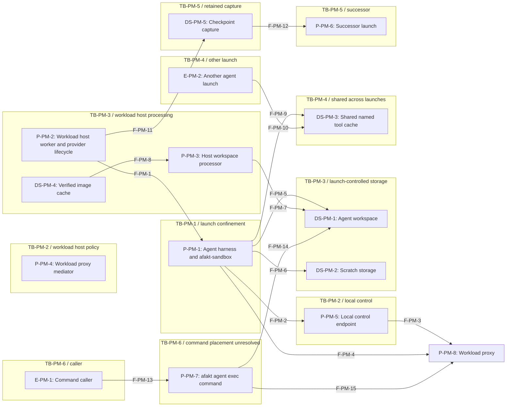
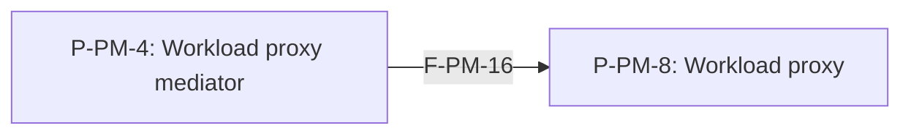
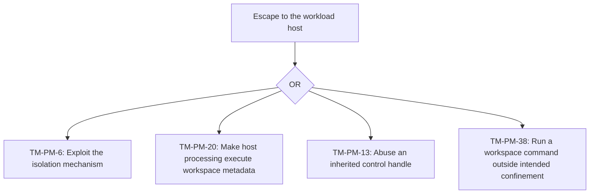
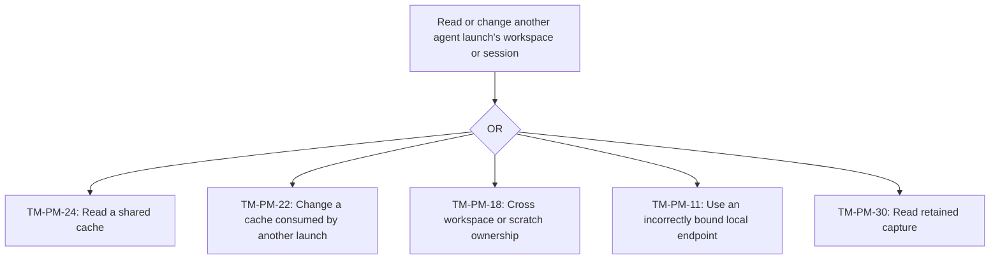
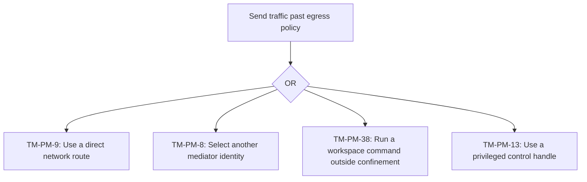
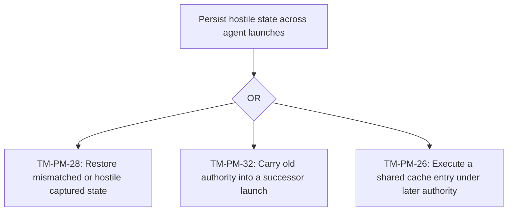

# Workload threat model for Podman

[Public key infrastructure](pki.md).

## Scope

The Podman provider uses the [provider design](workload-provider-podman.md). The [common workload threat model](workload-threat-model.md) covers shared service authority, credentials, network policy, sessions, registries, and audit records.

[Platforms and privileges](workload-provider-podman.md#Platforms%20and%20privileges) and [Provider isolation](workload-provider-podman.md#Isolation%20boundary) define the platform and its kernel boundary. [Provider startup](workload-provider-podman.md#Process%20placement%20and%20startup) places afakt-agent, afakt-sandbox, and the harness.

STRIDE covers spoofing, tampering, repudiation, information disclosure, denial of service, and elevation of privilege. A virtual machine (VM) supplies a separate guest kernel where the provider uses one. Agent Client Protocol (ACP) transports session messages. Domain Name System (DNS) queries use the workload proxy mediator. A User Identifier (UID) names an operating-system user. An Application Programming Interface (API) provides shared service authority.

### Workload proxy mediator access

The engine doesn't select a mandatory mediator path. Internal networks, host services, and runtime management expose distinct authority. The carrier and its isolation remain unresolved. See [Provider mediation](workload-provider-podman.md#Mediator%20connection%20and%20name%20resolution).

### Workspace, scratch, and caches

[Provider storage](workload-provider-podman.md#Workspace,%20scratch,%20and%20caches) distinguishes launch state, shared named tool caches, and verified image caches. Provider storage mappings, scratch cleanup, shared cache trust, and hostile host-side repository processing remain unresolved. [Provider materialization](workload-provider-podman.md#Workspace%20image%20materialization) separates verified extraction from later workspace capture.

### Workload snapshots and agent checkpoints

[Provider capture](workload-provider-podman.md#Workload%20snapshots%20and%20agent%20checkpoints) defines the capture boundary and unresolved restore contract. This provider has no workload snapshot. A native harness checkpoint doesn't capture its shared kernel or engine.

### Host visibility and workspace commands

Host custody and its limits follow [Provider observations](workload-provider-podman.md#Host%20observations). Termination authority and unresolved descendant cleanup follow [Provider teardown](workload-provider-podman.md#Cancellation%20and%20teardown). Same-user process separation and the host isolation baseline remain on hold under [`OQ-SBX-18`](agent-open-questions.md#%60OQ-SBX-18%60).

Commands started by `afakt agent exec` use standalone afakt-sandbox. [Provider startup](workload-provider-podman.md#Process%20placement%20and%20startup) leaves command placement, inherited state, and launch authority under [`OQ-AGT-40`](agent-open-questions.md#%60OQ-AGT-40%60). An unsandboxed invocation remains under [`OQ-AGT-26`](agent-open-questions.md#%60OQ-AGT-26%60).

## Trust boundaries

| Boundary ID | Boundary | Two sides | Enforcement in the design |
| --- | --- | --- | --- |
| `TB-PM-1` | Agent harness and provider control | untrusted process tree / provider lifecycle and platform authority | Podman provides container management under [Sandbox modes](workload-sandbox.md#Sandbox%20modes). Platform, rootless setup, container restrictions, and any VM boundary remain [`OQ-SBX-58`](agent-open-questions.md#%60OQ-SBX-58%60). |
| `TB-PM-2` | Local transport and workload proxy mediator | Launch network and control endpoints / mediator identity and policy | [Workload proxy mediator](workload-proxy-mediator.md#Launch%20boundary) Local endpoint binding remains [`OQ-SBX-13`](agent-open-questions.md#%60OQ-SBX-13%60). |
| `TB-PM-3` | Agent workspace and host processing | Launch-controlled files / worker capture, materialization, and cleanup | [Agent workspace capture](agent-workspace.md#Agent%20workspace%20capture) Host-side handling of repository metadata remains [`OQ-WSP-18`](agent-open-questions.md#%60OQ-WSP-18%60). |
| `TB-PM-4` | Shared named tool cache | One launch / cache content consumed by another launch | [Sandbox variables](workload-sandbox.md#Sandbox%20variables) Access, provenance, and capacity controls remain [`OQ-WSP-19`](agent-open-questions.md#%60OQ-WSP-19%60). |
| `TB-PM-5` | Captured state and successor launch | Current launch / retained capture and later launch | [Suspend and resume](workload-lifecycle.md#Suspend%20and%20resume) Checkpoint ownership and restoration remain [`OQ-AGT-28`](agent-open-questions.md#%60OQ-AGT-28%60). |
| `TB-PM-6` | Workspace command and launch authority | Authorized request for a command / command confinement and workspace access | [Host process sandbox](workload-sandbox.md#Host%20process%20sandbox) Command placement and lifecycle binding remain [`OQ-AGT-40`](agent-open-questions.md#%60OQ-AGT-40%60). |

## Data flow diagram

### Element inventory

| Element ID | Element | Location or custody |
| --- | --- | --- |
| `E-PM-1` | Command caller | Authenticated client. Shared service grants apply |
| `E-PM-2` | Another agent launch | Separate launch authority |
| `P-PM-1` | Agent harness and afakt-sandbox | Podman container. Platform and kernel placement unspecified |
| `P-PM-2` | Workload host worker and provider lifecycle | Workload host |
| `P-PM-3` | Host workspace processor | Worker capture and cleanup |
| `P-PM-8` | Workload proxy | Outside guest confinement. Launch identity custody |
| `P-PM-4` | Workload proxy mediator | Outside launch confinement. Process separation unresolved |
| `P-PM-5` | Local control endpoint | Carrier and placement unspecified |
| `P-PM-6` | Successor launch | New launch authority |
| `P-PM-7` | afakt agent exec command | Execution placement unspecified |
| `DS-PM-1` | Agent workspace | Per-launch writable content |
| `DS-PM-2` | Scratch storage | Outside workspace. Backing unspecified |
| `DS-PM-3` | Shared named tool cache | Shared across launches. Backing unspecified |
| `DS-PM-4` | Verified image cache | Workload host. Distinct from named tool cache |
| `DS-PM-5` | Checkpoint capture | Retained state. Access controls unresolved |

### Level one provider flows

Arrows identify exchanges and their return paths. Unspecified carriers and placements remain gaps. The shared named tool cache is outside individual launch confinement and has a separate crossing from another launch. The verified image cache has a different trust relationship.

- **`F-PM-1`.** Startup, stop, and observed exit of the process tree. Crosses `TB-PM-1`.
- **`F-PM-2`.** Session and local control messages. Endpoint binding remains unresolved. Crosses `TB-PM-2`.
- **`F-PM-3`.** Control messages and preview streams over the provider transport. Carrier authentication remains unresolved. Crosses `TB-PM-2`.
- **`F-PM-4`.** Network packets and name queries through the workload proxy under mediator decisions. Network and control traffic needs a bound mediator path. Its provider-specific mechanism remains unspecified. Crosses `TB-PM-2`.
- **`F-PM-5`.** Workspace reads and writes under launch confinement. Crosses `TB-PM-3`.
- **`F-PM-6`.** Scratch reads and writes outside the workspace. Allocation and cleanup are unspecified. Crosses `TB-PM-3`.
- **`F-PM-7`.** Host-side capture, metadata interpretation, and cleanup of hostile workspace content. Crosses `TB-PM-3`.
- **`F-PM-8`.** Verified immutable image content used for materialization. Cache ownership is provider-specific. Crosses `TB-PM-3`.
- **`F-PM-9`.** Named cache reads and writes by this launch. Mapping to backing storage is unspecified. Crosses `TB-PM-4`.
- **`F-PM-10`.** Named cache reads and writes by another launch across the same sharing boundary. Crosses `TB-PM-4`.
- **`F-PM-11`.** Capture and restore of harness checkpoint and workspace state. The contract for resuming execution remains unresolved and doesn't include a VM snapshot. Crosses `TB-PM-5`.
- **`F-PM-12`.** State admitted into a successor launch under new authority. Crosses `TB-PM-5`.
- **`F-PM-13`.** Authorized workspace command request. Local placement and credential binding remain unresolved. Crosses `TB-PM-6`.
- **`F-PM-14`.** Command reads and writes in the selected agent workspace. Concurrent access remains unresolved. Crosses `TB-PM-6`, `TB-PM-3`.
- **`F-PM-15`.** Command traffic requiring launch egress policy. Transport and identity binding remain unresolved. Crosses `TB-PM-6`, `TB-PM-2`.

## Workload proxy

Each workload has one workload proxy mediator and one workload proxy. The proxy transmits traffic in both directions and requests a mediator decision for every connection. The mediator never transmits traffic. Direct overlay peers authenticate with SPIFFE mutual Transport Layer Security (TLS), and both workload mediators check the connection. Service users and provider integration remain undecided under [Launch boundary](workload-proxy.md#Launch%20boundary).

- **`F-PM-16`.** Connection decision requests, launch identity, and decisions across the mediator/workload-proxy boundary. The local channel needs an authenticated peer and workload context.

## STRIDE analysis

Each table covers the six categories for its listed flows and every participating endpoint. Shared service checks are in the [common STRIDE analysis](workload-threat-model.md#STRIDE%20analysis). They don't establish provider isolation. A mitigation applies only to the stated attack.

### Isolation and lifecycle

| Threat ID | Element | STRIDE category | Threat | Mitigation in the design | Status |
| --- | --- | --- | --- | --- | --- |
| `TM-PM-1` | `F-PM-1`, `P-PM-2`, `P-PM-1` | spoofing | A local process substitutes for the provider control endpoint or launch process. | [Host process sandbox](workload-sandbox.md#Host%20process%20sandbox) [Runtime privileges](workload-sandbox.md#Runtime%20privileges) Per-launch identities and helper authority remain unresolved. [Provider startup](workload-provider-podman.md#Process%20placement%20and%20startup). | depends on an open question ([`OQ-SBX-27`](agent-open-questions.md#%60OQ-SBX-27%60)) |
| `TM-PM-2` | `F-PM-1`, `P-PM-2`, `P-PM-1` | tampering | A launch changes inherited handles, mounts, descriptors, or confinement inputs to reach provider authority. | Podman-specific mount, capability, namespace, and descriptor restrictions remain unspecified under [Runtime privileges and platforms](workload-host.md#Runtime%20privileges%20and%20platforms). The shared container restrictions in [`OQ-SBX-56`](agent-open-questions.md#%60OQ-SBX-56%60) need a Podman binding. Any VM and host integration boundary remains unspecified. [Provider isolation](workload-provider-podman.md#Isolation%20boundary). | gap ([`OQ-SBX-58`](agent-open-questions.md#%60OQ-SBX-58%60)) |
| `TM-PM-3` | `F-PM-1`, `P-PM-2`, `P-PM-1` | repudiation | A compromised workload host invents process exits or hides local workspace and command effects. | [Provider observations](workload-lifecycle.md#Workload%20provider%20observations) Independent verification of a compromised host is unspecified. [Provider observations](workload-provider-podman.md#Host%20observations). | gap ([`OQ-SBX-37`](agent-open-questions.md#%60OQ-SBX-37%60)) |
| `TM-PM-4` | `F-PM-1`, `P-PM-2`, `P-PM-1` | information disclosure | A same-user host process reads mediator memory, local session traffic, or another launch's files. | [Trust boundary](workload-host.md#Trust%20boundary) The design trusts host custody. Same-user process separation remains on hold. [Provider observations](workload-provider-podman.md#Host%20observations). | depends on an open question ([`OQ-SBX-18`](agent-open-questions.md#%60OQ-SBX-18%60)) |
| `TM-PM-5` | `F-PM-1`, `P-PM-2`, `P-PM-1` | denial of service | A hostile process tree ignores cancellation and continues running. | [Cancellation and limits](workload-lifecycle.md#Cancellation%20and%20limits) Bounds on cancellation don't specify how this provider kills and observes every descendant. [Provider teardown](workload-provider-podman.md#Cancellation%20and%20teardown). | gap ([`OQ-SBX-57`](agent-open-questions.md#%60OQ-SBX-57%60)) |
| `TM-PM-6` | `F-PM-1`, `P-PM-2`, `P-PM-1` | elevation of privilege | A process escapes the Podman container or reaches runtime management or host integration authority. | [Host process sandbox](workload-sandbox.md#Host%20process%20sandbox) requires afakt-sandbox in every mode. Container escape containment and Podman management access remain unspecified. See the shared container question [`OQ-SBX-56`](agent-open-questions.md#%60OQ-SBX-56%60). [Provider isolation](workload-provider-podman.md#Isolation%20boundary). | gap ([`OQ-SBX-58`](agent-open-questions.md#%60OQ-SBX-58%60)) |
| `TM-PM-7` | `F-PM-1`, `P-PM-2`, `P-PM-1` | elevation of privilege | An orphaned process or reused launch user retains local authority after worker failure. | [Restart and recovery](workload-host.md#Restart%20and%20recovery) Durable ownership and safe identity reuse remain unresolved. [Provider teardown](workload-provider-podman.md#Cancellation%20and%20teardown). | depends on an open question ([`OQ-SBX-29`](agent-open-questions.md#%60OQ-SBX-29%60)) |

### Local transport and egress

| Threat ID | Element | STRIDE category | Threat | Mitigation in the design | Status |
| --- | --- | --- | --- | --- | --- |
| `TM-PM-8` | `F-PM-2`, `F-PM-3`, `F-PM-4`, `P-PM-1`, `P-PM-5`, `P-PM-4` | spoofing | A process selects another launch's mediator endpoint and receives its authority. | [Workload proxy mediator](workload-proxy-mediator.md#Launch%20boundary) Endpoint authentication remains unresolved. [Provider mediation](workload-provider-podman.md#Mediator%20connection%20and%20name%20resolution). See [Per-launch services](workload-proxy.md#Launch%20boundary). | depends on an open question ([`OQ-SBX-13`](agent-open-questions.md#%60OQ-SBX-13%60)) |
| `TM-PM-9` | `F-PM-2`, `F-PM-3`, `F-PM-4`, `P-PM-1`, `P-PM-5`, `P-PM-4` | tampering | A process changes proxy settings or uses an interface that bypasses the workload proxy mediator. | [Workload proxy mediator](workload-proxy-mediator.md#Launch%20boundary) Network and control traffic needs a bound mediator path. Its provider-specific mechanism remains unspecified. [Provider mediation](workload-provider-podman.md#Mediator%20connection%20and%20name%20resolution). See [Per-launch services](workload-proxy.md#Launch%20boundary). | gap ([`OQ-SBX-54`](agent-open-questions.md#%60OQ-SBX-54%60)) |
| `TM-PM-10` | `F-PM-2`, `F-PM-3`, `F-PM-4`, `P-PM-1`, `P-PM-5`, `P-PM-4` | repudiation | Unbound local traffic acquires another launch's attribution before shared logging. | [Control requests](workload-proxy-mediator.md#Control%20requests) Stamping identity requires a trustworthy local sender binding. [Provider mediation](workload-provider-podman.md#Mediator%20connection%20and%20name%20resolution). See [Per-launch services](workload-proxy.md#Launch%20boundary). | depends on an open question ([`OQ-SBX-13`](agent-open-questions.md#%60OQ-SBX-13%60)) |
| `TM-PM-11` | `F-PM-2`, `F-PM-3`, `F-PM-4`, `P-PM-1`, `P-PM-5`, `P-PM-4` | information disclosure | A control carrier or network view exposes another launch's session or loopback listener. | [Loopback listeners](workload-ports.md#Loopback%20listeners) The design requires separate network views. The provider binding remains unresolved. [Provider mediation](workload-provider-podman.md#Mediator%20connection%20and%20name%20resolution). See [Per-launch services](workload-proxy.md#Launch%20boundary). | gap ([`OQ-SBX-54`](agent-open-questions.md#%60OQ-SBX-54%60)) |
| `TM-PM-12` | `F-PM-2`, `F-PM-3`, `F-PM-4`, `P-PM-1`, `P-PM-5`, `P-PM-4` | denial of service | A launch floods its local control carrier and prevents lifecycle or session progress. | Local carrier bounds and sharing remain unresolved under [mediator overload control](agent-open-questions.md#%60OQ-SBX-14%60). [Provider mediation](workload-provider-podman.md#Mediator%20connection%20and%20name%20resolution). See [Per-launch services](workload-proxy.md#Launch%20boundary). | depends on an open question ([`OQ-SBX-14`](agent-open-questions.md#%60OQ-SBX-14%60)) |
| `TM-PM-13` | `F-PM-2`, `F-PM-3`, `F-PM-4`, `P-PM-1`, `P-PM-5`, `P-PM-4` | elevation of privilege | A local process uses an inherited control handle for workload host operations outside its launch authority. | [Host process sandbox](workload-sandbox.md#Host%20process%20sandbox). Control handle ownership and launch binding remain unresolved. [Common mediator threats](workload-threat-model.md#Admission%20of%20requests%20by%20the%20workload%20proxy%20mediator) cover protocol parser attacks. [Provider mediation](workload-provider-podman.md#Mediator%20connection%20and%20name%20resolution). See [Per-launch services](workload-proxy.md#Launch%20boundary). | depends on an open question ([`OQ-SBX-13`](agent-open-questions.md#%60OQ-SBX-13%60)) |
| `TM-PM-14` | `F-PM-2`, `F-PM-3`, `P-PM-1`, `P-PM-5`, `P-PM-4` | spoofing | A process impersonates the local control endpoint or reuses its previous launch identity. | [Host process sandbox](workload-sandbox.md#Host%20process%20sandbox). A local endpoint needs the same binding guarantees as a guest relay. Its carrier authentication remains unresolved. [Provider mediation](workload-provider-podman.md#Mediator%20connection%20and%20name%20resolution). See [Per-launch services](workload-proxy.md#Launch%20boundary). | depends on an open question ([`OQ-SES-5`](agent-open-questions.md#%60OQ-SES-5%60)) |

### Workspace and scratch storage

| Threat ID | Element | STRIDE category | Threat | Mitigation in the design | Status |
| --- | --- | --- | --- | --- | --- |
| `TM-PM-15` | `F-PM-5`, `F-PM-6`, `F-PM-7`, `F-PM-8`, `P-PM-1`, `DS-PM-1`, `DS-PM-2`, `P-PM-3`, `DS-PM-4` | spoofing | A same-user process substitutes a workspace owner or capture helper. | [Agent workspace capture](agent-workspace.md#Agent%20workspace%20capture) Ownership and helper rights depend on launch identity. [Provider startup](workload-provider-podman.md#Process%20placement%20and%20startup). | depends on an open question ([`OQ-SBX-27`](agent-open-questions.md#%60OQ-SBX-27%60)) |
| `TM-PM-16` | `F-PM-5`, `F-PM-6`, `F-PM-7`, `F-PM-8`, `P-PM-1`, `DS-PM-1`, `DS-PM-2`, `P-PM-3`, `DS-PM-4` | tampering | Hostile workspace metadata redirects workload host capture or cleanup outside the selected workspace. | [Agent workspace capture](agent-workspace.md#Agent%20workspace%20capture) Content capture supplies no safe metadata interpretation contract. [Provider storage](workload-provider-podman.md#Workspace,%20scratch,%20and%20caches). | gap ([`OQ-WSP-18`](agent-open-questions.md#%60OQ-WSP-18%60)) |
| `TM-PM-17` | `F-PM-5`, `F-PM-6`, `F-PM-7`, `F-PM-8`, `P-PM-1`, `DS-PM-1`, `DS-PM-2`, `P-PM-3`, `DS-PM-4` | repudiation | A workspace or scratch writer denies changes made through a shared local identity. | [Provider observations](workload-lifecycle.md#Workload%20provider%20observations) Host compromise has no independent evidence mechanism. [Provider observations](workload-provider-podman.md#Host%20observations). | gap ([`OQ-SBX-37`](agent-open-questions.md#%60OQ-SBX-37%60)) |
| `TM-PM-18` | `F-PM-5`, `F-PM-6`, `F-PM-7`, `F-PM-8`, `P-PM-1`, `DS-PM-1`, `DS-PM-2`, `P-PM-3`, `DS-PM-4` | information disclosure | Capture, scratch reuse, or path aliasing exposes another launch's files. | [Agent workspace capture](agent-workspace.md#Agent%20workspace%20capture) Capture rights and storage placement remain unresolved. [Provider storage](workload-provider-podman.md#Workspace,%20scratch,%20and%20caches). | gap ([`OQ-WSP-20`](agent-open-questions.md#%60OQ-WSP-20%60)) |
| `TM-PM-19` | `F-PM-5`, `F-PM-6`, `F-PM-7`, `F-PM-8`, `P-PM-1`, `DS-PM-1`, `DS-PM-2`, `P-PM-3`, `DS-PM-4` | denial of service | Workspace or scratch growth exhausts host capacity outside an enforced allocation. | [Sandbox variables](workload-sandbox.md#Sandbox%20variables) Scratch is outside the workspace, but storage quotas and cleanup are unspecified. [Provider storage](workload-provider-podman.md#Workspace,%20scratch,%20and%20caches). | gap ([`OQ-WSP-20`](agent-open-questions.md#%60OQ-WSP-20%60)) |
| `TM-PM-20` | `F-PM-5`, `F-PM-6`, `F-PM-7`, `F-PM-8`, `P-PM-1`, `DS-PM-1`, `DS-PM-2`, `P-PM-3`, `DS-PM-4` | elevation of privilege | Host-side Git processing runs repository hooks or configuration or follows alternates or submodules or accepts hostile worktree paths. | [Agent workspace capture](agent-workspace.md#Agent%20workspace%20capture) Archive extraction checks don't protect later Git or filesystem consumers. [Provider storage](workload-provider-podman.md#Workspace,%20scratch,%20and%20caches). | gap ([`OQ-WSP-18`](agent-open-questions.md#%60OQ-WSP-18%60)) |

### Shared named tool cache

Cache sharing has no stated authorization, provenance, capacity, or invalidation mechanism.

| Threat ID | Element | STRIDE category | Threat | Mitigation in the design | Status |
| --- | --- | --- | --- | --- | --- |
| `TM-PM-21` | `F-PM-9`, `F-PM-10`, `P-PM-1`, `DS-PM-3`, `E-PM-2` | spoofing | One launch places cache entries that another mistakes for trusted tool output. | [Sandbox variables](workload-sandbox.md#Sandbox%20variables). Unspecified. [Provider storage](workload-provider-podman.md#Workspace,%20scratch,%20and%20caches). | gap ([`OQ-WSP-19`](agent-open-questions.md#%60OQ-WSP-19%60)) |
| `TM-PM-22` | `F-PM-9`, `F-PM-10`, `P-PM-1`, `DS-PM-3`, `E-PM-2` | tampering | A launch changes shared cache content consumed by another launch. | [Sandbox variables](workload-sandbox.md#Sandbox%20variables). Unspecified. [Provider storage](workload-provider-podman.md#Workspace,%20scratch,%20and%20caches). | gap ([`OQ-WSP-19`](agent-open-questions.md#%60OQ-WSP-19%60)) |
| `TM-PM-23` | `F-PM-9`, `F-PM-10`, `P-PM-1`, `DS-PM-3`, `E-PM-2` | repudiation | A cache writer denies modifying content because cache provenance has no stated record. | [Sandbox variables](workload-sandbox.md#Sandbox%20variables). Unspecified. [Provider storage](workload-provider-podman.md#Workspace,%20scratch,%20and%20caches). | gap ([`OQ-WSP-19`](agent-open-questions.md#%60OQ-WSP-19%60)) |
| `TM-PM-24` | `F-PM-9`, `F-PM-10`, `P-PM-1`, `DS-PM-3`, `E-PM-2` | information disclosure | A launch reads private data another launch left in a shared tool cache. | [Sandbox variables](workload-sandbox.md#Sandbox%20variables). Unspecified. [Provider storage](workload-provider-podman.md#Workspace,%20scratch,%20and%20caches). | gap ([`OQ-WSP-19`](agent-open-questions.md#%60OQ-WSP-19%60)) |
| `TM-PM-25` | `F-PM-9`, `F-PM-10`, `P-PM-1`, `DS-PM-3`, `E-PM-2` | denial of service | A launch fills or churns a shared cache and denies other launches useful capacity. | [Sandbox variables](workload-sandbox.md#Sandbox%20variables). Unspecified. [Provider storage](workload-provider-podman.md#Workspace,%20scratch,%20and%20caches). | gap ([`OQ-WSP-19`](agent-open-questions.md#%60OQ-WSP-19%60)) |
| `TM-PM-26` | `F-PM-9`, `F-PM-10`, `P-PM-1`, `DS-PM-3`, `E-PM-2` | elevation of privilege | A cached executable or build result runs under a later launch's broader authority. | [Sandbox variables](workload-sandbox.md#Sandbox%20variables). Unspecified. [Provider storage](workload-provider-podman.md#Workspace,%20scratch,%20and%20caches). | gap ([`OQ-WSP-19`](agent-open-questions.md#%60OQ-WSP-19%60)) |

### Agent checkpoints

This provider has no workload snapshot. Checkpoint capture, workspace binding, and resume behavior remain unresolved.

| Threat ID | Element | STRIDE category | Threat | Mitigation in the design | Status |
| --- | --- | --- | --- | --- | --- |
| `TM-PM-27` | `F-PM-11`, `F-PM-12`, `P-PM-2`, `DS-PM-5`, `P-PM-6` | spoofing | A capture or restore request substitutes another agent's owner or launch. | [Suspend and resume](workload-lifecycle.md#Suspend%20and%20resume). Resume behavior remains unresolved. [Provider capture](workload-provider-podman.md#Workload%20snapshots%20and%20agent%20checkpoints). | depends on an open question ([`OQ-AGT-28`](agent-open-questions.md#%60OQ-AGT-28%60)) |
| `TM-PM-28` | `F-PM-11`, `F-PM-12`, `P-PM-2`, `DS-PM-5`, `P-PM-6` | tampering | A mismatched checkpoint or workspace content restores inconsistent or hostile state. | [Suspend and resume](workload-lifecycle.md#Suspend%20and%20resume). Resume behavior remains unresolved. [Provider capture](workload-provider-podman.md#Workload%20snapshots%20and%20agent%20checkpoints). | depends on an open question ([`OQ-AGT-28`](agent-open-questions.md#%60OQ-AGT-28%60)) |
| `TM-PM-29` | `F-PM-11`, `F-PM-12`, `P-PM-2`, `DS-PM-5`, `P-PM-6` | repudiation | Rewind hides an earlier external effect or presents it as undone. | [Suspend and resume](workload-lifecycle.md#Suspend%20and%20resume). Resume behavior remains unresolved. [Provider capture](workload-provider-podman.md#Workload%20snapshots%20and%20agent%20checkpoints). | depends on an open question ([`OQ-AGT-28`](agent-open-questions.md#%60OQ-AGT-28%60)) |
| `TM-PM-30` | `F-PM-11`, `F-PM-12`, `P-PM-2`, `DS-PM-5`, `P-PM-6` | information disclosure | Checkpoint transfer exposes private session or workspace data to an unauthorized reader. | [Suspend and resume](workload-lifecycle.md#Suspend%20and%20resume). Resume behavior remains unresolved. [Provider capture](workload-provider-podman.md#Workload%20snapshots%20and%20agent%20checkpoints). | depends on an open question ([`OQ-AGT-28`](agent-open-questions.md#%60OQ-AGT-28%60)) |
| `TM-PM-31` | `F-PM-11`, `F-PM-12`, `P-PM-2`, `DS-PM-5`, `P-PM-6` | denial of service | Retained captures or uncertain ownership prevent safe collection and consume capacity. | [Suspend and resume](workload-lifecycle.md#Suspend%20and%20resume). Resume behavior remains unresolved. [Provider capture](workload-provider-podman.md#Workload%20snapshots%20and%20agent%20checkpoints). | depends on an open question ([`OQ-AGT-28`](agent-open-questions.md#%60OQ-AGT-28%60)) |
| `TM-PM-32` | `F-PM-11`, `F-PM-12`, `P-PM-2`, `DS-PM-5`, `P-PM-6` | elevation of privilege | Restoration carries old identity, executable configuration, or authority into a successor launch. | [Suspend and resume](workload-lifecycle.md#Suspend%20and%20resume). Resume behavior remains unresolved. [Provider capture](workload-provider-podman.md#Workload%20snapshots%20and%20agent%20checkpoints). | depends on an open question ([`OQ-AGT-28`](agent-open-questions.md#%60OQ-AGT-28%60)) |

### Commands in the agent workspace

| Threat ID | Element | STRIDE category | Threat | Mitigation in the design | Status |
| --- | --- | --- | --- | --- | --- |
| `TM-PM-33` | `F-PM-13`, `F-PM-14`, `F-PM-15`, `E-PM-1`, `P-PM-7`, `DS-PM-1`, `P-PM-4` | spoofing | A workspace command uses the authority of a different agent launch. | [Host process sandbox](workload-sandbox.md#Host%20process%20sandbox) Standalone command confinement doesn't specify launch identity binding. [Provider startup](workload-provider-podman.md#Process%20placement%20and%20startup). See [Per-launch services](workload-proxy.md#Launch%20boundary). | gap ([`OQ-AGT-40`](agent-open-questions.md#%60OQ-AGT-40%60)) |
| `TM-PM-34` | `F-PM-13`, `F-PM-14`, `F-PM-15`, `E-PM-1`, `P-PM-7`, `DS-PM-1`, `P-PM-4` | tampering | A command races capture or changes files outside the selected workspace through a stale path. | [Agent workspace capture](agent-workspace.md#Agent%20workspace%20capture) Command placement and capture ordering remain unresolved. [Provider startup](workload-provider-podman.md#Process%20placement%20and%20startup). See [Per-launch services](workload-proxy.md#Launch%20boundary). | gap ([`OQ-AGT-40`](agent-open-questions.md#%60OQ-AGT-40%60)) |
| `TM-PM-35` | `F-PM-13`, `F-PM-14`, `F-PM-15`, `E-PM-1`, `P-PM-7`, `DS-PM-1`, `P-PM-4` | repudiation | A command runs without a record binding its caller, launch, and confinement settings. | [What telemetry never records](agent-observability.md#What%20telemetry%20never%20records) Command attribution and lifecycle records remain unspecified. [Provider observations](workload-provider-podman.md#Host%20observations). See [Per-launch services](workload-proxy.md#Launch%20boundary). | gap ([`OQ-AGT-40`](agent-open-questions.md#%60OQ-AGT-40%60)) |
| `TM-PM-36` | `F-PM-13`, `F-PM-14`, `F-PM-15`, `E-PM-1`, `P-PM-7`, `DS-PM-1`, `P-PM-4` | information disclosure | A command inherits another launch's environment, session data, or readable workspace paths. | [Host process sandbox](workload-sandbox.md#Host%20process%20sandbox) Execution identity, inherited state, and path ownership remain unresolved. [Provider startup](workload-provider-podman.md#Process%20placement%20and%20startup). See [Per-launch services](workload-proxy.md#Launch%20boundary). | gap ([`OQ-AGT-40`](agent-open-questions.md#%60OQ-AGT-40%60)) |
| `TM-PM-37` | `F-PM-13`, `F-PM-14`, `F-PM-15`, `E-PM-1`, `P-PM-7`, `DS-PM-1`, `P-PM-4` | denial of service | A command continues running after cancellation or blocks workspace capture and teardown. | [Cancellation and limits](workload-lifecycle.md#Cancellation%20and%20limits) Independent command lifetime and cancellation remain unspecified. [Provider teardown](workload-provider-podman.md#Cancellation%20and%20teardown). See [Per-launch services](workload-proxy.md#Launch%20boundary). | gap ([`OQ-AGT-40`](agent-open-questions.md#%60OQ-AGT-40%60)) |
| `TM-PM-38` | `F-PM-13`, `F-PM-14`, `F-PM-15`, `E-PM-1`, `P-PM-7`, `DS-PM-1`, `P-PM-4` | elevation of privilege | A command starts outside the selected provider confinement or obtains a relaxation without review. | [Host process sandbox](workload-sandbox.md#Host%20process%20sandbox) afakt-sandbox confines standalone commands. Authority for an unsandboxed invocation remains unresolved. [Provider startup](workload-provider-podman.md#Process%20placement%20and%20startup). See [Per-launch services](workload-proxy.md#Launch%20boundary). | depends on an open question ([`OQ-AGT-26`](agent-open-questions.md#%60OQ-AGT-26%60)) |

### Per-launch network boundary

| Threat ID | Element | STRIDE category | Threat | Mitigation in the design | Status |
| --- | --- | --- | --- | --- | --- |
| `TM-PM-39` | `F-PM-16`, `P-PM-4`, `P-PM-8` | spoofing | A process substitutes another launch's local workload-proxy endpoint. | [Per-launch services](workload-proxy.md#Launch%20boundary) requires a local channel bound to the launch. Its peer authentication remains undecided. | depends on an open question ([`OQ-SBX-13`](agent-open-questions.md#%60OQ-SBX-13%60)) |
| `TM-PM-40` | `F-PM-16`, `P-PM-4`, `P-PM-8` | tampering | A malformed connection request changes its caller or target. | [Overlay connections](workload-proxy.md#Overlay%20connections) require direct mutual authentication and mediator checks. Binding caller and publication context to the guest listener remains open. | depends on an open question ([`OQ-PORT-14`](agent-open-questions.md#%60OQ-PORT-14%60)) |
| `TM-PM-41` | `F-PM-16`, `P-PM-4`, `P-PM-8` | repudiation | Reconnect loses the association between an admitted stream and its authorization record. | [Session message log](agent-acp.md#Session%20message%20log) requires retained history. Its owner, replay, and reconnect attribution remain open. | depends on an open question ([`OQ-SES-18`](agent-open-questions.md#%60OQ-SES-18%60)) |
| `TM-PM-42` | `F-PM-16`, `P-PM-4`, `P-PM-8` | information disclosure | Connection replacement sends a stream to a different launch. | Direct [overlay connections](workload-proxy.md#Overlay%20connections) authenticate both peers and require mediator decisions. How that publication and caller map to the intended listener remains unresolved. | depends on an open question ([`OQ-PORT-14`](agent-open-questions.md#%60OQ-PORT-14%60)) |
| `TM-PM-43` | `F-PM-16`, `P-PM-4`, `P-PM-8` | denial of service | One launch consumes proxy buffers or blocks control streams with published-port traffic. | [Overlay connections](workload-proxy.md#Overlay%20connections) requires bounded admission. The local scheduling and buffer limits remain undecided. | depends on an open question ([`OQ-SBX-14`](agent-open-questions.md#%60OQ-SBX-14%60)) |
| `TM-PM-44` | `F-PM-16`, `P-PM-4`, `P-PM-8` | elevation of privilege | After compromising the workload proxy, an attacker sends traffic without mediator approval. | [Per-launch services](workload-proxy.md#Launch%20boundary) separates policy from network authority. Their authenticated local binding remains undecided. | depends on an open question ([`OQ-SBX-13`](agent-open-questions.md#%60OQ-SBX-13%60)) |

## Attack trees

`OR` requires any child. `AND` requires every child. Leaves reference local threats. Shared policy failures use the [common attack trees](workload-threat-model.md#Attack%20trees).

### Escape to the workload host

- Cheapest path and blocking controls. Trigger host processing of hostile workspace metadata without a guest kernel exploit. [`OQ-WSP-18`](agent-open-questions.md#%60OQ-WSP-18%60) leaves the host-side consumer unprotected. The [platform attack surface](#Host%20visibility%20and%20workspace%20commands) has separate confinement gaps.

### Read or change another agent launch's workspace or session

- Cheapest path and blocking controls. Use a shared named tool cache already exposed to the launch. Cache authorization and provenance remain [`OQ-WSP-19`](agent-open-questions.md#%60OQ-WSP-19%60). Workspace ownership and local endpoint binding require separate controls.

### Send traffic past egress policy

- Cheapest path and blocking controls. Use a network path whose proxy routing is unspecified. [`OQ-SBX-54`](agent-open-questions.md#%60OQ-SBX-54%60) covers missing provider routing. [`OQ-SBX-13`](agent-open-questions.md#%60OQ-SBX-13%60) covers sender binding. The [common egress tree](workload-threat-model.md#Send%20traffic%20past%20egress%20policy) covers permitted name queries, passthrough, and relay proxy use.

### Persist hostile state across agent launches

- Cheapest path and blocking controls. Leave executable content in a shared named tool cache for a later launch. Cache provenance and invalidation remain [`OQ-WSP-19`](agent-open-questions.md#%60OQ-WSP-19%60). Captured state needs a separate binding under [`OQ-AGT-28`](agent-open-questions.md#%60OQ-AGT-28%60), while authority carried into a successor launch remains [`OQ-AGT-16`](agent-open-questions.md#%60OQ-AGT-16%60). The [common persistence tree](workload-threat-model.md#Persist%20hostile%20state%20across%20agent%20launches) covers workspace images and hooks.

## Residual risks and gaps

Host isolation remains on hold. The [common residual risks](workload-threat-model.md#Residual%20risks%20and%20gaps) keep hook protection, repository configuration scope, repository profile self-grant and credential domain bounds, and session-end wait with workload identity lifetime. No pending option supplies a mitigation.

### Isolation and lifecycle

- `TM-PM-1`. A local process substitutes for the provider control endpoint or launch process. depends on an open question ([`OQ-SBX-27`](agent-open-questions.md#%60OQ-SBX-27%60)).
- `TM-PM-2`. A launch changes inherited handles, mounts, descriptors, or confinement inputs to reach provider authority. gap ([`OQ-SBX-58`](agent-open-questions.md#%60OQ-SBX-58%60)).
- `TM-PM-3`. A compromised workload host invents process exits or hides local workspace and command effects. gap ([`OQ-SBX-37`](agent-open-questions.md#%60OQ-SBX-37%60)).
- `TM-PM-4`. A same-user host process reads mediator memory, local session traffic, or another launch's files. depends on an open question ([`OQ-SBX-18`](agent-open-questions.md#%60OQ-SBX-18%60)).
- `TM-PM-5`. A hostile process tree ignores cancellation and continues running. gap ([`OQ-SBX-57`](agent-open-questions.md#%60OQ-SBX-57%60)).
- `TM-PM-6`. A process escapes the Podman container or reaches runtime management or host integration authority. gap ([`OQ-SBX-58`](agent-open-questions.md#%60OQ-SBX-58%60)).
- `TM-PM-7`. An orphaned process or reused launch user retains local authority after worker failure. depends on an open question ([`OQ-SBX-29`](agent-open-questions.md#%60OQ-SBX-29%60)).

### Local transport and egress

- `TM-PM-8`. A process selects another launch's mediator endpoint and receives its authority. depends on an open question ([`OQ-SBX-13`](agent-open-questions.md#%60OQ-SBX-13%60)).
- `TM-PM-9`. A process changes proxy settings or uses an interface that bypasses the workload proxy mediator. gap ([`OQ-SBX-54`](agent-open-questions.md#%60OQ-SBX-54%60)).
- `TM-PM-10`. Unbound local traffic acquires another launch's attribution before shared logging. depends on an open question ([`OQ-SBX-13`](agent-open-questions.md#%60OQ-SBX-13%60)).
- `TM-PM-11`. A control carrier or network view exposes another launch's session or loopback listener. gap ([`OQ-SBX-54`](agent-open-questions.md#%60OQ-SBX-54%60)).
- `TM-PM-12`. A launch floods its local control carrier and prevents lifecycle or session progress. depends on an open question ([`OQ-SBX-14`](agent-open-questions.md#%60OQ-SBX-14%60)).
- `TM-PM-13`. A local process uses an inherited control handle for workload host operations outside its launch authority. depends on an open question ([`OQ-SBX-13`](agent-open-questions.md#%60OQ-SBX-13%60)).
- `TM-PM-14`. A process impersonates the local control endpoint or reuses its previous launch identity. depends on an open question ([`OQ-SES-5`](agent-open-questions.md#%60OQ-SES-5%60)).

### Workspace and scratch storage

- `TM-PM-15`. A same-user process substitutes a workspace owner or capture helper. depends on an open question ([`OQ-SBX-27`](agent-open-questions.md#%60OQ-SBX-27%60)).
- `TM-PM-16`. Hostile workspace metadata redirects workload host capture or cleanup outside the selected workspace. gap ([`OQ-WSP-18`](agent-open-questions.md#%60OQ-WSP-18%60)).
- `TM-PM-17`. A workspace or scratch writer denies changes made through a shared local identity. gap ([`OQ-SBX-37`](agent-open-questions.md#%60OQ-SBX-37%60)).
- `TM-PM-18`. Capture, scratch reuse, or path aliasing exposes another launch's files. gap ([`OQ-WSP-20`](agent-open-questions.md#%60OQ-WSP-20%60)).
- `TM-PM-19`. Workspace or scratch growth exhausts host capacity outside an enforced allocation. gap ([`OQ-WSP-20`](agent-open-questions.md#%60OQ-WSP-20%60)).
- `TM-PM-20`. Host-side Git processing runs repository hooks or configuration or follows alternates or submodules or accepts hostile worktree paths. gap ([`OQ-WSP-18`](agent-open-questions.md#%60OQ-WSP-18%60)).

### Shared named tool cache

- `TM-PM-21`. One launch places cache entries that another mistakes for trusted tool output. gap ([`OQ-WSP-19`](agent-open-questions.md#%60OQ-WSP-19%60)).
- `TM-PM-22`. A launch changes shared cache content consumed by another launch. gap ([`OQ-WSP-19`](agent-open-questions.md#%60OQ-WSP-19%60)).
- `TM-PM-23`. A cache writer denies modifying content because cache provenance has no stated record. gap ([`OQ-WSP-19`](agent-open-questions.md#%60OQ-WSP-19%60)).
- `TM-PM-24`. A launch reads private data another launch left in a shared tool cache. gap ([`OQ-WSP-19`](agent-open-questions.md#%60OQ-WSP-19%60)).
- `TM-PM-25`. A launch fills or churns a shared cache and denies other launches useful capacity. gap ([`OQ-WSP-19`](agent-open-questions.md#%60OQ-WSP-19%60)).
- `TM-PM-26`. A cached executable or build result runs under a later launch's broader authority. gap ([`OQ-WSP-19`](agent-open-questions.md#%60OQ-WSP-19%60)).

### Agent checkpoints

- `TM-PM-27`. A capture or restore request substitutes another agent's owner or launch. depends on an open question ([`OQ-AGT-28`](agent-open-questions.md#%60OQ-AGT-28%60)).
- `TM-PM-28`. A mismatched checkpoint or workspace content restores inconsistent or hostile state. depends on an open question ([`OQ-AGT-28`](agent-open-questions.md#%60OQ-AGT-28%60)).
- `TM-PM-29`. Rewind hides an earlier external effect or presents it as undone. depends on an open question ([`OQ-AGT-28`](agent-open-questions.md#%60OQ-AGT-28%60)).
- `TM-PM-30`. Checkpoint transfer exposes private session or workspace data to an unauthorized reader. depends on an open question ([`OQ-AGT-28`](agent-open-questions.md#%60OQ-AGT-28%60)).
- `TM-PM-31`. Retained captures or uncertain ownership prevent safe collection and consume capacity. depends on an open question ([`OQ-AGT-28`](agent-open-questions.md#%60OQ-AGT-28%60)).
- `TM-PM-32`. Restoration carries old identity, executable configuration, or authority into a successor launch. depends on an open question ([`OQ-AGT-28`](agent-open-questions.md#%60OQ-AGT-28%60)).

### Commands in the agent workspace

- `TM-PM-33`. A workspace command uses the authority of a different agent launch. gap ([`OQ-AGT-40`](agent-open-questions.md#%60OQ-AGT-40%60)).
- `TM-PM-34`. A command races capture or changes files outside the selected workspace through a stale path. gap ([`OQ-AGT-40`](agent-open-questions.md#%60OQ-AGT-40%60)).
- `TM-PM-35`. A command runs without a record binding its caller, launch, and confinement settings. gap ([`OQ-AGT-40`](agent-open-questions.md#%60OQ-AGT-40%60)).
- `TM-PM-36`. A command inherits another launch's environment, session data, or readable workspace paths. gap ([`OQ-AGT-40`](agent-open-questions.md#%60OQ-AGT-40%60)).
- `TM-PM-37`. A command continues running after cancellation or blocks workspace capture and teardown. gap ([`OQ-AGT-40`](agent-open-questions.md#%60OQ-AGT-40%60)).
- `TM-PM-38`. A command starts outside the selected provider confinement or obtains a relaxation without review. depends on an open question ([`OQ-AGT-26`](agent-open-questions.md#%60OQ-AGT-26%60)).
